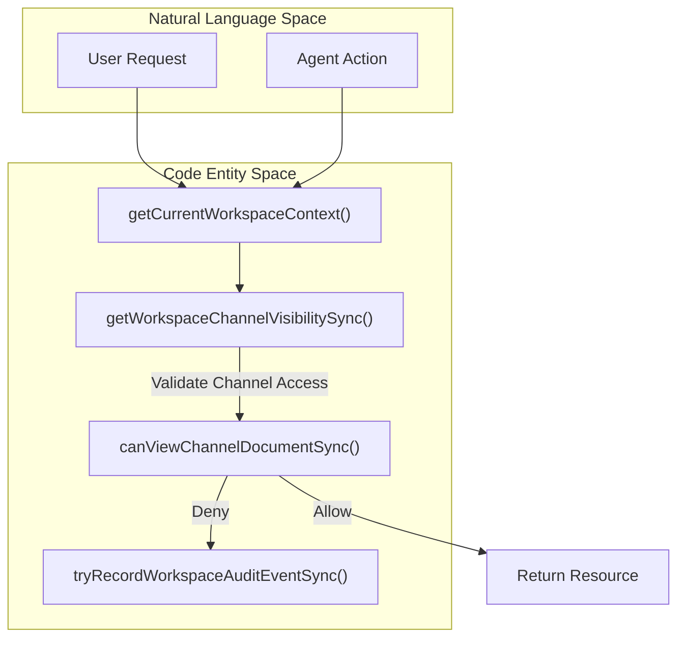
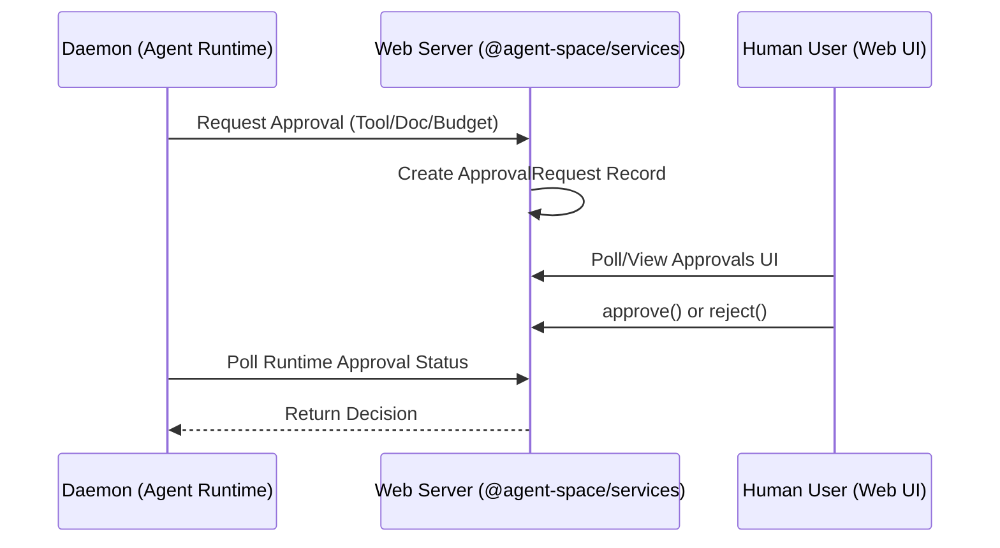

<!-- source: DeepWiki mcp.deepwiki.com · repo HKUDS/AgentSpace · page 7 Permissions, Approvals & Governance · fetched 2026-11-09 -->

# Permissions, Approvals & Governance

Relevant source files

The following files were used as context for generating this wiki page:

- [apps/cli/src/commands/channel.ts](apps/cli/src/commands/channel.ts)
- [apps/cli/src/commands/employee.ts](apps/cli/src/commands/employee.ts)
- [apps/cli/src/commands/workspace.ts](apps/cli/src/commands/workspace.ts)
- [apps/web/app/api/search/route.test.ts](apps/web/app/api/search/route.test.ts)
- [apps/web/app/api/search/route.ts](apps/web/app/api/search/route.ts)

The AgentSpace permission control plane manages the complex trust boundaries between human users, digital employees (agents), and workspace resources. It ensures that while agents can operate autonomously, they remain within the governance limits defined by workspace administrators and resource owners.

## Governance Overview

Governance in AgentSpace is enforced through a combination of static role-based access control (RBAC) and dynamic runtime grants. This dual-layer approach allows for broad organizational policies (e.g., "Only Admins can delete channels") while supporting granular, just-in-time permissions for agents (e.g., "Agent X is allowed to read Document Y for the duration of Task Z").

### Core Governance Entities

| Entity | Code Representation | Responsibility |
| :--- | :--- | :--- |
| **Workspace Role** | `WorkspaceRole` | Defines high-level capabilities (Admin, Member) [apps/web/app/api/search/route.ts:2-2](). |
| **Channel Visibility** | `WorkspaceChannelVisibility` | Controls which users and agents can see or post in specific channels [apps/web/app/api/search/route.ts:13-15](). |
| **Document Access** | `ChannelDocumentAccess` | Manages ownership and viewing rights for specific files/docs [apps/web/app/api/search/route.test.ts:149-152](). |
| **Runtime Bindings** | `EmployeeRuntimeBinding` | Maps an agent (employee) to a specific execution runtime [apps/cli/src/commands/employee.ts:17-19](). |

## Permission Control Flow

The following diagram illustrates how the system validates access when a user or agent attempts to interact with a resource, such as searching for documents.

### Access Validation Logic

Sources: [apps/web/app/api/search/route.ts:18-45](), [apps/web/app/api/search/route.ts:89-132]()

## Runtime Access & Grants

Permissions for digital employees are often tied to their runtime environment. Agents do not have blanket access to all workspace data; instead, they are granted access based on their current task context.

- **Employee Bindings**: Administrators use `bindEmployeeRuntimeSync` to associate an agent with a specific runtime environment [apps/cli/src/commands/employee.ts:74-94]().
- **Context Guards**: When an agent executes a command via the CLI, the system checks `AGENT_SPACE_CONTEXT_AGENT_NAME` to ensure the agent is operating within its authorized scope [apps/cli/src/commands/workspace.ts:15-17]().
- **Audit Logging**: Unauthorized attempts to access resources across workspace boundaries are caught and logged via `tryRecordWorkspaceAuditEventSync` with specific error codes like `workspace.cross_workspace_access_denied` [apps/web/app/api/search/route.ts:31-43]().

For details on how runtime permissions are enforced, see [Runtime Access & Grants](#7.1).

## Approval Queue & Human-in-the-Loop

The Approval Queue serves as the primary mechanism for "Human-in-the-Loop" governance. When an agent encounters a high-stakes action—such as calling a restricted tool, accessing a sensitive document, or exceeding a budget—it generates an `ApprovalRequest`.

### Approval Workflow Architecture

Sources: [apps/cli/src/commands/workspace.ts:90-126](), [apps/web/app/api/search/route.ts:107-113]()

- **Task Context**: Agents can search messages and resolve entities only within their assigned task runtime [apps/cli/src/commands/workspace.ts:81-88]().
- **Visibility Filtering**: Results from global searches are strictly filtered by `filterSearchResultsByChannelVisibility` to ensure agents only see what they are permitted to see [apps/web/app/api/search/route.ts:107-113]().

For details on the approval lifecycle and UI, see [Approval Queue & Human Checkpoints](#7.2).

## Workspace & Channel Governance

Workspace state is initialized and managed through structured commands that define the initial ownership and organizational structure.

- **Initialization**: `initializeOrganizationSync` sets the owner and their role during workspace setup [apps/cli/src/commands/workspace.ts:47-54]().
- **Channel Management**: Access to channels can be managed dynamically. Functions like `createChannelSync` and `deleteChannelSync` allow administrators to modify the collaboration landscape [apps/cli/src/commands/channel.ts:20-53]().
- **Document Permissions**: Each document version tracks who created it and what their role was (human vs agent) to maintain a clear audit trail [apps/web/app/api/search/route.test.ts:127-148]().

Sources: [apps/cli/src/commands/workspace.ts:1-10](), [apps/cli/src/commands/channel.ts:1-6](), [apps/web/app/api/search/route.test.ts:149-168]()

---

