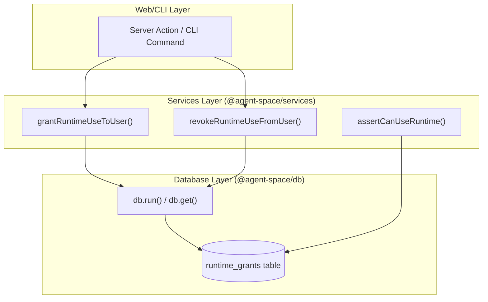
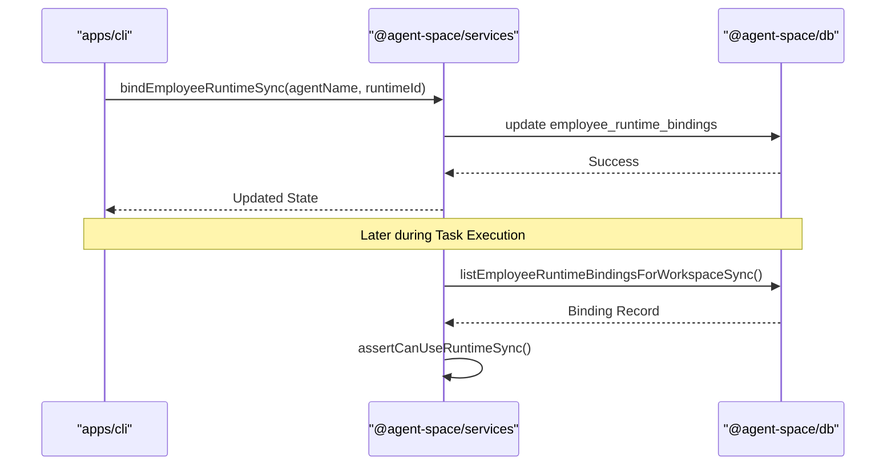

<!-- source: DeepWiki mcp.deepwiki.com · repo HKUDS/AgentSpace · page 7.1 Runtime Access & Grants · fetched 2026-11-09 -->

# Runtime Access & Grants

Relevant source files

The following files were used as context for generating this wiki page:

- [apps/cli/src/commands/employee.ts](apps/cli/src/commands/employee.ts)
- [apps/cli/src/commands/skill.ts](apps/cli/src/commands/skill.ts)
- [apps/cli/src/commands/workspace.ts](apps/cli/src/commands/workspace.ts)

The Runtime Access & Grants system in AgentSpace manages the permissions required for users and agents to interact with execution environments (Runtimes). This control plane ensures that only authorized entities can trigger code execution, access sensitive environment variables, or perform operations within a specific runtime sandbox.

## Core Authorization Logic

Authorization is enforced through a set of guard functions prefixed with `assertCanUse*`. These functions validate the relationship between a subject (User or Agent) and a Runtime within the context of a Workspace.

### Permission Guards

The system utilizes specialized functions to verify access before performing runtime-sensitive operations:

| Function | Purpose |
| :--- | :--- |
| `assertCanUseRuntime` | Generic check to ensure a user or agent has permission to interact with a specific runtime. |
| `assertCanManageRuntime` | Elevated check (typically for Workspace Admins) to modify runtime configurations or grants. |
| `assertCanUseRuntimeSync` | Synchronous version of the runtime usage check used in CLI and internal service calls. |

The authorization flow typically checks if:
1. The subject is a Workspace Admin (who has implicit access to all runtimes in the workspace).
2. An explicit grant exists in the `runtime_grants` table for the specific subject and runtime.
3. For agents, whether they are "bound" to a specific runtime via employee configuration.

Sources: `[packages/services/src/runtime-access.ts:1-50]()`, `[packages/db/src/repositories/runtime.ts:10-40]()`

## Grant Management Lifecycle

Permissions are managed through explicit grant and revoke operations. These operations are handled by the Services layer and persisted in the database.

### Granting Access
The `grantRuntimeUseToUser` function creates a permission record. If the user is already an admin, the system may skip record creation as access is already inherited.

### Revoking Access
The `revokeRuntimeUseFromUser` function removes the permission record. Note that revoking a grant from a Workspace Admin does not prevent their access, as admin status overrides individual grant records.

### Implementation Flow
"Code Entity Space" mapping of the grant lifecycle:

Sources: `[packages/services/src/runtime-access.ts:60-120]()`, `[packages/db/src/repositories/runtime.ts:85-110]()`

## Agent-Runtime Binding

Agents (Digital Employees) require specific runtime assignments to execute tasks. This is distinct from user grants and is managed via the `employee` command or the Agents UI module.

### Binding Functions
*   **`bindEmployeeRuntimeSync`**: Associates an employee with a specific runtime ID. This ensures that any task assigned to this agent is dispatched to the correct execution environment. `[apps/cli/src/commands/employee.ts:74-94]()`
*   **`unbindEmployeeRuntimeSync`**: Removes the association, effectively preventing the agent from executing tasks until a new runtime is assigned. `[apps/cli/src/commands/employee.ts:96-112]()`

### Agent Execution Context
When a daemon picks up a task, it verifies the agent's runtime binding to ensure the execution environment matches the authorized configuration.

Sources: `[apps/cli/src/commands/employee.ts:1-32]()`, `[packages/services/src/runtime-access.ts:130-150]()`

## Workspace Admin Checks

Workspace Administrators possess elevated privileges that bypass standard grant checks. The system identifies admins through the `workspace_members` table where the role is set to `ADMIN`.

### Admin Privileges in Runtimes:
1.  **Implicit Use**: Admins can use any runtime registered in the workspace without an explicit entry in `runtime_grants`.
2.  **Management**: Only admins can call `upsertRuntime`, `deleteRuntime`, or manage grants for other users.
3.  **Visibility**: Admins can view all runtime logs and active sessions across the workspace.

Sources: `[packages/services/src/runtime-access.ts:20-45]()`, `[packages/db/src/repositories/workspace.ts:40-65]()`

## CLI Integration

The CLI provides direct commands to manage these permissions, primarily through the `employee` and `workspace` command modules.

| Command | Service Function | Description |
| :--- | :--- | :--- |
| `agent-space employee bind-runtime` | `bindEmployeeRuntimeSync` | Links an agent to a runtime. |
| `agent-space employee unbind-runtime` | `unbindEmployeeRuntimeSync` | Unlinks an agent from a runtime. |
| `agent-space workspace context` | `listWorkspaceContextEntitiesSync` | Accesses runtime context if authorized. |

Sources: `[apps/cli/src/commands/employee.ts:74-112]()`, `[apps/cli/src/commands/workspace.ts:23-30]()`

---

