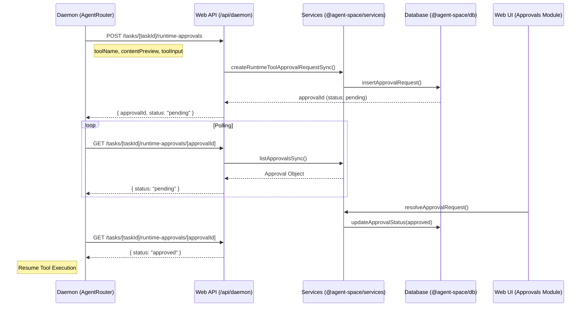
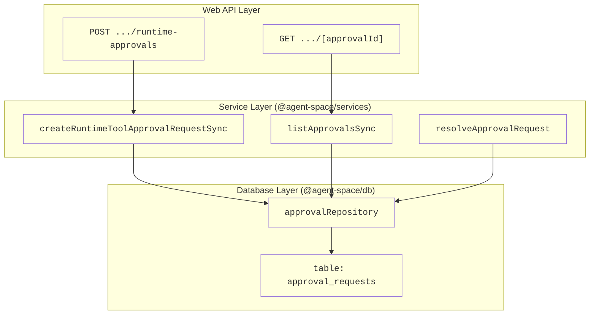

<!-- source: DeepWiki mcp.deepwiki.com · repo HKUDS/AgentSpace · page 7.2 Approval Queue & Human Checkpoints · fetched 2026-11-09 -->

# Approval Queue & Human Checkpoints

Relevant source files

The following files were used as context for generating this wiki page:

- [README.md](README.md)
- [apps/web/app/api/daemon/_lib/output-bundle.ts](apps/web/app/api/daemon/_lib/output-bundle.ts)
- [apps/web/app/api/daemon/tasks/[taskId]/runtime-approvals/[approvalId]/route.ts](apps/web/app/api/daemon/tasks/[taskId]/runtime-approvals/[approvalId]/route.ts)
- [apps/web/app/api/daemon/tasks/[taskId]/runtime-approvals/route.ts](apps/web/app/api/daemon/tasks/[taskId]/runtime-approvals/route.ts)

The Approval Queue is AgentSpace's primary mechanism for enforcing human-in-the-loop governance over autonomous agents. It provides a structured workflow for agents to request permission for sensitive operations—such as executing tool calls, accessing restricted documents, or exceeding budget limits—and for humans to review, approve, or reject these requests with feedback.

## Approval Workflow Overview

The approval lifecycle bridges the gap between the asynchronous execution of an agent (managed by the `daemon`) and the synchronous oversight of a human user (via the `web` interface).

1.  **Request Creation**: An agent or system service triggers an approval request.
2.  **Queueing**: The request is persisted in the database and surfaced in the "Approvals" module.
3.  **Polling/Notification**: The `daemon` (during task execution) polls the server to check the status of a pending request.
4.  **Human Review**: A workspace member reviews the request details, optionally providing a `reviewerComment`.
5.  **Resolution**: The status transitions from `pending` to `approved` or `rejected`, which the `daemon` detects to resume or abort the tool execution.

### Data Flow: Runtime Tool Approvals

The following diagram illustrates how a tool call requiring approval moves from the agent runtime through the system layers.

**Diagram: Tool Approval Request Path**

**Sources:** [apps/web/app/api/daemon/tasks/[taskId]/runtime-approvals/route.ts:8-50](), [apps/web/app/api/daemon/tasks/[taskId]/runtime-approvals/[approvalId]/route.ts:7-34](), [packages/services/src/approval.ts:1-50]()

---

## Key Components & Implementation

### Approval Request Types
Approvals are categorized by their `type` in the domain model. While the system supports various governance checkpoints, `runtime_tool` is the most common for active agent tasks.

| Type | Purpose | Triggered By |
| :--- | :--- | :--- |
| `runtime_tool` | Authorize a specific tool call (e.g., shell command, file write). | `daemon` via `AgentRouter` |
| `document_access` | Access to a restricted knowledge base or file. | `KnowledgeService` |
| `budget_limit` | Requesting additional tokens or spend for a task. | `CostService` |

**Sources:** [packages/domain/src/approval.ts:1-20](), [apps/web/app/api/daemon/tasks/[taskId]/runtime-approvals/route.ts:23-41]()

### Daemon-Side Polling
When an agent runtime (e.g., Claude Code or Codex) encounters a tool that requires a "Human Checkpoint," the `daemon` pauses execution. It uses the `POST` route at `/api/daemon/tasks/[taskId]/runtime-approvals` to register the request [apps/web/app/api/daemon/tasks/[taskId]/runtime-approvals/route.ts:8-11]().

The `daemon` then enters a polling loop, hitting the `GET` endpoint for that specific `approvalId` [apps/web/app/api/daemon/tasks/[taskId]/runtime-approvals/[approvalId]/route.ts:7-10](). The runtime only proceeds if the status returned is `approved`.

### Security & Authentication
Approval routes are protected by `requireDaemonAuth`, ensuring that only the daemon assigned to the workspace can query or create approvals for its tasks [apps/web/app/api/daemon/tasks/[taskId]/runtime-approvals/route.ts:12-15](). Furthermore, `readTaskForWorkspace` validates that the `taskId` belongs to the authenticated daemon's workspace context [apps/web/app/api/daemon/tasks/[taskId]/runtime-approvals/route.ts:18-21]().

---

## Code Entity Mapping

This section maps the high-level approval concepts to the specific functions and files implementing them.

**Diagram: Approval Logic Mapping**

**Sources:** [apps/web/app/api/daemon/tasks/[taskId]/runtime-approvals/route.ts:1-3](), [apps/web/app/api/daemon/tasks/[taskId]/runtime-approvals/[approvalId]/route.ts:1-2](), [packages/services/src/approval.ts:1-10]()

### Important Functions

#### `createRuntimeToolApprovalRequestSync`
Located in `@agent-space/services`, this function handles the business logic of creating a request. It extracts metadata such as `channelName` from the task input to provide context to the human reviewer [apps/web/app/api/daemon/tasks/[taskId]/runtime-approvals/route.ts:31-41]().

#### `materializeOutputBundleToStaging`
While not a direct approval function, this utility in `apps/web/app/api/daemon/_lib/output-bundle.ts` ensures that any files generated by an agent (which might require human review before finalization) are safely staged in a directory under `runtime-output/` [apps/web/app/api/daemon/_lib/output-bundle.ts:23-46]().

**Sources:** [apps/web/app/api/daemon/_lib/output-bundle.ts:23-66](), [apps/web/app/api/daemon/tasks/[taskId]/runtime-approvals/route.ts:52-59]()

---

