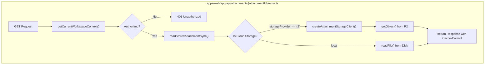
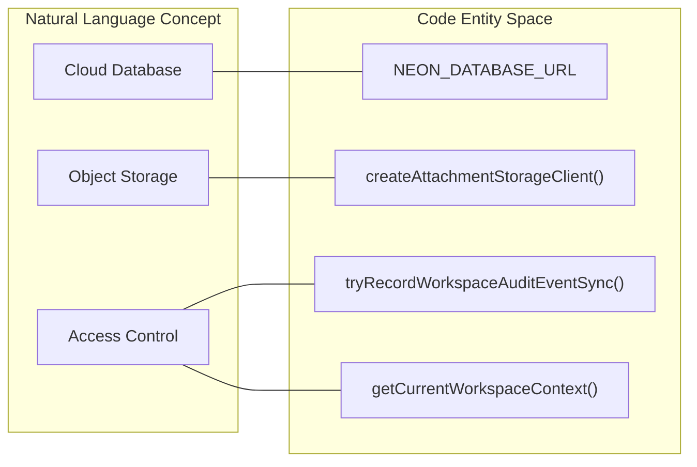

<!-- source: DeepWiki mcp.deepwiki.com · repo HKUDS/AgentSpace · page 8.2 Cloud Deployment (Neon + Cloudflare R2) · fetched 2026-11-09 -->

# Cloud Deployment (Neon + Cloudflare R2)

Relevant source files

The following files were used as context for generating this wiki page:

- [.env.example](.env.example)
- [apps/web/app/api/attachments/[attachmentId]/route.test.ts](apps/web/app/api/attachments/[attachmentId]/route.test.ts)
- [apps/web/app/api/attachments/[attachmentId]/route.ts](apps/web/app/api/attachments/[attachmentId]/route.ts)

AgentSpace supports a "Cloud" deployment mode designed for serverless scalability and high availability. This configuration replaces local file storage and standard PostgreSQL with managed cloud services: **Neon** for serverless PostgreSQL and **Cloudflare R2** for S3-compatible object storage.

## Deployment Mode Configuration

The system toggles between local and cloud infrastructure based on the `AGENT_SPACE_DEPLOYMENT_MODE` environment variable [`.env.example:1-4`](). When set to `cloud`, the application expects configuration for Neon and Cloudflare R2.

| Variable | Mode: `self_hosted` | Mode: `cloud` |
| :--- | :--- | :--- |
| **Database** | Local PostgreSQL [`.env.example:7-8`]() | Neon Serverless Postgres [`.env.example:16-17`]() |
| **Storage** | Local Filesystem [`.env.example:11`]() | Cloudflare R2 [`.env.example:32-40`]() |
| **Scaling** | Single-node vertical | Multi-region horizontal |

Sources: [`.env.example:1-44`]()

## Database: Neon Serverless PostgreSQL

In cloud mode, AgentSpace utilizes Neon's serverless architecture. Neon provides two distinct connection strings to optimize performance and migration reliability:

1.  **Pooled Connection (`NEON_DATABASE_URL`)**: Uses Neon's connection pooler (PgBouncer) for the application runtime to handle high concurrency [`.env.example:16`]().
2.  **Direct Connection (`NEON_DATABASE_DIRECT_URL`)**: Bypasses the pooler for schema migrations and administrative tasks to avoid session-level transaction conflicts [`.env.example:17`]().

### E2E Test Branching
AgentSpace leverages the Neon API to provide isolated database environments for E2E testing. During test execution, the system creates a temporary branch from the `production` parent [`.env.example:23-28`]().

**Data Flow: Neon Branching Lifecycle**
1.  Playwright test runner invokes the Neon API using `NEON_API_KEY` [`.env.example:30`]().
2.  A new database branch is created with a unique ID [`.env.example:26`]().
3.  The web server is pointed to this branch's unique connection string.
4.  The branch is automatically suspended or deleted after the `AGENT_SPACE_E2E_NEON_SUSPEND_TIMEOUT_SECONDS` period [`.env.example:29`]().

Sources: [`.env.example:13-30`]()

## Object Storage: Cloudflare R2

Attachments (images, documents, logs) are stored in Cloudflare R2 when in cloud mode. The integration uses an S3-compatible client to manage file lifecycles.

### Implementation Details
The storage logic is abstracted through the `createAttachmentStorageClient` function in the services layer [`apps/web/app/api/attachments/[attachmentId]/route.ts:8`]().

**Key Configuration Parameters:**
*   **Endpoint**: R2 uses a custom account-specific endpoint: `https://<ACCOUNT_ID>.r2.cloudflarestorage.com` [`.env.example:37`]().
*   **Signed URLs**: The `ATTACHMENT_SIGNED_URL_TTL_SECONDS` (default: 300s) controls the expiration of pre-signed URLs used for secure browser access [`.env.example:47`]().
*   **Upload Limits**: `ATTACHMENT_MAX_UPLOAD_BYTES` (default: 50MB) enforces size constraints at the application gateway [`.env.example:48`]().

### Attachment Retrieval Flow
When a user or agent requests an attachment via `/api/attachments/[attachmentId]`, the server executes the following logic:

**Diagram: Cloud Attachment Resolution**

Sources: [`apps/web/app/api/attachments/[attachmentId]/route.ts:25-155`](), [`apps/web/app/api/attachments/[attachmentId]/route.ts:157-167`](), [`.env.example:32-49`]()

## Data Flow & Security

The cloud deployment maintains strict workspace isolation even when using shared cloud buckets and databases.

### Cross-Workspace Protection
The `GET` handler in the attachments API explicitly checks if the `requestedWorkspaceId` matches the `workspaceContext.currentWorkspace.id` [`apps/web/app/api/attachments/[attachmentId]/route.ts:35-36`](). If a mismatch is detected, it logs a `workspace.cross_workspace_access_denied` audit event and returns a 403 Forbidden [`apps/web/app/api/attachments/[attachmentId]/route.ts:37-51`]().

### Caching Strategy
To reduce egress costs and improve performance, the system applies specific `Cache-Control` headers:
*   **Images**: `private, max-age=3600, stale-while-revalidate=86400` [`apps/web/app/api/attachments/[attachmentId]/route.ts:21`]().
*   **Files**: `private, no-cache` [`apps/web/app/api/attachments/[attachmentId]/route.ts:22`]().
*   **ETags**: Generated based on the attachment's SHA256 hash [`apps/web/app/api/attachments/[attachmentId]/route.ts:97-109`]().

**Diagram: Entity Mapping (Natural Language to Code)**

Sources: [`apps/web/app/api/attachments/[attachmentId]/route.ts:1-155`](), [`.env.example:1-82`]()

---

