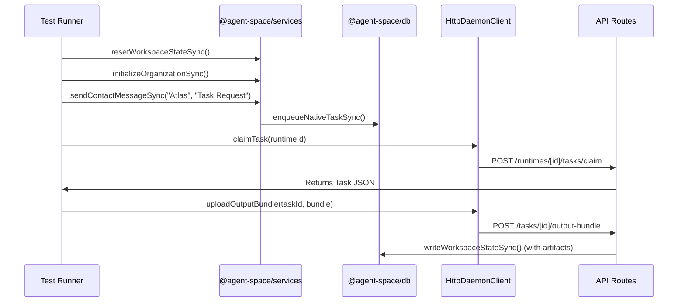
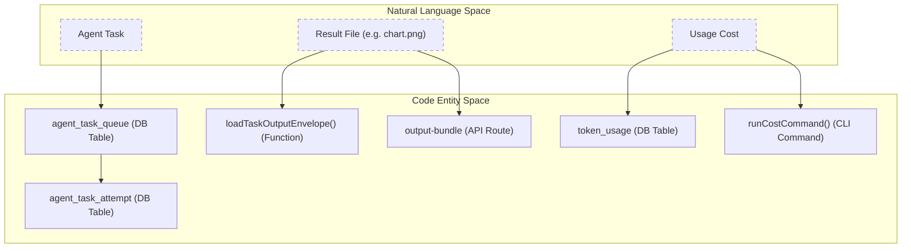

<!-- source: DeepWiki mcp.deepwiki.com · repo HKUDS/AgentSpace · page 8.3 Testing Infrastructure · fetched 2026-11-09 -->

# Testing Infrastructure

Relevant source files

The following files were used as context for generating this wiki page:

- [.env.example](.env.example)
- [apps/cli/src/commands/cost.test.ts](apps/cli/src/commands/cost.test.ts)
- [apps/cli/src/commands/daemon.test.ts](apps/cli/src/commands/daemon.test.ts)
- [apps/cli/src/commands/workspace.test.ts](apps/cli/src/commands/workspace.test.ts)
- [apps/web/app/api/daemon/client.integration.test.ts](apps/web/app/api/daemon/client.integration.test.ts)
- [apps/web/app/api/daemon/routes.test.ts](apps/web/app/api/daemon/routes.test.ts)

The AgentSpace testing infrastructure encompasses End-to-End (E2E) browser testing, unit and integration testing for CLI/Web/Daemon components, and a specialized database branching strategy for isolated cloud-based test environments.

## End-to-End (E2E) Testing with Playwright

AgentSpace uses Playwright for cross-browser and cross-device functional testing. These tests ensure the integrity of the workspace shell, navigation flows, and critical user journeys.

### Test Suites
*   **Smoke Tests**: Validates core authentication and landing page availability.
*   **Mobile Smoke**: Specialized viewports to ensure the responsive workspace shell remains functional on mobile devices.
*   **Workspace Navigation**: Exercises the multi-module workspace UI at `/w/[workspaceSlug]`, verifying that the sidebar, module cache, and lazy loaders function correctly.

### Neon Database Branching
For E2E tests running in `cloud` mode, the infrastructure leverages the Neon API to create ephemeral database branches. This provides every test run with a fully isolated PostgreSQL environment that is a direct clone of the production schema.

| Environment Variable | Purpose |
| :--- | :--- |
| `AGENT_SPACE_E2E_NEON_PROJECT_ID` | The target Neon project for branch creation. |
| `AGENT_SPACE_E2E_NEON_PARENT_BRANCH` | The source branch (usually `production` or `main`) to clone from. |
| `NEON_API_KEY` | Secret key used to authenticate with Neon for lifecycle management. |

**Sources:** [ .env.example:23-30 ]()

## Unit and Integration Testing Patterns

Testing is distributed across the monorepo, utilizing `node:test` for CLI/Services and `vitest` for the Web application.

### CLI Command Testing
CLI tests focus on command execution, workspace context resolution, and local filesystem interactions. They utilize temporary directories (`mkdtempSync`) to simulate isolated workspace environments.

*   **Context Resolution**: Tests like `workspace.test.ts` verify that the CLI correctly infers the active agent and task ID from environment variables such as `AGENT_SPACE_CONTEXT_AGENT_NAME` and `AGENT_SPACE_CONTEXT_TASK_ID` [ apps/cli/src/commands/workspace.test.ts:30-50 ]().
*   **Cost & Budgeting**: Tests verify that cost summaries and budget limits are correctly filtered by `--workspace-id` [ apps/cli/src/commands/cost.test.ts:33-62 ]().
*   **Output Handling**: `loadTaskOutputEnvelope` is tested to ensure it correctly handles relative paths, rejects absolute paths, and enforces attachment size limits [ apps/cli/src/commands/daemon.test.ts:29-176 ]().

### Web API & Daemon Integration Testing
The web layer includes integration tests that mock the HTTP boundary between the Daemon and the Server.

*   **HttpDaemonClient**: Tested in `client.integration.test.ts` to ensure it can register runtimes, claim tasks, and upload output bundles [ apps/web/app/api/daemon/client.integration.test.ts:70-205 ]().
*   **Route Verification**: Tests in `routes.test.ts` verify that Daemon API routes (e.g., `/api/daemon/register`, `/api/daemon/tasks/[taskId]/start`) correctly enforce bearer token authentication and process business logic [ apps/web/app/api/daemon/routes.test.ts:149-180 ]().

### Data Flow: Task Lifecycle Testing
The following diagram illustrates the integration points exercised during a standard task execution test.

**Task Execution Test Flow**

**Sources:** [ apps/web/app/api/daemon/client.integration.test.ts:119-205 ](), [ apps/cli/src/commands/daemon.test.ts:29-57 ]()

## Test Environment Seeding

The codebase utilizes "Sync" versions of service and database functions to seed data deterministically before test execution.

### Key Seeding Functions
| Function | File | Purpose |
| :--- | :--- | :--- |
| `resetWorkspaceStateSync` | `@agent-space/services` | Wipes the current workspace state to ensure test isolation. |
| `initializeOrganizationSync` | `@agent-space/services` | Sets up the initial organization, owner, and first channel. |
| `seedWorkspaceCosts` | `apps/cli/src/commands/cost.test.ts` | Populates `token_usage` and `agent_task_queue` for budget testing. |
| `registerDaemonRuntimesSync` | `@agent-space/db` | Simulates a daemon connecting and offering specific provider capabilities. |

**Sources:** [ apps/cli/src/commands/cost.test.ts:68-114 ](), [ apps/cli/src/commands/workspace.test.ts:85-176 ]()

## Code Entity Mapping

The testing infrastructure bridges the high-level "Task" concept with low-level database and file entities.

**Entity Mapping: Task Output Testing**

**Sources:** [ apps/cli/src/commands/daemon.test.ts:13-44 ](), [ apps/cli/src/commands/cost.test.ts:17-62 ](), [ apps/web/app/api/daemon/client.integration.test.ts:11-33 ]()

## Load Testing
Load testing scripts (located in `scripts/load-test` or similar) focus on:
1.  **Task Polling**: Measuring the latency of the `claimTask` route under high daemon concurrency.
2.  **State Persistence**: Verifying the performance of the synchronous worker-thread query model in `@agent-space/db` when multiple tasks are reporting `token_usage` and `task_execution_event` updates simultaneously.

**Sources:** [ apps/web/app/api/daemon/client.integration.test.ts:45-68 ](), [ apps/web/app/api/daemon/routes.test.ts:92-140 ]()

---

