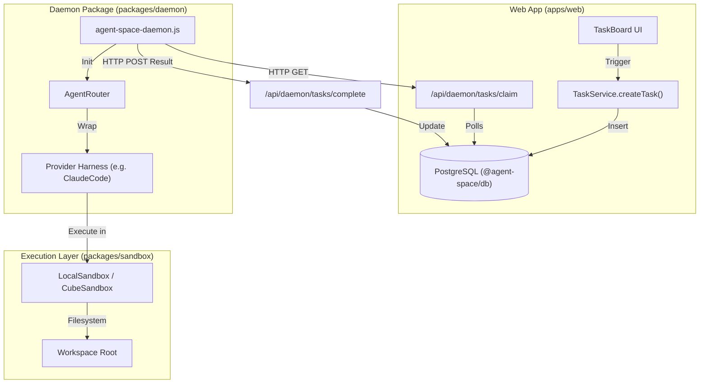
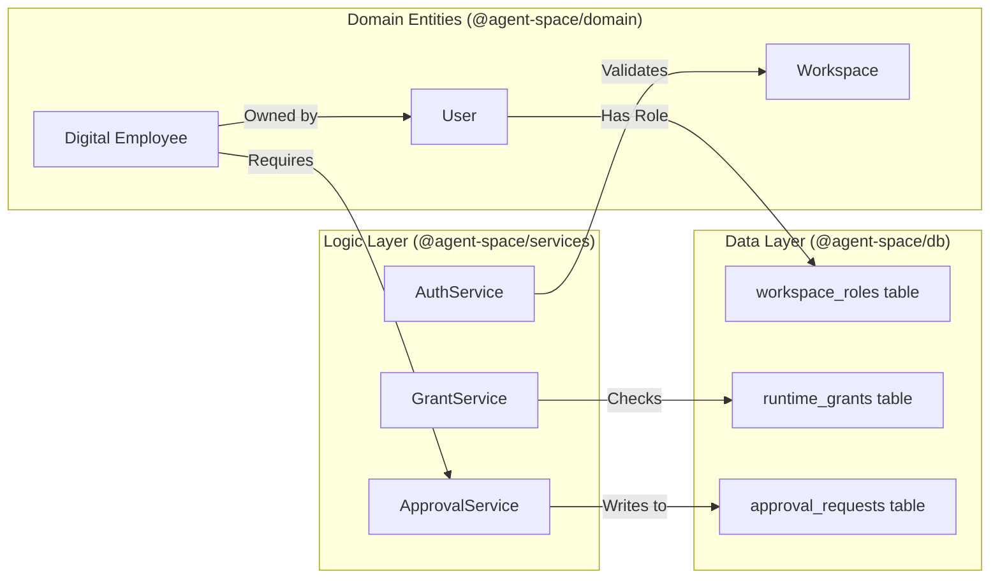

<!-- source: DeepWiki mcp.deepwiki.com · repo HKUDS/AgentSpace · page 9 Glossary · fetched 2026-11-09 -->

# Glossary

Relevant source files

The following files were used as context for generating this wiki page:

- [.env.example](.env.example)
- [README.md](README.md)
- [README_ZH.md](README_ZH.md)
- [agent-space-daemon-0.1.3.tgz](agent-space-daemon-0.1.3.tgz)
- [apps/cli/package-lock.json](apps/cli/package-lock.json)
- [apps/cli/package.json](apps/cli/package.json)

This page provides definitions for the core terminology, architectural concepts, and domain-specific entities used within the AgentSpace codebase. It serves as a technical reference for onboarding engineers to bridge the gap between natural language descriptions and the underlying code implementation.

## Core Concepts

### Digital Employee
A **Digital Employee** (often referred to simply as an **Employee** or **Agent**) is a first-class entity in AgentSpace. Unlike a stateless chatbot, a Digital Employee has a persistent identity, a defined role, an owner, and a set of capabilities.

*   **Implementation**: Represented by the `Employee` type in the domain package [[packages/domain]()] and managed via the `EmployeeService` [[packages/services]()] in the services layer.
*   **Attributes**: Includes `instructions`, `skills`, and `knowledge` sets that define its behavior across different tasks.

### Workspace
The top-level container for collaboration. All employees, channels, tasks, and documents belong to a specific **Workspace**. It acts as the multi-tenant boundary.

*   **Implementation**: Defined in `Workspace` domain models [[packages/domain]()] and handled by the `WorkspaceService` [[packages/services]()].
*   **Routing**: In the web application, workspaces are accessed via the `/w/[workspaceSlug]` route pattern [[apps/web]()].

### AgentRouter
The execution abstraction layer that decouples an Agent's identity from the underlying provider runtime (e.g., Claude Code, Codex, OpenClaw).

*   **Implementation**: Found in `packages/daemon/bin/agent-router.js` [[packages/daemon:37-37]()] and the internal `AgentRouter` class.
*   **Role**: It normalizes diverse CLI behaviors into a unified event stream and result format, allowing the same Agent to run on different harnesses depending on the task requirements [[README.md:115-123]()].

### Daemon
A background process (often remote) that claims tasks from the AgentSpace server, prepares the execution environment, and invokes the `AgentRouter`.

*   **Implementation**: Located in `packages/daemon` [[packages/daemon]()] with the entry point at `bin/agent-space-daemon.js` [[packages/daemon:36-36]()].
*   **Lifecycle**: The daemon performs a "claim-work-report" loop, communicating with the server via the Daemon API routes [[apps/web/src/app/api/daemon]()] (e.g., `/api/daemon/tasks/claim`).

---

## Technical Glossary Table

| Term | Definition | Code Pointer |
| :--- | :--- | :--- |
| **Harness** | An adapter for a specific LLM/Agent provider (e.g., `ClaudeCodeHarness`). | `packages/daemon/src/harnesses` |
| **Sandbox** | An isolation layer (Local or Cube) where the Agent executes code and filesystem operations. | `packages/sandbox` [[packages/daemon/package-lock.json:31-31]()] |
| **Task Bundle** | A packaged set of inputs (instructions, files, tokens) sent to a Daemon to start a task. | `packages/domain` (TaskBundle type) |
| **Runtime Grant** | A permission record allowing a specific user or agent to use a runtime/tool. | `packages/services` (GrantService) |
| **Approval Queue** | A system for "Human-in-the-loop" governance where sensitive tool calls wait for manual confirmation. | `apps/web/src/modules/approvals` |
| **Skill** | A reusable set of tools or functions that can be attached to a Digital Employee. | `packages/services` (SkillService) |

---

## Architecture Diagrams

### From Concept to Code: Task Execution Flow
The following diagram maps the high-level concept of "Running a Task" to the specific code entities and packages involved.

**Task Dispatch & Execution Mapping**

**Sources:** [[apps/cli/package.json:14-18]()], [[packages/daemon/package-lock.json:25-33]()], [[README.md:115-123]()]

### System Identity & Permissions
This diagram shows how natural language "Governance" is enforced through specific service classes and database relations.

**Governance & Access Control Mapping**

**Sources:** [[README.md:149-157]()], [[.env.example:64-70]()], [[apps/cli/package-lock.json:11-13]()]

---

## Key File Paths & Roles

### `packages/domain`
Contains the TypeScript interfaces and types that define the "Source of Truth" for data structures used across the monorepo. Every developer should check here first when modifying data models.
**Sources:** [[packages/daemon/package-lock.json:61-65]()]

### `packages/db`
The PostgreSQL client and repository layer. It uses `pg` and manages the connection pool. It is responsible for all raw SQL execution and migration logic.
**Sources:** [[packages/daemon/package-lock.json:47-53]()]

### `packages/services`
The "Business Logic" layer. If you are implementing a feature like "Transferring an Agent" or "Approving a Tool Call," the logic resides here so it can be shared between the Web UI and the CLI.
**Sources:** [[packages/daemon/package-lock.json:66-75]()]

### `apps/web/src/modules`
The modular UI implementation. Each subdirectory (e.g., `agents`, `tasks`, `approvals`) contains the Server Actions, React Components, and Hooks specific to that feature.
**Sources:** [[README.md:173-181]()]

### `.env.example`
The definitive guide to system configuration, including deployment modes (`self_hosted` vs `cloud`), database URLs, and integration secrets for Google Workspace.
**Sources:** [[.env.example:1-82]()]