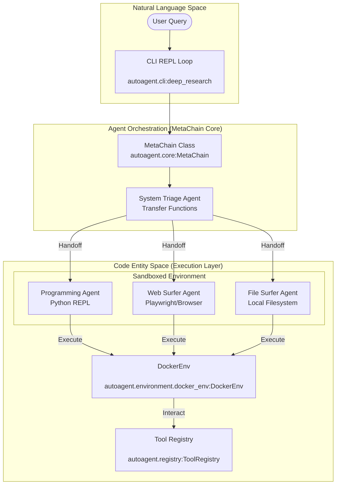
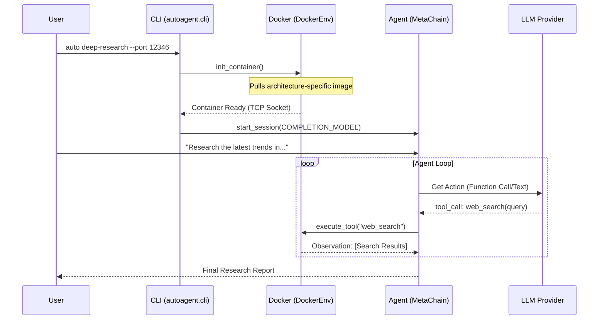

<!-- source: DeepWiki mcp.deepwiki.com · repo HKUDS/Auto-Deep-Research · page 1 Overview · fetched 2026-11-09 -->

# Overview

Relevant source files

The following files were used as context for generating this wiki page:

- [.env.template](.env.template)
- [Communication.md](Communication.md)
- [README.md](README.md)
- [assets/QR.png](assets/QR.png)
- [assets/logo.jpg](assets/logo.jpg)

Auto-Deep-Research is an open-source and cost-efficient alternative to OpenAI's Deep Research, built on the **AutoAgent** framework (previously known as MetaChain). This document provides a high-level introduction to the system's purpose, architecture, and core capabilities.

## Purpose and Scope

Auto-Deep-Research is designed to be a fully-automated personal AI assistant that delivers high performance on complex tasks (as evidenced by its performance on the GAIA Benchmark). Unlike proprietary services with high monthly subscriptions, it follows a pay-as-you-go model using your own LLM API keys.

The system provides a "One-Click Launch" experience via a simple CLI command, handling the complexities of environment containerization, tool registration, and agent orchestration automatically.

Sources: [README.md:25-35](), [README.md:68-80]()

## High-Level System Architecture

The architecture bridges high-level user intent ("Natural Language Space") with low-level execution ("Code Entity Space") by routing tasks through a specialized agent system into a sandboxed Docker environment.

**Architecture Overview: From Intent to Execution**

Sources: [README.md:113-121](), [README.md:25-35]()

## Key Features

*   **Universal LLM Support**: Integrates with OpenAI, Anthropic, DeepSeek, Gemini, Groq, and more via LiteLLM.
*   **Interaction Flexibility**: Automatically detects and handles both **function-calling** and **non-function-calling** (ReAct style) LLMs.
*   **Secure Sandboxing**: Uses Docker to isolate code execution and file manipulation, preventing side effects on the host system.
*   **Multi-Modal Research**: Combines web browsing, terminal execution, and file processing to solve multi-step research problems.

For a detailed breakdown of these capabilities, see [Key Features](#1.2).

Sources: [README.md:27-35](), [README.md:113-121]()

## System Workflow

The following diagram illustrates how the system initializes and processes a research task, mapping CLI components to the underlying environment management.

**Operational Workflow: Initialization and Execution Loop**

Sources: [README.md:99-101](), [README.md:113-121]()

## LLM Provider Integration

The system is highly configurable via environment variables, supporting a wide array of providers. It uses a specific logic to determine if a model supports native function calling or requires a text-based fallback.

| Provider | Key Variable | Support Type |
| :--- | :--- | :--- |
| **Anthropic** | `ANTHROPIC_API_KEY` | Native Function Calling |
| **OpenAI** | `OPENAI_API_KEY` | Native Function Calling |
| **DeepSeek** | `DEEPSEEK_API_KEY` | Non-Function Calling (via OpenRouter/API) |
| **Google** | `GEMINI_API_KEY` | Native Function Calling |

For configuration details and a full list of providers, see [Supported LLM Providers](#1.3).

Sources: [.env.template:1-9](), [README.md:124-150]()

## Navigation

*   **[Installation & Setup](#1.1)**: Guide for setting up Python 3.10, Docker, and API keys.
*   **[Key Features](#1.2)**: Deep dive into performance, file handling, and browsing.
*   **[Supported LLM Providers](#1.3)**: How to configure specific models and the `FN_CALL` flag.

Sources: [README.md:49-62]()

---

