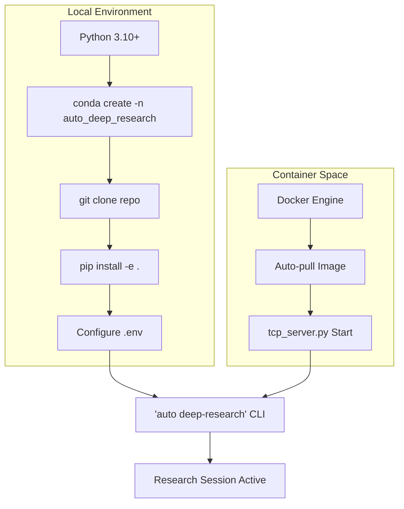
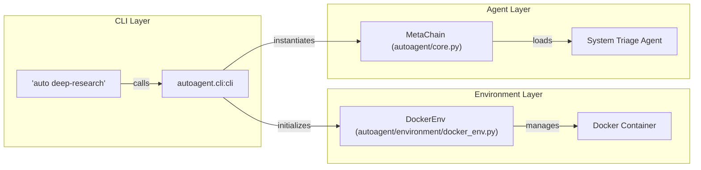

<!-- source: DeepWiki mcp.deepwiki.com · repo HKUDS/Auto-Deep-Research · page 1.1 Installation & Setup · fetched 2026-11-09 -->

# Installation & Setup

<details>
<summary>Relevant source files</summary>

The following files were used as context for generating this wiki page:

- [.env.template](.env.template)
- [MANIFEST.in](MANIFEST.in)
- [README.md](README.md)
- [assets/logo.jpg](assets/logo.jpg)
- [pyproject.toml](pyproject.toml)
- [setup.cfg](setup.cfg)

</details>


This document provides a comprehensive guide for installing and configuring Auto-Deep-Research, an open-source alternative to OpenAI's Deep Research based on the AutoAgent framework. This page covers the prerequisites, installation process, configuration of API keys, and launching the system.

## Prerequisites

Before installing Auto-Deep-Research, ensure your system meets the following requirements:

- **Python 3.10** or higher [setup.cfg:71-71]()
- **Docker**: Used to containerize the agent-interactive environment [README.md:99-101]()
- **Git**: For cloning the repository
- **Internet connection**: For downloading packages, Docker images, and accessing LLM APIs

### Installation Workflow

The following diagram illustrates the setup process from environment creation to the first launch.

**Setup Flow: From Source to Execution**

Sources: [README.md:87-101](), [setup.cfg:71-71]()

## Installation Process

### Python Environment Setup
Auto-Deep-Research requires Python 3.10. It is recommended to use Conda for environment isolation:

```bash
conda create -n auto_deep_research python=3.10
conda activate auto_deep_research
```

### Package Installation
Clone the repository and install the package in editable mode. This registers the `auto` command defined in the entry points [setup.cfg:73-75]().

```bash
git clone https://github.com/HKUDS/Auto-Deep-Research.git
cd Auto-Deep-Research
pip install -e .
```

The installation process pulls core dependencies including `litellm` for LLM abstraction, `playwright` for web browsing, and `chromadb` for vector memory [setup.cfg:16-65]().

Sources: [README.md:87-97](), [setup.cfg:1-81]()

### Docker Environment
The system uses Docker to provide a safe, isolated execution environment for agents (e.g., the Programming Agent). You do not need to manually pull images; the system automatically detects your machine architecture and pulls the appropriate pre-built image [README.md:99-101]().

## Configuration

Configuration is primarily handled through a `.env` file and command-line arguments.

### API Keys Setup
Copy the template file and populate it with your provider keys:

```bash
cp .env.template .env
```

**Supported Provider Keys in `.env`:**
| Variable | Purpose |
| :--- | :--- |
| `OPENAI_API_KEY` | For GPT-4o and other OpenAI models |
| `ANTHROPIC_API_KEY` | For Claude 3.5 Sonnet (Default model) |
| `DEEPSEEK_API_KEY` | For DeepSeek-V3/R1 |
| `GEMINI_API_KEY` | For Google Gemini models |
| `HUGGINGFACE_API_KEY` | For HF Inference API |
| `GROQ_API_KEY` | For Groq-hosted Llama/DeepSeek models |

Sources: [.env.template:1-8](), [README.md:103-107]()

### CLI Configuration Options
The `auto deep-research` command supports several environment variables and flags to customize the execution:

*   `COMPLETION_MODEL`: The model name (e.g., `gpt-4o`, `claude-3-5-sonnet-20241022`). Defaults to Claude 3.5 Sonnet [README.md:119-119]().
*   `--port`: Port for the Docker container communication (default: `12346`) [README.md:118-118]().
*   `--container_name`: Name of the sandbox container (default: `deepresearch`) [README.md:117-117]().
*   `API_BASE_URL`: Custom endpoint for OpenAI-compatible APIs [README.md:121-121]().

## System Launch

### Initializing the System
When you run the launch command, the `autoagent.cli:cli` function is invoked [setup.cfg:75-75]().

**Component Association: CLI to Code Entities**

Sources: [setup.cfg:73-75](), [README.md:111-120]()

### Launch Examples

**Standard Launch (Claude 3.5 Sonnet):**
```bash
auto deep-research
```

**OpenAI Launch (GPT-4o):**
```bash
OPENAI_API_KEY=sk-... COMPLETION_MODEL=gpt-4o auto deep-research
```

**DeepSeek-R1 via OpenRouter:**
```bash
OPENROUTER_API_KEY=sk-... COMPLETION_MODEL=openrouter/deepseek/deepseek-r1 auto deep-research
```

Sources: [README.md:139-140](), [README.md:149-149](), [README.md:244-244]()

## Troubleshooting

1.  **Docker Daemon**: Ensure Docker is running (`docker ps`). If the command fails to pull the image, check your internet connection and Docker disk space.
2.  **API Errors**: Verify that the `COMPLETION_MODEL` string matches the [LiteLLM](https://github.com/BerriAI/litellm) naming convention [README.md:119-119]().
3.  **Port Conflict**: If port `12346` is occupied, use `--port <new_port>` to specify an available one [README.md:118-118]().

---

