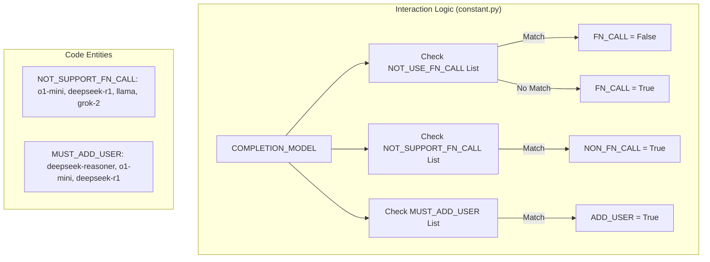
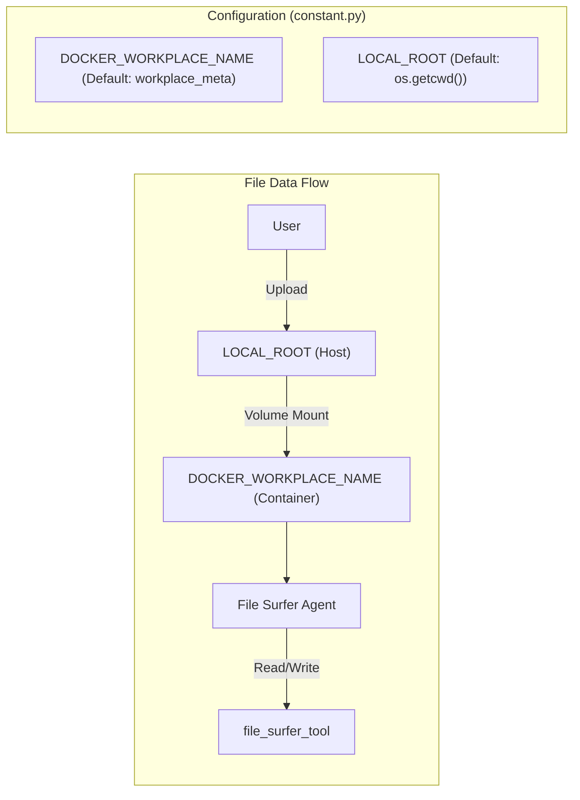

<!-- source: DeepWiki mcp.deepwiki.com · repo HKUDS/Auto-Deep-Research · page 1.2 Key Features · fetched 2026-11-09 -->

# Key Features

Relevant source files

The following files were used as context for generating this wiki page:

- [.env.template](.env.template)
- [README.md](README.md)
- [assets/logo.jpg](assets/logo.jpg)
- [autoagent/fn_call_converter.py](autoagent/fn_call_converter.py)
- [constant.py](constant.py)

This page documents the technical features that enable Auto-Deep-Research to function as a high-performance, cost-effective AI research assistant. It details the implementation of LLM support, interaction models, file handling, and the architecture that supports its benchmark-leading performance.

## High Performance & GAIA Benchmark
Auto-Deep-Research is built on the MetaChain framework and is designed for high-stakes reasoning tasks. It delivers state-of-the-art performance on the **GAIA (General AI Assistants) Benchmark**, ranking as a top open-source method [README.md:21-29](). The system achieves this by orchestrating specialized agents (Web, File, and Programming) to decompose complex queries into executable steps [README.md:25-27]().

## Universal LLM Support
The system integrates with a vast array of providers through `litellm`. Configuration is managed via the `.env` file and the `COMPLETION_MODEL` environment variable [constant.py:48-56]().

| Provider | Environment Variable | Implementation Note |
| :--- | :--- | :--- |
| **Anthropic** | `ANTHROPIC_API_KEY` | Default: `claude-3-5-sonnet-20241022` [README.md:119]() |
| **OpenAI** | `OPENAI_API_KEY` | Supports GPT-4o, o1-mini [constant.py:62-64]() |
| **DeepSeek** | `DEEPSEEK_API_KEY` | Supports `deepseek-chat` and `deepseek-reasoner` [constant.py:62-65]() |
| **Google** | `GEMINI_API_KEY` | Native Gemini support via LiteLLM [README.md:164]() |
| **OpenRouter** | `OPENROUTER_API_KEY` | Recommended for DeepSeek-R1 access [README.md:154-161]() |

**Sources:** [README.md:124-175](), [constant.py:48-56](), [.env.template:1-8]()

## Flexible Interaction: Function Calling vs. Prompting
Auto-Deep-Research distinguishes between models that support native tool use and those that require text-based instruction. This logic is centralized in `constant.py`.

### Logic Flow for Interaction Selection
The system automatically determines the interaction mode based on the `COMPLETION_MODEL` string.

### Non-Function Calling Fallback
For models like `deepseek-r1` or `llama`, the `FunctionCallingConverter` in `autoagent/fn_call_converter.py` wraps tools in a specialized XML-like prompt format [autoagent/fn_call_converter.py:35-58]().
- **System Suffix**: Appends instructions for `<function=...>` and `<parameter=...>` tags [autoagent/fn_call_converter.py:42-49]().
- **Few-Shot Examples**: Injects a multi-turn example of a coding task using `execute_bash` and `str_replace_editor` to guide the model [autoagent/fn_call_converter.py:63-205]().

**Sources:** [constant.py:61-86](), [autoagent/fn_call_converter.py:35-60](), [autoagent/fn_call_converter.py:63-205]()

## File Handling & Workspace
The system utilizes a Docker-based workspace to ensure safe and isolated file interactions.

- **Persistence**: Files uploaded to the workspace are accessible across agent handoffs (e.g., the Web Surfer can download a paper, and the Programming Agent can analyze it) [README.md:31-34]().
- **Architecture Awareness**: The system automatically pulls the correct Docker image (`tjbtech1/metachain:latest` for ARM or `tjbtech1/metachain:amd64_latest` for x86) based on the host machine's architecture [constant.py:37-46]().

**Sources:** [constant.py:25-28](), [constant.py:37-46](), [README.md:101]()

## Cost-Efficiency
Unlike proprietary services with flat monthly fees, Auto-Deep-Research uses a **pay-as-you-go** model.
- **Direct API Usage**: Users connect their own keys (OpenAI, Anthropic, etc.), paying only for the tokens consumed during research [README.md:30-32]().
- **Model Optimization**: The system allows switching to cheaper models (e.g., `claude-3-5-haiku` or `deepseek-chat`) for less complex sub-tasks to minimize costs [constant.py:48](), [README.md:149-152]().

**Sources:** [README.md:30-32](), [constant.py:48-65]()

---

