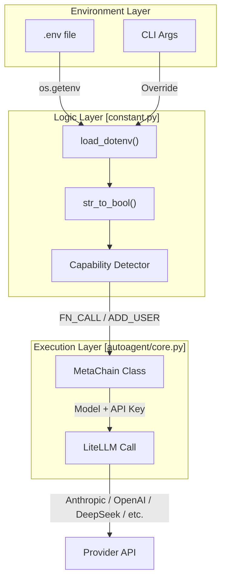
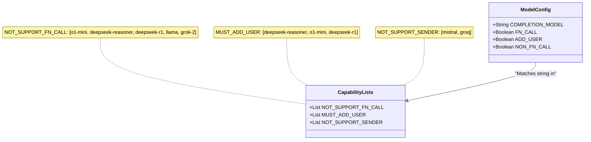

<!-- source: DeepWiki mcp.deepwiki.com · repo HKUDS/Auto-Deep-Research · page 1.3 Supported LLM Providers · fetched 2026-11-09 -->

# Supported LLM Providers

Relevant source files

The following files were used as context for generating this wiki page:

- [.env.template](.env.template)
- [README.md](README.md)
- [assets/logo.jpg](assets/logo.jpg)
- [constant.py](constant.py)

This page provides a technical deep dive into how Auto-Deep-Research integrates with various Large Language Model (LLM) providers. It details the configuration logic, the role of environment variables, and how the system dynamically adapts to different model capabilities like function calling.

## Provider Integration Architecture

Auto-Deep-Research utilizes **LiteLLM** as a translation layer to interface with multiple providers. The system state and model behavior are governed by constants defined in `constant.py` which are initialized from environment variables.

### LLM Configuration Data Flow

The following diagram shows how configuration moves from the environment into the core execution logic.

Sources: [constant.py:1-22](), [constant.py:48-85](), [README.md:113-123]()

## Supported Providers and Environment Variables

To enable a provider, the corresponding API key must be defined in the `.env` file. The system checks these variables at runtime to authenticate requests via LiteLLM.

| Provider | Environment Variable | Default/Example Model |
| :--- | :--- | :--- |
| **Anthropic** | `ANTHROPIC_API_KEY` | `claude-3-5-sonnet-20241022` |
| **OpenAI** | `OPENAI_API_KEY` | `gpt-4o`, `o1-mini` |
| **DeepSeek** | `DEEPSEEK_API_KEY` | `deepseek-chat`, `deepseek-reasoner` |
| **Google** | `GEMINI_API_KEY` | `gemini/gemini-1.5-pro` |
| **HuggingFace** | `HUGGINGFACE_API_KEY` | `huggingface/meta-llama/Llama-3.3-70B` |
| **Groq** | `GROQ_API_KEY` | `groq/llama-3.3-70b-versatile` |
| **Mistral** | `MISTRAL_API_KEY` | `mistral/mistral-large-latest` |
| **OpenRouter** | `OPENROUTER_API_KEY` | `openrouter/anthropic/claude-3.5-sonnet` |

Sources: [.env.template:1-8](), [README.md:128-252]()

## Model Capability Classification

The system performs automatic feature detection based on the `COMPLETION_MODEL` string. This logic is centralized in `constant.py` to ensure consistent behavior across different agents.

### Function Calling (`FN_CALL`)
The `FN_CALL` flag determines if the agent uses native tool-calling schemas or falls back to text-based prompting. 
- **Auto-Enable**: If `FN_CALL` is not explicitly set in `.env`, it defaults to `True` [constant.py:74-75]().
- **Auto-Disable**: It is set to `False` if the model name contains strings in `NOT_USE_FN_CALL` (e.g., `deepseek-chat`, `llama`, `grok-2`) [constant.py:64-79]().

### User Message Requirement (`ADD_USER`)
Some reasoning models (like `o1` or `deepseek-r1`) require a specific message structure where the conversation must start with or include a "user" role message rather than just a "system" prompt.
- **Logic**: If the model is in `MUST_ADD_USER`, the `ADD_USER` flag is set to `True` [constant.py:62-72]().

### Implementation Mapping

Sources: [constant.py:61-86]()

## Configuration via CLI

While `.env` provides persistence, the `auto deep-research` command allows for dynamic overrides.

- **Custom Model**: `COMPLETION_MODEL=gpt-4o auto deep-research`
- **Custom Endpoint**: Use `API_BASE_URL` to point to local vLLM or Ollama instances: `API_BASE_URL=http://localhost:8000/v1 COMPLETION_MODEL=openai/my-model auto deep-research`.
- **Force Function Calling**: Set `FN_CALL=True` or `FN_CALL=False` to override the automatic detection logic.

Sources: [constant.py:55-56](), [README.md:113-123]()

## Provider-Specific Implementation Details

### DeepSeek and OpenRouter
For `deepseek-r1`, the documentation recommends using **OpenRouter** as the provider for better reliability and performance compared to the direct API [README.md:225-226](). 

### Mistral and Groq
These providers are flagged in `NOT_SUPPORT_SENDER`, which informs the internal message formatting logic to strip specific metadata fields that cause API errors on these platforms [constant.py:61]().

### Default Model
If no model is specified, the system defaults to `claude-3-5-haiku-20241022` [constant.py:48](). This ensures an out-of-the-box experience with a high-performance, tool-capable model.

Sources: [constant.py:48](), [constant.py:61](), [README.md:225-226]()

---

