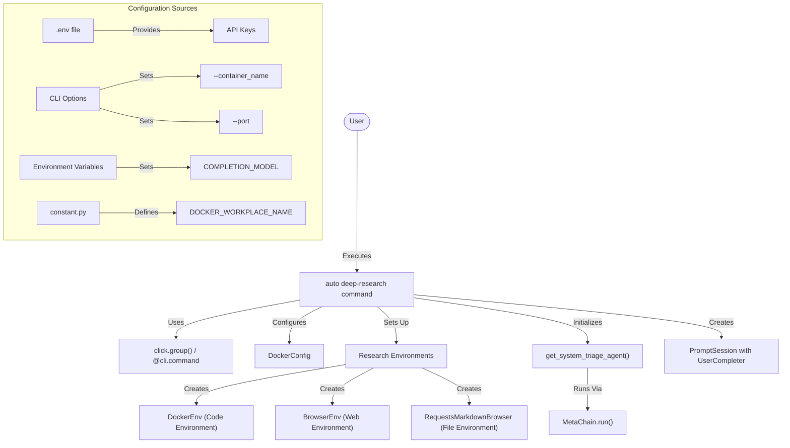
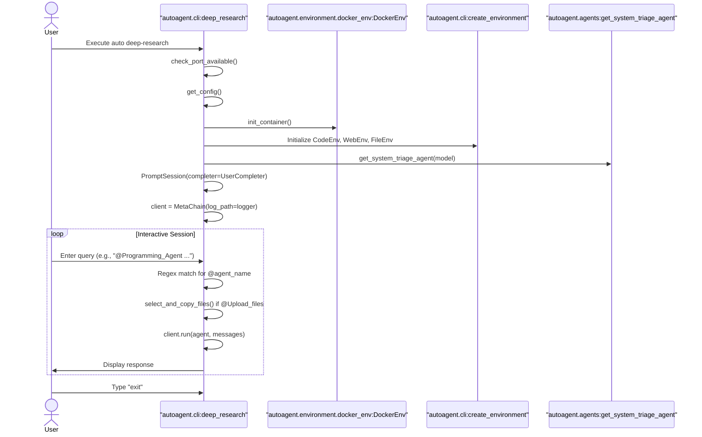

<!-- source: DeepWiki mcp.deepwiki.com · repo HKUDS/Auto-Deep-Research · page 2.1 CLI System · fetched 2026-11-09 -->

# CLI System

<details>
<summary>Relevant source files</summary>

The following files were used as context for generating this wiki page:

- [autoagent/cli.py](autoagent/cli.py)
- [autoagent/util.py](autoagent/util.py)
- [setup.cfg](setup.cfg)

</details>


The CLI System serves as the primary interface for users to interact with Auto-Deep-Research. It handles command-line argument parsing, Docker environment setup, agent initialization, and interactive user sessions. This page details the architecture, workflow, and implementation of the command-line interface system.

For information about the Docker environment managed by the CLI, see [Docker Environment](#2.2).

## Architecture

The CLI system is built using the `click` Python library [setup.cfg:28-28]() and follows a hierarchical command structure. It integrates with Docker to create containerized environments and initializes the necessary components for the research agent.

### Component Structure



Sources: [autoagent/cli.py:45-48](), [autoagent/cli.py:109-113](), [autoagent/cli.py:78-84](), [autoagent/cli.py:86-98](), [autoagent/cli.py:164-164](), [constant.py:28-28]()

### Command Flow



Sources: [autoagent/cli.py:112-214](), [autoagent/cli.py:32-44](), [autoagent/cli.py:53-85](), [autoagent/cli.py:86-98](), [autoagent/cli.py:146-164]()

## Implementation Details

### CLI Command Structure

The CLI system is defined in `autoagent/cli.py` using the `click` library. The entry point is mapped to the `auto` command in `setup.cfg`.

- **Main Group**: `cli()` defines the base command [autoagent/cli.py:45-48]().
- **Subcommand**: `deep-research` handles the primary research loop [autoagent/cli.py:109-112]().
- **Entry Point**: `auto = autoagent.cli:cli` [setup.cfg:75-75]().

Sources: [autoagent/cli.py:45-112](), [setup.cfg:73-75]()

### Docker Configuration and Port Management

The CLI manages Docker containers by ensuring unique port allocation. It uses `filelock` to prevent race conditions when multiple instances attempt to bind to the same port.

```python
# Port availability check implementation
def check_port_available(port):
    with socket.socket(socket.AF_INET, socket.SOCK_STREAM) as s:
        try:
            s.setsockopt(socket.SOL_SOCKET, socket.SO_REUSEADDR, 1)
            s.bind(('0.0.0.0', port))
            s.close()
            return True
        except socket.error:
            return False
```

The `get_config` function uses a lock file `.port_lock` and creates indicator files like `.port_12346` to track usage [autoagent/cli.py:64-74]().

Sources: [autoagent/cli.py:32-44](), [autoagent/cli.py:53-85]()

### Environment Setup

The `create_environment` function initializes the three-pillar environment required for deep research:

1.  **Code Environment**: `DockerEnv` handles container lifecycle and code execution [autoagent/cli.py:92-93]().
2.  **Web Environment**: `BrowserEnv` manages web browsing capabilities [autoagent/cli.py:95-95]().
3.  **File Environment**: `RequestsMarkdownBrowser` provides a high-level interface for reading local files and downloads as markdown [autoagent/cli.py:96-96]().

Sources: [autoagent/cli.py:86-98]()

### User Interaction System

The interactive REPL loop uses `prompt_toolkit` for advanced features like tab-completion and agent mentions.

- **Agent Mentions**: The `UserCompleter` class (sourced from `autoagent.util`) allows users to type `@` to see a list of available agents [autoagent/cli.py:159-163]().
- **Special Commands**:
    - `@Upload_files`: Triggers `select_and_copy_files()` to move local files into the Docker workspace [autoagent/cli.py:177-186]().
    - `exit`: Breaks the REPL loop [autoagent/cli.py:171-176]().
- **Context Variables**: The `context_variables` dictionary stores references to `code_env`, `web_env`, and `file_env`, which are passed into the `MetaChain` during execution [autoagent/cli.py:140-140]().

Sources: [autoagent/cli.py:158-214](), [autoagent/cli.py:140-140](), [autoagent/util.py:15-15]()

## Command Line Usage

### Basic Command Structure

```bash
auto deep-research [OPTIONS]
```

| Option | Description | Default Value |
|--------|-------------|---------------|
| `--container_name` | Name for the research Docker container | `deepresearch` |
| `--port` | Communication port for the container | `12346` |

Sources: [autoagent/cli.py:109-112]()

### Environment Configuration

The CLI relies on `constant.py` for default model selection and workplace naming.

- **Model**: `COMPLETION_MODEL` (defaulting to Claude 3.5 Sonnet) [constant.py:28-28]().
- **Workplace**: `DOCKER_WORKPLACE_NAME` (defaulting to `workspace`) [constant.py:21-21]().

Sources: [constant.py:21-28]()

## Internal Workflow

1.  **Initialization**: `deep_research` starts by displaying a salmon-colored logo and a version table [autoagent/cli.py:104-106]().
2.  **Config Resolution**: `get_config` determines the `local_root` path (e.g., `workspace_meta_showcase/showcase_deepresearch`) [autoagent/cli.py:75-76]().
3.  **Logger Setup**: `LoggerManager` is initialized with a `MetaChainLogger` [autoagent/cli.py:130-131]().
4.  **Agent Discovery**: The CLI discovers agents by inspecting the `agent_teams` attribute of the `system_triage_agent` [autoagent/cli.py:151-152]().
5.  **Execution**: User queries are passed to `client.run()`, which manages the `MetaChain` loop [autoagent/cli.py:214-214]().

Sources: [autoagent/cli.py:53-214]()

---

