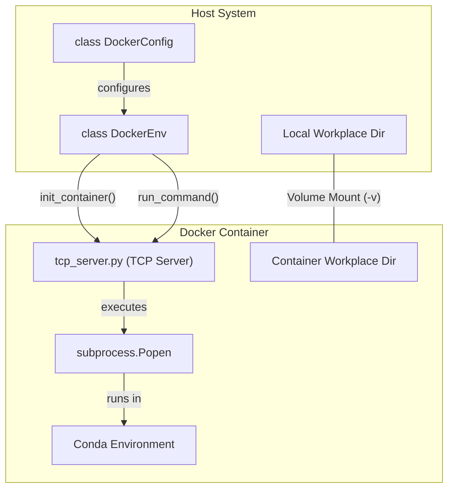
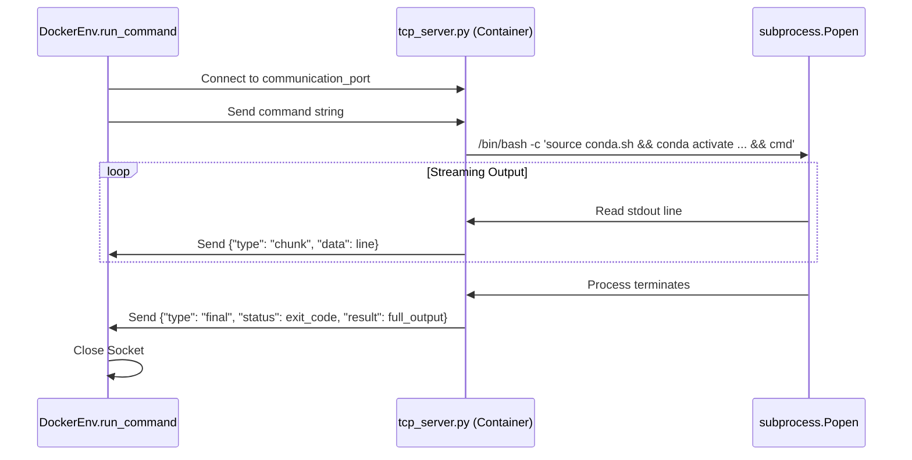

<!-- source: DeepWiki mcp.deepwiki.com · repo HKUDS/Auto-Deep-Research · page 2.2 Docker Environment · fetched 2026-11-09 -->

# Docker Environment

Relevant source files

The following files were used as context for generating this wiki page:

- [autoagent/environment/__init__.py](autoagent/environment/__init__.py)
- [autoagent/environment/docker_env.py](autoagent/environment/docker_env.py)
- [autoagent/environment/local_env.py](autoagent/environment/local_env.py)
- [autoagent/environment/shutdown_listener.py](autoagent/environment/shutdown_listener.py)
- [autoagent/environment/tcp_server.py](autoagent/environment/tcp_server.py)
- [autoagent/environment/tenacity_stop.py](autoagent/environment/tenacity_stop.py)
- [autoagent/environment/utils.py](autoagent/environment/utils.py)

This page documents the Docker containerization system used in Auto-Deep-Research. The Docker environment provides isolated execution environments for the research agent, enabling secure execution of code, web browsing, and file operations.

For information about how the CLI system interacts with Docker, see [CLI System](2.1). For details on the agent system running within the Docker container, see [Agent System](2.3).

## Architecture Overview

The Docker environment in Auto-Deep-Research serves as a containerized execution environment for the research agent. It provides an isolated space where code can be executed safely, files can be managed, and web resources can be accessed without risking the host system.

Sources: [autoagent/environment/docker_env.py:17-44](), [autoagent/environment/docker_env.py:108-114](), [autoagent/environment/tcp_server.py:12-43]().

## Docker Configuration

The Docker environment is configured through the `DockerConfig` dataclass, which specifies container settings including name, port, and workplace directory.

| Configuration Parameter | Description | Default Value |
|------------------------|-------------|---------------|
| `container_name` | Name of the Docker container | Required |
| `workplace_name` | Name of the workspace directory | Required |
| `communication_port` | Port used for TCP communication | Required |
| `conda_path` | Path to conda in the container | Required |
| `local_root` | Local directory where workplace is created | `os.getcwd()` |
| `git_clone` | Whether to clone MetaChain into the workplace | `False` |
| `setup_package` | Optional package to extract into the workplace | `None` |

These settings define how the Docker container is created and how it communicates with the host system.

Sources: [autoagent/environment/docker_env.py:17-28]().

## Container Lifecycle Management

The `DockerEnv` class manages the entire lifecycle of the Docker container, including initialization, command execution, and termination.

### Container Initialization

When `init_container` is called, the system performs the following sequence:
1. **Directory Setup**: Creates the `local_workplace` and ensures `tcp_server.py` is present [autoagent/environment/docker_env.py:48-60]().
2. **Repository Setup**: If `git_clone` is True, it clones the MetaChain repository and sets up the specified branch [autoagent/environment/docker_env.py:64-90]().
3. **Container Check**: Checks if a container with `container_name` already exists [autoagent/environment/docker_env.py:46-47]().
4. **Execution**: If the container is missing, it runs `docker run` with the `BASE_IMAGES` constant, mounting the workplace and starting the `tcp_server.py` [autoagent/environment/docker_env.py:108-114]().

### Command Execution via TCP

Commands are not executed via `docker exec` for every call. Instead, they are sent to a persistent TCP server running inside the container to maintain session state and improve performance.

Sources: [autoagent/environment/docker_env.py:154-209](), [autoagent/environment/tcp_server.py:31-63]().

## Communication Protocol

The Docker environment uses a JSON-based protocol over a TCP socket.

*   **Request**: A raw string containing the shell command to execute [autoagent/environment/tcp_server.py:36]().
*   **Chunk Response**: `{"type": "chunk", "data": "..."}` used for real-time streaming of stdout/stderr [autoagent/environment/tcp_server.py:51-55]().
*   **Final Response**: `{"type": "final", "status": int, "result": "..."}` contains the exit code and the full accumulated output [autoagent/environment/tcp_server.py:58-63]().

The server listens on `0.0.0.0` inside the container and binds to the `communication_port` specified in `DockerConfig` [autoagent/environment/tcp_server.py:16-18]().

## Workplace Synchronization

The `local_workplace` on the host is mounted to `docker_workplace` (usually `/{workplace_name}`) inside the container [autoagent/environment/docker_env.py:35-37](). This allows:
1. **Persistence**: Files created by the agent persist on the host after the container stops.
2. **Tool Access**: Tools like the `File Surfer Agent` can interact with the same files visible to the user.
3. **MetaChain Installation**: The `setup_metachain` utility installs the core library in editable mode (`pip install -e .`) within the container's workplace [autoagent/environment/utils.py:4-16]().

## Local Environment Fallback

While Docker is the primary execution target, the codebase provides a `LocalEnv` class in `autoagent/environment/local_env.py`. This class mimics the `DockerEnv` interface but runs commands directly on the host machine using `subprocess.Popen` [autoagent/environment/local_env.py:65-82](). It includes logic to automatically find `conda.sh` across different operating systems (Windows, Linux, MacOS) to ensure the environment can be activated [autoagent/environment/local_env.py:13-64]().

## Shutdown Handling

To ensure clean exits, the environment includes a `shutdown_listener.py`.
- **`should_exit()`**: Monitors for signals like `SIGINT` or `SIGTERM` [autoagent/environment/shutdown_listener.py:40-42]().
- **`stop_if_should_exit`**: A custom `tenacity` stop condition used to abort retries if the system is shutting down [autoagent/environment/tenacity_stop.py:7-11]().

Sources: [autoagent/environment/shutdown_listener.py:1-66](), [autoagent/environment/tenacity_stop.py:1-12]().

## Summary of Key Entities

| Code Entity | File Path | Role |
|-------------|-----------|------|
| `DockerConfig` | `autoagent/environment/docker_env.py` | Data structure for container parameters. |
| `DockerEnv` | `autoagent/environment/docker_env.py` | Orchestrates container lifecycle and TCP communication. |
| `tcp_server.py` | `autoagent/environment/tcp_server.py` | Script running inside the container to execute commands. |
| `LocalEnv` | `autoagent/environment/local_env.py` | Alternative environment for host-direct execution. |
| `setup_metachain` | `autoagent/environment/utils.py` | Bootstraps the agent code within the container. |

Sources: [autoagent/environment/docker_env.py:1-300](), [autoagent/environment/local_env.py:1-88](), [autoagent/environment/tcp_server.py:1-80]().

---

