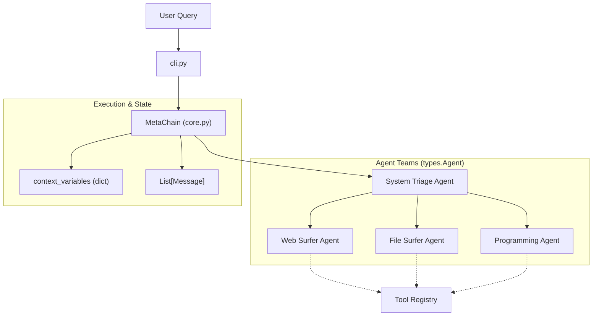
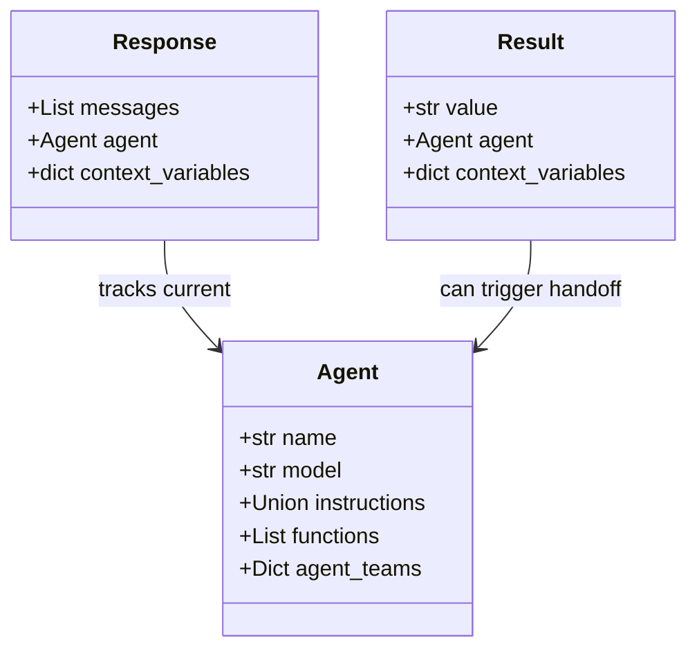
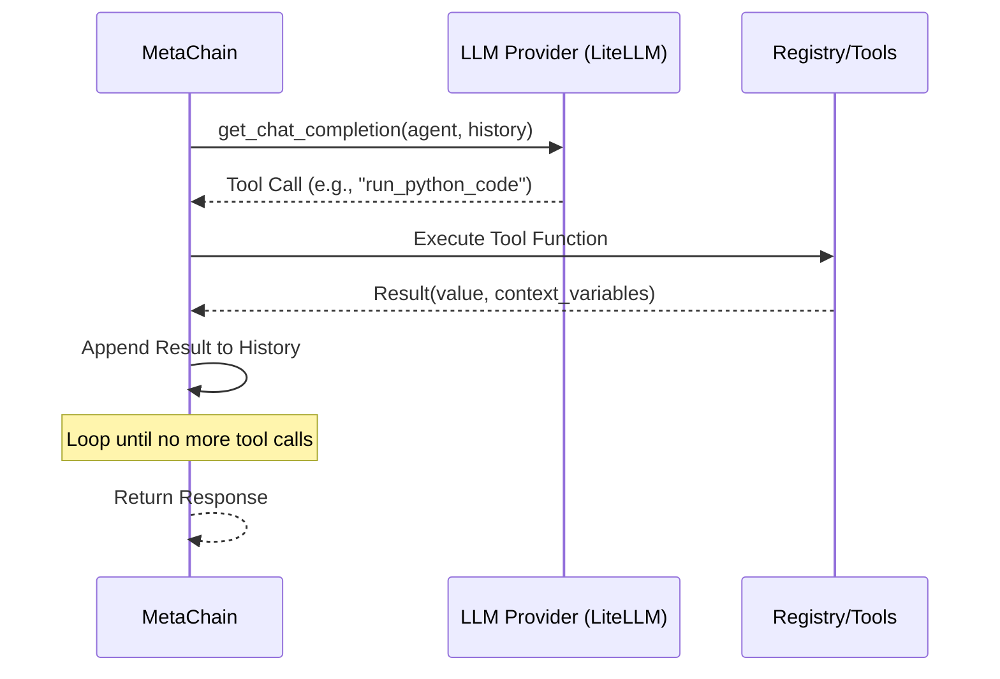

<!-- source: DeepWiki mcp.deepwiki.com · repo HKUDS/Auto-Deep-Research · page 2.3 Agent System · fetched 2026-11-09 -->

# Agent System

Relevant source files

The following files were used as context for generating this wiki page:

- [autoagent/core.py](autoagent/core.py)
- [autoagent/registry.py](autoagent/registry.py)
- [autoagent/types.py](autoagent/types.py)

The Agent System is the cognitive core of Auto-Deep-Research, providing the intelligence that powers the platform's research capabilities. This system organizes and orchestrates various specialized agents to process user queries, execute research tasks, and generate comprehensive outputs via a "MetaChain" execution loop.

## System Architecture

The Agent System follows a modular, hierarchical architecture that enables complex research workflows through agent specialization and collaboration.

Sources: [autoagent/core.py:58-68](), [autoagent/types.py:10-20](), [autoagent/registry.py:48-63]()

### MetaChain Core Engine
The `MetaChain` class in `autoagent/core.py` serves as the central orchestrator. It manages the loop of sending prompts to LLMs, parsing tool calls, executing those tools, and feeding results back into the conversation history. It handles the transition between agents (handoffs) by detecting when a tool returns a new `Agent` instance.

For a deep dive into the execution loop and retry logic, see [MetaChain Core Engine](#2.3.1).

Sources: [autoagent/core.py:58-85](), [autoagent/types.py:28-42]()

## Core Type Definitions

The system relies on three primary data structures defined in `autoagent/types.py` to maintain consistency across different LLM providers and tool executions.

| Class | Purpose | Key Attributes |
|:---|:---|:---|
| `Agent` | Defines an autonomous entity with a specific role. | `name`, `model`, `instructions`, `functions` (tools), `agent_teams` |
| `Response` | The final output of a `MetaChain.run` execution. | `messages` (history), `agent` (active agent), `context_variables` |
| `Result` | The return value from a tool/function call. | `value` (string result), `agent` (for handoffs), `context_variables` |

Sources: [autoagent/types.py:10-42]()

## Agent Registration and Discovery

The system employs a `Registry` pattern to manage tools and agents. This allows the system to dynamically discover capabilities and provide them to the LLM as functional tools.

*   **`Registry` Class**: A singleton that stores mappings for `tools`, `agents`, and `workflows`. [autoagent/registry.py:48-68]()
*   **Registration Decorator**: The `@register` (aliased as `@register_tool` or `@register_agent` in other files) decorator extracts function metadata, including docstrings and type hints, to generate JSON schemas for LLM function calling. [autoagent/registry.py:70-137]()
*   **Output Truncation**: The registry automatically wraps tool outputs with `truncate_output` to ensure tokens do not exceed `MAX_OUTPUT_LENGTH` (default 12,000). [autoagent/registry.py:7-24]()

Sources: [autoagent/registry.py:48-137]()

## System Agents

Auto-Deep-Research utilizes a "Hub-and-Spoke" model for agent coordination, centered around the **System Triage Agent**.

1.  **System Triage Agent**: Acts as the router. It analyzes the user's request and "transfers" the conversation to a specialized agent.
2.  **Specialized Agents**:
    *   **Web Surfer**: Optimized for search and browser navigation.
    *   **File Surfer**: Specialized in reading and organizing local workspace files.
    *   **Programming Agent**: Focused on writing and executing Python code in the Docker environment.

For details on how these agents are prompted and how handoffs work, see [System Agents](#2.3.2).

## Agent Execution Workflow

When a query is processed, the `MetaChain` executes a loop that bridges the high-level instructions with low-level code execution:

The system supports both standard **Function Calling** (via `litellm`) and a **Non-Function Calling fallback** for models that do not natively support structured tool use. In fallback mode, the system injects tool descriptions into the system prompt and parses the LLM's text output into tool calls.

Sources: [autoagent/core.py:106-163](), [autoagent/core.py:195-215]()

---

