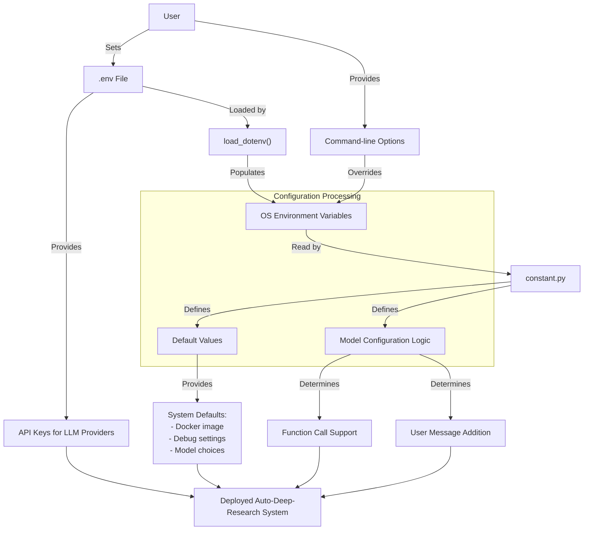
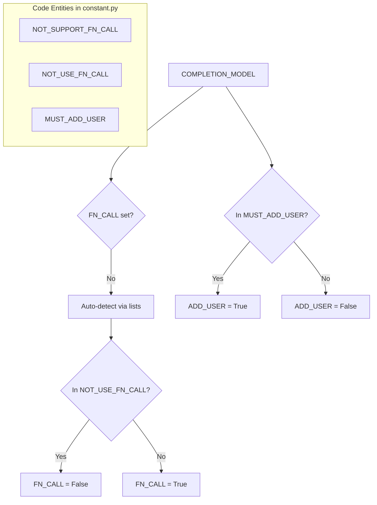
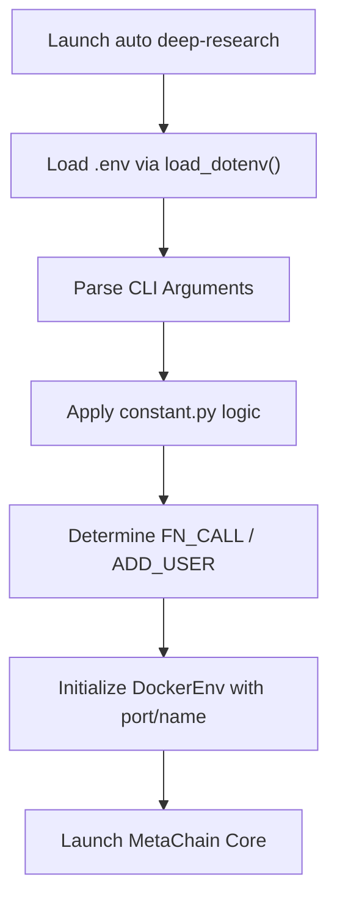

<!-- source: DeepWiki mcp.deepwiki.com · repo HKUDS/Auto-Deep-Research · page 3 Configuration · fetched 2026-11-09 -->

# Configuration

Relevant source files

The following files were used as context for generating this wiki page:

- [.env.template](.env.template)
- [README.md](README.md)
- [assets/logo.jpg](assets/logo.jpg)
- [constant.py](constant.py)

This page provides a comprehensive overview of the configuration system in Auto-Deep-Research, explaining how to customize and configure the system to your needs. It covers environment variables, command-line options, and constant definitions that control the behavior of the system.

For specific information about using different LLM providers, see [Supported LLM Providers](#1.3). For information about the CLI system, see [CLI System](#2.1).

## Configuration System Overview

Auto-Deep-Research uses a layered configuration approach that combines environment variables, command-line options, and predefined constants. This design allows for flexibility while maintaining sensible defaults for quick deployment.

### Configuration Flow Diagram
"Configuration Data Flow"

Sources: [constant.py:1-91](), [.env.template:1-9](), [README.md:102-121]()

## Environment Variables Configuration

Environment variables are the primary method for configuring API keys and basic system behavior. These are typically set in a `.env` file that follows the structure of the provided `.env.template`.

For details, see [Environment Variables](#3.1).

### API Keys Configuration

You need to set API keys for the LLM providers you intend to use. Each provider has its own environment variable:

| Environment Variable | Purpose | Required |
|---------------------|---------|----------|
| `OPENAI_API_KEY` | Authenticate with OpenAI API | Optional |
| `ANTHROPIC_API_KEY` | Authenticate with Anthropic API | Optional |
| `DEEPSEEK_API_KEY` | Authenticate with DeepSeek API | Optional |
| `GEMINI_API_KEY` | Authenticate with Google's Gemini API | Optional |
| `HUGGINGFACE_API_KEY` | Authenticate with Hugging Face API | Optional |
| `GROQ_API_KEY` | Authenticate with Groq API | Optional |
| `XAI_API_KEY` | Authenticate with xAI API | Optional |

### System Behavior Configuration

In addition to API keys, you can configure various system behaviors through environment variables:

| Environment Variable | Default | Purpose |
|---------------------|---------|---------|
| `DEBUG` | `False` | Enable debug mode for detailed logs |
| `COMPLETION_MODEL` | `claude-3-5-haiku-20241022` | The LLM model to use |
| `EMBEDDING_MODEL` | `text-embedding-3-small` | Model for text embeddings |
| `API_BASE_URL` | `None` | Custom base URL for API |
| `FN_CALL` | Auto-detected | Whether to use function calling |
| `DOCKER_WORKPLACE_NAME` | `workplace_meta` | Name of the Docker workspace directory |

Sources: [.env.template:1-9](), [constant.py:24-57](), [README.md:111-121]()

## Constants and Default Configuration

The system defines various constants and default configurations in `constant.py`. These constants determine the default behavior of the system when not explicitly configured through environment variables or command-line options.

For details, see [Constants & Defaults](#3.2).

### Platform-Specific Configuration

The system automatically detects the platform architecture via `get_architecture()` and selects the appropriate Docker image for the execution environment.

### Model-Specific Logic Mapping
"Model Capability Mapping Logic"

Sources: [constant.py:37-46](), [constant.py:61-85]()

## CLI Options

Auto-Deep-Research provides command-line options for the `auto deep-research` command to configure the runtime environment without modifying persistent configuration files. These options interact directly with the Docker and workspace management layers.

For details, see [CLI Options](#3.3).

### Common CLI Parameters

| Option | Default | Description |
|--------|---------|-------------|
| `--container_name` | `deepresearch` | The name of the Docker container instance. |
| `--port` | `12346` | The host port mapped to the container's internal service. |

Sources: [README.md:113-118]()

## Putting It All Together

The configuration system in Auto-Deep-Research provides a flexible, layered approach. By combining environment variables, command-line options, and intelligent defaults, the system aims to provide a "zero configuration" experience while allowing for detailed customization when needed.

"System Configuration Lifecycle"

Sources: [constant.py:5-22](), [constant.py:48-85](), [README.md:111-121]()

---

