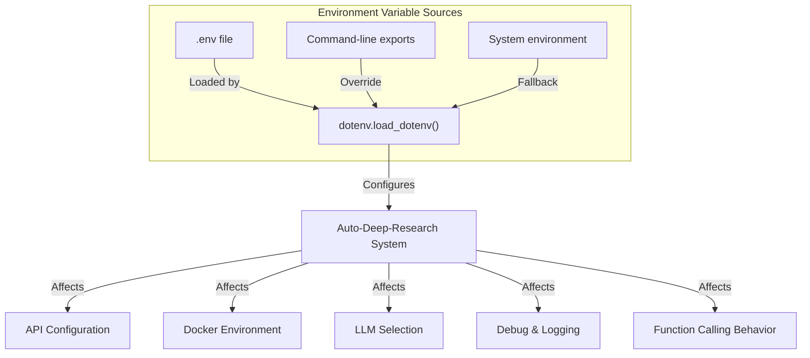
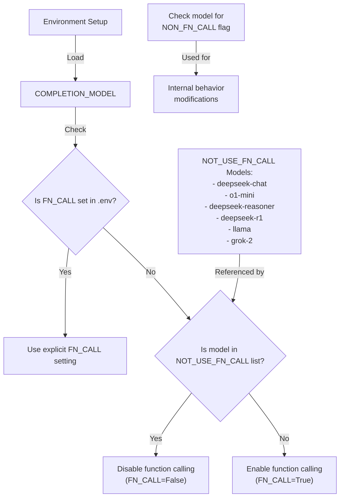
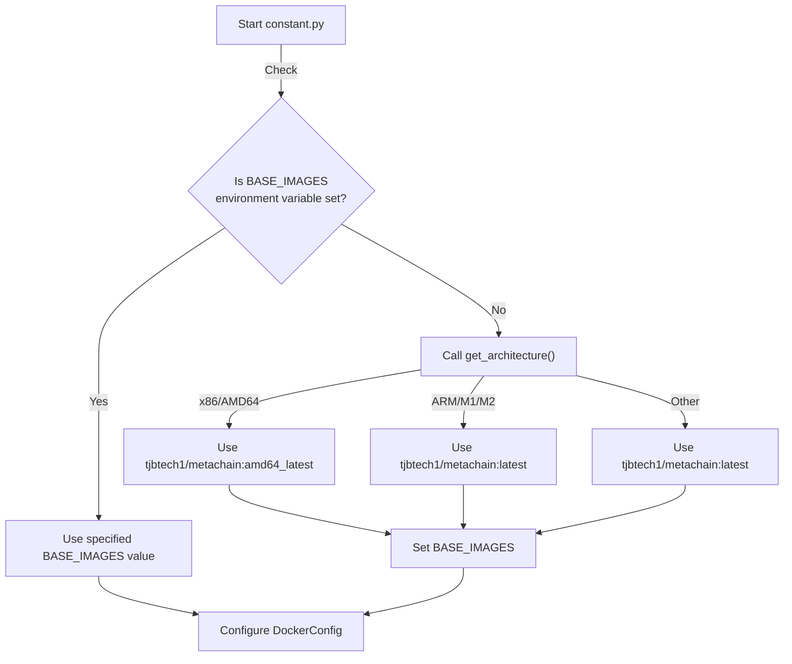
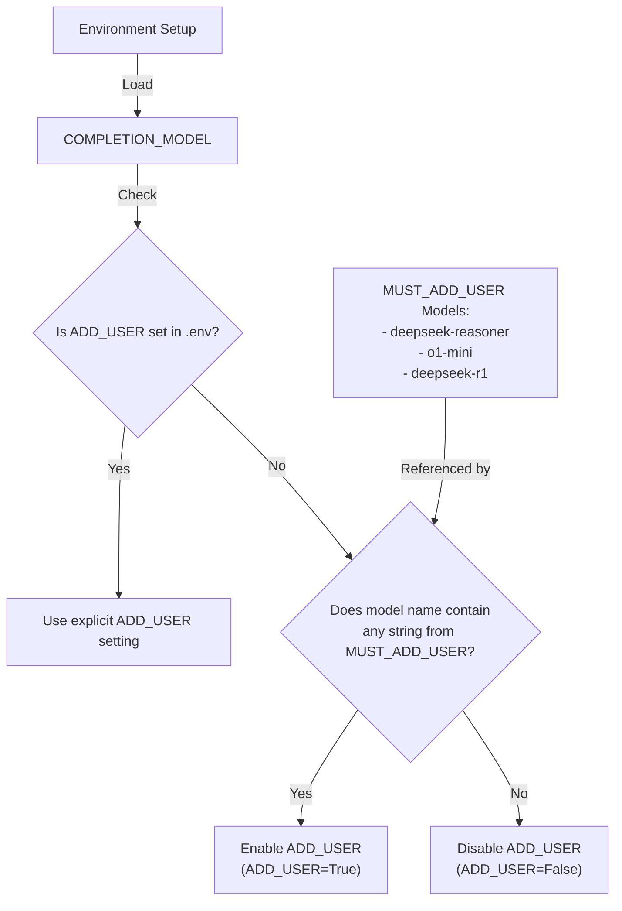
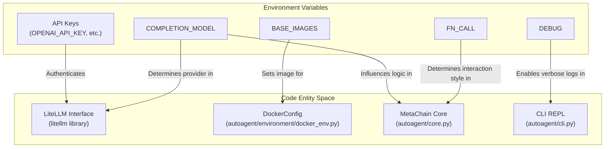

<!-- source: DeepWiki mcp.deepwiki.com · repo HKUDS/Auto-Deep-Research · page 3.1 Environment Variables · fetched 2026-11-09 -->

# Environment Variables

<details>
<summary>Relevant source files</summary>

The following files were used as context for generating this wiki page:

- [.env.template](.env.template)
- [.gitignore](.gitignore)
- [README.md](README.md)
- [assets/logo.jpg](assets/logo.jpg)
- [constant.py](constant.py)

</details>


This document details all environment variables used to configure Auto-Deep-Research, including API keys for LLM providers, system settings, and Docker configuration options. For information about command-line options, see [CLI Options](#3.3), and for constants and default values, see [Constants & Defaults](#3.2).

## Overview

Auto-Deep-Research uses environment variables to configure its behavior without requiring code changes. These variables are typically set in a `.env` file in the root directory of the project or passed directly when executing the `auto deep-research` command. The system employs `dotenv` to load these variables into the environment.

Title: Environment Variable Data Flow


Sources: [constant.py:1-5](), [.env.template:1-9]()

## API Keys

Auto-Deep-Research supports multiple LLM providers through API keys defined in environment variables. None of these are strictly required - you only need to provide keys for the LLM providers you intend to use.

| Environment Variable | Purpose | Required |
|---------------------|---------|----------|
| `OPENAI_API_KEY` | API key for OpenAI models (GPT-4o, etc.) | Optional |
| `ANTHROPIC_API_KEY` | API key for Anthropic models (Claude) | Optional |
| `DEEPSEEK_API_KEY` | API key for DeepSeek models | Optional |
| `GEMINI_API_KEY` | API key for Google's Gemini models | Optional |
| `HUGGINGFACE_API_KEY` | API key for Hugging Face models | Optional |
| `GROQ_API_KEY` | API key for Groq hosted models | Optional |
| `XAI_API_KEY` | API key for X.AI (Grok) models | Optional |

### API Key Configuration

Creating a `.env` file based on the template:

```text
# Example .env file with API keys
OPENAI_API_KEY=sk-xxxxxxxxxxxx
ANTHROPIC_API_KEY=sk-ant-xxxxxxxxxxxx
DEEPSEEK_API_KEY=xxxxxxxxxxxx
# Add other keys as needed
```

Sources: [.env.template:1-9](), [README.md:105-108]()

## LLM Configuration Variables

These variables control which LLM is used and how it interacts with the system.

| Environment Variable | Purpose | Default Value |
|---------------------|---------|---------------|
| `COMPLETION_MODEL` | Specifies which LLM model to use | `claude-3-5-haiku-20241022` |
| `EMBEDDING_MODEL` | Model used for text embeddings | `text-embedding-3-small` |
| `API_BASE_URL` | Custom API base URL for LLM provider | `None` |
| `FN_CALL` | Controls function calling capability | Auto-detected based on model |
| `ADD_USER` | Controls if user messages need special formatting | Auto-detected based on model |

### Model Selection and Function Calling Logic

The system includes logic to automatically determine whether to use function calling (`FN_CALL`) or standard text-based interaction (`NON_FN_CALL`) based on the model name.

Title: Function Calling Detection Logic


Sources: [constant.py:48-85](), [README.md:119-122]()

## Docker Environment Variables

These variables configure the Docker container used by Auto-Deep-Research to execute tools and browse the web.

| Environment Variable | Purpose | Default Value |
|---------------------|---------|---------------|
| `DOCKER_WORKPLACE_NAME` | Directory name for mounted workspace | `workplace_meta` |
| `BASE_IMAGES` | Docker image to use for the container | Auto-detected based on architecture |
| `LOCAL_ROOT` | Root directory for the local workspace | `os.getcwd()` |

### Architecture Detection Flow

The `get_architecture()` function in `constant.py` determines the appropriate Docker image if `BASE_IMAGES` is not manually specified.

Title: Docker Image Architecture Detection


Sources: [constant.py:25-46](), [README.md:99-101]()

## Debug and Logging Variables

These variables control debugging and logging behavior.

| Environment Variable | Purpose | Default Value |
|---------------------|---------|---------------|
| `DEBUG` | Enable debug mode for verbose logs | `False` |
| `DEFAULT_LOG` | Enable default logging | `False` |
| `LOG_PATH` | Custom path for log files | `None` |
| `EVAL_MODE` | Enable evaluation mode (disables standard logs) | `False` |

Sources: [constant.py:30-34](), [constant.py:88-90](), [README.md:120]()

## Special Handling Variables

### User Message Formatting (`ADD_USER`)

Some models (like DeepSeek Reasoner or OpenAI o1) require specific message structures. The system automatically detects these requirements.

Title: User Message Requirement Detection


Sources: [constant.py:57-72]()

## Working with Environment Variables

### Setting Variables for Different LLM Providers

#### Anthropic (Default)
```bash
# In .env file
ANTHROPIC_API_KEY=your_anthropic_api_key

# Run command
auto deep-research 
```

#### OpenAI
```bash
# In .env file
OPENAI_API_KEY=your_openai_api_key

# Run command
COMPLETION_MODEL=gpt-4o auto deep-research
```

#### Custom API Endpoints (e.g., vLLM or OpenRouter)
```bash
# In .env file
OPENAI_API_KEY=your_api_key

# Run command
COMPLETION_MODEL=openai/deepseek/deepseek-r1 API_BASE_URL=https://openrouter.ai/api/v1 auto deep-research
```

Sources: [README.md:128-222]()

## Relationship to System Components

Environment variables influence multiple components across the codebase.

Title: Configuration Impact on Code Entities


Sources: [README.md:111-222](), [constant.py:1-91]()

---

