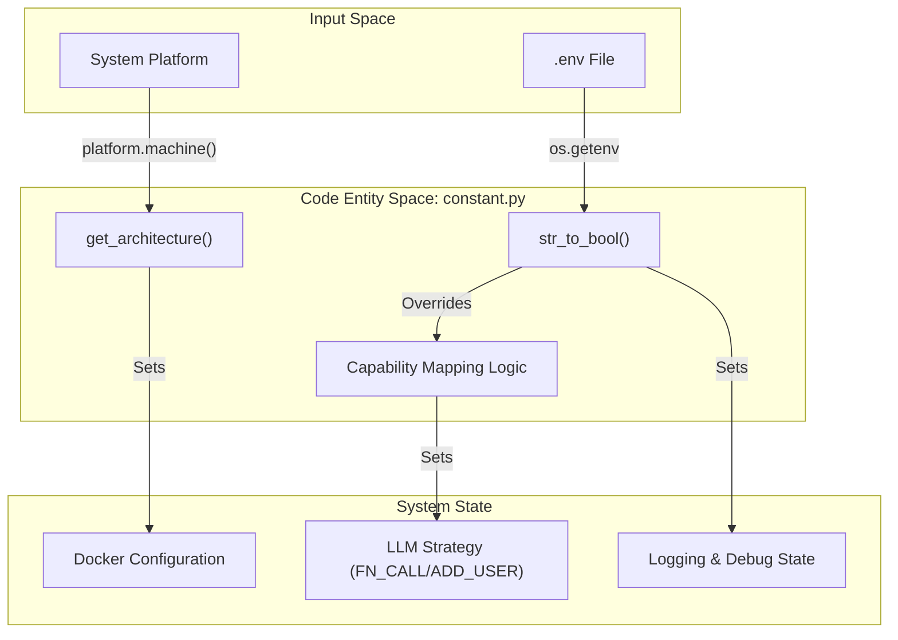
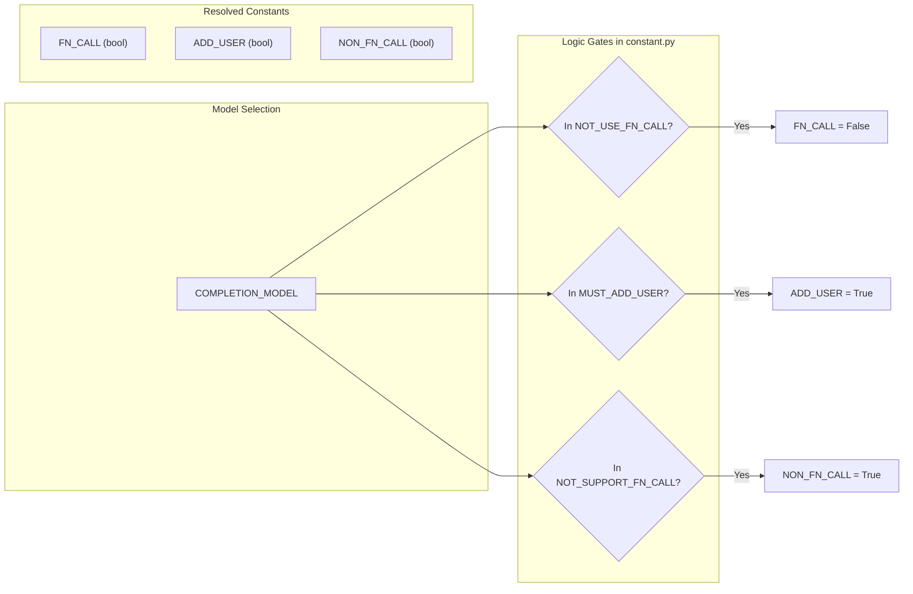

<!-- source: DeepWiki mcp.deepwiki.com · repo HKUDS/Auto-Deep-Research · page 3.2 Constants & Defaults · fetched 2026-11-09 -->

# Constants & Defaults

Relevant source files

The following files were used as context for generating this wiki page:

- [MANIFEST.in](MANIFEST.in)
- [constant.py](constant.py)

This page details the technical constants, default configurations, and automated environment detection logic defined in `constant.py`. These settings govern the core behavior of the MetaChain engine, Docker orchestration, and LLM interaction strategies.

## Overview of Configuration Logic

The configuration system in `constant.py` acts as the central source of truth for the application. It performs three primary roles:
1.  **Environment Loading**: Sanitizes and loads variables from `.env` files using `python-dotenv`.
2.  **Hardware Abstraction**: Detects system architecture to select compatible Docker images.
3.  **Model Capability Mapping**: Automatically adjusts agent behavior (e.g., enabling/disabling function calling) based on the string name of the `COMPLETION_MODEL`.

Sources: [constant.py:1-22](), [constant.py:37-46]()

## Environment & Docker Constants

The system defines the execution context for the Docker-based research environment.

| Constant | Code Reference | Default / Logic | Description |
| :--- | :--- | :--- | :--- |
| `DOCKER_WORKPLACE_NAME` | [constant.py:25]() | `'workplace_meta'` | The default name for the Docker container and volume. |
| `LOCAL_ROOT` | [constant.py:28]() | `os.getcwd()` | The host directory mounted into the container. |
| `BASE_IMAGES` | [constant.py:35-46]() | *Dynamic* | Detected via `get_architecture()`. |

### Architecture Detection
The `get_architecture()` function ensures that the correct Docker image manifest is pulled based on the host CPU [constant.py:37-44]().

*   **x86_64 / amd64**: Returns `tjbtech1/metachain:amd64_latest` [constant.py:39-40]().
*   **ARM (Apple Silicon/Raspberry Pi)**: Returns `tjbtech1/metachain:latest` [constant.py:41-42]().

Sources: [constant.py:25-46]()

## Model Capability Mapping

The system categorizes LLMs into capability groups to handle API variations automatically. This is crucial for models like `DeepSeek-R1` or `O1-mini` which have restricted schemas.

### Key Capability Lists
*   **`NOT_SUPPORT_SENDER`**: Models that do not accept a `sender` field in message payloads (e.g., Mistral, Groq) [constant.py:61]().
*   **`MUST_ADD_USER`**: Models that require at least one user message or specific formatting (e.g., `deepseek-reasoner`, `o1-mini`) [constant.py:62]().
*   **`NOT_SUPPORT_FN_CALL`**: Models that lack native tool-calling schemas [constant.py:64]().
*   **`NOT_USE_FN_CALL`**: A superset including `deepseek-chat` and all models in `NOT_SUPPORT_FN_CALL` [constant.py:65]().

### Automated Flag Resolution
The system resolves three boolean flags that dictate how `MetaChain` interacts with the LLM provider:

1.  **`ADD_USER`**: If `True`, the system ensures user-role messages are injected as required by models in `MUST_ADD_USER` [constant.py:67-72]().
2.  **`FN_CALL`**: If `True`, the agent uses native JSON tool schemas. If the model is found in `NOT_USE_FN_CALL`, this defaults to `False` [constant.py:74-79]().
3.  **`NON_FN_CALL`**: Specifically identifies models that require the "ReAct" or "String-based" prompting fallback because they cannot process function objects at all [constant.py:81-85]().

Sources: [constant.py:61-85]()

## Global Defaults

The following table summarizes secondary constants used for internal state management and logging.

| Constant | Code Reference | Default | Purpose |
| :--- | :--- | :--- | :--- |
| `COMPLETION_MODEL` | [constant.py:48]() | `claude-3-5-haiku-20241022` | The primary LLM used by agents. |
| `EMBEDDING_MODEL` | [constant.py:49]() | `text-embedding-3-small` | Used for RAG and memory vectorization. |
| `MC_MODE` | [constant.py:51]() | `True` | MetaChain Mode: Enables the core agentic loop. |
| `DEBUG` | [constant.py:30]() | `False` | Increases log verbosity. |
| `EVAL_MODE` | [constant.py:34]() | `False` | When `True`, `DEFAULT_LOG` is forced to `False` [constant.py:88-89](). |

### String to Boolean Utility
The `str_to_bool` function [constant.py:6-22]() provides robust parsing for environment variables. It maps truthy strings like `'yes'`, `'1'`, and `'on'` to `True`, and falsy strings like `'no'`, `'0'`, and `'off'` to `False`. By default, if a value is provided but not recognized, it returns `True` [constant.py:22]().

Sources: [constant.py:6-22](), [constant.py:30-51](), [constant.py:88-89]()

---

