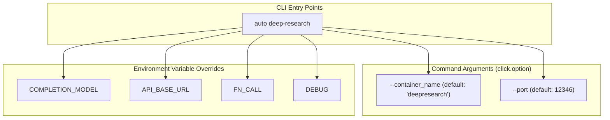
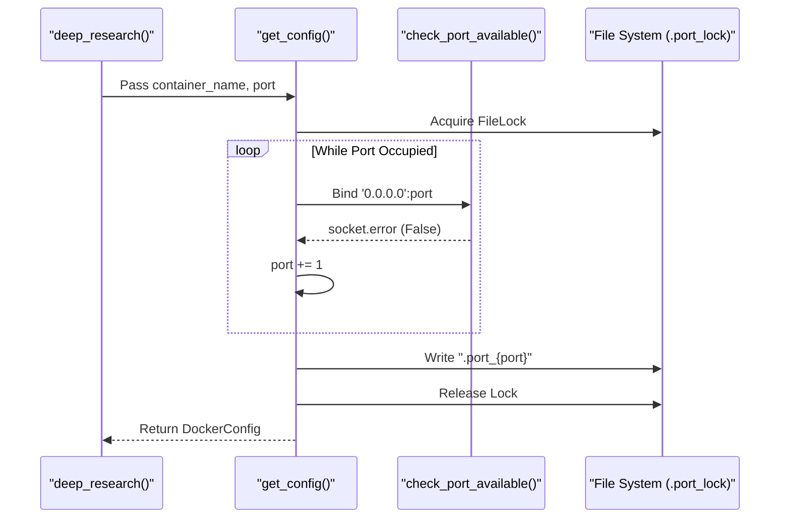
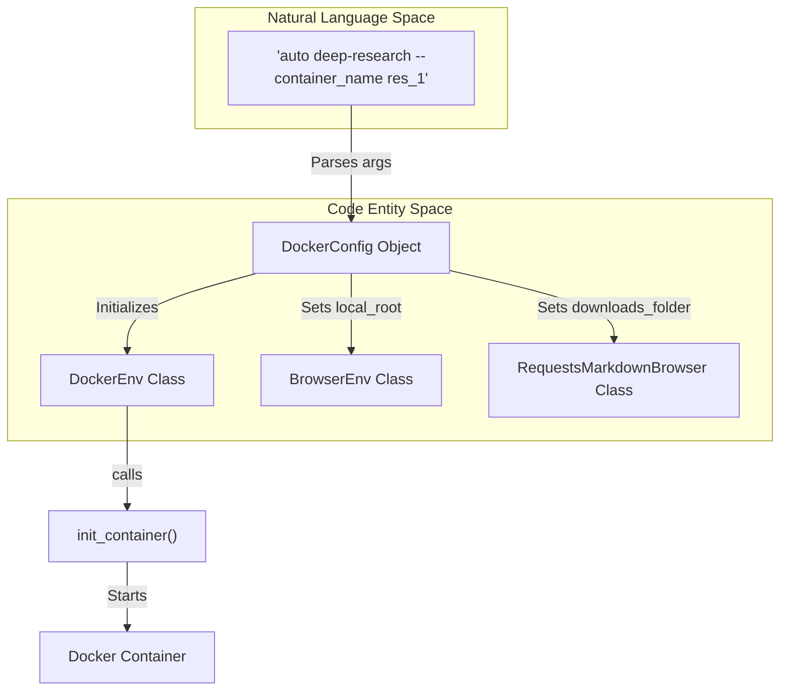
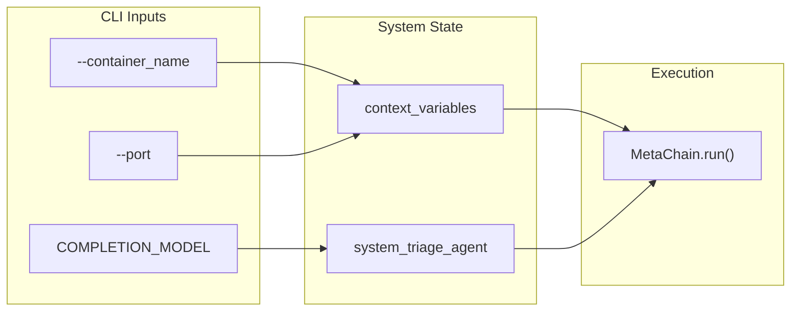

<!-- source: DeepWiki mcp.deepwiki.com · repo HKUDS/Auto-Deep-Research · page 3.3 CLI Options · fetched 2026-11-09 -->

# CLI Options

Relevant source files

The following files were used as context for generating this wiki page:

- [.env.template](.env.template)
- [README.md](README.md)
- [assets/logo.jpg](assets/logo.jpg)
- [autoagent/cli.py](autoagent/cli.py)

This page documents all available command-line options for the `auto deep-research` command and explains their implementation details, data flow, and interaction with the Docker and workspace configuration.

## Core CLI Command Structure

The CLI is built using the `click` library [autoagent/cli.py:45-48](). The primary entry point for the deep research functionality is the `deep-research` command [autoagent/cli.py:109]().

Sources: [autoagent/cli.py:109-112](), [README.md:113-122]()

## Available CLI Options

### Command-Line Arguments
These are passed directly to the `deep_research` function in `autoagent/cli.py`.

| Option | Type | Default | Description |
| :--- | :--- | :--- | :--- |
| `--container_name` | `str` | `deepresearch` | Unique identifier for the Docker container and local workspace directory [autoagent/cli.py:110](). |
| `--port` | `int` | `12346` | The base TCP port for communication with the `DockerEnv` [autoagent/cli.py:111](). |

### Environment Configuration
While not direct CLI flags, these variables are checked during the execution of the `deep-research` command:

| Variable | Source | Role |
| :--- | :--- | :--- |
| `COMPLETION_MODEL` | `constant.py` | Sets the LLM model (e.g., `claude-3-5-sonnet-20241022`) [autoagent/cli.py:117](). |
| `API_BASE_URL` | `.env` | Custom endpoint for LLM providers [README.md:121](). |
| `FN_CALL` | `.env` | Force enables/disables function calling mode [README.md:122](). |

Sources: [autoagent/cli.py:109-117](), [README.md:113-122]()

## Implementation: Port and Workspace Management

The `get_config` function [autoagent/cli.py:53-85]() processes the CLI options to initialize a `DockerConfig` object. This process includes automated port conflict resolution and workspace directory creation.

### Port Selection Logic
If the specified `--port` is occupied, the system uses a file-locking mechanism to find and reserve the next available port [autoagent/cli.py:63-74]().

Sources: [autoagent/cli.py:32-44](), [autoagent/cli.py:53-85]()

### Workspace Interaction
The `--container_name` option determines the local filesystem path where research data is stored.
*   **Path Template**: `workspace_meta_showcase/showcase_{container_name}` [autoagent/cli.py:75]().
*   **Action**: The directory is created automatically via `os.makedirs(local_root, exist_ok=True)` [autoagent/cli.py:76]().

Sources: [autoagent/cli.py:75-76]()

## Environment Initialization Flow

Once the CLI options are processed into a `DockerConfig`, the system invokes `create_environment` [autoagent/cli.py:86-98]() to instantiate the three core execution layers.

Sources: [autoagent/cli.py:86-98](), [autoagent/cli.py:127-134]()

## Data Flow: CLI to MetaChain

The CLI options eventually populate the `context_variables` dictionary, which is passed to the `MetaChain` execution loop [autoagent/cli.py:140-164]().

1.  **Model Selection**: The `COMPLETION_MODEL` (retrieved from constants or env) is passed to `get_system_triage_agent(model)` [autoagent/cli.py:146]().
2.  **Context Assembly**: The `code_env`, `web_env`, and `file_env` (configured via CLI `--port` and `--container_name`) are stored in `context_variables` [autoagent/cli.py:140]().
3.  **REPL Execution**: The `MetaChain` client uses these variables to manage agent handoffs and tool executions [autoagent/cli.py:164-171]().

Sources: [autoagent/cli.py:140-164](), [autoagent/cli.py:117]()

---

