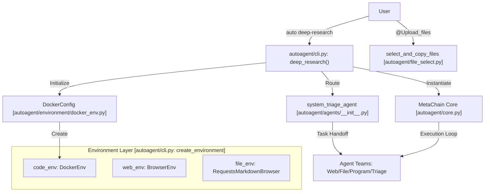
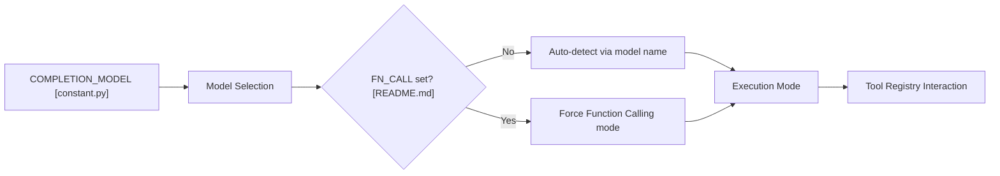

<!-- source: DeepWiki mcp.deepwiki.com · repo HKUDS/Auto-Deep-Research · page 4 User Guide · fetched 2026-11-09 -->

# User Guide

Relevant source files

The following files were used as context for generating this wiki page:

- [.env.template](.env.template)
- [README.md](README.md)
- [assets/logo.jpg](assets/logo.jpg)
- [autoagent/cli.py](autoagent/cli.py)

This guide provides practical instructions for using Auto-Deep-Research, a cost-effective open-source alternative to OpenAI's Deep Research. It covers installation, session management, file handling, and LLM provider configuration.

## System Overview

Auto-Deep-Research is a command-line tool that provides a fully-automated AI assistant for research tasks. It operates within a containerized environment to ensure safety and reproducibility.

### High-Level Interaction Flow
The following diagram bridges the User's Natural Language Space with the System's Code Entity Space, showing how CLI commands trigger specific class instances and environment setups.

Sources: [autoagent/cli.py:112-140](), [autoagent/cli.py:86-98](), [README.md:25-35]()

---

## 4.1 Getting Started
Launch your first research session by following these steps:

1.  **Installation**: Clone the repository and install the package in a Python 3.10 environment. [README.md:91-97]()
2.  **Environment Setup**: Configure your `.env` file with at least one supported LLM API key. [.env.template:1-8]()
3.  **Docker**: Ensure Docker is running; the system will automatically pull the necessary images based on your architecture. [README.md:101-102]()
4.  **Launch**: Run `auto deep-research` to enter the interactive REPL. [autoagent/cli.py:109-112]()

For a detailed step-by-step walkthrough, see **[Getting Started](#4.1)**.

---

## 4.2 Working with Files
Auto-Deep-Research allows for deep data interaction by managing local files within the research environment.

*   **Uploading**: Use the `@Upload_files` mention in the CLI to trigger the `select_and_copy_files` utility. [autoagent/cli.py:153-170]()
*   **Storage**: Files are moved into the `files` subdirectory within the `local_root` workspace. [autoagent/cli.py:75-84]()
*   **Processing**: The `File Surfer Agent` and `Programming Agent` can then read, analyze, or execute code against these files. [autoagent/cli.py:134-140]()

For details on supported formats and advanced file handling, see **[Working with Files](#4.2)**.

---

## 4.3 Selecting LLM Providers
The system is designed for universal LLM support via `litellm`.

### Configuration Matrix
| Provider | Key Variable | Model String Example |
| :--- | :--- | :--- |
| **Anthropic** | `ANTHROPIC_API_KEY` | `claude-3-5-sonnet-20241022` |
| **OpenAI** | `OPENAI_API_KEY` | `gpt-4o` |
| **DeepSeek** | `DEEPSEEK_API_KEY` | `deepseek/deepseek-chat` |
| **OpenRouter** | `OPENROUTER_API_KEY` | `openrouter/deepseek/deepseek-r1` |

### Provider Logic Flow
The system dynamically adjusts behavior (like function calling) based on the selected provider.

For instructions on configuring custom endpoints and understanding the `FN_CALL` flag, see **[Selecting LLM Providers](#4.3)**.

Sources: [README.md:113-123](), [constant.py:28-28](), [autoagent/cli.py:117-117]()

---

## Troubleshooting & Help
*   **Port Management**: If the default port `12346` is busy, the system uses a `filelock` mechanism to find and reserve the next available port. [autoagent/cli.py:63-74]()
*   **Workspace**: Local logs and research data are stored in `workspace_meta_showcase/showcase_[container_name]`. [autoagent/cli.py:75-76]()
*   **Debug Mode**: Set `DEBUG=True` in your environment to see detailed execution logs. [README.md:120-120]()

Sources: [autoagent/cli.py:32-44](), [autoagent/cli.py:63-85]()

---

