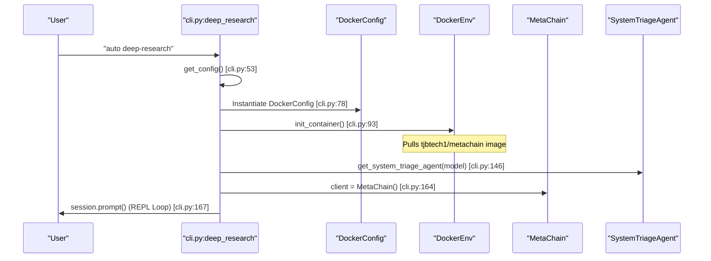
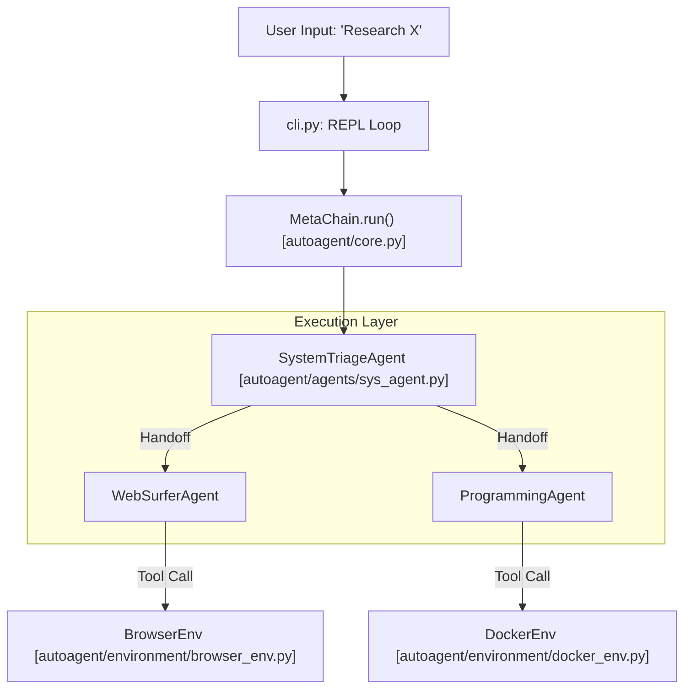

<!-- source: DeepWiki mcp.deepwiki.com · repo HKUDS/Auto-Deep-Research · page 4.1 Getting Started · fetched 2026-11-09 -->

# Getting Started

<details>
<summary>Relevant source files</summary>

The following files were used as context for generating this wiki page:

- [.env.template](.env.template)
- [README.md](README.md)
- [assets/logo.jpg](assets/logo.jpg)
- [autoagent/cli.py](autoagent/cli.py)
- [constant.py](constant.py)

</details>


This guide provides step-by-step instructions to set up and launch your first research session with Auto-Deep-Research. Auto-Deep-Research is an open-source alternative to OpenAI's Deep Research built on the `MetaChain` framework, providing a fully automated and cost-effective personal AI assistant.

## Prerequisites

Before getting started, ensure you have the following installed:

1.  **Python 3.10**: Required for compatibility with the core engine and dependencies [README.md:92-93]().
2.  **Docker**: Essential for containerizing the agent-interactive execution environment [README.md:99-101]().
3.  **Conda**: Recommended for environment isolation [README.md:92-93]().
4.  **API Key(s)**: At least one key for supported providers (Anthropic, OpenAI, DeepSeek, etc.) [.env.template:1-9]().

Sources: [README.md:86-101](), [.env.template:1-9]()

## Installation

Follow these steps to install the package and its dependencies:

1.  **Create and activate the environment**:
    ```bash
    conda create -n auto_deep_research python=3.10
    conda activate auto_deep_research
    ```
2.  **Clone and install**:
    ```bash
    git clone https://github.com/HKUDS/Auto-Deep-Research.git
    cd Auto-Deep-Research
    pip install -e .
    ```

The system uses `DockerEnv` to manage the sandbox. You do not need to manually pull images; the system detects your hardware architecture via `get_architecture()` in `constant.py` and pulls the appropriate image (e.g., `tjbtech1/metachain:amd64_latest` or `tjbtech1/metachain:latest`) [constant.py:37-46]().

Sources: [README.md:89-97](), [constant.py:37-46]()

## Configuration (.env)

The system relies on environment variables defined in a `.env` file.

1.  Copy the template: `cp .env.template .env`.
2.  Fill in your primary model keys.
3.  (Optional) Set `COMPLETION_MODEL` to override the default `claude-3-5-haiku-20241022` [constant.py:48-48]().

| Variable | Role | File Reference |
| :--- | :--- | :--- |
| `ANTHROPIC_API_KEY` | Key for Claude models | [.env.template:4-4]() |
| `OPENAI_API_KEY` | Key for GPT models | [.env.template:2-2]() |
| `COMPLETION_MODEL` | Primary LLM identifier | [constant.py:48-48]() |
| `FN_CALL` | Toggle for tool-use mode | [constant.py:55-55]() |

Sources: [.env.template:1-9](), [constant.py:48-86]()

## Launching the Session

The entry point is the `auto deep-research` command defined in `autoagent/cli.py`.

### System Initialization Flow
The following diagram maps the CLI startup sequence to the underlying code entities.


Sources: [autoagent/cli.py:53-167](), [autoagent/environment/docker_env.py:1-20]()

### Running your first query
When the CLI starts, it initializes three environments: `DockerEnv` (code), `BrowserEnv` (web), and `RequestsMarkdownBrowser` (files) [autoagent/cli.py:92-96]().

1.  **Start the CLI**:
    ```bash
    auto deep-research --container_name my_session --port 12346
    ```
2.  **Interact**:
    *   **Direct Query**: "Research the impact of Llama-3 on open-source AI."
    *   **Agent Mention**: Use `@Programming_Agent` to force code execution [autoagent/cli.py:169-170]().
    *   **File Upload**: Use `@Upload_files` to trigger the `select_and_copy_files` utility [autoagent/cli.py:153]().

### Natural Language to Code Entity Mapping
This diagram shows how user input is routed through the system classes.


Sources: [autoagent/cli.py:146-164](), [autoagent/core.py:1-50](), [autoagent/agents/sys_agent.py:1-20]()

## Common CLI Options

| Option | Description | Default |
| :--- | :--- | :--- |
| `--container_name` | The name for the Docker sandbox | `deepresearch` |
| `--port` | The communication port for the Docker TCP server | `12346` |

The system uses a `filelock` mechanism on `.port_lock` to ensure that if you run multiple sessions, they increment the port automatically to avoid collisions [autoagent/cli.py:63-74]().

Sources: [autoagent/cli.py:110-112](), [autoagent/cli.py:63-74]()

---

