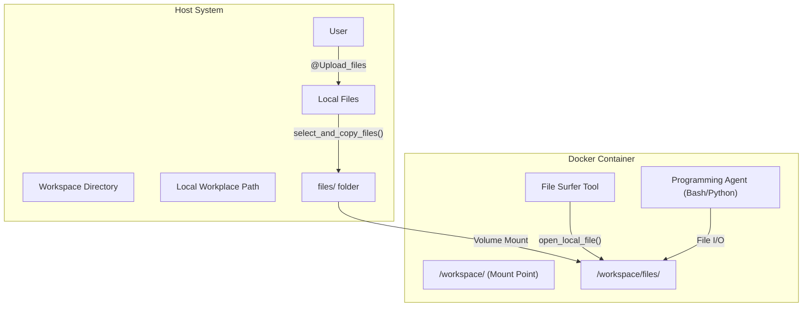

<!-- source: DeepWiki mcp.deepwiki.com · repo HKUDS/Auto-Deep-Research · page 4.2 Working with Files · fetched 2026-11-09 -->

# Working with Files

Relevant source files

The following files were used as context for generating this wiki page:

- [autoagent/environment/browser_cookies.py](autoagent/environment/browser_cookies.py)
- [autoagent/environment/cookie_json/README.md](autoagent/environment/cookie_json/README.md)
- [autoagent/environment/cookies_data.py](autoagent/environment/cookies_data.py)
- [autoagent/file_select.py](autoagent/file_select.py)
- [autoagent/tools/file_surfer_tool.py](autoagent/tools/file_surfer_tool.py)

This document explains how to upload, process, and manage files within the Auto-Deep-Research environment. The system provides specialized utilities for file selection, a virtual agent for uploads, and a "File Surfer" toolset for browsing local content.

## File System Architecture

The research environment operates across a host-container boundary. Files are physically stored on the host but mapped into the Docker container via volume mounts to allow agents to interact with them.

Sources: [autoagent/file_select.py:7-49](), [autoagent/tools/file_surfer_tool.py:66-86]()

## File Upload via `Upload_files`

The system provides a virtual agent trigger `@Upload_files` in the CLI. When this is detected, the system pauses the LLM interaction and launches a local GUI for file selection.

### The `file_select` Utility
The `select_and_copy_files` function uses `tkinter` to open a native file explorer. It supports various file types including PDFs, Docx, Zip, and Txt files.

- **Implementation**: It creates a hidden `tk.Tk()` root and calls `filedialog.askopenfilenames` [autoagent/file_select.py:9-13]().
- **Data Flow**: Selected files are copied using `shutil.copy2` to the `dest_dir` (the local workplace path) [autoagent/file_select.py:40-44]().
- **CLI Integration**: The `autoagent/cli.py` intercepts the `@Upload_files` string and executes this utility before continuing the research loop.

Sources: [autoagent/file_select.py:1-50](), [autoagent/cli.py:207-212]()

## File Surfer Toolset

Once files are in the workspace, the `File Surfer Agent` uses specialized tools defined in `file_surfer_tool.py` to inspect them. This agent acts like a "text-based browser" for local files.

### Key Functions
- **`open_local_file`**: Converts a Docker-relative path to a local path and loads it into a `RequestsMarkdownBrowser` instance [autoagent/tools/file_surfer_tool.py:66-86]().
- **Navigation**: Tools like `page_up_markdown` [autoagent/tools/file_surfer_tool.py:88-101]() and `page_down_markdown` [autoagent/tools/file_surfer_tool.py:103-116]() allow the agent to paginate through large documents.
- **Search**: `find_on_page_ctrl_f` [autoagent/tools/file_surfer_tool.py:118-134]() and `find_next` [autoagent/tools/file_surfer_tool.py:136-149]() provide keyword search capabilities within the current file.

Sources: [autoagent/tools/file_surfer_tool.py:66-149]()

## Authenticated Sessions via Browser Cookies

For web-based research that requires authentication (e.g., GitHub, ResearchGate, Nature), the system supports importing browser cookies.

### Cookie Management Workflow
1. **Export**: Users use a Chrome extension ("Export cookie JSON file for Puppeteer") to save cookies as JSON [autoagent/environment/cookie_json/README.md:7-14]().
2. **Processing**: The `convert_cookies_to_python()` function in `browser_cookies.py` reads all JSON files from the `cookie_json` directory [autoagent/environment/browser_cookies.py:12-30]().
3. **Storage**: It generates a `cookies_data.py` file containing a `COOKIES_LIST` [autoagent/environment/browser_cookies.py:32-38]().
4. **Usage**: These cookies are injected into the `RequestsMarkdownBrowser` to maintain sessions during web surfing.

| Recommended Websites for Cookies |
|----------------------------------|
| github.com                       |
| nature.com                       |
| researchgate.net                 |
| archive.org                      |
| ncbi.nlm.nih.gov                 |

Sources: [autoagent/environment/browser_cookies.py:12-39](), [autoagent/environment/cookie_json/README.md:22-37]()

## Supported File Formats

The system is designed to handle both structured and unstructured data:

- **Documents**: `.pdf`, `.docx`, `.txt`, `.md`
- **Data**: `.csv`, `.json`
- **Archives**: `.zip` (can be extracted via Programming Agent)
- **Media**: The system includes utilities for image encoding and video/audio processing (via `faster_whisper` and `moviepy`) though these are typically handled by specialized tools [autoagent/tools/file_surfer_tool.py:151-185]().

## Technical Implementation Summary

| Component | Code Entity | Role |
|-----------|-------------|------|
| **Upload Utility** | `select_and_copy_files` | GUI-based file transfer to workspace [autoagent/file_select.py:7]() |
| **Local Browser** | `RequestsMarkdownBrowser` | Renders file content into markdown for LLM consumption [autoagent/tools/file_surfer_tool.py:1]() |
| **Path Mapping** | `_convert_docker_to_local` | Translates container paths to host paths for file I/O [autoagent/tools/file_surfer_tool.py:80]() |
| **Cookie Converter** | `convert_cookies_to_python` | Serializes JSON cookies into Python lists [autoagent/environment/browser_cookies.py:12]() |

Sources: [autoagent/file_select.py:7](), [autoagent/tools/file_surfer_tool.py:1-80](), [autoagent/environment/browser_cookies.py:12]()

---

