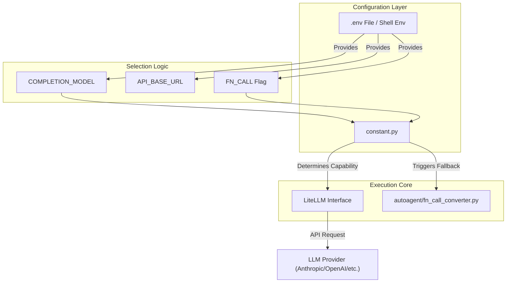
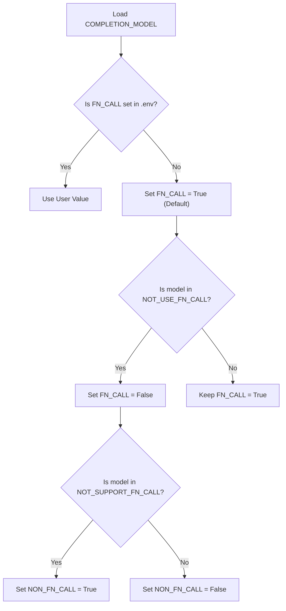

<!-- source: DeepWiki mcp.deepwiki.com · repo HKUDS/Auto-Deep-Research · page 4.3 Selecting LLM Providers · fetched 2026-11-09 -->

# Selecting LLM Providers

<details>
<summary>Relevant source files</summary>

The following files were used as context for generating this wiki page:

- [.env.template](.env.template)
- [README.md](README.md)
- [assets/logo.jpg](assets/logo.jpg)
- [autoagent/fn_call_converter.py](autoagent/fn_call_converter.py)
- [constant.py](constant.py)

</details>


This document provides technical instructions for choosing and configuring different Large Language Model (LLM) providers within Auto-Deep-Research. It details the implementation of provider selection, the logic behind the `FN_CALL` flag, and the configuration of custom endpoints.

## Purpose and Scope

Auto-Deep-Research is designed to be provider-agnostic, utilizing the [LiteLLM](https://github.com/BerriAI/litellm) library to interface with various AI services [README.md:119-121](). This page explains how the system resolves model capabilities—specifically function calling—and how users can override defaults via environment variables like `COMPLETION_MODEL`, `API_BASE_URL`, and `FN_CALL`.

## LLM Provider Selection Architecture

The following diagram illustrates how the system processes user input and environment variables to initialize the LLM interface.

### LLM Initialization Data Flow

Sources: [constant.py:48-56](), [autoagent/fn_call_converter.py:1-7](), [README.md:119-124]()

## Function Calling and Fallback Logic

A critical component of Auto-Deep-Research is the `FN_CALL` flag. While many modern models support native tool use (function calling), several high-performance reasoning models (like DeepSeek-R1 or OpenAI o1-mini) do not, or have unstable implementations for complex agentic loops.

### Automatic Capability Detection
The system automatically determines if a model should use function calling by checking the `COMPLETION_MODEL` against internal blacklists in `constant.py`.

*   **`NOT_SUPPORT_FN_CALL`**: Models that physically lack the API for function calling [constant.py:64-64]().
*   **`NOT_USE_FN_CALL`**: Models where function calling is disabled by default for stability (e.g., `deepseek-chat`) [constant.py:65-65]().

### FN_CALL Logic Implementation

Sources: [constant.py:74-85]()

### Non-Function Calling Converter
When `FN_CALL` is `False`, the system utilizes `autoagent/fn_call_converter.py` to wrap tool definitions into a system prompt suffix [autoagent/fn_call_converter.py:35-58](). This forces the model to output a specific XML-like format:
*   `<function=example_function_name>` [autoagent/fn_call_converter.py:42-42]()
*   `<parameter=name>value</parameter>` [autoagent/fn_call_converter.py:43-43]()

## Provider Configuration Guide

### API Key Setup
API keys must be defined in the `.env` file. The system looks for specific environment variable names based on the provider.

| Provider | Environment Variable | Default Model Example |
| :--- | :--- | :--- |
| Anthropic | `ANTHROPIC_API_KEY` | `claude-3-5-sonnet-20241022` |
| OpenAI | `OPENAI_API_KEY` | `gpt-4o` |
| DeepSeek | `DEEPSEEK_API_KEY` | `deepseek-chat` |
| Gemini | `GEMINI_API_KEY` | `gemini/gemini-2.0-flash` |
| Groq | `GROQ_API_KEY` | `groq/deepseek-r1-distill-llama-70b` |
| OpenRouter | `OPENROUTER_API_KEY` | `openrouter/deepseek/deepseek-r1` |

Sources: [.env.template:1-9](), [README.md:128-252]()

### Using Custom Endpoints (API_BASE_URL)
For local deployments (vLLM, Ollama) or OpenAI-compatible proxies (Grok, OpenRouter), use the `API_BASE_URL` variable.

**Example: Configuring x.ai (Grok)**
```bash
OPENAI_API_KEY=your_xai_key \
API_BASE_URL=https://api.x.ai/v1 \
COMPLETION_MODEL=openai/grok-2-latest \
auto deep-research
```
Sources: [README.md:210-222](), [constant.py:56-56]()

### Using OpenRouter for DeepSeek-R1
DeepSeek-R1 is highly recommended for its reasoning capabilities but often requires a proxy like OpenRouter for high availability.

1. Set `OPENROUTER_API_KEY` in `.env` [README.md:224-230]().
2. Run with the OpenRouter model identifier:
   ```bash
   COMPLETION_MODEL=openrouter/deepseek/deepseek-r1 auto deep-research
   ```
   *Note: The system will automatically detect `deepseek-r1` in the string and set `FN_CALL=False` and `ADD_USER=True`* [constant.py:62-79]().

## Special Model Handling
Certain models require specific message formatting adjustments, managed in `constant.py`:

*   **`MUST_ADD_USER`**: Models like `deepseek-reasoner` and `o1-mini` require the conversation to start or end with a user message [constant.py:62-62]().
*   **`NOT_SUPPORT_SENDER`**: Models from Mistral or Groq that may not support the `sender` field in message metadata [constant.py:61-61]().

Sources: [constant.py:61-72]()

---

