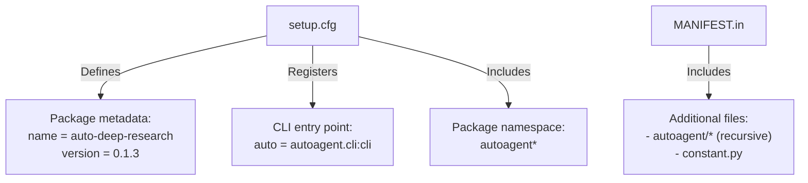
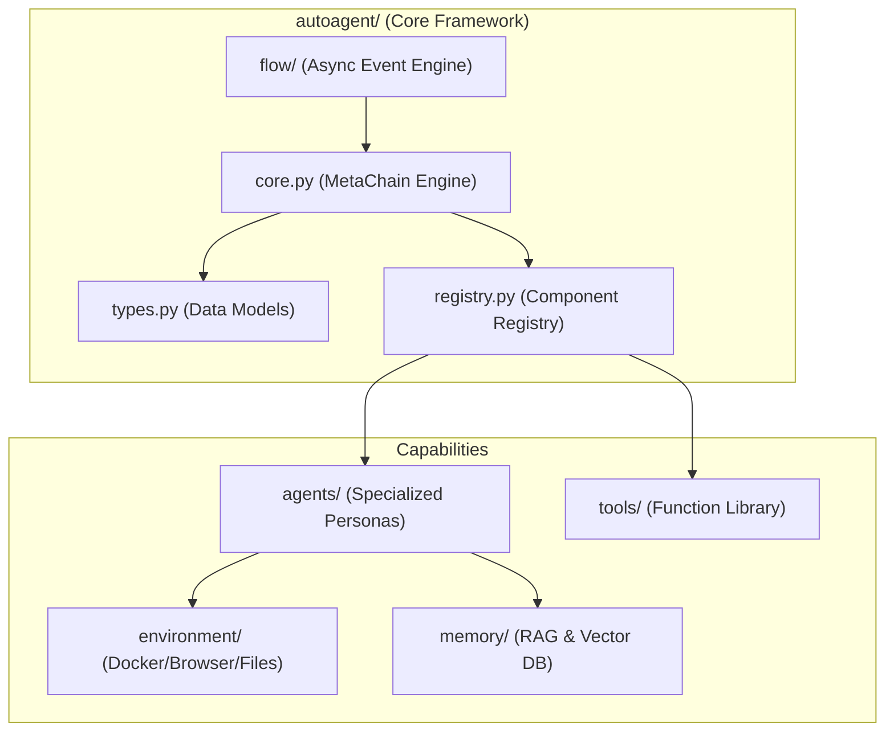
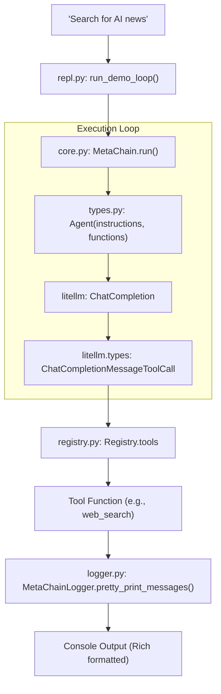

<!-- source: DeepWiki mcp.deepwiki.com · repo HKUDS/Auto-Deep-Research · page 5.1 Package Structure · fetched 2026-11-09 -->

# Package Structure

<details>
<summary>Relevant source files</summary>

The following files were used as context for generating this wiki page:

- [autoagent/__init__.py](autoagent/__init__.py)
- [autoagent/agents/__init__.py](autoagent/agents/__init__.py)
- [autoagent/io_utils.py](autoagent/io_utils.py)
- [autoagent/logger.py](autoagent/logger.py)
- [autoagent/registry.py](autoagent/registry.py)
- [autoagent/repl/__init__.py](autoagent/repl/__init__.py)
- [autoagent/repl/repl.py](autoagent/repl/repl.py)
- [autoagent/types.py](autoagent/types.py)

</details>


This document provides a detailed overview of the Auto-Deep-Research package organization, code components, and their relationships. It is intended for developers who want to understand the system architecture, navigate the codebase effectively, or extend the system with new capabilities.

## Package Configuration

Auto-Deep-Research is distributed as a Python package named `auto-deep-research` with its core functionality residing in the `autoagent` namespace package.



Sources: [setup.cfg:1-12](), [MANIFEST.in:1-4]()

## Core Modules and Components

The `autoagent` directory contains the engine and framework logic. Unlike the high-level logic found in `agents/` or `tools/`, these core files define the execution protocols and data structures.

### MetaChain Core (`autoagent/core.py`)
The `MetaChain` class is the central orchestration engine. It manages the conversation loop, handles tool execution, and manages agent handoffs (swarming). It provides both synchronous `run` and asynchronous `run_and_stream` methods.

### Type Definitions (`autoagent/types.py`)
This module defines the core Pydantic models used throughout the system:
*   `Agent`: Defines an agent's `name`, `model`, `instructions`, and available `functions` [autoagent/types.py:10-19]().
*   `Response`: The object returned by `MetaChain.run`, containing the final `messages`, the active `agent`, and `context_variables` [autoagent/types.py:22-25]().
*   `Result`: Used by agent functions to return values, switch agents, or update context [autoagent/types.py:28-42]().

### Registry System (`autoagent/registry.py`)
The `Registry` class implements a singleton pattern to track all available tools, agents, and workflows [autoagent/registry.py:48-63]().
*   **Decorators**: Use `@registry.register(type="tool", ...)` to add capabilities to the system [autoagent/registry.py:70-137]().
*   **Output Truncation**: Automatically handles long tool outputs via `truncate_output` to prevent context window overflow [autoagent/registry.py:19-24]().

### Logging and I/O (`autoagent/logger.py` & `autoagent/io_utils.py`)
*   `MetaChainLogger`: Provides rich-formatted console output and file logging for tool executions and assistant messages [autoagent/logger.py:9-137]().
*   `io_utils.py`: Contains utility functions for file MD5 hashing, YAML/JSON reading, and folder compression [autoagent/io_utils.py:7-47]().

## Directory Structure

The codebase is organized into functional subdirectories that separate the "brain" (agents), "hands" (tools), and "world" (environment).



Sources: [autoagent/__init__.py:1-10](), [autoagent/agents/__init__.py:29-64]()

### Subdirectory Roles

| Directory | Purpose | Key Components |
|:---|:---|:---|
| `autoagent/agents/` | Implementation of specialized agents (WebSurfer, FileSurfer, etc.) | Recursive importer [autoagent/agents/__init__.py:29-58]() |
| `autoagent/environment/` | Execution contexts for the agents | Docker containers, Browser instances |
| `autoagent/tools/` | Atomic functions that agents can call | Search, Terminal, File Ops |
| `autoagent/memory/` | Persistence and retrieval systems | ChromaDB, RAG logic, Code Trees |
| `autoagent/flow/` | Asynchronous event-driven orchestration | `EventEngineCls`, `BaseEvent` |
| `autoagent/repl/` | Interactive CLI loop for testing | `run_demo_loop` [autoagent/repl/repl.py:60-88]() |

## Data Flow: From Request to Execution

This diagram bridges the Natural Language Space (User Input) to the Code Entity Space (Classes and Functions).



Sources: [autoagent/repl/repl.py:73-87](), [autoagent/core.py:1-10](), [autoagent/registry.py:140-142](), [autoagent/logger.py:114-137]()

## Implementation Details: Agent Discovery

The `autoagent.agents` module uses a recursive import mechanism to ensure all agents decorated with the registry are loaded into the system memory automatically upon initialization.

```python
# autoagent/agents/__init__.py
def import_agents_recursively(base_dir: str, base_package: str):
    for root, dirs, files in os.walk(base_dir):
        for file in files:
            if file.endswith('.py') and not file.startswith('__'):
                # build the module path and importlib.import_module(module_path)
```

Sources: [autoagent/agents/__init__.py:29-58]()

## Conclusion

The Auto-Deep-Research package follows a well-organized modular structure that separates concerns between user interface, agent logic, execution environments, and utility tools. The `MetaChain` core acts as the glue, while the `Registry` provides a unified way to extend the system's capabilities without modifying the core engine.

---

