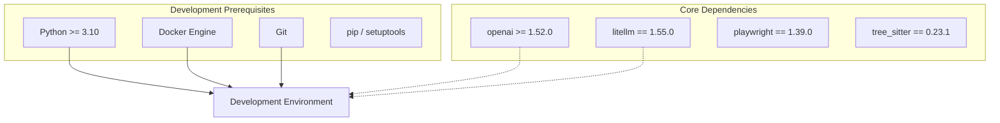
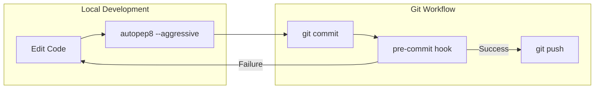
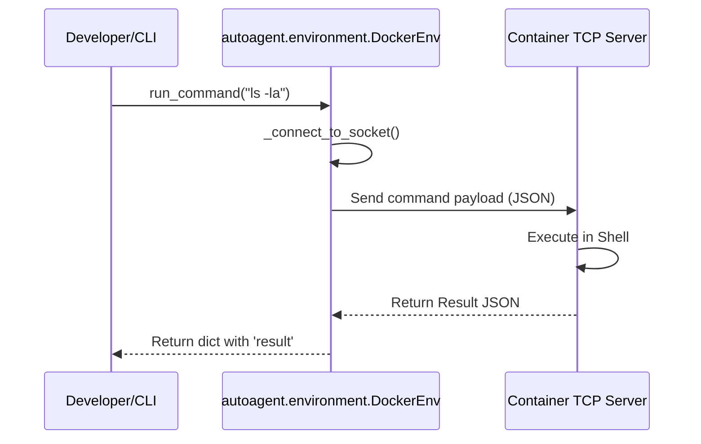

<!-- source: DeepWiki mcp.deepwiki.com · repo HKUDS/Auto-Deep-Research · page 5.2 Development Environment · fetched 2026-11-09 -->

# Development Environment

<details>
<summary>Relevant source files</summary>

The following files were used as context for generating this wiki page:

- [.gitignore](.gitignore)
- [MANIFEST.in](MANIFEST.in)
- [pyproject.toml](pyproject.toml)
- [setup.cfg](setup.cfg)

</details>


This page provides comprehensive guidelines for setting up a development environment for contributing to the Auto-Deep-Research project. It covers Python version requirements, dependency management via `setup.cfg`, pre-commit hooks, code formatting standards, and testing procedures.

## Prerequisites

Before setting up the development environment, ensure your system meets the following requirements:

- **Python**: Version 3.10 or higher [setup.cfg:71-71]()
- **Docker**: Required for the execution environment [autoagent/environment/docker_env.py:17-30]()
- **Git**: For version control and managing pre-commit hooks


**Title: Development Environment Prerequisites**

Sources: [setup.cfg:16-71](), [pyproject.toml:1-3]()

## Installation and Dependency Management

The project uses `setup.cfg` and `pyproject.toml` for declarative configuration and build instructions.

### 1. Development Install
To set up the environment for active development, use an editable install. This allows changes in the `autoagent/` directory to take effect immediately without re-installing the package.

```bash
# From the repository root
pip install -e .
```

### 2. Dependency Specification
Dependencies are strictly managed in `setup.cfg`. Key libraries include:
*   **Agent Core**: `instructor`, `pydantic`, `tenacity` [setup.cfg:23-57]()
*   **Environment**: `browsergym`, `playwright`, `Flask` [setup.cfg:26-47]()
*   **Analysis/RAG**: `chromadb`, `sentence_transformers`, `beautifulsoup4` [setup.cfg:25-65]()
*   **CLI/UI**: `click`, `rich`, `prompt_toolkit`, `inquirer` [setup.cfg:28-55]()

### 3. Entry Points
The `auto` command is registered as a console script pointing to the `cli` function in `autoagent/cli.py` [setup.cfg:73-75]().

Sources: [setup.cfg:10-75](), [pyproject.toml:1-3]()

## Code Quality and Formatting

The project enforces strict coding standards using `autopep8` and `pre-commit` hooks to ensure consistency across the codebase.

### Autopep8 Configuration
The project follows a 120-character line limit and uses aggressive formatting settings defined in `setup.cfg`:
*   `max_line_length = 120` [setup.cfg:77-77]()
*   `aggressive = 3` (Maximum level of non-manual formatting) [setup.cfg:81-81]()
*   `in-place = true` [setup.cfg:79-79]()

### Pre-commit Hooks
The `pre-commit` package is included in `install_requires` [setup.cfg:22-22](). Developers should initialize hooks to automatically run formatters and linters before every commit:

```bash
pre-commit install
```


**Title: Formatting and Commit Workflow**

Sources: [setup.cfg:76-81](), [setup.cfg:22-22]()

## Testing with Pytest

The project uses `pytest` for automated testing [setup.cfg:19-19](). 

### Running Tests
To run the test suite:
```bash
pytest
```

### Test Environment Isolation
The `.gitignore` file ensures that development artifacts do not interfere with the repository state. Key ignored patterns include:
*   `workplace_*/` and `workspace_*/`: Temporary agent execution directories [/.gitignore:1-2]()
*   `code_db/*`: Local vector databases [/.gitignore:4-4]()
*   `*.log` and `logs/*`: Execution logs [/.gitignore:3-9]()
*   `.env`: Local environment secrets [/.gitignore:25-25]()

Sources: [setup.cfg:19-19](), [/.gitignore:1-33]()

## Docker Development Integration

The `DockerEnv` class is the primary interface for managing the execution environment during development.

### Implementation Details
The `DockerEnv` class in `autoagent/environment/docker_env.py` handles the lifecycle of the container where tools are executed. It interacts with the Docker daemon to initialize containers and set up communication via a TCP socket [autoagent/environment/docker_env.py:17-152]().

### Communication Protocol
The host communicates with the container using a custom TCP server. The `run_command` method serializes commands and sends them to the container's port [autoagent/environment/docker_env.py:154-209]().


**Title: Docker Command Execution Flow**

Sources: [autoagent/environment/docker_env.py:17-209](), [setup.cfg:32-32]()

## Contributing Guidelines

1.  **Branching**: Create feature branches from `main`.
2.  **Formatting**: Ensure all files are formatted with `autopep8` as per `setup.cfg` [setup.cfg:76-81]().
3.  **Dependencies**: If adding a new dependency, update `install_requires` in `setup.cfg` [setup.cfg:16-65]().
4.  **Manifest**: Ensure any new non-python files (like templates or configs) are included in `MANIFEST.in` [MANIFEST.in:1-4]().
5.  **Cleanliness**: Verify that new temporary files are covered by `.gitignore` to prevent accidental commits of logs or workspaces [/.gitignore:1-33]().

Sources: [setup.cfg:1-81](), [MANIFEST.in:1-4](), [/.gitignore:1-33]()

---

