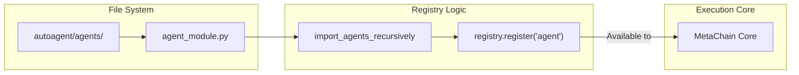

<!-- source: DeepWiki mcp.deepwiki.com · repo HKUDS/Auto-Deep-Research · page 5.3 Extending the System · fetched 2026-11-09 -->

# Extending the System

<details>
<summary>Relevant source files</summary>

The following files were used as context for generating this wiki page:

- [autoagent/registry.py](autoagent/registry.py)
- [autoagent/tools/__init__.py](autoagent/tools/__init__.py)
- [autoagent/tools/dummy_tool.py](autoagent/tools/dummy_tool.py)
- [autoagent/tools/inner.py](autoagent/tools/inner.py)
- [autoagent/tools/tool_utils.py](autoagent/tools/tool_utils.py)
- [autoagent/workflows/__init__.py](autoagent/workflows/__init__.py)

</details>


This page provides technical documentation on how to extend Auto-Deep-Research with new capabilities. The system is designed with extensibility in mind, allowing developers to add new tools, agents, and workflows through a centralized registration system.

## Extension Registry System

The core of the extension mechanism is the `Registry` class, which manages tools, agents, and workflows. It uses decorators to automatically collect and metadata-tag functions for use by the LLM agents.

```mermaid
graph TD
    subgraph "Code Entity Space"
        Reg["Registry Class"]
        RT["@register_tool"]
        RPT["@register_plugin_tool"]
        RA["@register_agent"]
        RW["@register_workflow"]
    end

    subgraph "Natural Language Space"
        TI["tools_info (FunctionInfo)"]
        AI["agents_info (FunctionInfo)"]
        WI["workflows_info (FunctionInfo)"]
    end

    RT -->|Stores in| Reg
    RPT -->|Wraps & Stores| Reg
    RA -->|Stores in| Reg
    RW -->|Stores in| Reg

    Reg -->|Generates| TI
    Reg -->|Generates| AI
    Reg -->|Generates| WI

    TI -->|Provides| "LLM Tool Definitions"
    AI -->|Provides| "Agent Descriptions"
```

Sources: [autoagent/registry.py:48-63](), [autoagent/registry.py:70-137]()

## Registering New Tools

Tools are the primary way agents interact with the environment. There are two main registration decorators: `@register_tool` and `@register_plugin_tool`.

### Tool Types and Decorators

| Decorator | Use Case | Key Features |
| :--- | :--- | :--- |
| `@register_tool` | Internal system tools. | Direct registration of the function. [autoagent/registry.py:70-87]() |
| `@register_plugin_tool` | User-defined or external tools. | Automatically wraps output with `truncate_output` to prevent context window overflow. [autoagent/registry.py:88-95]() |

### Implementation Details
When a tool is registered, the system uses `inspect` to extract:
*   **Function Signature**: Arguments and return types. [autoagent/registry.py:104-105]()
*   **Docstrings**: Used as the tool description for the LLM. [autoagent/registry.py:106]()
*   **Source Code**: The actual function body is stored in `FunctionInfo`. [autoagent/registry.py:109-114]()

### Example: Creating a Plugin Tool
To add a tool, create a file in `autoagent/tools/` and use the decorator:

```python
from autoagent.registry import register_plugin_tool

@register_plugin_tool("my_custom_tool")
def my_custom_tool(query: str, context_variables: dict):
    """
    Detailed description for the LLM.
    Args:
        query: The search string.
    """
    # Implementation logic
    return "Result string"
```
Sources: [autoagent/tools/dummy_tool.py:5-40](), [autoagent/registry.py:122-131]()

## Creating New Agents

Agents are registered similarly to tools but are stored in the `agents` registry. The system performs recursive discovery of agents in the `autoagent/agents/` directory.

### Agent Discovery Data Flow



Sources: [autoagent/registry.py:52-59](), [autoagent/registry.py:144-145]()

## Adding Workflows

Workflows represent complex, multi-step event-driven processes managed by the `Flow Engine`. They are registered using the `workflow` type in the registry.

*   **Recursive Import**: Workflows are automatically loaded from the `autoagent/workflows/` directory. [autoagent/workflows/__init__.py:5-34]()
*   **Registry Storage**: They are stored in `self._registry["workflows"]`. [autoagent/registry.py:55]()
*   **Metadata**: Workflow metadata is accessible via `workflows_info`. [autoagent/registry.py:176-177]()

## Output Management and Truncation

To ensure stability, the system enforces limits on tool outputs. If a tool registered via `@register_plugin_tool` returns a string exceeding `MAX_OUTPUT_LENGTH` (12,000 tokens), it is truncated.

*   **Tokenization**: Uses `tiktoken` for accurate gpt-4o token counting. [autoagent/registry.py:9-18]()
*   **Truncation Warning**: Appends a `[TOOL WARNING]` suggesting the user save output to the `workplace/` directory instead of returning it directly. [autoagent/registry.py:19-24]()
*   **Terminal Truncation**: A specialized utility `truncate_by_tokens` in `tool_utils.py` saves overflow content to a file in the Docker workplace and provides the file path to the agent. [autoagent/tools/tool_utils.py:6-23]()

Sources: [autoagent/registry.py:7-24](), [autoagent/tools/tool_utils.py:6-23]()

## Best Practices for Extensions

1.  **Context Variables**: Always include `context_variables` in tool arguments if you need access to the `DockerEnv` (passed as `code_env`). [autoagent/tools/dummy_tool.py:6-33]()
2.  **Return Types**: Tools can return a `str`, an `Agent` (for handoffs), or a `Result` object (to update context variables). [autoagent/tools/dummy_tool.py:18-36]()
3.  **Naming**: Ensure the registration name (e.g., `@register_tool("name")`) matches the function name for consistency in logs. [autoagent/tools/dummy_tool.py:5-6]()
4.  **Documentation**: Write clear docstrings as they are the primary "UI" for the LLM to understand how to use your extension. [autoagent/tools/inner.py:4-12]()

Sources: [autoagent/registry.py:106-127](), [autoagent/tools/dummy_tool.py:18-36]()

---

