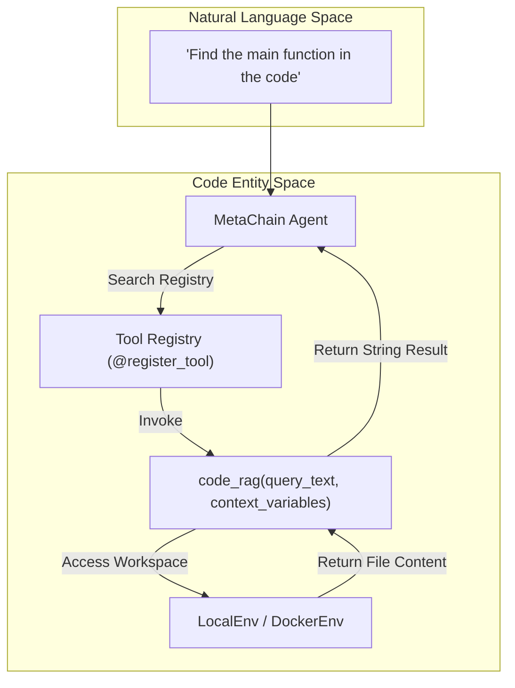
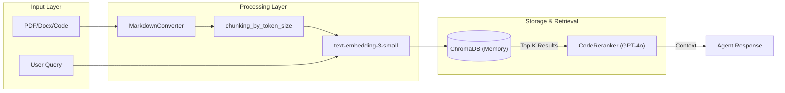

<!-- source: DeepWiki mcp.deepwiki.com · repo HKUDS/Auto-Deep-Research · page 5.4 Tool System · fetched 2026-11-09 -->

# Tool System

Relevant source files

The following files were used as context for generating this wiki page:

- [autoagent/tools/file_surfer_tool.py](autoagent/tools/file_surfer_tool.py)
- [autoagent/tools/md_obs.py](autoagent/tools/md_obs.py)
- [autoagent/tools/rag_code.py](autoagent/tools/rag_code.py)
- [autoagent/tools/rag_tools.py](autoagent/tools/rag_tools.py)
- [autoagent/tools/terminal_tools.py](autoagent/tools/terminal_tools.py)
- [autoagent/tools/web_tools.py](autoagent/tools/web_tools.py)

The Tool System in Auto-Deep-Research provides a robust library of capabilities that allow agents to interact with the external world, including web browsing, terminal execution, file manipulation, and knowledge retrieval via RAG. Tools are managed through a central registry pattern, enabling seamless integration into the MetaChain execution loop.

## Tool Registry Pattern

The system employs a decorator-based registry pattern to expose Python functions as tools to LLM agents. This decoupling allows developers to define tools in specialized modules while making them globally discoverable by the agent system.

*   **`@register_tool`**: Registers a function as a standard tool available to agents [autoagent/registry.py:1-10]().
*   **`@register_plugin_tool`**: Specifically used for tools intended to be used as plugins in complex workflows [autoagent/tools/rag_tools.py:19-20]().
*   **Context Injection**: Many tools use the `context_variables` argument to access shared state, such as environment instances (`file_env`, `code_env`, `memo`) [autoagent/tools/file_surfer_tool.py:74-75]().

### Data Flow: Tool Execution
The following diagram illustrates how a natural language request is transformed into a tool call and executed within the system.

**Natural Language to Tool Execution Flow**

Sources: [autoagent/tools/rag_code.py:7-16](), [autoagent/registry.py:1-10](), [autoagent/core.py:100-150]()

---

## Web Surfer Tools (`web_tools.py`)

The web tools leverage `browsergym` and `BrowserEnv` to provide high-level browser automation. Observations are converted into a simplified "Accessibility Tree" or Markdown format to save tokens while preserving structural information.

| Tool Name | Description | Key Code Entity |
| :--- | :--- | :--- |
| `search` | Performs a Google search and navigates to the results page. | `search()` [autoagent/tools/web_tools.py:214]() |
| `click` | Clicks an element identified by its `bid` (Browsergym ID). | `click()` [autoagent/tools/web_tools.py:157]() |
| `type_text` | Types text into a specific input field. | `type_text()` [autoagent/tools/web_tools.py:238]() |
| `scroll` | Scrolls the page in a specified direction. | `scroll()` [autoagent/tools/web_tools.py:311]() |

### Observation Processing
The system uses `flatten_md_axtree_to_str` to convert the browser's DOM/Accessibility tree into a readable format for the LLM [autoagent/tools/md_obs.py:3-22](). This includes filtering visible elements and mapping them to `bid` attributes for subsequent interaction [autoagent/tools/web_tools.py:134-139]().

Sources: [autoagent/tools/web_tools.py:1-152](), [autoagent/tools/md_obs.py:1-150]()

---

## Terminal Tools (`terminal_tools.py`)

Terminal tools allow agents to execute shell commands within a controlled environment (usually a Docker container).

*   **Output Management**: Large terminal outputs are handled by a virtual browser (`RequestsMarkdownBrowser`) that paginates the text [autoagent/tools/terminal_tools.py:22-47]().
*   **Pagination Tools**:
    *   `terminal_page_up`: Scrolls up in the command output [autoagent/tools/terminal_tools.py:67-71]().
    *   `terminal_page_down`: Scrolls down [autoagent/tools/terminal_tools.py:80-84]().
    *   `terminal_page_to`: Jumps to a specific page, useful for skipping long progress bars [autoagent/tools/terminal_tools.py:92-97]().
*   **Execution Wrappers**: The `@process_terminal_response` decorator captures `stdout`, `stderr`, and exit status, formatting them into a consistent string for the agent [autoagent/tools/terminal_tools.py:141-155]().

Sources: [autoagent/tools/terminal_tools.py:1-160]()

---

## File Surfer Tool (`file_surfer_tool.py`)

This tool provides a text-based interface for browsing and reading local files. It is primarily used by the `File Surfer Agent`.

*   **`open_local_file`**: Loads a file into the `file_env` (a `RequestsMarkdownBrowser` instance) and returns the first viewport of text [autoagent/tools/file_surfer_tool.py:66-84]().
*   **Navigation**: Includes `page_up_markdown`, `page_down_markdown`, and `find_on_page_ctrl_f` (regex/string search) [autoagent/tools/file_surfer_tool.py:88-134]().
*   **Multimodal Support**: Includes an `_encode_image` utility to process visual data within files if the model supports it [autoagent/tools/file_surfer_tool.py:151-185]().

Sources: [autoagent/tools/file_surfer_tool.py:1-150]()

---

## RAG Tools (`rag_tools.py` & `rag_code.py`)

Retrieval-Augmented Generation tools enable searching through large document sets or codebases.

### Code RAG
The `code_rag` tool indexes the project directory using `CodeMemory`. It performs token-based chunking and utilizes a `CodeReranker` (typically `gpt-4o`) to ensure the most relevant code snippets are returned [autoagent/tools/rag_code.py:7-29]().

### Document RAG
General document RAG involves two primary steps:
1.  **`save_raw_docs_to_vector_db`**: Converts PDF, Docx, or TXT files into chunks (default 4096 tokens) and stores them in a ChromaDB-backed `Memory` [autoagent/tools/rag_tools.py:19-34]().
2.  **`query_db`**: Performs semantic search against a named collection to retrieve relevant text [autoagent/tools/rag_tools.py:121-139]().

**RAG System Architecture**

Sources: [autoagent/tools/rag_tools.py:85-116](), [autoagent/tools/rag_code.py:17-29](), [autoagent/memory/rag_memory.py:1-20]()

Sources: [autoagent/tools/rag_tools.py:1-140](), [autoagent/tools/rag_code.py:1-30]()

---

