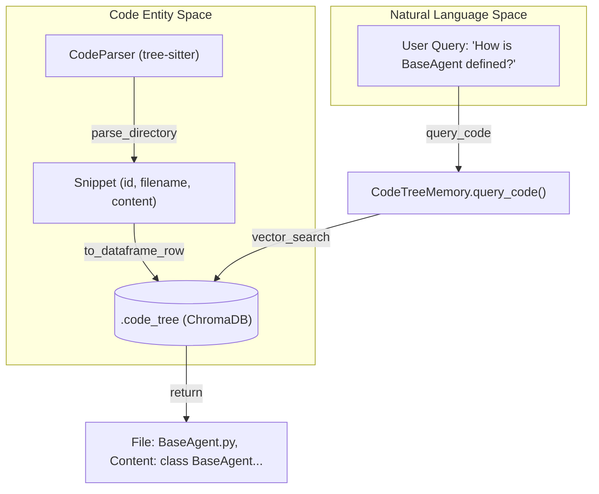
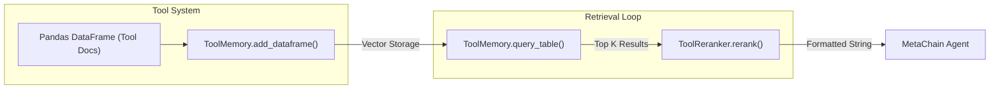

<!-- source: DeepWiki mcp.deepwiki.com · repo HKUDS/Auto-Deep-Research · page 5.5 Memory System · fetched 2026-11-09 -->

# Memory System

Relevant source files

The following files were used as context for generating this wiki page:

- [autoagent/memory/__init__.py](autoagent/memory/__init__.py)
- [autoagent/memory/code_memory.py](autoagent/memory/code_memory.py)
- [autoagent/memory/code_tree/code_parser.py](autoagent/memory/code_tree/code_parser.py)
- [autoagent/memory/codetree_memory.py](autoagent/memory/codetree_memory.py)
- [autoagent/memory/paper_memory.py](autoagent/memory/paper_memory.py)
- [autoagent/memory/rag_memory.py](autoagent/memory/rag_memory.py)
- [autoagent/memory/tool_memory.py](autoagent/memory/tool_memory.py)
- [autoagent/memory/utils.py](autoagent/memory/utils.py)

The Memory System in Auto-Deep-Research provides a robust Retrieval-Augmented Generation (RAG) infrastructure. It is designed to manage diverse data types, including raw source code, technical papers, and tool documentation, using vector databases for semantic search and LLM-based reranking for precision.

## Core RAG Infrastructure

The foundation of the memory system is the `Memory` class, which interfaces with **ChromaDB** to provide persistent vector storage and retrieval capabilities.

### The Memory Class
The `Memory` class handles the lifecycle of vector collections, including initialization, embedding generation, and querying [autoagent/memory/rag_memory.py:14-30](). It supports both OpenAI embeddings (e.g., `text-embedding-3-small`) and local SentenceTransformer models [autoagent/memory/rag_memory.py:38-43]().

Key methods include:
*   `add_query`: Encodes and inserts documents into a specified collection with metadata like timestamps [autoagent/memory/rag_memory.py:45-85]().
*   `query`: Performs a vector similarity search and returns the top-$k$ results [autoagent/memory/rag_memory.py:87-115]().
*   `delete`/`reset`: Manages collection cleanup and database resets [autoagent/memory/rag_memory.py:147-172]().

### Reranking Mechanism
To improve retrieval quality, the system employs a `Reranker` abstract base class [autoagent/memory/rag_memory.py:174-179](). Subclasses implement specific logic to take raw vector search results and re-order them using an LLM to ensure the most contextually relevant information is presented to the agent.

**Sources:** [autoagent/memory/rag_memory.py:14-179]()

---

## Code Memory and Parsing

The system implements specialized memory for codebases, allowing agents to "understand" project structures and locate specific definitions.

### CodeTreeMemory and Tree-Sitter
The `CodeTreeMemory` class uses the **Tree-sitter** library to parse source code into an Abstract Syntax Tree (AST). This allows the system to extract specific code entities like `class_definition` and `function_definition` rather than treating code as raw text [autoagent/memory/codetree_memory.py:33-37]().

### Data Flow: Code to Vector Space
1.  **Parsing**: `CodeParser` walks the directory and uses `tree-sitter` to extract snippets [autoagent/memory/code_tree/code_parser.py:19-77]().
2.  **Embedding**: Snippets are converted to vectors via `OpenAI` embeddings [autoagent/memory/codetree_memory.py:43-50]().
3.  **Storage**: Snippets, metadata (filename, language), and embeddings are stored in ChromaDB [autoagent/memory/codetree_memory.py:61-66]().

**Code Entity Mapping Diagram**

**Sources:** [autoagent/memory/codetree_memory.py:11-88](), [autoagent/memory/code_tree/code_parser.py:8-123]()

---

## Specialized Memory Modules

### Paper Memory (TextMemory)
The `TextMemory` class is optimized for long-form documents like research papers. It utilizes a token-based chunking utility to split large texts into manageable segments while maintaining context through overlaps [autoagent/memory/paper_memory.py:10-26]().
*   **Chunking**: Uses `chunking_by_token_size` with a default `max_token_size` of 4096 tokens [autoagent/memory/paper_memory.py:31]().
*   **Batching**: Supports batch insertion to handle large documents efficiently [autoagent/memory/paper_memory.py:45-54]().

### Tool Memory
`ToolMemory` manages documentation for available APIs and tools. It stores tool definitions (Name, Description, Details) in a structured format within the vector DB [autoagent/memory/tool_memory.py:12-28]().
*   **ToolReranker**: A specialized reranker that uses an LLM to select the top 5 most relevant APIs based on a `RerankResult` Pydantic schema [autoagent/memory/tool_memory.py:83-123]().

**Tool Retrieval Workflow**

**Sources:** [autoagent/memory/paper_memory.py:10-81](), [autoagent/memory/tool_memory.py:12-164]()

---

## Utility Functions

The memory system relies on `autoagent/memory/utils.py` for text processing:
*   **Tiktoken Integration**: Uses `tiktoken` for accurate token counting and encoding/decoding [autoagent/memory/utils.py:4-17]().
*   **Sliding Window Chunking**: The `chunking_by_token_size` function implements a sliding window with configurable `overlap_token_size` (default 128) to ensure semantic continuity across chunks [autoagent/memory/utils.py:18-36]().

| Function | Purpose | Default Model |
| :--- | :--- | :--- |
| `encode_string_by_tiktoken` | Converts text to token IDs | `gpt-4o` |
| `decode_tokens_by_tiktoken` | Converts token IDs back to text | `gpt-4o` |
| `chunking_by_token_size` | Slices text into overlapping chunks | `gpt-4o` |

**Sources:** [autoagent/memory/utils.py:1-36]()

---

