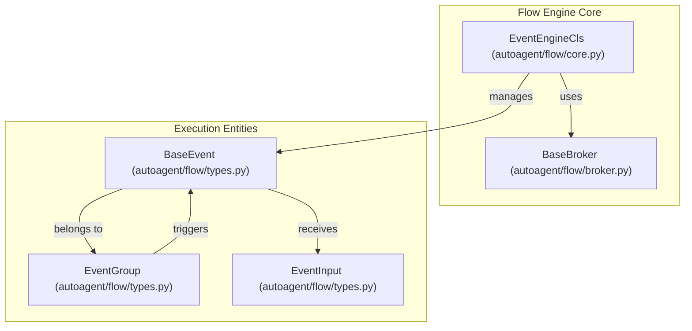
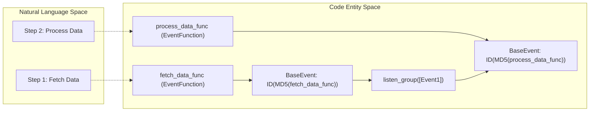
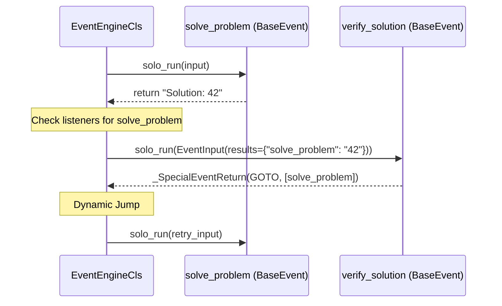

<!-- source: DeepWiki mcp.deepwiki.com · repo HKUDS/Auto-Deep-Research · page 5.6 Flow Engine · fetched 2026-11-09 -->

# Flow Engine

Relevant source files

The following files were used as context for generating this wiki page:

- [autoagent/flow/__init__.py](autoagent/flow/__init__.py)
- [autoagent/flow/broker.py](autoagent/flow/broker.py)
- [autoagent/flow/core.py](autoagent/flow/core.py)
- [autoagent/flow/dynamic.py](autoagent/flow/dynamic.py)
- [autoagent/flow/types.py](autoagent/flow/types.py)
- [autoagent/flow/utils.py](autoagent/flow/utils.py)

The **Flow Engine** is an asynchronous event orchestration system located in `autoagent/flow/`. It provides a structured framework for defining complex, multi-step agentic workflows where events trigger based on the completion of other events or groups of events. It supports dynamic branching, re-triggering logic, and asynchronous task management.

## Core Architecture

The system is built around an event-driven model where `BaseEvent` objects represent units of work (coroutine functions), and `EventEngineCls` manages the lifecycle and execution of these units.

### Key Classes and Data Structures

| Class | Description |
| :--- | :--- |
| `EventEngineCls` | The main orchestrator that manages event registration, group listening, and execution flow. |
| `BaseEvent` | A wrapper around an asynchronous function (`EventFunction`). It holds unique identifiers based on the function's source code. |
| `EventGroup` | Defines a collection of events that a downstream event is "listening" to. |
| `EventInput` | The data structure passed to an event, containing results from the triggering group and metadata. |
| `ReturnBehavior` | An Enum defining how the engine should handle an event's return value (`DISPATCH`, `GOTO`, `ABORT`, `INPUT`). |

### Event Engine Entities
The following diagram maps the logical flow components to their implementation classes.

Sources: [autoagent/flow/core.py:17-21](), [autoagent/flow/types.py:15-100](), [autoagent/flow/broker.py:6-12]()

---

## Event Registration and Listening

Events are created from coroutine functions using `make_event`. The engine uses a decorator pattern, `listen_group`, to establish dependencies between events.

### Mechanism
1.  **Event Creation**: `make_event` validates that the input is a coroutine and generates a unique ID based on the function's MD5 hash [autoagent/flow/core.py:30-39]().
2.  **Dependency Definition**: `listen_group` takes a list of `BaseEvent` markers. The decorated event will only execute once the markers in that group have completed [autoagent/flow/core.py:41-78]().
3.  **Retrigger Logic**: The `retrigger_type` (either `"all"` or `"any"`) determines if the downstream event should fire every time a parent finishes or only when the entire group is ready [autoagent/flow/core.py:45-68]().

### Event Dependency Mapping
This diagram shows how code-level functions are transformed into a directed graph of events.

Sources: [autoagent/flow/core.py:30-78](), [autoagent/flow/types.py:84-99](), [autoagent/flow/utils.py:47-48]()

---

## Execution Loop: `invoke_event`

The `invoke_event` method in `EventEngineCls` is the primary entry point for starting a workflow. It manages an internal queue of events and an asynchronous task set.

### Workflow Execution Steps
1.  **Queue Initialization**: The starting event and its input are added to a `queue` [autoagent/flow/core.py:91]().
2.  **Task Spawning**: The engine pulls events from the queue and wraps them in `asyncio.create_task` using the `run_event` helper [autoagent/flow/core.py:160-164]().
3.  **Solo Execution**: `current_event.solo_run` is called to execute the underlying `EventFunction` [autoagent/flow/core.py:96]().
4.  **Result Dispatching**:
    *   If the result is a standard object, the engine searches `__event_maps` for downstream events listening to the current event's ID [autoagent/flow/core.py:116-120]().
    *   It checks if the entire `EventGroup` requirements are met (context coverage) before adding the next event to the queue [autoagent/flow/core.py:121-151]().
5.  **Special Behaviors**: If the function returns a `_SpecialEventReturn`, the engine modifies its traversal [autoagent/flow/core.py:101-114]().

Sources: [autoagent/flow/core.py:83-165](), [autoagent/flow/types.py:109-112]()

---

## Dynamic Flows and Branching

The engine supports non-linear execution through `ReturnBehavior`. This allows agents to skip steps or jump to specific parts of the workflow dynamically.

### Return Behaviors
Defined in `autoagent/flow/types.py` and implemented via helper functions in `autoagent/flow/dynamic.py`:

*   **`GOTO`**: Triggered by `goto_events(group_markers, any_return)`. It forces the engine to immediately queue specific events, bypassing the standard dependency graph [autoagent/flow/dynamic.py:9-14]().
*   **`ABORT`**: Triggered by `abort_this()`. It stops the current branch of execution without triggering downstream listeners [autoagent/flow/dynamic.py:17-18]().
*   **`DISPATCH`**: The default behavior where the engine follows the `listen_group` definitions [autoagent/flow/types.py:16]().

Sources: [autoagent/flow/types.py:15-20](), [autoagent/flow/dynamic.py:1-19](), [autoagent/flow/core.py:102-114]()

---

## Broker Pattern

The `BaseBroker` class in `autoagent/flow/broker.py` provides an abstraction for task persistence and external callbacks. While the `default_drive` uses a basic broker, this can be extended to support:
*   Appending tasks to a persistent database [autoagent/flow/broker.py:7-8]().
*   Handling callbacks after a run is completed to notify external systems [autoagent/flow/broker.py:10-11]().

Sources: [autoagent/flow/broker.py:6-12](), [autoagent/flow/core.py:18-20]()

---

## Concrete Example: Math Solver Workflow

In a typical implementation (like a math solver), the flow engine orchestrates the following logic:

1.  **Initialization**: An `EventEngineCls` instance is created.
2.  **Event Definition**:
    *   `solve_problem`: An event that attempts to solve a math query.
    *   `verify_solution`: An event decorated with `@engine.listen_group([solve_problem])`.
3.  **Execution**:
    *   `solve_problem` runs and returns a result.
    *   The engine sees `verify_solution` is listening to `solve_problem`.
    *   The engine packages the result into an `EventInput` and queues `verify_solution`.
    *   If `verify_solution` finds an error, it can use `goto_events([solve_problem])` to retry the calculation with feedback.

Sources: [autoagent/flow/core.py:93-112](), [autoagent/flow/dynamic.py:9-14](), [autoagent/flow/types.py:44-52]()

---

