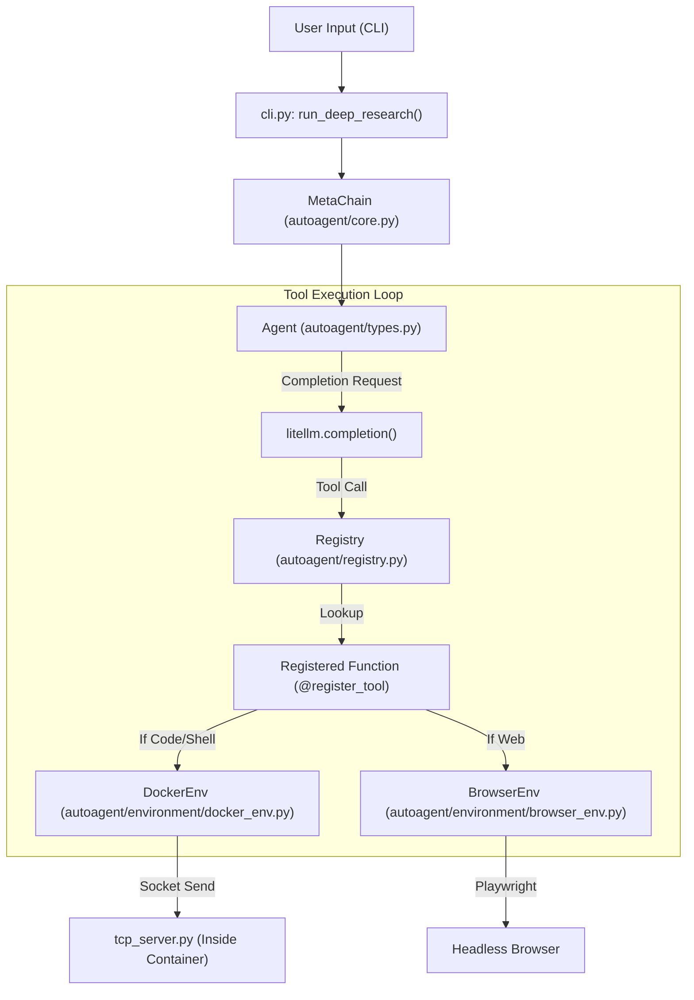
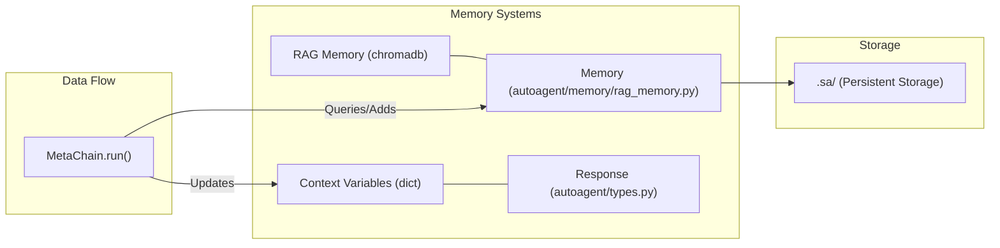

<!-- source: DeepWiki mcp.deepwiki.com · repo HKUDS/Auto-Deep-Research · page 6 Glossary · fetched 2026-11-09 -->

# Glossary

Relevant source files

The following files were used as context for generating this wiki page:

- [.env.template](.env.template)
- [README.md](README.md)
- [assets/logo.jpg](assets/logo.jpg)
- [autoagent/core.py](autoagent/core.py)
- [autoagent/environment/browser_env.py](autoagent/environment/browser_env.py)
- [autoagent/environment/docker_env.py](autoagent/environment/docker_env.py)
- [autoagent/flow/core.py](autoagent/flow/core.py)
- [autoagent/fn_call_converter.py](autoagent/fn_call_converter.py)
- [autoagent/memory/rag_memory.py](autoagent/memory/rag_memory.py)
- [autoagent/registry.py](autoagent/registry.py)
- [autoagent/types.py](autoagent/types.py)
- [constant.py](constant.py)

This page provides definitions and implementation details for codebase-specific terms, jargon, and architectural concepts used in Auto-Deep-Research.

## Core System Terms

### MetaChain
The central execution engine of the Auto-Deep-Research framework. It manages the agentic loop, handles tool calls, and orchestrates state transitions between different agents. It is designed to be provider-agnostic, utilizing `litellm` for completions.
*   **Implementation**: Defined in `MetaChain` class [autoagent/core.py:58-59]().
*   **Key Function**: `run()` (and `run_async`) which iterates through the `Agent` responses and executes tool calls until a final response is reached or a handoff occurs [autoagent/core.py:210-230]().

### Agent
A specialized LLM configuration that includes a specific system prompt (`instructions`), a set of available `functions` (tools), and a target `model`.
*   **Implementation**: Defined as a Pydantic model in `Agent` [autoagent/types.py:10-19]().
*   **Attributes**: Includes `tool_choice` and `parallel_tool_calls` to control LLM behavior [autoagent/types.py:15-16]().

### Handoff (Transfer)
The mechanism by which one agent "transfers" control to another. This is implemented by an agent function returning another `Agent` instance. The `MetaChain` detects this return type and updates the active agent in the loop.
*   **Logic**: Handled within the tool execution logic of `MetaChain` [autoagent/core.py:255-265]().

### Registry
A singleton system used to track and retrieve all available tools, agents, and workflows. It uses decorators to catalog functions and their metadata (docstrings, arguments).
*   **Implementation**: `Registry` class [autoagent/registry.py:48-68]().
*   **Decorators**: `@register("tool")`, `@register("agent")`, etc. [autoagent/registry.py:70-73]().

---

## Environment & Infrastructure

### DockerEnv
The abstraction layer for managing the containerized execution environment. It ensures that all code execution and file manipulations happen in a sandboxed Docker container rather than the host machine.
*   **Implementation**: `DockerEnv` class [autoagent/environment/docker_env.py:30-44]().
*   **Workplace**: The `local_workplace` on the host is mounted to `docker_workplace` inside the container [autoagent/environment/docker_env.py:110-111]().

### TCP Server (`tcp_server.py`)
A script that runs inside the Docker container to listen for commands from the host via a TCP socket. This allows the `DockerEnv` to execute shell commands and manage files within the sandbox.
*   **Source**: Downloaded automatically during container initialization [autoagent/environment/docker_env.py:50-60]().

### BrowserEnv
A gymnasium-based environment that uses Playwright and `browsergym` to allow agents to interact with the web. It handles navigation, element interaction, and markdown conversion of web pages.
*   **Implementation**: `autoagent/environment/browser_env.py` [autoagent/environment/browser_env.py:1-40]().

---

## LLM Interaction Modes

### FN_CALL (Function Calling)
A boolean flag indicating if the system should use the LLM provider's native function-calling API (e.g., OpenAI's `tools`).
*   **Configuration**: Set in `constant.py` based on model support [constant.py:55-79]().

### NON_FN_CALL (Non-Function Calling Fallback)
A mode for models that do not natively support function calling (e.g., DeepSeek-R1, O1-mini). In this mode, `MetaChain` injects a specific XML-like prompt format into the system message to instruct the model on how to call tools.
*   **Logic**: Uses `convert_tools_to_description` and `SYSTEM_PROMPT_SUFFIX_TEMPLATE` [autoagent/fn_call_converter.py:35-58]().
*   **Parsing**: The response is parsed back into standard `tool_calls` objects via `convert_non_fncall_messages_to_fncall_messages` [autoagent/core.py:161-162]().

---

## Architecture Diagrams

### From Natural Language to Code Entities: Execution Flow
The following diagram bridges the user's intent to the specific code classes and functions responsible for execution.

**Sources**: [autoagent/core.py:58-100](), [autoagent/registry.py:48-73](), [autoagent/environment/docker_env.py:108-115](), [autoagent/environment/browser_env.py:59-90]().

### Memory and State Management
This diagram shows how different memory types are associated with specific code entities.

**Sources**: [autoagent/memory/rag_memory.py:14-36](), [autoagent/types.py:22-26](), [autoagent/core.py:210-220]().

---

## Technical Terms Table

| Term | Definition | Code Pointer |
| :--- | :--- | :--- |
| **Context Variables** | A dictionary passed between agent functions to maintain state across different agents. | `autoagent/types.py:25` |
| **System Triage** | The primary agent responsible for routing the user request to specialized agents (File/Web/Program). | `autoagent/agents/system_agents.py` |
| **Result** | The return type of an agent function, containing the string value and optional agent handoff. | `autoagent/types.py:28-42` |
| **Stop Words** | Sequences used in `NON_FN_CALL` mode to stop generation after a tool call is detected. | `autoagent/fn_call_converter.py:60` |
| **Tiktoken** | Used for calculating token counts and truncating tool outputs to prevent context overflow. | `autoagent/registry.py:9-24` |
| **Base Images** | The Docker images used for the sandbox, selected based on machine architecture (AMD64 vs ARM). | `constant.py:37-46` |

**Sources**: [autoagent/types.py:25](), [autoagent/types.py:28-42](), [autoagent/fn_call_converter.py:60](), [autoagent/registry.py:9-24](), [constant.py:37-46]().