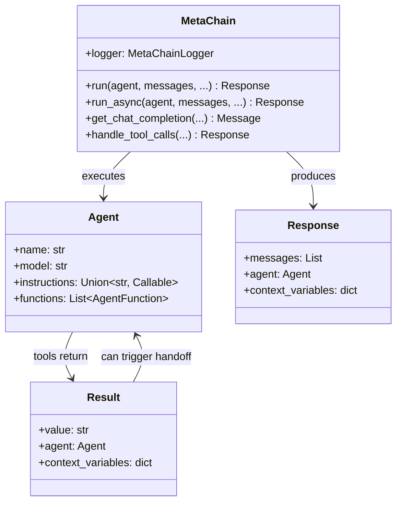
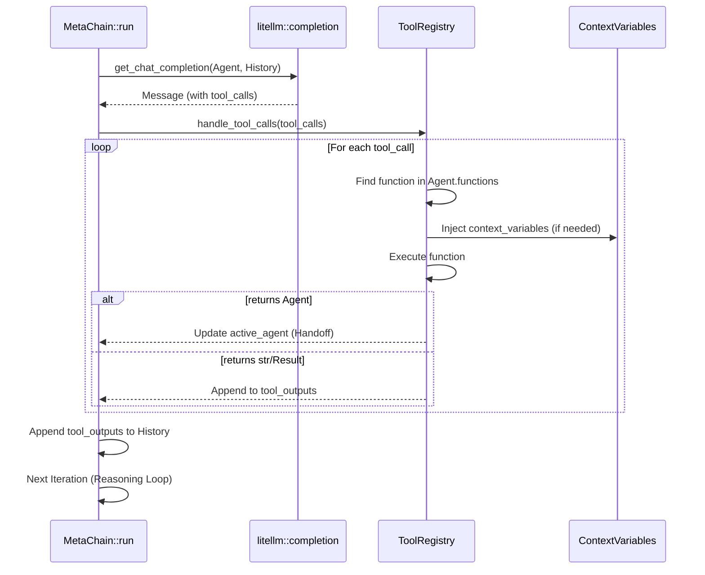

<!-- source: DeepWiki mcp.deepwiki.com · repo HKUDS/Auto-Deep-Research · extra page MetaChain Core Engine · fetched 2026-11-09 -->

# MetaChain Core Engine

Relevant source files

The following files were used as context for generating this wiki page:

- [autoagent/core.py](autoagent/core.py)
- [autoagent/fn_call_converter.py](autoagent/fn_call_converter.py)
- [autoagent/main.py](autoagent/main.py)
- [autoagent/types.py](autoagent/types.py)

The **MetaChain Core Engine** is the central orchestration component of the Auto-Deep-Research system. Implemented primarily via the `MetaChain` class in `autoagent/core.py`, it manages the lifecycle of agent interactions, including message history maintenance, tool execution, agent handoffs, and LLM communication. It serves as the runtime that executes the "reasoning loop" for all agents in the system.

Sources: [autoagent/core.py:58-68](), [autoagent/types.py:10-26]()

## Core Execution Methods

The `MetaChain` class provides three primary entry points for executing an agent's logic. These methods handle the transition from a user query to a final `Response` object.

| Method | Type | Description |
| :--- | :--- | :--- |
| `run` | Synchronous | The standard execution loop. It blocks until the agent completes its task or reaches the `max_turns` limit. |
| `run_async` | Asynchronous | The async version of `run`, utilizing `litellm.acompletion` for non-blocking I/O. |
| `run_and_stream` | Streaming | Provides a generator that yields partial responses and tool call updates in real-time. |

### The Reasoning Loop (`run`/`run_async`)
The core logic follows a continuous loop:
1. **Completion**: Call the LLM using `get_chat_completion` to get the next `Message`.
2. **Processing**: Append the message to the history.
3. **Tool Handling**: If the message contains `tool_calls`, iterate through them and execute the corresponding functions.
4. **Handoff**: If a tool returns an `Agent` object instead of a string, the active agent is swapped (handoff).
5. **Termination**: Stop if there are no tool calls or if the `max_turns` limit is reached.

Sources: [autoagent/core.py:284-330](), [autoagent/core.py:340-390]()

## Implementation Architecture

The following diagram illustrates the relationship between the `MetaChain` engine and the data entities defined in `types.py`.

### MetaChain Entity Relationship

Sources: [autoagent/core.py:58-85](), [autoagent/types.py:10-42]()

## Tool Call Handling & Agent Handoff

When the LLM triggers a tool call, `MetaChain` looks up the function in the `Agent.functions` list. 

### Execution Flow
1. **Function Lookup**: Matches the tool name to the function in the agent's registry [autoagent/core.py:214-220]().
2. **Argument Parsing**: Decodes JSON arguments provided by the LLM [autoagent/core.py:221-224]().
3. **Context Injection**: If the function signature includes `context_variables`, the engine injects the current state [autoagent/core.py:228-232]().
4. **Result Processing**:
    - If the function returns a `str`, it is wrapped in a `Result` [autoagent/core.py:246-248]().
    - If it returns an `Agent`, it signals a **Handoff**, and the `active_agent` is updated [autoagent/core.py:249-251]().
    - If it returns a `Result` object, the engine merges its `context_variables` into the global state [autoagent/core.py:252-258]().

### Handoff Mechanism
Handoffs occur when a tool (often a "transfer" function) returns a new `Agent` instance. The `MetaChain` loop detects this change in the `active_agent` variable and continues the next iteration of the loop using the new agent's instructions and toolset.

Sources: [autoagent/core.py:210-265](), [autoagent/types.py:7-18]()

## Non-Function-Calling Fallback

For models that do not natively support OpenAI-style function calling (e.g., certain versions of DeepSeek or smaller open-source models), `MetaChain` implements a fallback mechanism.

1. **Flag Check**: Triggered when `FN_CALL` is set to `False` in the environment [autoagent/core.py:106-132]().
2. **Prompt Injection**: Uses `convert_tools_to_description` to transform JSON tool definitions into a natural language system prompt suffix [autoagent/core.py:136-137]().
3. **Template**: The `SYSTEM_PROMPT_SUFFIX_TEMPLATE` instructs the model to output tool calls in a specific XML-like format: `<function=...> <parameter=...>...</parameter> </function>` [autoagent/fn_call_converter.py:35-58]().
4. **Conversion**: After receiving the raw text response, `convert_non_fncall_messages_to_fncall_messages` parses the XML back into standard `ChatCompletionMessageToolCall` objects so the rest of the engine remains agnostic to the model's capabilities [autoagent/core.py:161-163]().

Sources: [autoagent/core.py:133-165](), [autoagent/fn_call_converter.py:1-58]()

## Error Retry Logic

`MetaChain` utilizes the `tenacity` library to handle transient API failures and network issues.

### Retry Strategy
The `get_chat_completion` method is decorated with a retry policy:
- **Max Attempts**: 4 [autoagent/core.py:72]().
- **Wait Time**: Exponential backoff (min 4s, max 60s) [autoagent/core.py:73]().
- **Retry Condition**: Defined in `should_retry_error`, which filters for `APIError`, `RemoteProtocolError`, `ConnectError`, and specific substrings like "timeout" or "connection error" [autoagent/core.py:38-54]().

### MetaChain Reasoning Loop Sequence

Sources: [autoagent/core.py:71-85](), [autoagent/core.py:210-265](), [autoagent/core.py:340-390]()

## Logger Integration
The engine uses a `LoggerManager` to retrieve a `MetaChainLogger`. Every step of the execution—including instructions, tool calls, tool results, and agent handoffs—is logged. If a log path is not provided, it defaults to a standard output logger.

Sources: [autoagent/core.py:56-68](), [autoagent/logger.py:21-25]()

---

