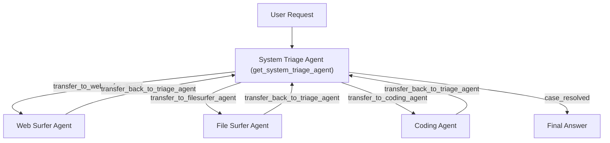
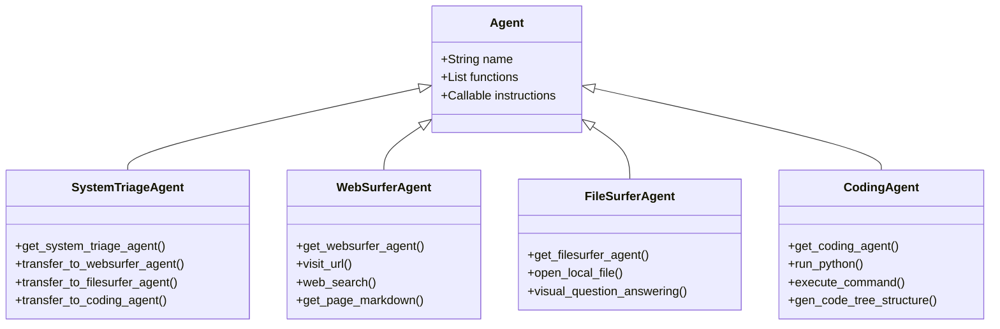

<!-- source: DeepWiki mcp.deepwiki.com · repo HKUDS/Auto-Deep-Research · extra page System Agents · fetched 2026-11-09 -->

# System Agents

Relevant source files

The following files were used as context for generating this wiki page:

- [autoagent/agents/system_agent/filesurfer_agent.py](autoagent/agents/system_agent/filesurfer_agent.py)
- [autoagent/agents/system_agent/programming_agent.py](autoagent/agents/system_agent/programming_agent.py)
- [autoagent/agents/system_agent/system_triage_agent.py](autoagent/agents/system_agent/system_triage_agent.py)
- [autoagent/agents/system_agent/websurfer_agent.py](autoagent/agents/system_agent/websurfer_agent.py)

System Agents are the specialized workers within the Auto-Deep-Research ecosystem. The architecture employs a **hub-and-spoke model** where a central "Triage Agent" coordinates tasks and delegates them to specialized agents with distinct environmental access and toolsets. This separation of concerns allows for robust handling of diverse research tasks including web navigation, file manipulation, and complex code execution.

### Agent Handoff Mechanism

The system uses a "Transfer Function" pattern to move the conversation state between agents. When an agent determines that a task (or sub-task) requires the capabilities of another agent, it calls a specific transfer function that returns a `Result` object containing the target `Agent` instance [autoagent/agents/system_agent/system_triage_agent.py:39-54]().

**Agent Routing Architecture**

| From Agent | To Agent | Transfer Function | Purpose |
| :--- | :--- | :--- | :--- |
| **System Triage Agent** | Web Surfer Agent | `transfer_to_websurfer_agent` | Navigate the internet or search for info. |
| **System Triage Agent** | File Surfer Agent | `transfer_to_filesurfer_agent` | Read/Analyze local files in the workspace. |
| **System Triage Agent** | Coding Agent | `transfer_to_coding_agent` | Execute code, solve math, or process data. |
| **Any Sub-Agent** | System Triage Agent | `transfer_back_to_triage_agent` | Return control after task completion/failure. |

**Sources:** [autoagent/agents/system_agent/system_triage_agent.py:39-64](), [autoagent/types.py:1-10]()

---

### 1. System Triage Agent
The `System Triage Agent` acts as the central router and supervisor. It does not perform domain-specific tasks like browsing or coding directly; instead, it analyzes the user's request and the current context to decide which specialized agent is best suited for the next step [autoagent/agents/system_agent/system_triage_agent.py:11-12]().

*   **Implementation**: Defined in `get_system_triage_agent` [autoagent/agents/system_agent/system_triage_agent.py:8]().
*   **Key Responsibility**: Orchestrate the workflow and determine when a case is fully resolved via `case_resolved` or `case_not_resolved` tools [autoagent/agents/system_agent/system_triage_agent.py:30-35]().
*   **Data Flow**: It receives a `task_status` from sub-agents and provides a `sub_task_description` when delegating [autoagent/agents/system_agent/system_triage_agent.py:39-54]().

**Triage Routing Logic**
Title: System Triage Hub-and-Spoke Routing

**Sources:** [autoagent/agents/system_agent/system_triage_agent.py:8-64](), [autoagent/tools/inner.py:6-6]()

---

### 2. Web Surfer Agent
The `Web Surfer Agent` is responsible for all external network interactions and browser automation. It operates within a `BrowserEnv` and uses a set of tools to interact with web pages as a human would [autoagent/agents/system_agent/websurfer_agent.py:13-15]().

*   **Implementation**: Defined in `get_websurfer_agent` [autoagent/agents/system_agent/websurfer_agent.py:8]().
*   **Capabilities**: Search, URL visitation, clicking, scrolling, and inputting text [autoagent/agents/system_agent/websurfer_agent.py:24]().
*   **Special Handling**: 
    *   **Markdown Conversion**: Uses `get_page_markdown` to parse complex sites (YouTube, Wikipedia) into readable text [autoagent/agents/system_agent/websurfer_agent.py:19]().
    *   **Downloads**: Files downloaded (e.g., PDFs) are saved to a specific directory (`/downloads`). The agent cannot read these files itself; it must transfer back to Triage to trigger the File Surfer [autoagent/agents/system_agent/websurfer_agent.py:19]().
    *   **Multimodal**: Uses `handle_mm_func` to process screenshots of the current page state [autoagent/agents/system_agent/websurfer_agent.py:11-12]().

**Sources:** [autoagent/agents/system_agent/websurfer_agent.py:8-33]()

---

### 3. File Surfer Agent
The `File Surfer Agent` manages local file interactions within the Docker workspace. It is optimized for reading, navigating, and answering questions about document-style files [autoagent/agents/system_agent/filesurfer_agent.py:18-22]().

*   **Implementation**: Defined in `get_filesurfer_agent` [autoagent/agents/system_agent/filesurfer_agent.py:9]().
*   **Environment**: Uses `RequestsMarkdownBrowser` (aliased as `file_env`) to treat local files like browsable pages [autoagent/agents/system_agent/filesurfer_agent.py:15]().
*   **Supported Formats**: Handles `.html`, `.pdf`, `.docx`, `.pptx`, `.xlsx`, and standard text files [autoagent/agents/system_agent/filesurfer_agent.py:23]().
*   **Tools**: Includes `open_local_file`, `page_up_markdown`, `page_down_markdown`, and `visual_question_answering` for images [autoagent/agents/system_agent/filesurfer_agent.py:33]().

**Sources:** [autoagent/agents/system_agent/filesurfer_agent.py:9-42]()

---

### 4. Programming Agent (Coding Agent)
The `Coding Agent` is the computational engine of the system. It writes and executes code to solve complex problems, perform data analysis, or automate repetitive tasks [autoagent/agents/system_agent/programming_agent.py:63-65]().

*   **Implementation**: Defined in `get_coding_agent` [autoagent/agents/system_agent/programming_agent.py:59-61]().
*   **Execution Environment**: Typically runs within a `DockerEnv` for secure code execution [autoagent/agents/system_agent/programming_agent.py:63]().
*   **Key Tools**:
    *   `run_python`: The primary method for executing Python scripts [autoagent/agents/system_agent/programming_agent.py:70]().
    *   `execute_command`: Used for shell commands, installing dependencies (pip), or running non-Python code [autoagent/agents/system_agent/programming_agent.py:79]().
    *   `create_file` / `write_file`: For persistent code generation [autoagent/agents/system_agent/programming_agent.py:69]().
*   **Pagination**: If terminal output is voluminous, it uses `terminal_page_up/down` to navigate the output buffer [autoagent/agents/system_agent/programming_agent.py:80]().

**Agent Capability to Code Entity Mapping**
Title: Agent Implementation and Tool Mapping

**Sources:** [autoagent/agents/system_agent/programming_agent.py:1-98](), [autoagent/types.py:1-5]()

---

