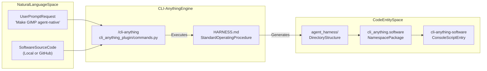
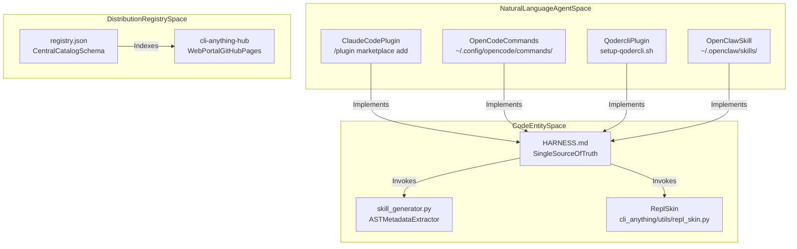
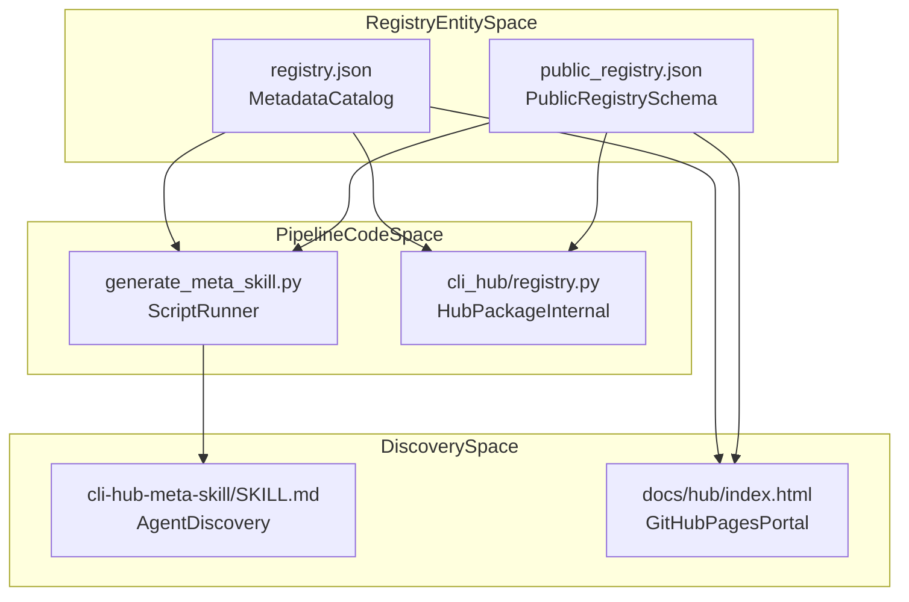

<!-- source: DeepWiki mcp.deepwiki.com · repo HKUDS/CLI-Anything · page 1 Overview · fetched 2026-11-09 -->

# Overview

Relevant source files

The following files were used as context for generating this wiki page:

- [.gitignore](.gitignore)
- [README.md](README.md)
- [README_CN.md](README_CN.md)
- [README_DE.md](README_DE.md)
- [README_JA.md](README_JA.md)
- [minimax/agent-harness/FIX_NOTES.md](minimax/agent-harness/FIX_NOTES.md)
- [minimax/agent-harness/cli_anything/minimax/README.md](minimax/agent-harness/cli_anything/minimax/README.md)
- [minimax/agent-harness/cli_anything/minimax/minimax_cli.py](minimax/agent-harness/cli_anything/minimax/minimax_cli.py)
- [minimax/agent-harness/cli_anything/minimax/skills/SKILL.md](minimax/agent-harness/cli_anything/minimax/skills/SKILL.md)
- [minimax/agent-harness/cli_anything/minimax/tests/TEST.md](minimax/agent-harness/cli_anything/minimax/tests/TEST.md)
- [minimax/agent-harness/cli_anything/minimax/tests/test_core.py](minimax/agent-harness/cli_anything/minimax/tests/test_core.py)
- [minimax/agent-harness/cli_anything/minimax/tests/test_full_e2e.py](minimax/agent-harness/cli_anything/minimax/tests/test_full_e2e.py)
- [minimax/agent-harness/cli_anything/minimax/tests/test_tts_extended.py](minimax/agent-harness/cli_anything/minimax/tests/test_tts_extended.py)
- [minimax/agent-harness/cli_anything/minimax/utils/minimax_backend.py](minimax/agent-harness/cli_anything/minimax/utils/minimax_backend.py)
- [minimax/agent-harness/setup.py](minimax/agent-harness/setup.py)
- [registry.json](registry.json)
- [skills/cli-anything-minimax/SKILL.md](skills/cli-anything-minimax/SKILL.md)
- [skills/cli-anything-wavetone/SKILL.md](skills/cli-anything-wavetone/SKILL.md)
- [wavetone/agent-harness/cli_anything/wavetone/README.md](wavetone/agent-harness/cli_anything/wavetone/README.md)
- [wavetone/agent-harness/cli_anything/wavetone/core/audio.py](wavetone/agent-harness/cli_anything/wavetone/core/audio.py)
- [wavetone/agent-harness/cli_anything/wavetone/core/project.py](wavetone/agent-harness/cli_anything/wavetone/core/project.py)
- [wavetone/agent-harness/cli_anything/wavetone/core/session.py](wavetone/agent-harness/cli_anything/wavetone/core/session.py)
- [wavetone/agent-harness/cli_anything/wavetone/tests/TEST.md](wavetone/agent-harness/cli_anything/wavetone/tests/TEST.md)
- [wavetone/agent-harness/cli_anything/wavetone/tests/test_core.py](wavetone/agent-harness/cli_anything/wavetone/tests/test_core.py)
- [wavetone/agent-harness/cli_anything/wavetone/tests/test_full_e2e.py](wavetone/agent-harness/cli_anything/wavetone/tests/test_full_e2e.py)
- [wavetone/agent-harness/cli_anything/wavetone/utils/repl_skin.py](wavetone/agent-harness/cli_anything/wavetone/utils/repl_skin.py)
- [wavetone/agent-harness/cli_anything/wavetone/utils/wavetone_backend.py](wavetone/agent-harness/cli_anything/wavetone/utils/wavetone_backend.py)
- [wavetone/agent-harness/cli_anything/wavetone/wavetone_cli.py](wavetone/agent-harness/cli_anything/wavetone/wavetone_cli.py)
- [wavetone/agent-harness/setup.py](wavetone/agent-harness/setup.py)

This document provides a high-level introduction to CLI-Anything, explaining its purpose, architecture, and core mission of making software agent-native. It describes the system's role in transforming arbitrary software applications into command-line interfaces (CLIs) through an automated generation pipeline.

For detailed information about specific subsystems, see:
- [What is CLI-Anything](#1.1) — Fundamental concepts and the agent-native mission.
- [Supported Applications](#1.2) — List of currently supported software and integration patterns.
- [Key Features](#1.3) — Core capabilities including the 7-phase pipeline and REPL mode.

Sources: [README.md:1-40](), [cli-anything-plugin/README.md:5-19]()

---

## The Agent-Software Gap

Modern AI agents excel at reasoning but struggle to control professional software applications. CLI-Anything bridges this gap by generating production-grade CLIs that provide structured, agent-friendly access while preserving full application capabilities.

| Approach | Limitation | Example |
|----------|-----------|---------|
| **UI Automation** | Fragile, screenshot-dependent, breaks with UI changes | Selenium, Playwright for desktop apps |
| **Limited APIs** | Coverage gaps, missing 90% of functionality | Partial REST APIs for video editors |
| **Reimplementations** | Functionality compromises, maintenance burden | Python wrappers that only support basic operations |

Sources: [README_CN.md:39-54](), [cli-anything-plugin/README.md:11-19]()

---

## System Purpose and Architecture

CLI-Anything is an automated generation system that transforms software with accessible source code into an agent-native tool. The system operates through a fully automated 7-phase pipeline that analyzes codebases, designs command architecture, implements the CLI with comprehensive testing, and publishes the result as a `pip`-installable Python package.

### Workflow: Natural Language Space to Code Entity Space

Sources: [README.md:1-28](), [cli-anything-plugin/README.md:59-81](), [README_CN.md:115-122]()

---

## Platform Ecosystem

CLI-Anything integrates with multiple AI agent platforms through specific adapters, all following the unified methodology defined in `HARNESS.md`.

### Integration Topology: Natural Language to Runtime Entity Space

**Key Integration Files**:
- Claude Code: [cli-anything-plugin/README.md:21-55]()
- OpenCode: [README_CN.md:159-182]()
- Qodercli: [README_CN.md:210-228]()
- OpenClaw: [README_CN.md:232-245]()
- Pi Coding Agent: [.pi-extension/cli-anything/README.md:1-40]()

Sources: [README.md:32-34](), [README_CN.md:65-250](), [cli-anything-plugin/README.md:174-182]()

---

## The 7-Phase Generation Pipeline

The generation process is a deterministic sequence that moves from source analysis to a published, test-verified package.

| Phase | Title | Key Output |
|-------|-------|------------|
| **1** | Analysis | `SOFTWARE.md` (Mapping GUI to API) |
| **2** | Design | Command group architecture |
| **3** | Implementation | Click-based CLI with REPL and `--json` |
| **4-5**| Testing | `test_core.py` and `test_full_e2e.py` |
| **6** | Documentation | `TEST.md` with full `pytest` results |
| **6.5**| Skill Gen | `SKILL.md` (Agent-discoverable metadata) |
| **7** | Publishing | `setup.py` (Namespace package installation) |

Sources: [cli-anything-plugin/README.md:153-233](), [README_CN.md:115-122]()

---

## CLI-Anything Hub & Registry

The **CLI-Hub** serves as a centralized registry for all community-built agent-native CLIs. It allows users and agents to browse, install, and manage CLIs via the `cli-anything-hub` package.

### Hub Architecture

**Key Hub Entities**:
- **Registry**: `registry.json` defines the catalog of available harnesses [registry.json:1-187]().
- **Meta-Skill**: Provides the interface for agents to browse and install CLIs.
- **Web Portal**: The live [CLI-Hub](https://hkuds.github.io/CLI-Anything/) for browsing.

Sources: [README.md:8-16](), [README.md:48-65](), [registry.json:1-187]()

---

## Design Philosophy: Authentic Integration

CLI-Anything follows the principle of **"Use the Real Software—Don't Reimplement It"**. Generated CLIs act as sophisticated wrappers that:
1.  Manage state via project persistence and undo/redo functionality.
2.  Maintain session consistency using unified UX components like `ReplSkin` [wavetone/agent-harness/cli_anything/wavetone/utils/repl_skin.py:1-40]().
3.  Invoke the actual software backend via subprocess or native APIs.
4.  Provide machine-readable outputs for agents using the `--json` flag.

Sources: [cli-anything-plugin/README.md:174-182](), [quietshrink/agent-harness/QUIETSHRINK.md:5-14](), [browser/agent-harness/cli_anything/browser/README.md:248-254]()

---

## Navigation

- [What is CLI-Anything](#1.1)
- [Supported Applications](#1.2)
- [Key Features](#1.3)

---

