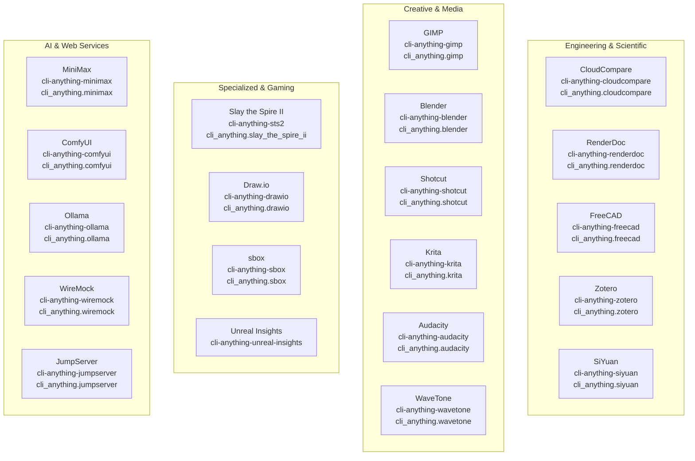
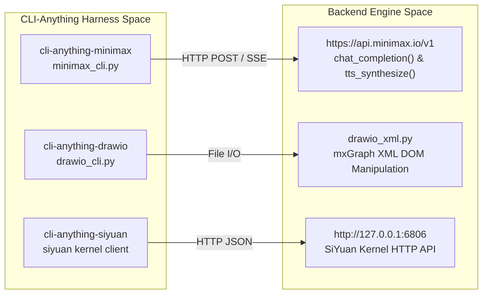

<!-- source: DeepWiki mcp.deepwiki.com · repo HKUDS/CLI-Anything · page 1.2 Supported Applications · fetched 2026-11-09 -->

# Supported Applications

Relevant source files

The following files were used as context for generating this wiki page:

- [.github/scripts/sync_root_skills.py](.github/scripts/sync_root_skills.py)
- [.github/scripts/validate_root_skills.py](.github/scripts/validate_root_skills.py)
- [drawio/agent-harness/DRAWIO.md](drawio/agent-harness/DRAWIO.md)
- [drawio/agent-harness/cli_anything/drawio/README.md](drawio/agent-harness/cli_anything/drawio/README.md)
- [drawio/agent-harness/cli_anything/drawio/__init__.py](drawio/agent-harness/cli_anything/drawio/__init__.py)
- [drawio/agent-harness/cli_anything/drawio/core/__init__.py](drawio/agent-harness/cli_anything/drawio/core/__init__.py)
- [drawio/agent-harness/cli_anything/drawio/core/connectors.py](drawio/agent-harness/cli_anything/drawio/core/connectors.py)
- [drawio/agent-harness/cli_anything/drawio/core/export.py](drawio/agent-harness/cli_anything/drawio/core/export.py)
- [drawio/agent-harness/cli_anything/drawio/core/pages.py](drawio/agent-harness/cli_anything/drawio/core/pages.py)
- [drawio/agent-harness/cli_anything/drawio/core/project.py](drawio/agent-harness/cli_anything/drawio/core/project.py)
- [drawio/agent-harness/cli_anything/drawio/core/shapes.py](drawio/agent-harness/cli_anything/drawio/core/shapes.py)
- [drawio/agent-harness/cli_anything/drawio/drawio_cli.py](drawio/agent-harness/cli_anything/drawio/drawio_cli.py)
- [drawio/agent-harness/cli_anything/drawio/tests/test_core.py](drawio/agent-harness/cli_anything/drawio/tests/test_core.py)
- [drawio/agent-harness/cli_anything/drawio/utils/drawio_xml.py](drawio/agent-harness/cli_anything/drawio/utils/drawio_xml.py)
- [minimax/agent-harness/FIX_NOTES.md](minimax/agent-harness/FIX_NOTES.md)
- [minimax/agent-harness/cli_anything/minimax/README.md](minimax/agent-harness/cli_anything/minimax/README.md)
- [minimax/agent-harness/cli_anything/minimax/minimax_cli.py](minimax/agent-harness/cli_anything/minimax/minimax_cli.py)
- [minimax/agent-harness/cli_anything/minimax/skills/SKILL.md](minimax/agent-harness/cli_anything/minimax/skills/SKILL.md)
- [minimax/agent-harness/cli_anything/minimax/tests/TEST.md](minimax/agent-harness/cli_anything/minimax/tests/TEST.md)
- [minimax/agent-harness/cli_anything/minimax/tests/test_core.py](minimax/agent-harness/cli_anything/minimax/tests/test_core.py)
- [minimax/agent-harness/cli_anything/minimax/tests/test_full_e2e.py](minimax/agent-harness/cli_anything/minimax/tests/test_full_e2e.py)
- [minimax/agent-harness/cli_anything/minimax/tests/test_tts_extended.py](minimax/agent-harness/cli_anything/minimax/tests/test_tts_extended.py)
- [minimax/agent-harness/cli_anything/minimax/utils/minimax_backend.py](minimax/agent-harness/cli_anything/minimax/utils/minimax_backend.py)
- [minimax/agent-harness/setup.py](minimax/agent-harness/setup.py)
- [public_registry.json](public_registry.json)
- [registry.json](registry.json)
- [siyuan/agent-harness/setup.py](siyuan/agent-harness/setup.py)
- [skills/cli-anything-iterm2-ctl/SKILL.md](skills/cli-anything-iterm2-ctl/SKILL.md)
- [skills/cli-anything-minimax/SKILL.md](skills/cli-anything-minimax/SKILL.md)
- [skills/cli-anything-qgis/SKILL.md](skills/cli-anything-qgis/SKILL.md)
- [skills/cli-anything-siyuan/SKILL.md](skills/cli-anything-siyuan/SKILL.md)

This page documents all software applications currently supported by CLI-Anything, including their domain categories, backend integration methods, package locations, and technical implementation details. CLI-Anything has generated production-ready CLI harnesses for over 40 diverse applications spanning creative tools, engineering software, scientific analysis, gaming, web services, and AI APIs.

For information about how these applications are generated through the 7-phase pipeline, see [The 7-Phase Generation Pipeline](). For details on the internal structure of each generated CLI, see [Generated CLI Architecture]().

---

## Complete Application Inventory

CLI-Anything currently supports a vast ecosystem of applications. Each application receives a dedicated namespace package under `cli_anything.<software>` and a console script entry point following the pattern `cli-anything-<software>`.

### Application Ecosystem Mapping

The following diagram bridges the Natural Language names of supported software to their specific code entities and entry points within the repository.

Sources: `[registry.json:9-186]()`, `[public_registry.json:1-50]()`, `[skills/cli-anything-siyuan/SKILL.md:1-20]()`

---

## Application Catalog

The `registry.json` and `public_registry.json` files serve as the source of truth for all supported applications, defining their categories, install commands, and entry points.

| Software | Category | CLI Command | Backend Integration Method | Source / Registry |
|----------|----------|-------------|----------------------------|-------------------|
| **CloudCompare** | 3D/Science | `cli-anything-cloudcompare` | `-SILENT` mode subprocess + Glob renaming | `[registry.json:1-170]()` |
| **RenderDoc** | GPU/Dev | `cli-anything-renderdoc` | Python API (`import renderdoc`) embedding | `[registry.json:1-170]()` |
| **Zotero** | Research | `cli-anything-zotero` | Local API + SQLite (`zotero_sqlite.py`) | `[registry.json:1-170]()` |
| **SiYuan** | Knowledge | `cli-anything-siyuan` | Kernel HTTP API (`http://127.0.0.1:6806`) | `[skills/cli-anything-siyuan/SKILL.md:11-13]()` |
| **Shotcut** | Video | `cli-anything-shotcut` | MLT XML Manipulation + `melt` CLI | `[skills/cli-anything-shotcut/SKILL.md:9-21]()` |
| **Draw.io** | Diagram | `cli-anything-drawio` | mxGraph XML DOM Manipulation | `[drawio/agent-harness/cli_anything/drawio/drawio_cli.py:1-15]()` |
| **MiniMax** | AI/API | `cli-anything-minimax` | OpenAI-compatible REST API & SSE TTS | `[minimax/agent-harness/cli_anything/minimax/utils/minimax_backend.py:1-35]()` |
| **Slay the Spire II** | Gaming | `cli-anything-sts2` | .NET Bridge Mod + Localhost HTTP API | `[registry.json:1-170]()` |
| **WireMock** | Testing | `cli-anything-wiremock` | WireMock REST API | `[registry.json:66-83]()` |
| **JumpServer** | DevOps | `cli-anything-jumpserver` | JumpServer REST API | `[registry.json:9-26]()` |
| **OpenRefine** | Database | `cli-anything-openrefine` | Local HTTP API + Session Undo/Redo | `[registry.json:28-45]()` |
| **CC Switch** | DevOps | `cli-anything-ccswitch` | AI Coding Tool Config DB Inspection | `[registry.json:47-64]()` |
| **NSLogger** | DevOps | `cli-anything-nslogger` | Bonjour Live Capture & Log Parsing | `[registry.json:85-102]()` |
| **AnyGen** | Generation | `cli-anything-anygen` | AnyGen Cloud API | `[registry.json:104-121]()` |
| **AdGuardHome** | Network | `cli-anything-adguardhome` | REST API | `[registry.json:123-140]()` |
| **Audacity** | Audio | `cli-anything-audacity` | sox Wrapper | `[registry.json:142-159]()` |
| **WaveTone** | Audio | `cli-anything-wavetone` | Transcription Manifests & Windows EXE | `[registry.json:161-170]()` |

Sources: `[registry.json:9-170]()`, `[public_registry.json:1-100]`, `[skills/cli-anything-siyuan/SKILL.md:11-15]()`, `[drawio/agent-harness/cli_anything/drawio/drawio_cli.py:1-20]()`, `[minimax/agent-harness/cli_anything/minimax/utils/minimax_backend.py:1-30]()`

---

## Specialized Integration Patterns

Newer harnesses utilize advanced patterns to handle complex software lifecycles, local HTTP daemons, SQLite stores, and SSE streaming.

### Advanced Backend Architectures

This diagram illustrates how specialized harnesses bridge the gap between Natural Language requests and technical backend entities across different domains.

Sources: `[minimax/agent-harness/cli_anything/minimax/minimax_cli.py:103-125]()`, `[minimax/agent-harness/cli_anything/minimax/utils/minimax_backend.py:21-35]()`, `[drawio/agent-harness/cli_anything/drawio/drawio_cli.py:129-165]()`, `[skills/cli-anything-siyuan/SKILL.md:11-14]()`

### Key Integration Examples

#### 1. MiniMax (OpenAI-Compatible & SSE TTS Pattern)
The MiniMax harness communicates with the MiniMax REST API supporting global (`api.minimax.io`) and regional endpoints (`api.minimaxi.com`) `[minimax/agent-harness/cli_anything/minimax/utils/minimax_backend.py:21-34]()`. It provides `chat`, `stream` (streaming responses via callbacks) `[minimax/agent-harness/cli_anything/minimax/minimax_cli.py:195-231]()`, and `tts` (synthesizing speech via Server-Sent Events and hex-decoded audio streams) `[minimax/agent-harness/cli_anything/minimax/tests/test_full_e2e.py:100-114]()`.

#### 2. SiYuan (Kernel HTTP API Pattern)
The SiYuan harness connects to a running local SiYuan kernel via `http://127.0.0.1:6806` using an API token `[skills/cli-anything-siyuan/SKILL.md:11-17]()`. It exposes structured commands for `notebook`, `doc`, `block`, `sql` queries over block databases, and Markdown export `[skills/cli-anything-siyuan/SKILL.md:21-61]()`.

#### 3. Draw.io (mxGraph XML DOM Manipulation)
The Draw.io harness parses and manipulates Draw.io XML files directly (`drawio_cli.py`) `[drawio/agent-harness/cli_anything/drawio/drawio_cli.py:1-6]()`. It provides project presets, shape management, connectors, pages, and export capabilities through programmatic DOM manipulation `[drawio/agent-harness/cli_anything/drawio/drawio_cli.py:170-198]()`.

#### 4. WireMock (REST API Pattern)
The WireMock harness manages HTTP mock servers via their REST API `[registry.json:66-74]()`. It allows AI agents to create stubs, inspect requests, record traffic, and manage complex test scenarios against a running standalone Java instance `[registry.json:66-74]()`.

#### 5. Shotcut (MLT XML Pattern)
The Shotcut harness operates directly on MLT XML project structures and offloads actual rendering tasks to the `melt` CLI tool `[skills/cli-anything-shotcut/SKILL.md:9-21]()`. It maintains a two-step media model where assets are imported to a bin before placement on timeline tracks `[skills/cli-anything-shotcut/SKILL.md:56-69]()`.

---

## State and Session Management

CLI-Anything harnesses maintain execution state through localized project files, config files (`~/.config/cli-anything-*`), and session snapshots.

*   **REPL Mode:** Invoking any generated CLI without arguments launches an interactive `prompt-toolkit` REPL session maintaining command context and in-memory variables `[minimax/agent-harness/cli_anything/minimax/minimax_cli.py:114-124]()`, `[drawio/agent-harness/cli_anything/drawio/drawio_cli.py:136-165]()`.
*   **Error Handling Decorators:** Standardized `@handle_error` wrappers catch runtime, validation, and API exceptions, emitting formatted JSON payloads when `--json` is specified or printing user-friendly stderr output `[minimax/agent-harness/cli_anything/minimax/minimax_cli.py:86-100]()`, `[drawio/agent-harness/cli_anything/drawio/drawio_cli.py:87-122]()`.
*   **Agent Discovery:** Each harness packages a `SKILL.md` file describing its complete command surface, options, and agent usage guidelines, which are automatically indexed by the CLI-Hub registry `[registry.json:18-18]`, `[minimax/agent-harness/cli_anything/minimax/skills/SKILL.md:1-50]()`.

Sources: `[minimax/agent-harness/cli_anything/minimax/minimax_cli.py:43-124]`, `[minimax/agent-harness/cli_anything/minimax/skills/SKILL.md:1-150]`, `[drawio/agent-harness/cli_anything/drawio/drawio_cli.py:39-165]()`

---

