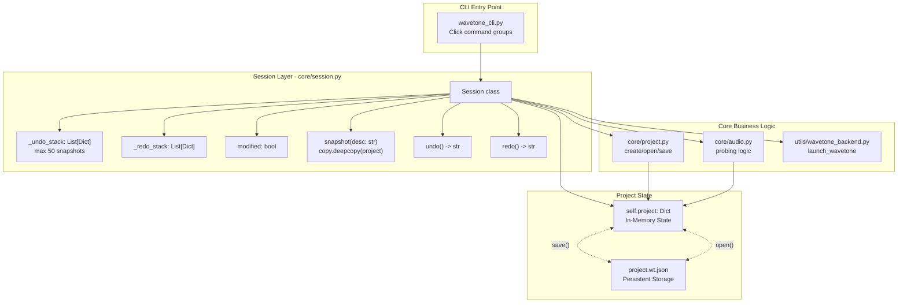
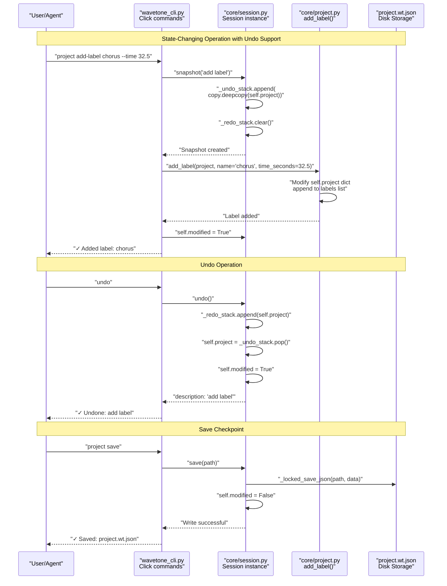
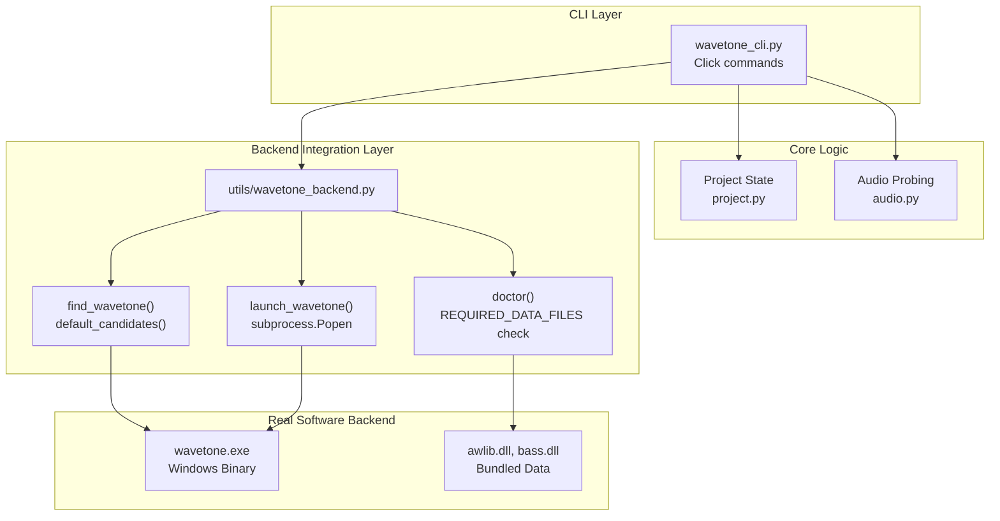
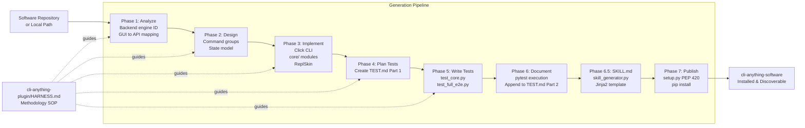
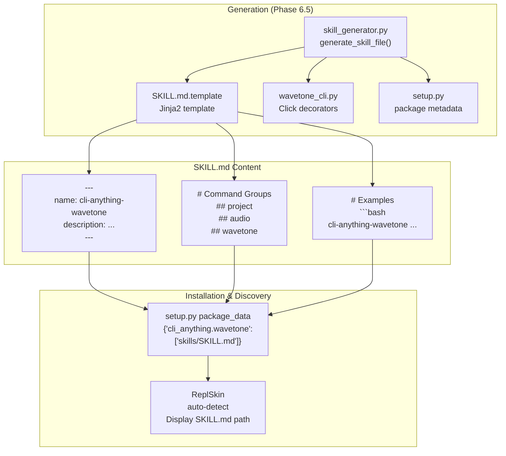

<!-- source: DeepWiki mcp.deepwiki.com · repo HKUDS/CLI-Anything · page 1.3 Key Features · fetched 2026-11-09 -->

# Key Features

<details>
<summary>Relevant source files</summary>

The following files were used as context for generating this wiki page:

- [.gitignore](.gitignore)
- [README.md](README.md)
- [README_CN.md](README_CN.md)
- [README_JA.md](README_JA.md)
- [anygen/agent-harness/cli_anything/anygen/core/session.py](anygen/agent-harness/cli_anything/anygen/core/session.py)
- [audacity/agent-harness/cli_anything/audacity/core/session.py](audacity/agent-harness/cli_anything/audacity/core/session.py)
- [blender/agent-harness/cli_anything/blender/core/session.py](blender/agent-harness/cli_anything/blender/core/session.py)
- [drawio/agent-harness/cli_anything/drawio/core/session.py](drawio/agent-harness/cli_anything/drawio/core/session.py)
- [gimp/agent-harness/cli_anything/gimp/core/session.py](gimp/agent-harness/cli_anything/gimp/core/session.py)
- [inkscape/agent-harness/cli_anything/inkscape/core/session.py](inkscape/agent-harness/cli_anything/inkscape/core/session.py)
- [kdenlive/agent-harness/cli_anything/kdenlive/core/session.py](kdenlive/agent-harness/cli_anything/kdenlive/core/session.py)
- [libreoffice/agent-harness/cli_anything/libreoffice/core/session.py](libreoffice/agent-harness/cli_anything/libreoffice/core/session.py)
- [obs-studio/agent-harness/cli_anything/obs_studio/core/session.py](obs-studio/agent-harness/cli_anything/obs_studio/core/session.py)
- [shotcut/agent-harness/cli_anything/shotcut/core/session.py](shotcut/agent-harness/cli_anything/shotcut/core/session.py)
- [skills/cli-anything-wavetone/SKILL.md](skills/cli-anything-wavetone/SKILL.md)
- [wavetone/agent-harness/cli_anything/wavetone/README.md](wavetone/agent-harness/cli_anything/wavetone/README.md)
- [wavetone/agent-harness/cli_anything/wavetone/core/audio.py](wavetone/agent-harness/cli_anything/wavetone/core/audio.py)
- [wavetone/agent-harness/cli_anything/wavetone/core/project.py](wavetone/agent-harness/cli_anything/wavetone/core/project.py)
- [wavetone/agent-harness/cli_anything/wavetone/core/session.py](wavetone/agent-harness/cli_anything/wavetone/core/session.py)
- [wavetone/agent-harness/cli_anything/wavetone/tests/TEST.md](wavetone/agent-harness/cli_anything/wavetone/tests/TEST.md)
- [wavetone/agent-harness/cli_anything/wavetone/tests/test_core.py](wavetone/agent-harness/cli_anything/wavetone/tests/test_core.py)
- [wavetone/agent-harness/cli_anything/wavetone/tests/test_full_e2e.py](wavetone/agent-harness/cli_anything/wavetone/tests/test_full_e2e.py)
- [wavetone/agent-harness/cli_anything/wavetone/utils/repl_skin.py](wavetone/agent-harness/cli_anything/wavetone/utils/repl_skin.py)
- [wavetone/agent-harness/cli_anything/wavetone/utils/wavetone_backend.py](wavetone/agent-harness/cli_anything/wavetone/utils/wavetone_backend.py)
- [wavetone/agent-harness/cli_anything/wavetone/wavetone_cli.py](wavetone/agent-harness/cli_anything/wavetone/wavetone_cli.py)
- [wavetone/agent-harness/setup.py](wavetone/agent-harness/setup.py)

</details>


This document describes the core features that make CLI-Anything effective at transforming GUI applications into agent-native tools. These features apply universally across all generated CLIs and are enforced by the automated generation pipeline.

---

## Features Overview

CLI-Anything provides seven fundamental capabilities that distinguish it from traditional CLI tools and enable authentic agent-software integration:

| Feature | Technical Implementation | Agent Benefit |
|---------|-------------------------|---------------|
| **Automated 7-Phase Generation** | Pipeline from analysis to PyPI publishing, guided by `HARNESS.md` | Any software becomes agent-ready in minutes |
| **Authentic Backend Integration** | Native project file generation + real backend invocation via subprocess | Full professional capabilities, zero compromises |
| **Stateful Session Management** | `core/session.py` with 50-level undo/redo, deep-copy snapshots | Multi-step workflows with error recovery |
| **Dual Interaction Modes** | Click command groups + `utils/repl_skin.py` REPL wrapper | Interactive exploration + scriptable automation |
| **JSON Output** | `--json` flag on all commands with structured error messages | Zero parsing complexity for agent consumption |
| **SKILL.md Generation** | Phase 6.5: `skill_generator.py` creates YAML frontmatter + examples | Agent discovery via `package_data` inclusion |
| **Production Testing** | Comprehensive test suite: unit + E2E native + E2E backend + CLI subprocess | 100% pass rate, zero compromise dependencies |

Sources: [README.md:115-123](), [cli-anything-plugin/README.md:152-243](), [cli-anything-plugin/HARNESS.md:12-132](), [cli-anything-plugin/guides/skill-generation.md:1-12]()

---

## Stateful CLI Design

### Session and Project Model

Every generated CLI implements a stateful design where project state persists across commands. This contrasts with traditional CLIs that are purely stateless and require complete information in each invocation.

Diagram: Stateful CLI Architecture

Sources: [cli-anything-plugin/HARNESS.md:39-48](), [cli-anything-plugin/HARNESS.md:71-99](), [cli-anything-plugin/guides/session-locking.md:1-39](), [wavetone/agent-harness/cli_anything/wavetone/wavetone_cli.py:67-85]()

The `Session` class in each generated CLI provides:

- **Snapshot Creation**: Before each state-changing operation, `session.snapshot(description)` uses `copy.deepcopy(self.project)` to capture the current project state [cli-anything-plugin/HARNESS.md:40-42]().
- **Undo/Redo Stacks**: Two independent stacks (`_undo_stack` and `_redo_stack`) storing serialized project states with operation descriptions, limited to 50 entries [cli-anything-plugin/HARNESS.md:22-23](), [cli-anything-plugin/README.md:181]().
- **Modification Tracking**: The `modified` flag tracks unsaved changes and appears in REPL prompt [cli-anything-plugin/repl_skin.py:11-12](), [cli-anything-plugin/HARNESS.md:84-90]().
- **Project Lifecycle**: Methods `open(path)`, `save(path)`, and automatic persistence using locked JSON writes to prevent concurrent write corruption [cli-anything-plugin/guides/session-locking.md:1-37]().

Sources: [cli-anything-plugin/HARNESS.md:39-48](), [cli-anything-plugin/HARNESS.md:71-99](), [cli-anything-plugin/guides/session-locking.md:1-39]()

### Undo/Redo Implementation

Diagram: Undo/Redo Execution Sequence

Sources: [cli-anything-plugin/HARNESS.md:22-23](), [cli-anything-plugin/HARNESS.md:71-99](), [cli-anything-plugin/guides/session-locking.md:1-39](), [wavetone/agent-harness/cli_anything/wavetone/core/project.py:1-40]()

---

## Dual Interaction Modes

Generated CLIs support two distinct usage patterns, both built on the same command structure using the Click framework [cli-anything-plugin/HARNESS.md:27-30]().

### REPL Mode

Entering REPL mode requires simply invoking the CLI without subcommands. This is achieved by setting `invoke_without_command=True` on the main Click group [cli-anything-plugin/README.md:182-183](), [wavetone/agent-harness/cli_anything/wavetone/wavetone_cli.py:67-85]().

```bash
cli-anything-wavetone           # Enters interactive REPL
```

The REPL interface is provided by `ReplSkin` in `utils/repl_skin.py` (or harness-local replicas), which delivers:

| Component | Implementation | Description |
|-----------|----------------|-------------|
| **Branded Banner** | `skin.print_banner()` | ASCII art box with app name, version, and SKILL.md path for agent discovery [cli-anything-plugin/repl_skin.py:188-210](), [wavetone/agent-harness/cli_anything/wavetone/wavetone_cli.py:91-92]() |
| **Styled Prompt** | `skin.get_input()` | Displays project name and modification indicator [cli-anything-plugin/repl_skin.py:84](), [wavetone/agent-harness/cli_anything/wavetone/wavetone_cli.py:97]() |
| **Command History** | `skin.create_prompt_session()` | Persistent arrow key navigation via `prompt_toolkit` [cli-anything-plugin/HARNESS.md:83](), [wavetone/agent-harness/cli_anything/wavetone/wavetone_cli.py:94]() |
| **Formatted Output** | `skin.table()`, `skin.success()` | Consistent success (✓), error (✗), warning (⚠), and info (●) styling [cli-anything-plugin/repl_skin.py:86-92](), [wavetone/agent-harness/cli_anything/wavetone/wavetone_cli.py:111-118]() |

Sources: [cli-anything-plugin/HARNESS.md:74-108](), [wavetone/agent-harness/cli_anything/wavetone/wavetone_cli.py:87-119]()

### One-Shot/Scriptable Mode

For automation and scripting, commands can be invoked directly with subcommands and parameters [cli-anything-plugin/HARNESS.md:29]().

```bash
cli-anything-wavetone --json project new input.wav -o project.wt.json
cli-anything-wavetone --project project.wt.json --json audio probe
```

Sources: [cli-anything-plugin/HARNESS.md:29](), [wavetone/agent-harness/cli_anything/wavetone/wavetone_cli.py:126-151]()

### JSON Output for Agents

Every command supports the `--json` global flag, which transforms output into structured data for agent consumption [cli-anything-plugin/README.md:180](), [cli-anything-plugin/HARNESS.md:44-48]().

```bash
cli-anything-wavetone --json wavetone doctor
```

The `--json` flag is implemented via `emit()` and `ctx_json()` in `wavetone_cli.py`, ensuring agents parse results programmatically without regex scraping [wavetone/agent-harness/cli_anything/wavetone/wavetone_cli.py:30-43]().

Sources: [cli-anything-plugin/HARNESS.md:44-48](), [wavetone/agent-harness/cli_anything/wavetone/wavetone_cli.py:30-43]()

---

## Authentic Software Integration

### Real Backend Invocation

CLI-Anything generates valid project files and delegates heavy lifting to the actual software via backend wrappers [cli-anything-plugin/HARNESS.md:54-68]().

Diagram: Authentic Backend Integration Architecture

Sources: [cli-anything-plugin/HARNESS.md:54-68](), [wavetone/agent-harness/cli_anything/wavetone/utils/wavetone_backend.py:1-145]()

---

## Automated 7-Phase Generation Pipeline

The generation pipeline transforms any software codebase into a production-ready CLI through seven automated phases plus Phase 6.5 for SKILL.md generation [README.md:115-123](), [cli-anything-plugin/README.md:72-81]().

Diagram: Automated Generation Pipeline

Sources: [README.md:115-123](), [cli-anything-plugin/README.md:152-243](), [cli-anything-plugin/HARNESS.md:12-230](), [cli-anything-plugin/guides/skill-generation.md:34-84]()

---

## SKILL.md and Agent Discovery

Phase 6.5 enables AI agent discovery of generated CLIs. Each CLI includes a `SKILL.md` file that can be loaded by AI assistants like Claude Code or OpenClaw [cli-anything-plugin/guides/skill-generation.md:1-14](), [README_CN.md:232-246]().

Diagram: SKILL.md Generation and Discovery Architecture

Sources: [cli-anything-plugin/guides/skill-generation.md:1-135](), [skills/cli-anything-wavetone/SKILL.md:1-53]()

---

## Production Testing & Quality

### Comprehensive Testing Strategy

Every generated CLI undergoes validation through unit and E2E testing to ensure a 100% pass rate [README.md:18](), [wavetone/agent-harness/cli_anything/wavetone/tests/TEST.md:1-157]().

| Test Type | Implementation | What It Validates |
|-----------|----------------|-------------------|
| **Unit Tests** | `tests/test_core.py` | Core logic with synthetic data, project creation, session snapshots [wavetone/agent-harness/cli_anything/wavetone/tests/test_core.py:30-100]() |
| **E2E Native** | `tests/test_full_e2e.py` | Intermediate project file structure validation and workflow state [wavetone/agent-harness/cli_anything/wavetone/tests/test_full_e2e.py:80-118]() |
| **E2E Backend** | `tests/test_full_e2e.py` | Real software rendering/launch smoke tests (`TestRealWaveToneBackend`) [wavetone/agent-harness/cli_anything/wavetone/tests/test_full_e2e.py:119-153]() |
| **CLI Subprocess** | `tests/test_full_e2e.py` | Subprocess execution using `_resolve_cli()` pattern [wavetone/agent-harness/cli_anything/wavetone/tests/test_full_e2e.py:18-30]() |

Sources: [README.md:18-27](), [wavetone/agent-harness/cli_anything/wavetone/tests/TEST.md:1-157](), [wavetone/agent-harness/cli_anything/wavetone/tests/test_core.py:1-125](), [wavetone/agent-harness/cli_anything/wavetone/tests/test_full_e2e.py:1-153]()

---

