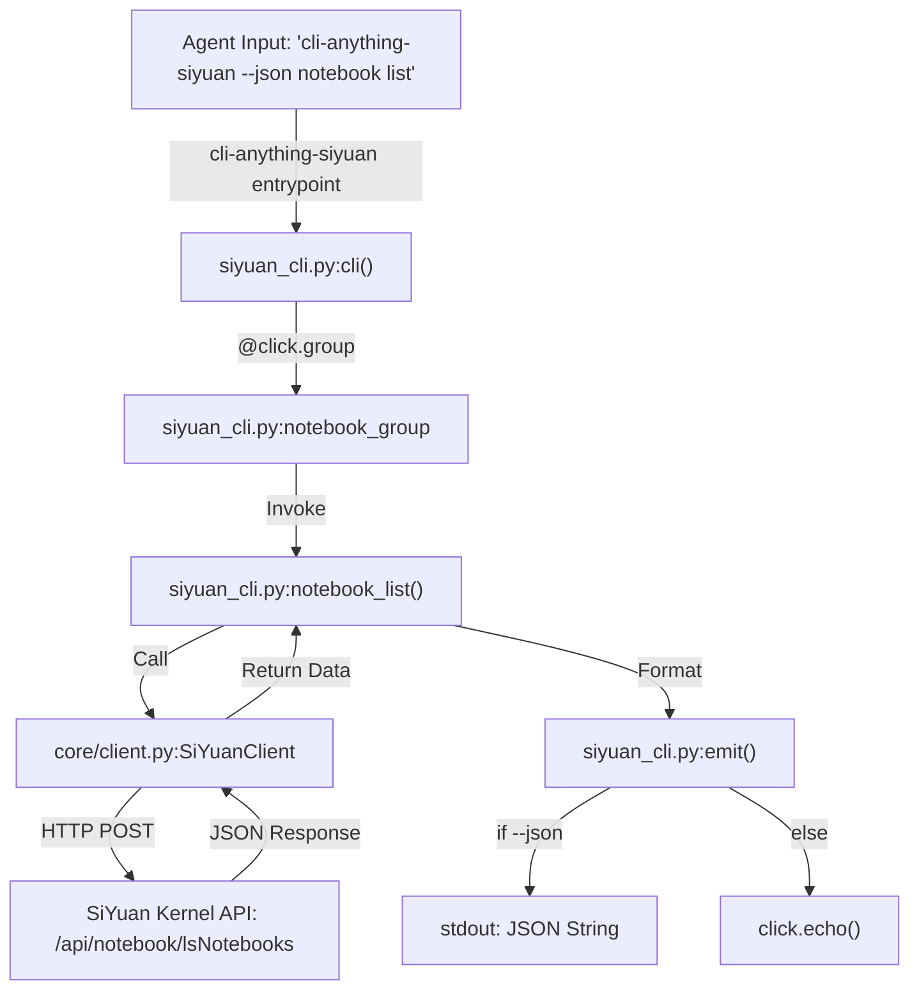
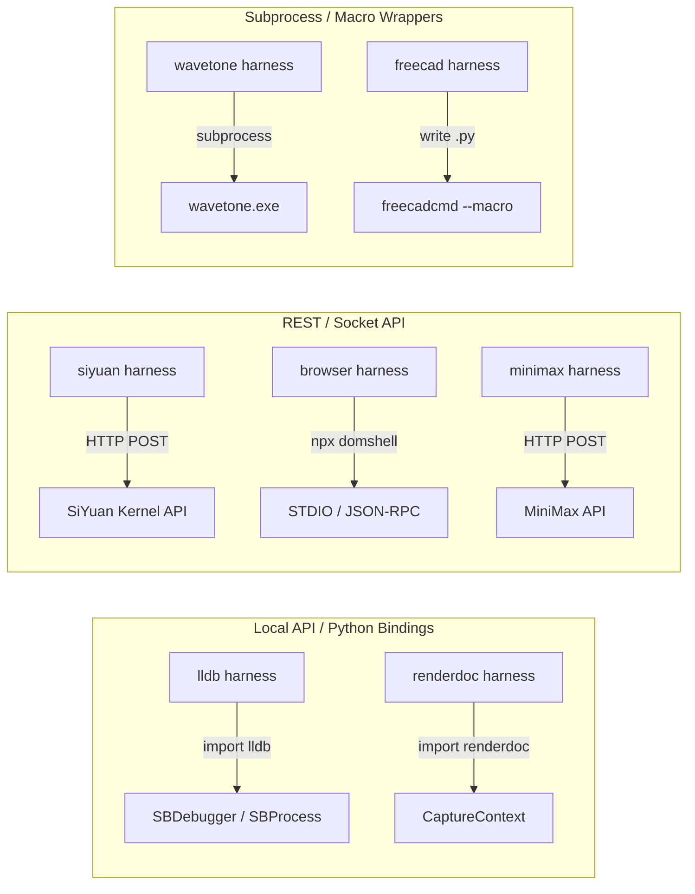

<!-- source: DeepWiki mcp.deepwiki.com · repo HKUDS/CLI-Anything · page 10 Glossary · fetched 2026-11-09 -->

# Glossary

Relevant source files

The following files were used as context for generating this wiki page:

- [.gitignore](.gitignore)
- [README.md](README.md)
- [README_CN.md](README_CN.md)
- [README_JA.md](README_JA.md)
- [browser/agent-harness/HARNESS.md](browser/agent-harness/HARNESS.md)
- [browser/agent-harness/cli_anything/browser/README.md](browser/agent-harness/cli_anything/browser/README.md)
- [browser/agent-harness/cli_anything/browser/__init__.py](browser/agent-harness/cli_anything/browser/__init__.py)
- [browser/agent-harness/cli_anything/browser/__main__.py](browser/agent-harness/cli_anything/browser/__main__.py)
- [browser/agent-harness/cli_anything/browser/browser_cli.py](browser/agent-harness/cli_anything/browser/browser_cli.py)
- [browser/agent-harness/cli_anything/browser/core/__init__.py](browser/agent-harness/cli_anything/browser/core/__init__.py)
- [browser/agent-harness/cli_anything/browser/core/fs.py](browser/agent-harness/cli_anything/browser/core/fs.py)
- [browser/agent-harness/cli_anything/browser/core/page.py](browser/agent-harness/cli_anything/browser/core/page.py)
- [browser/agent-harness/cli_anything/browser/core/session.py](browser/agent-harness/cli_anything/browser/core/session.py)
- [browser/agent-harness/cli_anything/browser/tests/test_core.py](browser/agent-harness/cli_anything/browser/tests/test_core.py)
- [browser/agent-harness/cli_anything/browser/tests/test_domshell_backend.py](browser/agent-harness/cli_anything/browser/tests/test_domshell_backend.py)
- [browser/agent-harness/cli_anything/browser/tests/test_full_e2e.py](browser/agent-harness/cli_anything/browser/tests/test_full_e2e.py)
- [browser/agent-harness/cli_anything/browser/utils/domshell_backend.py](browser/agent-harness/cli_anything/browser/utils/domshell_backend.py)
- [lldb/agent-harness/HARNESS.md](lldb/agent-harness/HARNESS.md)
- [lldb/agent-harness/LLDB.md](lldb/agent-harness/LLDB.md)
- [lldb/agent-harness/cli_anything/lldb/README.md](lldb/agent-harness/cli_anything/lldb/README.md)
- [lldb/agent-harness/cli_anything/lldb/__init__.py](lldb/agent-harness/cli_anything/lldb/__init__.py)
- [lldb/agent-harness/cli_anything/lldb/core/breakpoints.py](lldb/agent-harness/cli_anything/lldb/core/breakpoints.py)
- [lldb/agent-harness/cli_anything/lldb/core/session.py](lldb/agent-harness/cli_anything/lldb/core/session.py)
- [lldb/agent-harness/cli_anything/lldb/dap.py](lldb/agent-harness/cli_anything/lldb/dap.py)
- [lldb/agent-harness/cli_anything/lldb/lldb_cli.py](lldb/agent-harness/cli_anything/lldb/lldb_cli.py)
- [lldb/agent-harness/cli_anything/lldb/skills/SKILL.md](lldb/agent-harness/cli_anything/lldb/skills/SKILL.md)
- [lldb/agent-harness/cli_anything/lldb/tests/TEST.md](lldb/agent-harness/cli_anything/lldb/tests/TEST.md)
- [lldb/agent-harness/cli_anything/lldb/tests/test_core.py](lldb/agent-harness/cli_anything/lldb/tests/test_core.py)
- [lldb/agent-harness/cli_anything/lldb/tests/test_full_e2e.py](lldb/agent-harness/cli_anything/lldb/tests/test_full_e2e.py)
- [lldb/agent-harness/cli_anything/lldb/utils/session_client.py](lldb/agent-harness/cli_anything/lldb/utils/session_client.py)
- [lldb/agent-harness/cli_anything/lldb/utils/session_server.py](lldb/agent-harness/cli_anything/lldb/utils/session_server.py)
- [lldb/agent-harness/setup.py](lldb/agent-harness/setup.py)
- [minimax/agent-harness/FIX_NOTES.md](minimax/agent-harness/FIX_NOTES.md)
- [minimax/agent-harness/cli_anything/minimax/README.md](minimax/agent-harness/cli_anything/minimax/README.md)
- [minimax/agent-harness/cli_anything/minimax/minimax_cli.py](minimax/agent-harness/cli_anything/minimax/minimax_cli.py)
- [minimax/agent-harness/cli_anything/minimax/skills/SKILL.md](minimax/agent-harness/cli_anything/minimax/skills/SKILL.md)
- [minimax/agent-harness/cli_anything/minimax/tests/TEST.md](minimax/agent-harness/cli_anything/minimax/tests/TEST.md)
- [minimax/agent-harness/cli_anything/minimax/tests/test_core.py](minimax/agent-harness/cli_anything/minimax/tests/test_core.py)
- [minimax/agent-harness/cli_anything/minimax/tests/test_full_e2e.py](minimax/agent-harness/cli_anything/minimax/tests/test_full_e2e.py)
- [minimax/agent-harness/cli_anything/minimax/tests/test_tts_extended.py](minimax/agent-harness/cli_anything/minimax/tests/test_tts_extended.py)
- [minimax/agent-harness/cli_anything/minimax/utils/minimax_backend.py](minimax/agent-harness/cli_anything/minimax/utils/minimax_backend.py)
- [minimax/agent-harness/setup.py](minimax/agent-harness/setup.py)
- [registry.json](registry.json)
- [siyuan/agent-harness/SIYUAN.md](siyuan/agent-harness/SIYUAN.md)
- [siyuan/agent-harness/cli_anything/siyuan/README.md](siyuan/agent-harness/cli_anything/siyuan/README.md)
- [siyuan/agent-harness/cli_anything/siyuan/__init__.py](siyuan/agent-harness/cli_anything/siyuan/__init__.py)
- [siyuan/agent-harness/cli_anything/siyuan/__main__.py](siyuan/agent-harness/cli_anything/siyuan/__main__.py)
- [siyuan/agent-harness/cli_anything/siyuan/core/__init__.py](siyuan/agent-harness/cli_anything/siyuan/core/__init__.py)
- [siyuan/agent-harness/cli_anything/siyuan/core/client.py](siyuan/agent-harness/cli_anything/siyuan/core/client.py)
- [siyuan/agent-harness/cli_anything/siyuan/core/session.py](siyuan/agent-harness/cli_anything/siyuan/core/session.py)
- [siyuan/agent-harness/cli_anything/siyuan/siyuan_cli.py](siyuan/agent-harness/cli_anything/siyuan/siyuan_cli.py)
- [siyuan/agent-harness/cli_anything/siyuan/skills/SKILL.md](siyuan/agent-harness/cli_anything/siyuan/skills/SKILL.md)
- [siyuan/agent-harness/cli_anything/siyuan/tests/test_cli_commands.py](siyuan/agent-harness/cli_anything/siyuan/tests/test_cli_commands.py)
- [siyuan/agent-harness/cli_anything/siyuan/tests/test_core.py](siyuan/agent-harness/cli_anything/siyuan/tests/test_core.py)
- [siyuan/agent-harness/cli_anything/siyuan/tests/test_full_e2e.py](siyuan/agent-harness/cli_anything/siyuan/tests/test_full_e2e.py)
- [skills/cli-anything-lldb/SKILL.md](skills/cli-anything-lldb/SKILL.md)
- [skills/cli-anything-minimax/SKILL.md](skills/cli-anything-minimax/SKILL.md)
- [skills/cli-anything-wavetone/SKILL.md](skills/cli-anything-wavetone/SKILL.md)
- [wavetone/agent-harness/cli_anything/wavetone/README.md](wavetone/agent-harness/cli_anything/wavetone/README.md)
- [wavetone/agent-harness/cli_anything/wavetone/core/audio.py](wavetone/agent-harness/cli_anything/wavetone/core/audio.py)
- [wavetone/agent-harness/cli_anything/wavetone/core/project.py](wavetone/agent-harness/cli_anything/wavetone/core/project.py)
- [wavetone/agent-harness/cli_anything/wavetone/core/session.py](wavetone/agent-harness/cli_anything/wavetone/core/session.py)
- [wavetone/agent-harness/cli_anything/wavetone/tests/TEST.md](wavetone/agent-harness/cli_anything/wavetone/tests/TEST.md)
- [wavetone/agent-harness/cli_anything/wavetone/tests/test_core.py](wavetone/agent-harness/cli_anything/wavetone/tests/test_core.py)
- [wavetone/agent-harness/cli_anything/wavetone/tests/test_full_e2e.py](wavetone/agent-harness/cli_anything/wavetone/tests/test_full_e2e.py)
- [wavetone/agent-harness/cli_anything/wavetone/utils/repl_skin.py](wavetone/agent-harness/cli_anything/wavetone/utils/repl_skin.py)
- [wavetone/agent-harness/cli_anything/wavetone/utils/wavetone_backend.py](wavetone/agent-harness/cli_anything/wavetone/utils/wavetone_backend.py)
- [wavetone/agent-harness/cli_anything/wavetone/wavetone_cli.py](wavetone/agent-harness/cli_anything/wavetone/wavetone_cli.py)
- [wavetone/agent-harness/setup.py](wavetone/agent-harness/setup.py)

This glossary defines technical terms, architectural patterns, and domain-specific jargon used throughout the CLI-Anything codebase.

## Core Architectural Terms

### Agent-Harness
The standardized directory structure and implementation pattern used to wrap a GUI application into an agent-native CLI. It typically resides at `[software_name]/agent-harness/` and contains the `cli_anything` namespace package.
*   **Sources:** `[.gitignore:5-5]()`, `[README.md:118-121]()`, `[registry.json:15-15]()`

### 7-Phase Pipeline
The automated workflow followed by the `/cli-anything` command to generate a new harness.
1.  **Codebase Analysis**: Mapping GUI to API (generates `SOFTWARE.md`).
2.  **CLI Architecture Design**: Planning command groups and state models.
3.  **Implementation**: Building Click CLI, REPL, and `software_backend.py`.
4.  **Test Planning**: Creating `TEST.md` with a test inventory.
5.  **Test Implementation**: Writing `pytest` suites (Unit, E2E, Subprocess).
6.  **Test Documentation**: Appending results to `TEST.md`.
7.  **SKILL.md Generation**: Creating agent discovery files (Phase 6.5).
8.  **Installation**: Registering to `PATH` via `setup.py`.
*   **Sources:** `[README_CN.md:115-122]()`, `[README.md:72-81]()`

### ReplSkin
A unified UX class provided in `repl_skin.py`. It provides branded banners, styled prompts, and standardized status messaging (success, error, warning) for the interactive REPL mode of all harnesses. It automatically detects `skills/SKILL.md` to display in the banner.
*   **Code Pointer:** `[wavetone/agent-harness/cli_anything/wavetone/utils/repl_skin.py:1-20]()` (class `ReplSkin`)
*   **Sources:** `[wavetone/agent-harness/cli_anything/wavetone/wavetone_cli.py:91-92]()`

### HARNESS.md
The "Standard Operating Procedure" (SOP) and methodology document. It serves as the single source of truth for how agents should design and implement new CLIs, including patterns for session locking and testing.
*   **Sources:** `[README_CN.md:180-180]()`

### SKILL.md
A markdown file with YAML frontmatter containing metadata about a CLI's capabilities. It is used by AI agents for tool discovery and by `ReplSkin` to display available skills. Generated using `skill_generator.py` and Jinja2 templates.
*   **Sources:** `[README.md:216-225]()`, `[registry.json:18-18]()`

### CLI-Hub
The centralized registry and discovery system for agent-native CLIs. It includes a web portal, a `cli-hub` Python package, and CI/CD automation to manage `registry.json` and `public_registry.json`.
*   **Sources:** `[README.md:12-12]()`, `[README_CN.md:8-8]()`, `[README_JA.md:8-8]()`

### Meta-Skill
A specialized skill (`cli-hub-meta-skill/SKILL.md`) that allows agents to autonomously search, browse, and install other CLIs from the CLI-Hub registry.
*   **Sources:** `[.gitignore:36-36]()`

### Capability Matrix
A structured representation of the functionalities provided by various CLIs, often used by agents to understand which tools can perform specific tasks. These are generated and managed within the `cli-hub-matrix/` directory.
*   **Sources:** `[.gitignore:44-44]()`

## System State & Integration

### Namespace Package
CLI-Anything uses PEP 420 namespace packages. The `cli_anything` directory must **not** contain an `__init__.py` file at the root to allow multiple independent harnesses to share the namespace.
*   **Sources:** `[minimax/agent-harness/setup.py:1-10]()`, `[wavetone/agent-harness/setup.py:1-10]()`

### Locked Save
An atomic JSON writing pattern used in `_locked_save_json` to prevent file corruption during concurrent access. It opens a file with `r+`, acquires an exclusive flock, and then truncates and writes.
*   **Sources:** `[siyuan/agent-harness/cli_anything/siyuan/core/session.py:1-10]()`

### Force-Installed Mode
Triggered by the `CLI_ANYTHING_FORCE_INSTALLED` environment variable. It forces test suites to use the version of the CLI installed in the system `PATH` rather than the local source code.
*   **Sources:** `[wavetone/agent-harness/cli_anything/wavetone/tests/TEST.md:91-91]()`

### Snapshot
A deep-copy of the current project state or session data, stored in a history stack to facilitate multi-level undo/redo operations.
*   **Sources:** `[lldb/agent-harness/cli_anything/lldb/core/session.py:1-10]()`

### Daemon Mode
A mode of operation where a long-running background process (daemon) maintains a persistent connection to the backend software, allowing for stateful interactions without re-initializing the connection for each command. This is used in the `browser` harness for DOMShell.
*   **Sources:** `[browser/agent-harness/cli_anything/browser/utils/domshell_backend.py:60-60]()`

### Accessibility Tree VFS
The architectural approach of the `browser` harness, which maps Chrome's Accessibility Tree into a Virtual Filesystem (VFS) accessible via `ls`, `cd`, and `cat` commands. This allows agents to interact with web pages as if they were a filesystem.
*   **Sources:** `[browser/agent-harness/cli_anything/browser/utils/domshell_backend.py:3-4]()`, `[browser/agent-harness/cli_anything/browser/tests/test_domshell_backend.py:1-7]()`

### Lane
In the context of the `browser` harness and DOMShell, a "lane" refers to a specific browser tab or context that the agent is interacting with. The `_daemon_lane_id` variable in `domshell_backend.py` stores the ID of the active lane.
*   **Sources:** `[browser/agent-harness/cli_anything/browser/utils/domshell_backend.py:66-83]()`

### Split-and-check
A pattern used in the `browser` harness's `domshell_backend` for handling absolute paths. Instead of a single command, it performs three distinct operations: `cd` to the target, execute the command (e.g., `ls`), and then `cd` back to the original working directory. This ensures the operation is performed in the correct context and the session state is restored.
*   **Sources:** `[browser/agent-harness/cli_anything/browser/tests/test_domshell_backend.py:50-55]()`

### MCP (Multi-Channel Protocol)
A protocol used for inter-process communication, particularly in the `browser` harness for DOMShell. It allows the CLI to communicate with the DOMShell server via `stdio`.
*   **Sources:** `[browser/agent-harness/cli_anything/browser/utils/domshell_backend.py:29-30]()`

## Domain-Specific Terms

### MSCX/MSCZ
The native file formats for MuseScore projects. `MSCX` is uncompressed XML, while `MSCZ` is a compressed version. The MuseScore harness interacts with these files.
*   **Sources:** `[.gitignore:315-315]()`

### bpy
The Python API for Blender. The Blender harness uses `bpy` to script and automate 3D modeling tasks.
*   **Sources:** `[.gitignore:230-230]()`

### MLT XML
The XML-based project format used by Shotcut and Kdenlive for video editing. The harnesses for these applications manipulate `MLT XML` files.
*   **Sources:** `[.gitignore:315-315]()`

### DOMShell
A browser automation tool that maps Chrome's Accessibility Tree to a virtual filesystem, used by the `browser` harness.
*   **Sources:** `[browser/agent-harness/cli_anything/browser/utils/domshell_backend.py:3-16]()`

### CloudCompare -SILENT Mode
The command-line execution mode for CloudCompare where no GUI is spawned. The harness uses this mode to process point clouds and meshes via `subprocess`.
*   **Sources:** `[.gitignore:157-157]()`

### Entity Index
A 0-based integer used in the CloudCompare harness to refer to specific point clouds or meshes within the current project state.

### CaptureHandle
A class in the RenderDoc harness that manages the lifecycle of an open `.rdc` capture file, including ref-counted initialization of the RenderDoc replay API.
*   **Sources:** `[.gitignore:154-154]()`

### Action Tree
The hierarchy of GPU commands (Draw, Dispatch) within a RenderDoc capture. The `eventId` is the unique identifier for a specific action in the replay timeline.

### Zotero Key
A unique identifier for items in Zotero.

### AmbiguousReferenceError
An error raised in the Zotero harness when a search query returns multiple items, requiring the agent to use a more specific key.
*   **Sources:** `[.gitignore:102-102]()`

### FCStd
`.FCStd` is the native FreeCAD file format.

### freecadcmd
The headless executable used by the FreeCAD harness to execute Python macros for parametric modeling.
*   **Sources:** `[.gitignore:168-168]()`

### STS2_Bridge
The Slay the Spire II integration uses a `.NET` bridge mod to expose a local HTTP API.

### Decision State
In the Slay the Spire II harness, the "Decision State" is the normalized JSON representing the current game state when the game is awaiting agent input.
*   **Sources:** `[.gitignore:263-263]()`

### Scalar Field
A data structure in CloudCompare representing a single numerical value associated with each point in a point cloud, used for analysis and visualization.

### CSF (Cloth Simulation Filter)
An algorithm for ground point extraction, exposed as an agent-native command in the CloudCompare harness.

### ICP (Iterative Closest Point)
An algorithm used for aligning point clouds, exposed as an agent-native command in the CloudCompare harness.

### T2A (Text-to-Audio)
Refers to the functionality of converting text into spoken audio, as implemented in harnesses like MiniMax.
*   **Sources:** `[minimax/agent-harness/cli_anything/minimax/minimax_cli.py:1-10]()`

### Kramdown
A Markdown dialect used by SiYuan (思源笔记). The SiYuan harness can retrieve and update blocks in Kramdown format.
*   **Sources:** `[siyuan/agent-harness/cli_anything/siyuan/siyuan_cli.py:137-137]()`

### Block/Notebook (SiYuan)
Fundamental organizational units in SiYuan. A "Block" is the smallest editable unit of content, while a "Notebook" is a collection of documents. The SiYuan harness provides commands to manage these.
*   **Sources:** `[siyuan/agent-harness/cli_anything/siyuan/siyuan_cli.py:126-127]()`, `[siyuan/agent-harness/cli_anything/siyuan/core/client.py:111-111]()`

### WFD file
A WaveTone-specific analysis file (`.wfd` extension) that can be attached to a project manifest.
*   **Sources:** `[wavetone/agent-harness/cli_anything/wavetone/tests/TEST.md:20-20]()`, `[wavetone/agent-harness/cli_anything/wavetone/wavetone_cli.py:22-22]()`

### SBDebugger/DAP
`SBDebugger` is a core class from the LLDB Python API used by the `lldb` harness to control the debugger engine. DAP (Debug Adapter Protocol) is a protocol used for communication between a debugger client and a debugger server, which the `lldb` harness can interact with.
*   **Sources:** `[lldb/agent-harness/cli_anything/lldb/dap.py:1-10]()`, `[lldb/agent-harness/cli_anything/lldb/core/session.py:1-10]()`

### Stop-Rule Profile
In the LLDB harness, a "stop-rule profile" defines conditions under which the debugger should pause execution (e.g., at a specific function, on a certain type of event).

### mxGraph model
The XML-based format used by Draw.io to represent diagrams. The Draw.io harness manipulates these `mxGraph` models.
*   **Sources:** `[.gitignore:139-139]()`

### PAT (Personal Access Token)
A token used for authentication, specifically mentioned for the Teltonika RMS REST API.
*   **Sources:** `[.gitignore:152-152]()`

## Code Entities & Patterns

### TestCLISubprocess
A standardized test class pattern used to verify that the CLI correctly handles subprocess execution and returns expected exit codes/JSON.
*   **Sources:** `[wavetone/agent-harness/cli_anything/wavetone/tests/TEST.md:130-130]()`, `[wavetone/agent-harness/cli_anything/wavetone/tests/test_full_e2e.py:1-10]()`

### _resolve_cli
A helper function used in tests to determine whether to run the CLI via the installed entry point or `python -m cli_anything...`.
*   **Sources:** `[wavetone/agent-harness/cli_anything/wavetone/tests/TEST.md:51-52]()`, `[wavetone/agent-harness/cli_anything/wavetone/tests/test_full_e2e.py:100-100]()`

### handle_error
A function or pattern for gracefully handling exceptions and converting them into user-friendly CLI error messages, often used in Click command groups.
*   **Sources:** `[siyuan/agent-harness/cli_anything/siyuan/siyuan_cli.py:53-61]()`

### registry.json
The primary JSON file that serves as the central catalog for all available CLI-Anything harnesses, containing metadata like name, description, install command, and entry point.
*   **Sources:** `[registry.json:1-7]()`

### public_registry.json
A public-facing version of the `registry.json`, often hosted on GitHub Pages, used for broader discovery and installation by agents.
*   **Sources:** `[registry.json:1-7]()`

### SOFTWARE.md
A documentation file generated during Phase 1 of the 7-Phase Pipeline. It outlines the analysis of the target software's codebase, mapping GUI actions to underlying APIs or backend functions.
*   **Sources:** `[README_CN.md:117-117]()`

### TEST.md
A documentation file that serves as both a test plan and a record of test results for a specific harness. It includes unit test plans, E2E test plans, and the output of `pytest` runs.
*   **Sources:** `[wavetone/agent-harness/cli_anything/wavetone/tests/TEST.md:1-10]()`, `[README_CN.md:120-120]()`

### Gap Analysis
A process, often performed by the `/cli-anything:refine` command, that compares the full functionality of a target software with the current coverage of its generated CLI, identifying missing commands or features.
*   **Sources:** `[README_CN.md:137-137]()`, `[README_JA.md:111-111]()`

---

## Mapping: Natural Language to Code Entities

The following diagrams illustrate how conceptual system terms map to specific code implementations.

### Diagram: CLI Execution and Output Mapping
Title: Bridging Natural Language Commands to Code Execution

**Sources:** `[siyuan/agent-harness/cli_anything/siyuan/siyuan_cli.py:64-97]()`, `[siyuan/agent-harness/cli_anything/siyuan/siyuan_cli.py:126-127]()`, `[siyuan/agent-harness/cli_anything/siyuan/core/client.py:113-114]()`

### Diagram: Integration Patterns by Software Category
Title: Code-Level Integration Strategies

**Sources:** `[lldb/agent-harness/cli_anything/lldb/core/session.py:1-10]()`, `[siyuan/agent-harness/cli_anything/siyuan/core/client.py:73-76]()`, `[browser/agent-harness/cli_anything/browser/utils/domshell_backend.py:54-58]()`, `[minimax/agent-harness/cli_anything/minimax/utils/minimax_backend.py:1-10]()`, `[wavetone/agent-harness/cli_anything/wavetone/utils/wavetone_backend.py:1-10]()`

### Table: Key Files and Their Roles

| File | Role | Key Function/Class |
| :--- | :--- | :--- |
| `registry.json` | Central CLI Catalog | `clis` list |
| `repl_skin.py` | Unified UX Engine | `ReplSkin` class |
| `skill_generator.py` | Phase 6.5 Automation | `generate_skill_md()` |
| `setup.py` | Namespace Package Definition | `find_namespace_packages` |
| `SOFTWARE.md` | Phase 1 Backend Analysis | Mapping GUI to API |
| `TEST.md` | Test Plan & Results | Coverage logs |

**Sources:** `[registry.json:1-7]()`, `[wavetone/agent-harness/cli_anything/wavetone/utils/repl_skin.py:1-20]()`, `[minimax/agent-harness/setup.py:1-10]()`, `[wavetone/agent-harness/cli_anything/wavetone/tests/TEST.md:1-10]()`