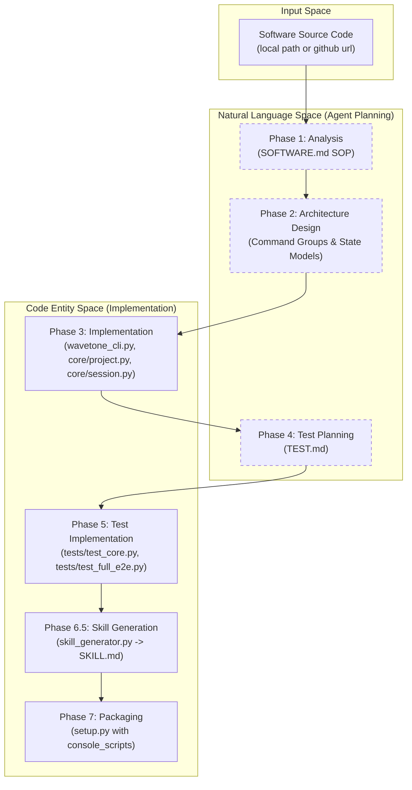
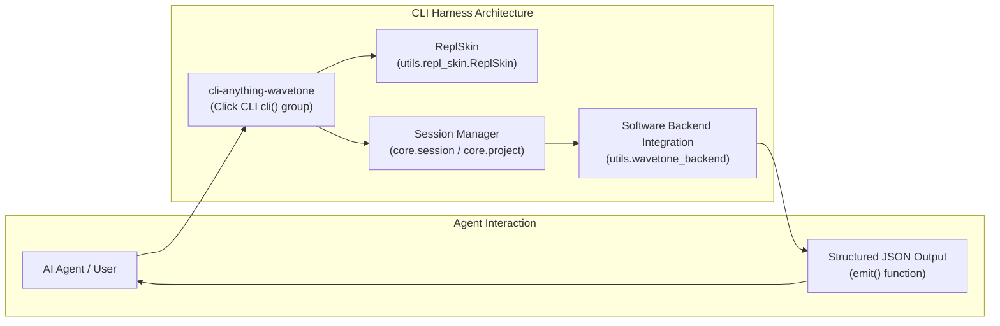

<!-- source: DeepWiki mcp.deepwiki.com · repo HKUDS/CLI-Anything · page 2 Getting Started · fetched 2026-11-09 -->

# Getting Started

Relevant source files

The following files were used as context for generating this wiki page:

- [.github/workflows/check-codex-skill.yml](.github/workflows/check-codex-skill.yml)
- [.gitignore](.gitignore)
- [README.md](README.md)
- [README_CN.md](README_CN.md)
- [README_JA.md](README_JA.md)
- [codex-skill/SKILL.md](codex-skill/SKILL.md)
- [codex-skill/agents/openai.yaml](codex-skill/agents/openai.yaml)
- [codex-skill/scripts/install.ps1](codex-skill/scripts/install.ps1)
- [codex-skill/scripts/install.sh](codex-skill/scripts/install.sh)
- [codex-skill/tests/test_install.sh](codex-skill/tests/test_install.sh)
- [skills/cli-anything-wavetone/SKILL.md](skills/cli-anything-wavetone/SKILL.md)
- [wavetone/agent-harness/cli_anything/wavetone/README.md](wavetone/agent-harness/cli_anything/wavetone/README.md)
- [wavetone/agent-harness/cli_anything/wavetone/core/audio.py](wavetone/agent-harness/cli_anything/wavetone/core/audio.py)
- [wavetone/agent-harness/cli_anything/wavetone/core/project.py](wavetone/agent-harness/cli_anything/wavetone/core/project.py)
- [wavetone/agent-harness/cli_anything/wavetone/core/session.py](wavetone/agent-harness/cli_anything/wavetone/core/session.py)
- [wavetone/agent-harness/cli_anything/wavetone/tests/TEST.md](wavetone/agent-harness/cli_anything/wavetone/tests/TEST.md)
- [wavetone/agent-harness/cli_anything/wavetone/tests/test_core.py](wavetone/agent-harness/cli_anything/wavetone/tests/test_core.py)
- [wavetone/agent-harness/cli_anything/wavetone/tests/test_full_e2e.py](wavetone/agent-harness/cli_anything/wavetone/tests/test_full_e2e.py)
- [wavetone/agent-harness/cli_anything/wavetone/utils/repl_skin.py](wavetone/agent-harness/cli_anything/wavetone/utils/repl_skin.py)
- [wavetone/agent-harness/cli_anything/wavetone/utils/wavetone_backend.py](wavetone/agent-harness/cli_anything/wavetone/utils/wavetone_backend.py)
- [wavetone/agent-harness/cli_anything/wavetone/wavetone_cli.py](wavetone/agent-harness/cli_anything/wavetone/wavetone_cli.py)
- [wavetone/agent-harness/setup.py](wavetone/agent-harness/setup.py)

This page guides users through the initial setup and first usage of CLI-Anything, providing a high-level overview of platform-specific installations, the automated CLI generation walkthrough, and basic execution patterns. For comprehensive details, see the child pages: **[Platform Installation](#2.1)**, **[Generating Your First CLI](#2.2)**, and **[Using a Generated CLI](#2.3)**.

Sources: `[README.md:1-12]()`, `[README_CN.md:56-64]()`

---

## 2.1. Platform Installation

CLI-Anything integrates with multiple AI agent platforms. Each platform adapter makes `/cli-anything` and related slash commands available within the agent workspace.

- **Claude Code Plugin**: Installed via marketplace commands such as `/plugin marketplace add` and `/plugin install cli-anything` `[README_CN.md:73-83]()`.
- **OpenCode Commands**: Utilizes global or project-level copies of command files and `HARNESS.md` placed in `~/.config/opencode/commands/` `[README_CN.md:173-178]()`.
- **Qodercli Plugin**: Registered via `setup-qodercli.sh` which updates `~/.qoder.json` `[README_CN.md:216-218]()`.
- **OpenClaw Skill**: Native skill integration via `SKILL.md` placed in `~/.openclaw/skills/`.
- **Codex Skill**: Installed via `codex-skill/scripts/install.sh` or `install.ps1` scripts (`[codex-skill/scripts/install.sh:10-11]()`, `[codex-skill/scripts/install.ps1:17-18]()`), utilizing metadata in `codex-skill/agents/openai.yaml` and validated by CI workflows.
- **Reasonix, Hermes, Cursor and Pi Adapters**: Additional platform adapters include `reasonix-skill/`, `hermes-skill/`, `cursor-plugin/`, and `.pi-extension/cli-anything` (`[.pi-extension/cli-anything]()`, `[README.md:53]()`).

For platform-specific setup guides, see **[Platform Installation](#2.1)**.

Sources: `[README.md:37]()`, `[README_CN.md:73-218]()`, `[codex-skill/scripts/install.sh:10-58]()`

---

## 2.2. Generating Your First CLI

Once installed, running `/cli-anything <software-path>` triggers a strict 7-phase automated generation process guided by `HARNESS.md`. This pipeline converts application source code or repository URLs into fully tested, agent-native CLI harnesses.

### Bridging Natural Language to Code Entities

The diagram below illustrates how user prompts and agent planning space map to concrete Python modules and harness implementation artifacts during generation.

**Generation Pipeline Architecture**

Sources: `[cli-anything-plugin/skill_generator.py:7-142]()`, `[wavetone/agent-harness/setup.py]()`, `[wavetone/agent-harness/cli_anything/wavetone/wavetone_cli.py:67-85]()`

For a detailed phase-by-phase breakdown, see **[Generating Your First CLI](#2.2)**.

---

## 2.3. Using a Generated CLI

Generated CLIs are exposed via console scripts (e.g., `cli-anything-<software>`) defined in `setup.py` (`[wavetone/agent-harness/setup.py]()`). They support two execution patterns:

1. **REPL Mode**: Invoked with no arguments, starting an interactive shell (`[wavetone/agent-harness/cli_anything/wavetone/wavetone_cli.py:83-85]()`) managed by `ReplSkin` (`[wavetone/agent-harness/cli_anything/wavetone/utils/repl_skin.py]()`) with history and prompts (`[wavetone/agent-harness/cli_anything/wavetone/wavetone_cli.py:89-97]()`).
2. **One-Shot & JSON Mode**: Invoked with subcommands and flags such as `--json` (`[wavetone/agent-harness/cli_anything/wavetone/wavetone_cli.py:69]()`), emitting structured machine-readable objects for agent parsing (`[wavetone/agent-harness/cli_anything/wavetone/wavetone_cli.py:30-38]()`).

### CLI Execution Architecture

Sources: `[wavetone/agent-harness/cli_anything/wavetone/wavetone_cli.py:30-118]()`, `[wavetone/agent-harness/cli_anything/wavetone/utils/repl_skin.py]()`

For detailed usage instructions, flag references, and REPL commands, see **[Using a Generated CLI](#2.3)**.

---

