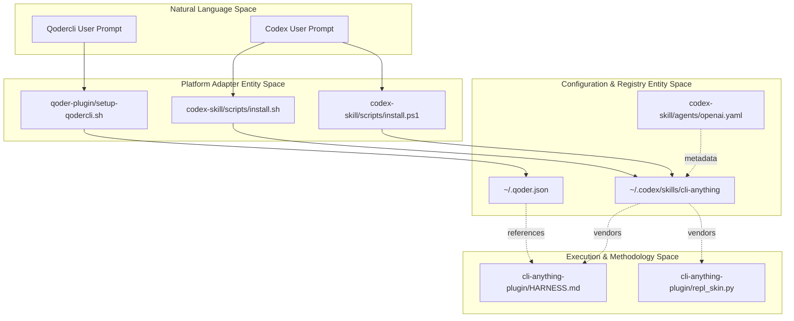
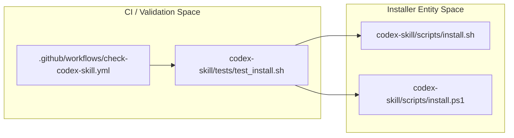

<!-- source: DeepWiki mcp.deepwiki.com · repo HKUDS/CLI-Anything · page 2.1 Platform Installation · fetched 2026-11-09 -->

# Platform Installation

Relevant source files

The following files were used as context for generating this wiki page:

- [.github/workflows/check-codex-skill.yml](.github/workflows/check-codex-skill.yml)
- [codex-skill/SKILL.md](codex-skill/SKILL.md)
- [codex-skill/agents/openai.yaml](codex-skill/agents/openai.yaml)
- [codex-skill/scripts/install.ps1](codex-skill/scripts/install.ps1)
- [codex-skill/scripts/install.sh](codex-skill/scripts/install.sh)
- [codex-skill/tests/test_install.sh](codex-skill/tests/test_install.sh)
- [qoder-plugin/setup-qodercli.sh](qoder-plugin/setup-qodercli.sh)

This document provides an overview of CLI-Anything's multi-platform integration architecture and the supported AI agent platforms. Each platform features a specialized installation mechanism, but all converge on the same core methodology defined in `cli-anything-plugin/HARNESS.md` as the single source of truth.

For detailed installation procedures specific to each platform, see the child pages:
- [Claude Code Plugin](#2.1.1) — Installing via Claude Code marketplace (`/plugin marketplace add`, `/plugin install`).
- [OpenCode Commands](#2.1.2) — Copying command files and `HARNESS.md` to `~/.config/opencode/commands/`.
- [Qodercli Plugin](#2.1.3) — Running `setup-qodercli.sh` to register in `~/.qoder.json` [qoder-plugin/setup-qodercli.sh:41]().
- [OpenClaw Skill](#2.1.4) — Copying `SKILL.md` to `~/.openclaw/skills/` for native skill integration.
- [Codex Skill](#2.1.5) — Running `install.sh`/`install.ps1` scripts [codex-skill/scripts/install.sh:1](), [codex-skill/scripts/install.ps1:1](), leveraging `agents/openai.yaml` metadata [codex-skill/agents/openai.yaml:1](), and the `check-codex-skill` CI workflow [.github/workflows/check-codex-skill.yml:1]().
- [Reasonix, Hermes, Cursor and Pi Adapters](#2.1.6) — Cover additional platform adapters including `reasonix-skill/`, `hermes-skill/`, `cursor-plugin/`, and `.pi-extension/cli-anything`.

---

## Platform-Agnostic Architecture & Installation Overview

CLI-Anything utilizes a platform abstraction pattern where natural language requests across disparate agent interfaces route into a unified 7-phase generation pipeline.

**Diagram: Natural Language Space to Code Entity Space (Installation Flow)**

**Sources:** [qoder-plugin/setup-qodercli.sh:1-42](), [codex-skill/scripts/install.sh:1-15](), [codex-skill/scripts/install.ps1:1-18](), [codex-skill/agents/openai.yaml:1-4]()

---

## Summary of Platform Installation Approaches

Each supported environment bridges user instructions to the generation pipeline through specific scripts or marketplace mechanisms:

| Platform | Primary Installation Script / Command | Target Configuration Path | Key Artifacts |
|----------|-------------------------------------|---------------------------|---------------|
| **Claude Code** | `/plugin marketplace add` / `/plugin install` | `~/.claude/plugins/cli-anything/` | `plugin.json`, commands [cli-anything-plugin/README.md:1]() |
| **OpenCode** | Manual copy or sync script | `~/.config/opencode/commands/` | `cli-anything*.md`, `HARNESS.md` [README_CN.md:172-180]() |
| **Qodercli** | `bash qoder-plugin/setup-qodercli.sh` [qoder-plugin/setup-qodercli.sh:1]() | `~/.qoder.json` [qoder-plugin/setup-qodercli.sh:41]() | Plugin registry source entry |
| **OpenClaw** | Manual directory placement | `~/.openclaw/skills/cli-anything/` | `SKILL.md` [README_CN.md:244]() |
| **Codex** | `bash codex-skill/scripts/install.sh` [codex-skill/scripts/install.sh:1]() | `~/.codex/skills/cli-anything` [codex-skill/scripts/install.sh:10]() | Vendored `HARNESS.md`, scripts, `openai.yaml` [codex-skill/agents/openai.yaml:1]() |
| **Other Adapters** | Platform-specific install scripts | Various local paths | `.pi-extension/`, `cursor-plugin/`, `hermes-skill/`, `reasonix-skill/` |

**Sources:** [qoder-plugin/setup-qodercli.sh:1-57](), [codex-skill/scripts/install.sh:1-62](), [codex-skill/agents/openai.yaml:1-4]()

---

## Installation Validation and CI

To guarantee that installation scripts function reliably across operating systems and upgrades, automated checks run within GitHub Actions. For instance, the Codex skill installer is rigorously tested via `codex-skill/tests/test_install.sh` [codex-skill/tests/test_install.sh:1]() and governed by the `.github/workflows/check-codex-skill.yml` workflow [.github/workflows/check-codex-skill.yml:1]().

**Diagram: Installation Verification Pipeline**

**Sources:** [.github/workflows/check-codex-skill.yml:1-31](), [codex-skill/tests/test_install.sh:1-40]()

---

