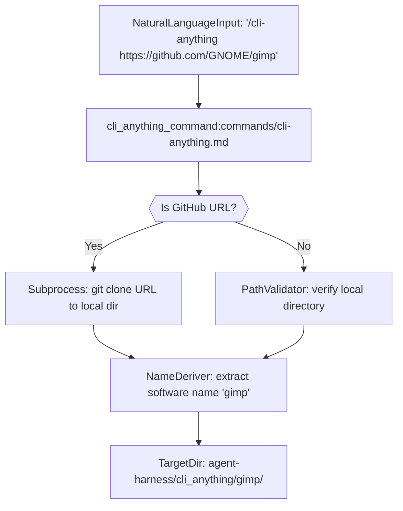
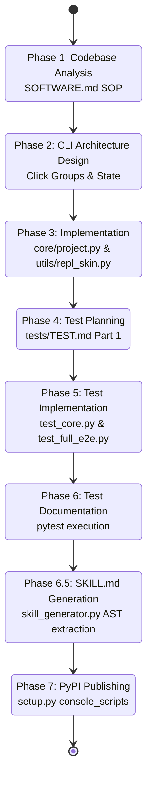

<!-- source: DeepWiki mcp.deepwiki.com · repo HKUDS/CLI-Anything · page 2.2 Generating Your First CLI · fetched 2026-11-09 -->

# Generating Your First CLI

<details>
<summary>Relevant source files</summary>

The following files were used as context for generating this wiki page:

- [cli-anything-plugin/HARNESS.md](cli-anything-plugin/HARNESS.md)
- [cli-anything-plugin/README.md](cli-anything-plugin/README.md)
- [cli-anything-plugin/commands/cli-anything.md](cli-anything-plugin/commands/cli-anything.md)
- [cli-anything-plugin/commands/list.md](cli-anything-plugin/commands/list.md)
- [cli-anything-plugin/commands/refine.md](cli-anything-plugin/commands/refine.md)
- [cli-anything-plugin/commands/test.md](cli-anything-plugin/commands/test.md)
- [cli-anything-plugin/commands/validate.md](cli-anything-plugin/commands/validate.md)
- [cli-anything-plugin/guides/filter-translation.md](cli-anything-plugin/guides/filter-translation.md)
- [cli-anything-plugin/guides/mcp-backend.md](cli-anything-plugin/guides/mcp-backend.md)
- [cli-anything-plugin/guides/pypi-publishing.md](cli-anything-plugin/guides/pypi-publishing.md)
- [cli-anything-plugin/guides/session-locking.md](cli-anything-plugin/guides/session-locking.md)
- [cli-anything-plugin/guides/skill-generation.md](cli-anything-plugin/guides/skill-generation.md)
- [cli-anything-plugin/guides/timecode-precision.md](cli-anything-plugin/guides/timecode-precision.md)
- [cli-anything-plugin/repl_skin.py](cli-anything-plugin/repl_skin.py)
- [krita/agent-harness/KRITA.md](krita/agent-harness/KRITA.md)
- [krita/agent-harness/cli_anything/krita/README.md](krita/agent-harness/cli_anything/krita/README.md)
- [krita/agent-harness/cli_anything/krita/__init__.py](krita/agent-harness/cli_anything/krita/__init__.py)
- [krita/agent-harness/cli_anything/krita/__main__.py](krita/agent-harness/cli_anything/krita/__main__.py)

</details>


This guide walks through the process of running the CLI generation command for the first time and understanding the 7-phase automated pipeline that transforms a software codebase into an agent-native CLI harness.

**Scope:** This page assumes you have already installed CLI-Anything on your chosen platform (see [2.1. Platform Installation]()). It focuses on executing the generation command and understanding the output. For information about using the generated CLI after installation, see [2.3. Using a Generated CLI](). For detailed methodology behind each phase, see [4. The 7-Phase Generation Pipeline]().

---

## Prerequisites

Before generating your first CLI, ensure:

1.  **Platform installed** — You have completed one of the platform installation procedures. [cli-anything-plugin/README.md:21-40]()
2.  **Target software available** — You have either:
    *   A **local path** to the software source code (e.g., `/home/user/gimp`, `./blender`). [cli-anything-plugin/commands/cli-anything.md:18-18]()
    *   A **GitHub repository URL** (e.g., `https://github.com/GNOME/gimp`). [cli-anything-plugin/commands/cli-anything.md:19-19]()
3.  **Python 3.10+** — Required for the generated CLI package execution. [cli-anything-plugin/README.md:44-44]()

Sources: [cli-anything-plugin/README.md:42-55](), [cli-anything-plugin/commands/cli-anything.md:15-24]()

---

## Command Syntax and Invocation

The generation command follows a consistent pattern across all agent platforms, translating high-level natural language intent or slash commands into automated harness creation procedures handled by the plugin code:

| Platform | Command Format | Code Handler / Entry Point |
| :--- | :--- | :--- |
| **Claude Code** | `/cli-anything <software-path-or-repo>` | `cli-anything-plugin/commands/cli-anything.md` |
| **OpenCode** | `/cli-anything <software-path-or-repo>` | `cli-anything-plugin/commands/cli-anything.md` |
| **Qodercli** | `/cli-anything:cli-anything <software-path-or-repo>` | `cli-anything-plugin/commands/cli-anything.md` |
| **OpenClaw** | `@cli-anything build a CLI for <path-or-repo>` | `cli-anything-plugin/commands/cli-anything.md` |

**Important:** The argument must be an actual path or URL to source code, not just a software name. `./gimp` or `https://github.com/GNOME/gimp` are valid; `"gimp"` alone is not. [cli-anything-plugin/commands/cli-anything.md:23-23]()

Sources: [cli-anything-plugin/README.md:59-70](), [cli-anything-plugin/commands/cli-anything.md:11-24]()

---

## Phase 0: Source Acquisition

Before the 7-phase pipeline begins, CLI-Anything normalizes the input arguments via the source acquisition logic.

Diagram: Natural Language to Code Entity Space - Source Acquisition

Sources: [cli-anything-plugin/commands/cli-anything.md:29-33]()

---

## The 7-Phase Pipeline Execution

Once the source is acquired, the automated pipeline executes sequential phases defined in `HARNESS.md`. [cli-anything-plugin/commands/cli-anything.md:27-27]()

### Pipeline State Machine

Diagram: Natural Language to Code Entity Space - Pipeline Architecture

Sources: [cli-anything-plugin/README.md:153-238](), [cli-anything-plugin/commands/cli-anything.md:34-86]()

---

## Phase-by-Phase Breakdown

### Phase 1: Codebase Analysis
The agent analyzes the source code structure to identify the backend engine, map GUI actions to internal API calls, and determine project file serialization formats. [cli-anything-plugin/README.md:154-162]()
Sources: [cli-anything-plugin/README.md:154-162](), [cli-anything-plugin/commands/cli-anything.md:34-40]()

### Phase 2: CLI Architecture Design
Using Phase 1 analysis, the agent designs the Click command hierarchy, data model persistence, and output formats (human vs `--json`). [cli-anything-plugin/README.md:164-172]()
Sources: [cli-anything-plugin/README.md:164-173](), [cli-anything-plugin/commands/cli-anything.md:41-45]()

### Phase 3: Implementation
The core implementation phase builds the Python package structure under `agent-harness/cli_anything/<software>/`.
Sources: [cli-anything-plugin/README.md:174-184](), [cli-anything-plugin/commands/cli-anything.md:46-52]()

### Phase 4: Test Planning
Before writing test code, the agent generates `tests/TEST.md` containing the unit test plan, E2E test plan, and workflow scenarios. [cli-anything-plugin/README.md:186-193]()
Sources: [cli-anything-plugin/README.md:186-193](), [cli-anything-plugin/commands/cli-anything.md:53-58]()

### Phase 5: Test Implementation
Writes unit tests (`tests/test_core.py`), end-to-end tests (`tests/test_full_e2e.py`), and subprocess harness tests using `_resolve_cli()`. [cli-anything-plugin/README.md:195-205]()
Sources: [cli-anything-plugin/commands/cli-anything.md:59-66](), [cli-anything-plugin/README.md:195-205]()

### Phase 6: Test Documentation
Executes `pytest -v --tb=no`, appends execution output to `tests/TEST.md`, and documents coverage. [cli-anything-plugin/README.md:207-214]()
Sources: [cli-anything-plugin/commands/cli-anything.md:67-71](), [cli-anything-plugin/README.md:207-214]()

### Phase 6.5: SKILL.md Generation
Invokes `skill_generator.py` to extract CLI metadata via AST inspection of Click decorators, generating YAML frontmatter and Markdown bodies for agent discovery. [cli-anything-plugin/guides/skill-generation.md:36-53]()
Sources: [cli-anything-plugin/guides/skill-generation.md:1-135](), [cli-anything-plugin/commands/cli-anything.md:72-78]()

### Phase 7: PyPI Publishing and Installation
Creates `setup.py` using `find_namespace_packages(include=["cli_anything.*"])`, configures `console_scripts` entry points, and installs via `pip install -e .`. [cli-anything-plugin/README.md:226-238]()
Sources: [cli-anything-plugin/commands/cli-anything.md:79-86](), [cli-anything-plugin/README.md:226-238]()

---

## Output Structure

The resulting directory layout inside `agent-harness/` conforms strictly to the namespace package standard:

```text
agent-harness/
├── <SOFTWARE>.md          # Software-specific SOP
├── setup.py               # PyPI package config (find_namespace_packages)
└── cli_anything/          # Namespace package (NO __init__.py)
    └── <software>/        # Sub-package (HAS __init__.py)
        ├── README.md          # Installation and usage guide
        ├── <software>_cli.py  # Main CLI entry point (Click)
        ├── core/              # Core modules (project, session, export)
        │   ├── project.py
        │   ├── session.py
        │   └── export.py
        ├── skills/
        │   └── SKILL.md       # AI-discoverable skill definition
        ├── utils/             # Utilities (repl_skin, backend)
        └── tests/
            ├── TEST.md        # Test plan and results
            ├── test_core.py   # Unit tests
            └── test_full_e2e.py # E2E tests
```
Sources: [cli-anything-plugin/commands/cli-anything.md:87-110]()

---

## Verifying Success

A generation is verified successful when:
1. All core modules are functional and support session state tracking. [cli-anything-plugin/commands/cli-anything.md:125-125]()
2. `--json` output mode operates correctly for programmatic consumption. [cli-anything-plugin/commands/cli-anything.md:127-127]()
3. All tests pass (100% pass rate) including subprocess validations via `_resolve_cli()`. [cli-anything-plugin/commands/cli-anything.md:128-129]()
4. The executable is registered in system PATH as `cli-anything-<software>`. [cli-anything-plugin/commands/cli-anything.md:134-134]()

Sources: [cli-anything-plugin/commands/cli-anything.md:122-135]()

---

