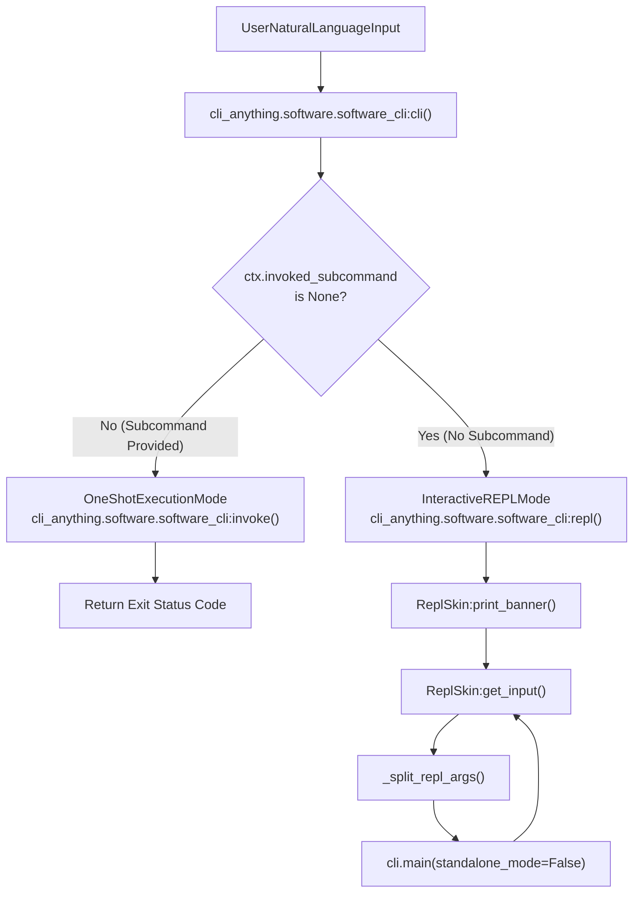

<!-- source: DeepWiki mcp.deepwiki.com · repo HKUDS/CLI-Anything · page 2.3 Using a Generated CLI · fetched 2026-11-09 -->

# Using A Generated CLI

<details>
<summary>Relevant source files</summary>

The following files were used as context for generating this wiki page:

- [.gitignore](.gitignore)
- [README.md](README.md)
- [README_CN.md](README_CN.md)
- [README_JA.md](README_JA.md)
- [siyuan/agent-harness/SIYUAN.md](siyuan/agent-harness/SIYUAN.md)
- [siyuan/agent-harness/cli_anything/siyuan/README.md](siyuan/agent-harness/cli_anything/siyuan/README.md)
- [siyuan/agent-harness/cli_anything/siyuan/__init__.py](siyuan/agent-harness/cli_anything/siyuan/__init__.py)
- [siyuan/agent-harness/cli_anything/siyuan/__main__.py](siyuan/agent-harness/cli_anything/siyuan/__main__.py)
- [siyuan/agent-harness/cli_anything/siyuan/core/__init__.py](siyuan/agent-harness/cli_anything/siyuan/core/__init__.py)
- [siyuan/agent-harness/cli_anything/siyuan/core/client.py](siyuan/agent-harness/cli_anything/siyuan/core/client.py)
- [siyuan/agent-harness/cli_anything/siyuan/core/session.py](siyuan/agent-harness/cli_anything/siyuan/core/session.py)
- [siyuan/agent-harness/cli_anything/siyuan/siyuan_cli.py](siyuan/agent-harness/cli_anything/siyuan/siyuan_cli.py)
- [siyuan/agent-harness/cli_anything/siyuan/skills/SKILL.md](siyuan/agent-harness/cli_anything/siyuan/skills/SKILL.md)
- [siyuan/agent-harness/cli_anything/siyuan/tests/test_cli_commands.py](siyuan/agent-harness/cli_anything/siyuan/tests/test_cli_commands.py)
- [siyuan/agent-harness/cli_anything/siyuan/tests/test_core.py](siyuan/agent-harness/cli_anything/siyuan/tests/test_core.py)
- [siyuan/agent-harness/cli_anything/siyuan/tests/test_full_e2e.py](siyuan/agent-harness/cli_anything/siyuan/tests/test_full_e2e.py)
- [skills/cli-anything-wavetone/SKILL.md](skills/cli-anything-wavetone/SKILL.md)
- [wavetone/agent-harness/cli_anything/wavetone/README.md](wavetone/agent-harness/cli_anything/wavetone/README.md)
- [wavetone/agent-harness/cli_anything/wavetone/core/audio.py](wavetone/agent-harness/cli_anything/wavetone/core/audio.py)
- [wavetone/agent-harness/cli_anything/wavetone/core/project.py](wavetone/agent-harness/cli_anything/wavetone/core/project.py)
- [wavetone/agent-harness/cli_anything/wavetone/core/session.py](wavetone/agent-harness/cli_anything/wavetone/core/session.py)
- [wavetone/agent-harness/cli_anything/wavetone/tests/TEST.md](wavetone/agent-harness/cli_anything/wavetone/tests/TEST.md)
- [wavetone/agent-harness/cli_anything/wavetone/tests/test_core.py](wavetone/agent-harness/cli_anything/wavetone/tests/test_core.py)
- [wavetone/agent-harness/cli_anything/wavetone/tests/test_full_e2e.py](wavetone/agent-harness/cli_anything/wavetone/tests/test_full_e2e.py)
- [wavetone/agent-harness/cli_anything/wavetone/utils/repl_skin.py](wavetone/agent-harness/cli_anything/wavetone/utils/repl_skin.py)
- [wavetone/agent-harness/cli_anything/wavetone/utils/wavetone_backend.py](wavetone/agent-harness/cli_anything/wavetone/utils/wavetone_backend.py)
- [wavetone/agent-harness/cli_anything/wavetone/wavetone_cli.py](wavetone/agent-harness/cli_anything/wavetone/wavetone_cli.py)
- [wavetone/agent-harness/setup.py](wavetone/agent-harness/setup.py)

</details>


## Purpose and Scope
This page covers how to use a generated `cli-anything-<software>` CLI harness after the 7-phase generation pipeline completes. It details installation verification, execution modes (one-shot and REPL), command-line option structures (`--json`, `--help`, global config flags), error translation, and subprocess testing patterns.

Sources: [wavetone/agent-harness/cli_anything/wavetone/README.md:1-46](), [siyuan/agent-harness/cli_anything/siyuan/siyuan_cli.py:1-106]()

---

## Installation and Verification

After building or generating a harness, install it into your active Python environment in editable mode to register its console entry points.

```bash
cd <software>/agent-harness
pip install -e .
which cli-anything-<software>
```

The package layout relies on PEP 420 namespace packages where the top-level `cli_anything/` directory contains **no** `__init__.py` file, allowing multiple independent software harnesses to share the namespace cleanly. The sub-package (`cli_anything/<software>/`) hosts the core logic, while `setup.py` maps console scripts to the primary CLI entry point module.

Sources: [README.md:12-12](), [.gitignore:1-10]()

---

## CLI Invocation Modes

Generated CLIs support two primary modes of execution: **One-Shot Execution** for programmatic shell scripting or AI agent subprocess calls, and **REPL Mode** for interactive sessions with rich terminal styling via `ReplSkin`.

### Invocation Mode Decision Flow


Sources: [siyuan/agent-harness/cli_anything/siyuan/siyuan_cli.py:64-105](), [wavetone/agent-harness/cli_anything/wavetone/wavetone_cli.py:67-119]()

---

## Command-Line Interface Structure

Click-based command groups organize features hierarchically. Global parameters such as `--json`, `--help`, and backend connection parameters (`--host`, `--port`, `--token`, `--project`) apply across all subcommands.

### Command Structure and Error Translation

```mermaid
flowchart TB
    subgraph NaturalLanguageSpace
        NLCommand["User Command: 'sy search \"model\"'"]
        NLJSON["Agent Query: 'cli-anything-wavetone --json project new'"]
    end

    subgraph CodeEntitySpace
        ClickMain["click.group(cls=_CatchErrors, invoke_without_command=True)<br/>cli_anything.siyuan.siyuan_cli:cli()"]
        CatchGroup["class _CatchErrors(click.Group)<br/>Converts SiYuanClientError to exit code 1"]
        CommandGroups["Subcommand Groups:<br/>- project (cli_anything.wavetone.wavetone_cli:project_group)<br/>- audio (probe_audio)<br/>- search (search_blocks)"]
        EmitFunc["emit(data, json_mode)<br/>cli_anything.wavetone.wavetone_cli:emit()"]
    end

    NLCommand --> ClickMain
    NLJSON --> ClickMain
    ClickMain --> CatchGroup
    CatchGroup --> CommandGroups
    CommandGroups --> EmitFunc
```
Sources: [siyuan/agent-harness/cli_anything/siyuan/siyuan_cli.py:44-63](), [wavetone/agent-harness/cli_anything/wavetone/wavetone_cli.py:30-40]()

---

## REPL Mode and ReplSkin Integration

When invoked without subcommands, the CLI enters an interactive read-eval-print loop powered by `prompt_toolkit` and `ReplSkin`.

- **Banner Display**: Shows the software name, version, branding, and local skill path for AI agent discovery [wavetone/agent-harness/cli_anything/wavetone/tests/test_core.py:38-38]().
- **Context Preservation**: Maintains workspace state (such as active project paths or connected host parameters) across sequential commands [wavetone/agent-harness/cli_anything/wavetone/tests/test_core.py:31-32]().
- **Robust Argument Splitting**: Uses `_split_repl_args()` with `shlex.split(posix=False)` and quote stripping to handle Windows path backslashes and quoted arguments safely [wavetone/agent-harness/cli_anything/wavetone/tests/test_core.py:37-37](), [wavetone/agent-harness/cli_anything/wavetone/wavetone_cli.py:57-65]().

Sources: [wavetone/agent-harness/cli_anything/wavetone/wavetone_cli.py:87-119](), [wavetone/agent-harness/cli_anything/wavetone/tests/test_core.py:124-125]()

---

## JSON Output and Agent Integration

To support LLM and AI agent integration, all generated CLIs accept a `--json` flag. When enabled, responses are serialized to machine-readable JSON via `emit()` or `ctx_json(ctx)` checks, avoiding human-formatted console tables or chat strings.

- **Deterministic Payload**: Structured keys (`ok`, `project_path`, `project`, `errors`) ensure agents can parse execution status without brittle regex.
- **UTF-8 Stream Enforcement**: Harnesses explicitly reconfigure `sys.stdout` and `sys.stderr` to UTF-8 to prevent encoding crashes on Windows CJK environments [siyuan/agent-harness/cli_anything/siyuan/siyuan_cli.py:73-76]().

Sources: [wavetone/agent-harness/cli_anything/wavetone/wavetone_cli.py:30-43](), [siyuan/agent-harness/cli_anything/siyuan/tests/test_cli_commands.py:65-76]()

---

## Common Subprocess Operations and Testing

AI agents and automated testing frameworks invoke generated CLIs as subprocesses. The test architecture implements a `_resolve_cli()` pattern to guarantee correct module resolution during development versus installed execution.

```python
# Typical E2E subprocess resolution pattern
def _resolve_cli(name: str, force_installed: bool = False) -> list[str]:
    module = "cli_anything.wavetone.wavetone_cli"
    if not force_installed:
        return [sys.executable, "-m", module]
    path = shutil.which(name)
    if not path:
        raise RuntimeError(f"{name} not found in PATH.")
    return [path]
```

Sources: [wavetone/agent-harness/cli_anything/wavetone/tests/test_full_e2e.py:18-30](), [wavetone/agent-harness/cli_anything/wavetone/tests/TEST.md:5-9]()

---

