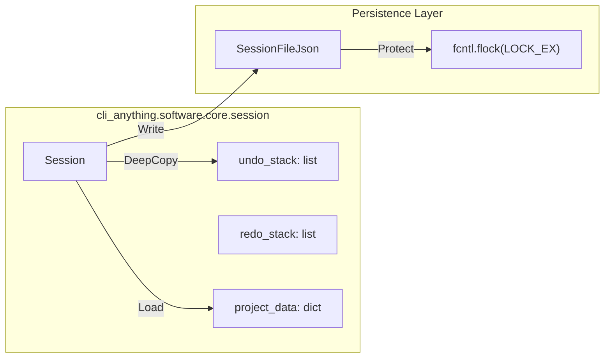
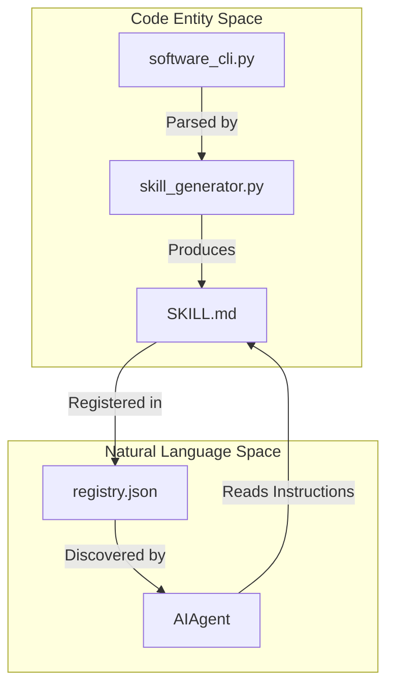

<!-- source: DeepWiki mcp.deepwiki.com · repo HKUDS/CLI-Anything · page 3 Core Concepts · fetched 2026-11-09 -->

# Core Concepts

<details>
<summary>Relevant source files</summary>

The following files were used as context for generating this wiki page:

- [cli-anything-plugin/HARNESS.md](cli-anything-plugin/HARNESS.md)
- [cli-anything-plugin/README.md](cli-anything-plugin/README.md)
- [cli-anything-plugin/guides/filter-translation.md](cli-anything-plugin/guides/filter-translation.md)
- [cli-anything-plugin/guides/mcp-backend.md](cli-anything-plugin/guides/mcp-backend.md)
- [cli-anything-plugin/guides/pypi-publishing.md](cli-anything-plugin/guides/pypi-publishing.md)
- [cli-anything-plugin/guides/session-locking.md](cli-anything-plugin/guides/session-locking.md)
- [cli-anything-plugin/guides/skill-generation.md](cli-anything-plugin/guides/skill-generation.md)
- [cli-anything-plugin/guides/timecode-precision.md](cli-anything-plugin/guides/timecode-precision.md)
- [cli-anything-plugin/repl_skin.py](cli-anything-plugin/repl_skin.py)

</details>


## Purpose and Scope

This page explains the fundamental architectural concepts and design principles behind CLI-Anything. It covers the **HARNESS.md** methodology, stateful session management, agent-native interface design, and authentic software integration strategies. 

For implementation details of the 7-phase generation pipeline, see [The 7-Phase Generation Pipeline](#4). For detailed architecture of generated CLIs, see [Generated CLI Architecture](#5).

---

## Conceptual Foundation

CLI-Anything transforms GUI-only applications into agent-accessible tools through a methodology called "harness generation." A harness is not a replacement for the underlying software—it is a structured command-line interface that generates valid project files and delegates to the real application for rendering [cli-anything-plugin/HARNESS.md:5-10]().

### From Human-Centric to Agent-Native
Traditional software is designed for human interaction via mouse and display. CLI-Anything provides a "skin" that translates high-level agent commands into software-specific API calls or file manipulations [README.md:4-6]().

**Title: Bridging the Gap**
```mermaid
graph TB
    subgraph "Traditional Approach"
        GUIApp["GUIApplication"]
        AIAgent1["AIAgent"]
        
        AIAgent1 -.x.-> GUIApp
        
        Note1["❌ No programmatic access<br/>❌ UI automation fragile<br/>❌ Limited APIs"]
    end
    
    subgraph "CLI-Anything Approach"
        GUIReal["GUIApplication (Real Software)"]
        Harness["click.Group (CLI Harness)"]
        Agent2["AIAgent"]
        ProjectFile["Project File (.json/.xml)"]
        
        Agent2 --> Harness
        Harness --> ProjectFile
        ProjectFile --> GUIReal
        GUIReal --> Output["Rendered Output"]
        
        Note2["✓ Structured commands<br/>✓ JSON output<br/>✓ Authentic rendering"]
    end
```
**Sources:** [README.md:1-6](), [cli-anything-plugin/HARNESS.md:5-10]()

---

## 3.1 The HARNESS.md Methodology
The `HARNESS.md` file is the **Single Source of Truth** and Standard Operating Procedure (SOP) for the entire project. It defines the 7-phase pipeline that agents follow to build a CLI [cli-anything-plugin/HARNESS.md:1-10]().

*   **Phase 1-2**: Discovery of the "Backend Engine" (e.g., `bpy` for Blender, `Script-Fu` for GIMP) and mapping GUI actions to API calls [cli-anything-plugin/HARNESS.md:12-48]().
*   **Phase 3**: Implementation of the `Click` CLI (`click.group`, `click.command`), `ReplSkin`, and core business logic [cli-anything-plugin/HARNESS.md:49-108]().
*   **Phase 4-6**: Strict testing requirements, including `TEST.md` documentation [cli-anything-plugin/HARNESS.md:109-158]().
*   **Phase 6.5**: Automatic generation of agent-discoverable skill manifests using `skill_generator.py` [cli-anything-plugin/guides/skill-generation.md:1-5]().
*   **Phase 7**: Packaging as a PEP 420 namespace package with `setup.py` [cli-anything-plugin/README.md:227-231]().

For details, see [The HARNESS.md Methodology](#3.1).

**Sources:** [cli-anything-plugin/HARNESS.md:12-132](), [README.md:99-107](), [cli-anything-plugin/guides/skill-generation.md:36-43]()

---

## 3.2 Agent-Native Design
A CLI is "agent-native" if it removes the friction of natural language parsing and state tracking for the AI. Key features include:

*   **Self-Describing**: Uses `click` decorators (`@click.command`, `@click.option`) to provide `--help` documentation that agents can query [cli-anything-plugin/HARNESS.md:44-48]().
*   **Structured Output**: Every command supports a `--json` flag for machine-readable results [cli-anything-plugin/HARNESS.md:46-47]().
*   **Unified UX**: Uses `ReplSkin` to provide a consistent visual interface and status reporting [cli-anything-plugin/HARNESS.md:74-94]().
*   **Discovery**: Ships with a `SKILL.md` file containing YAML metadata for platforms like OpenClaw or Claude Code [cli-anything-plugin/guides/skill-generation.md:17-24]().

For details, see [Agent-Native Design](#3.2).

**Sources:** [cli-anything-plugin/HARNESS.md:44-48](), [cli-anything-plugin/guides/skill-generation.md:1-24](), [cli-anything-plugin/repl_skin.py:106-111]()

---

## 3.3 Stateful Session Management
Unlike standard "one-shot" CLIs, CLI-Anything harnesses maintain persistent state.

*   **Deep-Copy Snapshots**: Before every mutation, the `Session` object performs a `deepcopy` of the project state to allow for reliable undos [cli-anything-plugin/HARNESS.md:69-70]().
*   **Undo/Redo Stack**: Managed via stacks in the `Session` class, typically supporting 50 levels [cli-anything-plugin/HARNESS.md:37]().
*   **Locked JSON Saves**: To prevent corruption during concurrent agent access, harnesses use the `_locked_save_json` pattern, opening with `r+` and truncating inside an `fcntl.flock` [cli-anything-plugin/guides/session-locking.md:9-12]().

For details, see [Stateful Session Management](#3.3).

**Title: Session Logic and Persistence**

**Sources:** [cli-anything-plugin/HARNESS.md:69-73](), [cli-anything-plugin/guides/session-locking.md:13-37]()

---

## 3.4 Authentic Backend Integration
The core principle is **"Use the Real Software—Don't Reimplement It."** Harnesses act as orchestrators for the actual application binaries [cli-anything-plugin/HARNESS.md:7-8]().

*   **Subprocess Invocation**: Uses `subprocess.run()` to call headless versions of software (e.g., `libreoffice --headless` or `blender --background`) [cli-anything-plugin/HARNESS.md:54-66]().
*   **Verification**: After an export, the harness validates the output using "Magic Bytes" rather than trusting exit codes alone [cli-anything-plugin/HARNESS.md:150-151]().
*   **Backend Discovery**: Uses `shutil.which()` or custom `find_software()` utilities in `utils/software_backend.py` to locate binaries [cli-anything-plugin/HARNESS.md:54-58]().

For details, see [Authentic Backend Integration](#3.4).

**Sources:** [cli-anything-plugin/HARNESS.md:54-68](), [cli-anything-plugin/README.md:173-184]()

---

## 3.5 SKILL.md and Agent Discovery
To bridge the "Natural Language Space" and the "Code Entity Space," CLI-Anything uses `SKILL.md` files. These files act as a manifest for AI agents [cli-anything-plugin/guides/skill-generation.md:3-5]().

*   **Auto-Generation**: The `skill_generator.py` script parses the CLI source code and docstrings to create the skill [cli-anything-plugin/guides/skill-generation.md:36-45]().
*   **Metadata**: Contains YAML frontmatter with the skill name and description [cli-anything-plugin/guides/skill-generation.md:19-23]().
*   **Integration**: `ReplSkin` auto-detects these files and prints their absolute path in the REPL banner so agents know exactly where to find the tool's documentation [cli-anything-plugin/guides/skill-generation.md:94-98]().

For details, see [SKILL.md and Agent Discovery](#3.5).

**Title: Skill Discovery Flow**

**Sources:** [cli-anything-plugin/guides/skill-generation.md:36-53](), [cli-anything-plugin/guides/skill-generation.md:94-105](), [README.md:73-81]()

---

