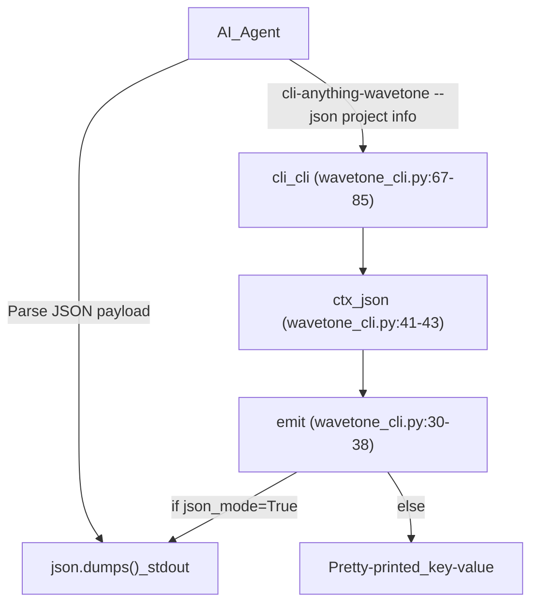
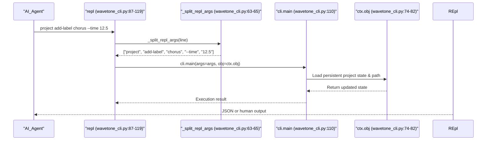

<!-- source: DeepWiki mcp.deepwiki.com · repo HKUDS/CLI-Anything · page 3.2 Agent-Native Design · fetched 2026-11-09 -->

# Agent-Native Design

Relevant source files

The following files were used as context for generating this wiki page:

- [.gitignore](.gitignore)
- [README.md](README.md)
- [README_CN.md](README_CN.md)
- [README_JA.md](README_JA.md)
- [minimax/agent-harness/FIX_NOTES.md](minimax/agent-harness/FIX_NOTES.md)
- [minimax/agent-harness/cli_anything/minimax/README.md](minimax/agent-harness/cli_anything/minimax/README.md)
- [minimax/agent-harness/cli_anything/minimax/minimax_cli.py](minimax/agent-harness/cli_anything/minimax/minimax_cli.py)
- [minimax/agent-harness/cli_anything/minimax/skills/SKILL.md](minimax/agent-harness/cli_anything/minimax/skills/SKILL.md)
- [minimax/agent-harness/cli_anything/minimax/tests/TEST.md](minimax/agent-harness/cli_anything/minimax/tests/TEST.md)
- [minimax/agent-harness/cli_anything/minimax/tests/test_core.py](minimax/agent-harness/cli_anything/minimax/tests/test_core.py)
- [minimax/agent-harness/cli_anything/minimax/tests/test_full_e2e.py](minimax/agent-harness/cli_anything/minimax/tests/test_full_e2e.py)
- [minimax/agent-harness/cli_anything/minimax/tests/test_tts_extended.py](minimax/agent-harness/cli_anything/minimax/tests/test_tts_extended.py)
- [minimax/agent-harness/cli_anything/minimax/utils/minimax_backend.py](minimax/agent-harness/cli_anything/minimax/utils/minimax_backend.py)
- [minimax/agent-harness/setup.py](minimax/agent-harness/setup.py)
- [registry.json](registry.json)
- [skills/cli-anything-minimax/SKILL.md](skills/cli-anything-minimax/SKILL.md)
- [skills/cli-anything-wavetone/SKILL.md](skills/cli-anything-wavetone/SKILL.md)
- [wavetone/agent-harness/cli_anything/wavetone/README.md](wavetone/agent-harness/cli_anything/wavetone/README.md)
- [wavetone/agent-harness/cli_anything/wavetone/core/audio.py](wavetone/agent-harness/cli_anything/wavetone/core/audio.py)
- [wavetone/agent-harness/cli_anything/wavetone/core/project.py](wavetone/agent-harness/cli_anything/wavetone/core/project.py)
- [wavetone/agent-harness/cli_anything/wavetone/core/session.py](wavetone/agent-harness/cli_anything/wavetone/core/session.py)
- [wavetone/agent-harness/cli_anything/wavetone/tests/TEST.md](wavetone/agent-harness/cli_anything/wavetone/tests/TEST.md)
- [wavetone/agent-harness/cli_anything/wavetone/tests/test_core.py](wavetone/agent-harness/cli_anything/wavetone/tests/test_core.py)
- [wavetone/agent-harness/cli_anything/wavetone/tests/test_full_e2e.py](wavetone/agent-harness/cli_anything/wavetone/tests/test_full_e2e.py)
- [wavetone/agent-harness/cli_anything/wavetone/utils/repl_skin.py](wavetone/agent-harness/cli_anything/wavetone/utils/repl_skin.py)
- [wavetone/agent-harness/cli_anything/wavetone/utils/wavetone_backend.py](wavetone/agent-harness/cli_anything/wavetone/utils/wavetone_backend.py)
- [wavetone/agent-harness/cli_anything/wavetone/wavetone_cli.py](wavetone/agent-harness/cli_anything/wavetone/wavetone_cli.py)
- [wavetone/agent-harness/setup.py](wavetone/agent-harness/setup.py)

## Purpose and Scope
This page defines the architectural and design principles that render a CLI "agent-native" within the CLI-Anything ecosystem. It details how generated tools bridge the gap between human-centric software and autonomous AI agent execution through self-describing interfaces, structured JSON serialization, stateful session management, and robust decoupling from specific agent frameworks.

---

## 1. What Makes a CLI Agent-Native?
"Agent-native" means software designed from the ground up to be operated by AI agents, not merely accessible to them. Traditional software serves human users through GUIs, documentation, and interactive workflows. Agent-native software treats AI agents as first-class users with distinct needs: structured output, self-describing interfaces, deterministic behavior, and no assumptions about how the agent will use the tool [README.md:8-10]().

CLI-Anything generates command-line interfaces that follow core principles separating agent-native design from traditional CLI wrappers or GUI automation tools.

Sources: [README.md:8-10]()

---

## 2. Core Design Principles

### 2.1 Self-Describing Interfaces
Agent-native CLIs expose their capabilities through standard discovery mechanisms. Agents discover commands dynamically using `--help` flags or by reading the `SKILL.md` file automatically generated during the pipeline [wavetone/agent-harness/cli_anything/wavetone/wavetone_cli.py:72-73](), [minimax/agent-harness/cli_anything/minimax/skills/SKILL.md:1-6]().

| Approach | Discovery Method | Agent Experience |
|----------|------------------|------------------|
| **Traditional CLI** | Man pages, unstructured text | Agent must parse arbitrary text or rely on hardcoded prompts |
| **REST API** | OpenAPI specs | Agent must parse complex schemas and manage HTTP states |
| **GUI Automation** | Accessibility Trees, OCR | Brittle, latency-heavy, prone to visual shifts |
| **Agent-Native CLI** | `SKILL.md` + `--help` flags | Agent reads structured YAML frontmatter and precise Click command trees |

Sources: [wavetone/agent-harent/cli_anything/wavetone/wavetone_cli.py:72-73](), [minimax/agent-harness/cli_anything/minimax/skills/SKILL.md:1-6]()

### 2.2 Structured Machine-Readable Output
Every command supports dual modes: human-readable output by default (using `ReplSkin` for formatted tables and logs), and machine-readable JSON via the `--json` flag [wavetone/agent-harness/cli_anything/wavetone/wavetone_cli.py:30-43]().

Diagram Title: "JSON Emission Data Flow from CLI Command to Output"

Sources: [wavetone/agent-harness/cli_anything/wavetone/wavetone_cli.py:30-43](), [wavetone/agent-harness/cli_anything/wavetone/wavetone_cli.py:67-85]()

### 2.3 Stateful Session Support
Agent-native CLIs maintain context across commands. While one-shot executions operate statelessly, interactive REPL sessions persist working directories, project files, and session event logs [wavetone/agent-harness/cli_anything/wavetone/wavetone_cli.py:87-119](), [wavetone/agent-harness/cli_anything/wavetone/core/session.py:1-25]().

Diagram Title: "Stateful REPL and Command Invocation Flow"

Sources: [wavetone/agent-harness/cli_anything/wavetone/wavetone_cli.py:63-119](), [wavetone/agent-harness/cli_anything/wavetone/core/session.py:1-25]()

### 2.4 No Assumptions About Agents
Agent-native tools make zero assumptions about the orchestration framework calling them. They enforce deterministic exit codes (`0` for success, non-zero for errors), write diagnostics exclusively to `stderr`, and package metadata so any agent framework (Claude Code, OpenCode, OpenClaw, Codex, Qodercli) can discover them via standardized skills [README_CN.md:28-54](), [minimax/agent-harness/cli_anything/minimax/skills/SKILL.md:1-6]().

Sources: [README_CN.md:28-54](), [minimax/agent-harness/cli_anything/minimax/skills/SKILL.md:1-6]()

---

## 3. Implementation Patterns in Code

### 3.1 Click Integration and REPL Fallback
Generated harnesses leverage the Python `click` library. The root command group uses `invoke_without_command=True` to seamlessly transition into an interactive REPL when invoked without arguments [wavetone/agent-harness/cli_anything/wavetone/wavetone_cli.py:67-85]().

Sources: [wavetone/agent-harness/cli_anything/wavetone/wavetone_cli.py:67-85]()

### 3.2 ReplSkin UI Abstraction
The `ReplSkin` class manages prompts, banners, and status feedback, separating human-friendly console decoration from structured data emission [wavetone/agent-harness/cli_anything/wavetone/wavetone_cli.py:91-94](), [wavetone/agent-harness/cli_anything/wavetone/utils/repl_skin.py:1-30]().

Sources: [wavetone/agent-harness/cli_anything/wavetone/wavetone_cli.py:91-94](), [wavetone/agent-harness/cli_anything/wavetone/utils/repl_skin.py:1-30]()

---

