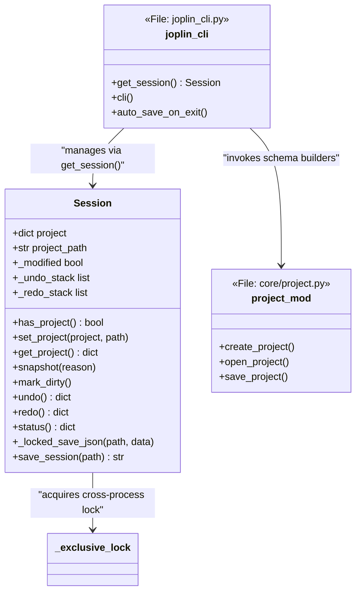
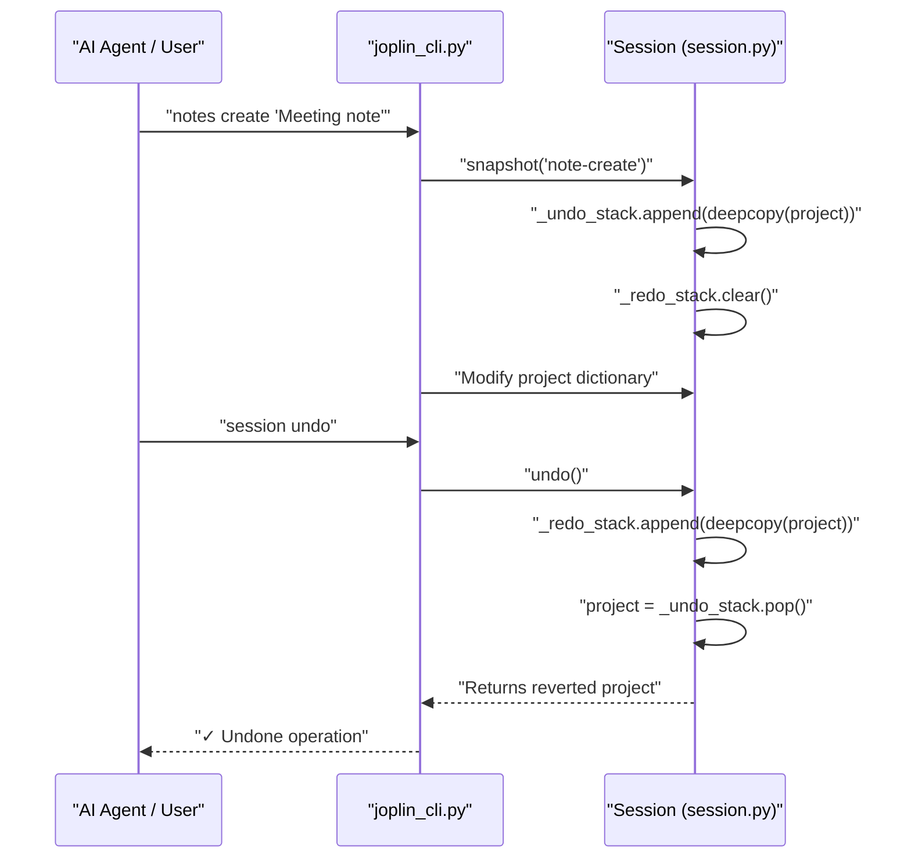

<!-- source: DeepWiki mcp.deepwiki.com · repo HKUDS/CLI-Anything · page 3.3 Stateful Session Management · fetched 2026-11-09 -->

# Stateful Session Management

<details>
<summary>Relevant source files</summary>

The following files were used as context for generating this wiki page:

- [anygen/agent-harness/cli_anything/anygen/core/session.py](anygen/agent-harness/cli_anything/anygen/core/session.py)
- [audacity/agent-harness/cli_anything/audacity/core/session.py](audacity/agent-harness/cli_anything/audacity/core/session.py)
- [blender/agent-harness/cli_anything/blender/core/session.py](blender/agent-harness/cli_anything/blender/core/session.py)
- [drawio/agent-harness/cli_anything/drawio/core/session.py](drawio/agent-harness/cli_anything/drawio/core/session.py)
- [gimp/agent-harness/cli_anything/gimp/core/session.py](gimp/agent-harness/cli_anything/gimp/core/session.py)
- [inkscape/agent-harness/cli_anything/inkscape/core/session.py](inkscape/agent-harness/cli_anything/inkscape/core/session.py)
- [joplin/agent-harness/JOPLIN.md](joplin/agent-harness/JOPLIN.md)
- [joplin/agent-harness/README.md](joplin/agent-harness/README.md)
- [joplin/agent-harness/cli_anything/joplin/README.md](joplin/agent-harness/cli_anything/joplin/README.md)
- [joplin/agent-harness/cli_anything/joplin/WORKFLOWS.md](joplin/agent-harness/cli_anything/joplin/WORKFLOWS.md)
- [joplin/agent-harness/cli_anything/joplin/core/backend.py](joplin/agent-harness/cli_anything/joplin/core/backend.py)
- [joplin/agent-harness/cli_anything/joplin/core/session.py](joplin/agent-harness/cli_anything/joplin/core/session.py)
- [joplin/agent-harness/cli_anything/joplin/joplin_cli.py](joplin/agent-harness/cli_anything/joplin/joplin_cli.py)
- [joplin/agent-harness/cli_anything/joplin/skills/SKILL.md](joplin/agent-harness/cli_anything/joplin/skills/SKILL.md)
- [joplin/agent-harness/cli_anything/joplin/tests/TEST.md](joplin/agent-harness/cli_anything/joplin/tests/TEST.md)
- [joplin/agent-harness/cli_anything/joplin/tests/test_core.py](joplin/agent-harness/cli_anything/joplin/tests/test_core.py)
- [joplin/agent-harness/cli_anything/joplin/utils/joplin_backend.py](joplin/agent-harness/cli_anything/joplin/utils/joplin_backend.py)
- [kdenlive/agent-harness/cli_anything/kdenlive/core/session.py](kdenlive/agent-harness/cli_anything/kdenlive/core/session.py)
- [libreoffice/agent-harness/cli_anything/libreoffice/core/session.py](libreoffice/agent-harness/cli_anything/libreoffice/core/session.py)
- [obs-studio/agent-harness/cli_anything/obs_studio/core/session.py](obs-studio/agent-harness/cli_anything/obs_studio/core/session.py)
- [shotcut/agent-harness/cli_anything/shotcut/core/session.py](shotcut/agent-harness/cli_anything/shotcut/core/session.py)
- [skills/cli-anything-joplin/SKILL.md](skills/cli-anything-joplin/SKILL.md)

</details>


This document describes the session management system used by generated CLI-Anything harnesses to maintain stateful, interactive workflows with full undo/redo capabilities and cross-platform file locking. Session management is a core component of every generated CLI, enabling AI agents and users to build up complex projects through incremental commands while preserving the ability to revert changes.

## Overview

CLI-Anything implements a robust session model designed for agent-native interaction. Key features include:
*   **Deep-Copy Snapshots**: State is preserved using `copy.deepcopy` to prevent reference contamination [joplin/agent-harness/cli_anything/joplin/core/session.py:95-95]().
*   **Cross-Platform Locked JSON Saves**: Atomic writes with exclusive file locking (`fcntl.flock` on POSIX, `msvcrt.locking` on Windows) prevent data corruption during concurrent access [joplin/agent-harness/cli_anything/joplin/core/session.py:25-67]().
*   **Project Persistence**: Session metadata (history, modification flags) is persisted alongside project data [joplin/agent-harness/cli_anything/joplin/core/session.py:80-86]().
*   **Auto-Save & Dry-Run Support**: One-shot commands automatically commit modifications on exit unless overridden by `--dry-run` [joplin/agent-harness/cli_anything/joplin/joplin_cli.py:146-158]().

---

## Session Architecture

Every generated CLI harness includes a `Session` class (typically in `core/session.py`) that serves as the central state container. The session maintains the current project state, modification tracking, file persistence, and dual undo/redo stacks.

### Class Structure and Data Flow

The following diagram bridges the natural language concepts of session management to the precise code entities in `cli_anything.joplin`.


**Figure 1: Session Class Association with Code Entities**

**Sources**: [joplin/agent-harness/cli_anything/joplin/core/session.py:70-76](), [joplin/agent-harness/cli_anything/joplin/joplin_cli.py:32-36]()

---

## State Representation and Modification

State modifications follow a strict checkpoint-before-modify pattern. Before any mutation occurs, the session records the current state into the undo stack or marks the project as dirty.

### The Snapshot Mechanism
The snapshot mechanism captures a deep copy of the project dictionary, pushing it to `_undo_stack` and clearing `_redo_stack` [joplin/agent-harness/cli_anything/joplin/core/session.py:92-99]().

[joplin/agent-harness/cli_anything/joplin/core/session.py:92-99]()
```python
    def snapshot(self, reason: str) -> None:
        if not self.project:
            raise RuntimeError("No project loaded")
        self._undo_stack.append(copy.deepcopy(self.project))
        self._redo_stack.clear()
        self._modified = True
        project_mod.add_history(self.project, "snapshot", {"reason": reason})
```

**Sources**: [joplin/agent-harness/cli_anything/joplin/core/session.py:92-99]()

---

## Undo/Redo State Machine

The session maintains two explicit stacks (`_undo_stack` and `_redo_stack`) enabling agents to step backward and forward through operation history.


**Figure 2: Undo/Redo Execution Flow**

**Sources**: [joplin/agent-harness/cli_anything/joplin/core/session.py:110-126]()

---

## Locked JSON Saves and Atomic Writes

To prevent race conditions when multiple agent workers or processes access the same project file, CLI-Anything implements cross-platform exclusive file locking combined with atomic file replacement (`os.replace`).

### Implementation Detail: `_locked_save_json`
The `_locked_save_json` method creates parent directories if needed, opens a `.lock` file descriptor, acquires an exclusive lock (`fcntl.flock` on POSIX or `msvcrt.locking` with exponential backoff on Windows), writes to a temporary `.tmp` file, and atomically replaces the target file [joplin/agent-harness/cli_anything/joplin/core/session.py:137-162]().

[joplin/agent-harness/cli_anything/joplin/core/session.py:137-162]()
```python
    def _locked_save_json(self, path: str, data: dict) -> None:
        parent = os.path.dirname(os.path.abspath(path))
        if parent:
            os.makedirs(parent, exist_ok=True)

        lock_path = f"{path}.lock"
        lock_fd = os.open(lock_path, os.O_CREAT | os.O_RDWR)
        try:
            with _exclusive_lock(lock_fd):
                tmp = f"{path}.tmp"
                with open(tmp, "w", encoding="utf-8") as f:
                    json.dump(data, f, indent=2, ensure_ascii=False)
                os.replace(tmp, path)
        finally:
            os.close(lock_fd)
```

**Sources**: [joplin/agent-harness/cli_anything/joplin/core/session.py:137-162]()

---

## Project and Session Persistence

Sessions distinguish between the loaded project container and session metadata flags.

| Persistence Feature | Implementation | Purpose |
| :--- | :--- | :--- |
| **Project Path** | `self.project_path` | Tracks the target JSON file path for saves [joplin/agent-harness/cli_anything/joplin/core/session.py:72]() |
| **Modification Flag** | `self._modified` | Tracks if unsaved changes exist for auto-save triggers [joplin/agent-harness/cli_anything/joplin/core/session.py:73]() |
| **Undo Stack** | `self._undo_stack` | Stores previous deep-copy snapshots [joplin/agent-harness/cli_anything/joplin/core/session.py:74]() |
| **Redo Stack** | `self._redo_stack` | Stores reverted snapshots for redo operations [joplin/agent-harness/cli_anything/joplin/core/session.py:75]() |
| **Session Status** | `Session.status()` | Exposes a summary dictionary for agents (`undo_depth`, `redo_depth`, `modified`) [joplin/agent-harness/cli_anything/joplin/core/session.py:128-135]() |

**Sources**: [joplin/agent-harness/cli_anything/joplin/core/session.py:70-135]()

---

## Session Lifecycle and Auto-Save

In one-shot CLI execution, a result callback (`auto_save_on_exit`) monitors command completion. If the project was modified and a project path is set, changes are committed automatically unless `--dry-run` is specified [joplin/agent-harness/cli_anything/joplin/joplin_cli.py:146-158]().

[joplin/agent-harness/cli_anything/joplin/joplin_cli.py:146-158]()
```python
@cli.result_callback()
def auto_save_on_exit(result, use_json, project_path, binary, profile, dry_run, **kwargs):
    if _repl_mode:
        return
    if dry_run:
        return
    sess = get_session()
    if sess.has_project() and sess._modified and sess.project_path:
        try:
            sess.save_session()
        except Exception as e:
            click.echo(f"Warning: Auto-save failed: {e}", err=True)
```

**Sources**: [joplin/agent-harness/cli_anything/joplin/joplin_cli.py:146-158]()

---

