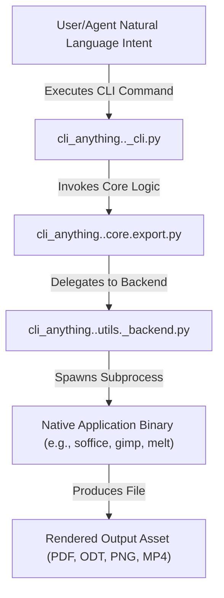
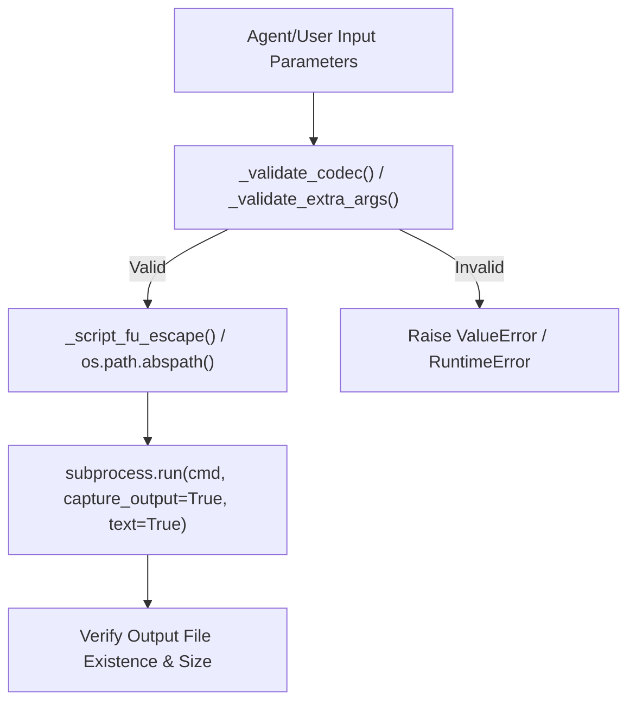

<!-- source: DeepWiki mcp.deepwiki.com · repo HKUDS/CLI-Anything · page 3.4 Authentic Backend Integration · fetched 2026-11-09 -->

# Authentic Backend Integration

<details>
<summary>Relevant source files</summary>

The following files were used as context for generating this wiki page:

- [SECURITY.md](SECURITY.md)
- [gimp/agent-harness/cli_anything/gimp/core/export.py](gimp/agent-harness/cli_anything/gimp/core/export.py)
- [gimp/agent-harness/cli_anything/gimp/core/layers.py](gimp/agent-harness/cli_anything/gimp/core/layers.py)
- [gimp/agent-harness/cli_anything/gimp/core/media.py](gimp/agent-harness/cli_anything/gimp/core/media.py)
- [gimp/agent-harness/cli_anything/gimp/tests/test_full_e2e.py](gimp/agent-harness/cli_anything/gimp/tests/test_full_e2e.py)
- [gimp/agent-harness/cli_anything/gimp/utils/gimp_backend.py](gimp/agent-harness/cli_anything/gimp/utils/gimp_backend.py)
- [inkscape/agent-harness/cli_anything/inkscape/core/export.py](inkscape/agent-harness/cli_anything/inkscape/core/export.py)
- [inkscape/agent-harness/cli_anything/inkscape/core/text.py](inkscape/agent-harness/cli_anything/inkscape/core/text.py)
- [kdenlive/agent-harness/cli_anything/kdenlive/utils/melt_backend.py](kdenlive/agent-harness/cli_anything/kdenlive/utils/melt_backend.py)
- [libreoffice/agent-harness/LIBREOFFICE.md](libreoffice/agent-harness/LIBREOFFICE.md)
- [libreoffice/agent-harness/cli_anything/libreoffice/README.md](libreoffice/agent-harness/cli_anything/libreoffice/README.md)
- [libreoffice/agent-harness/cli_anything/libreoffice/core/document.py](libreoffice/agent-harness/cli_anything/libreoffice/core/document.py)
- [libreoffice/agent-harness/cli_anything/libreoffice/core/importer.py](libreoffice/agent-harness/cli_anything/libreoffice/core/importer.py)
- [libreoffice/agent-harness/cli_anything/libreoffice/tests/TEST.md](libreoffice/agent-harness/cli_anything/libreoffice/tests/TEST.md)
- [libreoffice/agent-harness/cli_anything/libreoffice/tests/test_core.py](libreoffice/agent-harness/cli_anything/libreoffice/tests/test_core.py)
- [libreoffice/agent-harness/cli_anything/libreoffice/tests/test_full_e2e.py](libreoffice/agent-harness/cli_anything/libreoffice/tests/test_full_e2e.py)
- [libreoffice/agent-harness/cli_anything/libreoffice/utils/lo_backend.py](libreoffice/agent-harness/cli_anything/libreoffice/utils/lo_backend.py)
- [libreoffice/agent-harness/setup.py](libreoffice/agent-harness/setup.py)
- [shotcut/agent-harness/cli_anything/shotcut/utils/melt_backend.py](shotcut/agent-harness/cli_anything/shotcut/utils/melt_backend.py)

</details>


## Purpose and Scope

This page explains CLI-Anything's core architectural principle: **Use the Real Software—Don't Reimplement It**. Generated CLIs invoke actual applications (such as LibreOffice, GIMP, Shotcut/Kdenlive, Blender, and CloudCompare) via their native command-line interfaces, scripting APIs, or headless engines, rather than attempting to reimplement their rendering, layout, or document processing engines in Python. This guarantees complete feature parity, professional output fidelity, and zero behavioural drift from the target applications.

For details on the generation pipeline that produces these integrations, see **4. The 7-Phase Generation Pipeline**. For testing strategies, see **5.5. Testing Architecture**.

Sources: `[libreoffice/agent-harness/cli_anything/libreoffice/utils/lo_backend.py:1-11]`, `[SECURITY.md:7-15]()`

---

## The Anti-Pattern: Reimplementation

A recurring failure mode when building CLI wrappers for complex software is trying to emulate the backend in Python (e.g., using Pillow filters for GIMP operations or writing custom XML parsers that bypass ODF specifications). Reimplementation yields brittle, toy implementations that fail on complex real-world files, miss advanced features (such as color profiles or complex layer blend modes), and require endless maintenance to keep pace with the upstream software.

```python
# BAD: Reimplementing raster processing in pure Python / Pillow
def apply_gaussian_blur(image_path, radius):
    img = Image.open(image_path)
    # Lacks GEGL engine support, color spaces, and high-bit depth fidelity
    return img.filter(ImageFilter.GaussianBlur(radius))
```

Instead of reimplementation, CLI-Anything acts as an intelligent orchestration wrapper that delegates the heavy lifting directly to the native software binary.

Sources: `[gimp/agent-harness/cli_anything/gimp/core/export.py:54-85]`, `[SECURITY.md:7-15]()`

---

## The Correct Approach: Backend Delegation

Backend delegation separates the command-line and state management layers from the execution engine. The architecture spans three distinct tiers:
1. **CLI & State Layer**: Built with `click` and `prompt_toolkit`, managing user inputs, project metadata, and undo/redo snapshots.
2. **Backend Integration Layer**: Dedicated wrapper modules (`utils/<software>_backend.py`) that handle binary discovery, argument security, and subprocess execution.
3. **Native Application Binary**: The actual software engine executing headless conversions, batch scripts, or timeline rendering.

### Natural Language Space to Code Entity Space

The following diagram maps high-level user/agent goals to the underlying code entities responsible for executing them.

Title: "Natural Language Space to Code Entity Space Mapping"


Sources: `[libreoffice/agent-harness/cli_anything/libreoffice/utils/lo_backend.py:45-83]`, `[gimp/agent-harness/cli_anything/gimp/utils/gimp_backend.py:25-34]()`

---

## Backend Integration Patterns and Implementation

Different software architectures require tailored invocation strategies. CLI-Anything implements several core patterns:

### Supported Integration Patterns

| Pattern | Mechanism | Example Backend Module | Target Software |
| :--- | :--- | :--- | :--- |
| **Headless Mode** | `--headless`, `--background` flags | `utils/lo_backend.py` | LibreOffice, Blender |
| **Batch Scripting** | Embedded scripting (`-b`, Script-Fu) | `utils/gimp_backend.py` | GIMP, Audacity |
| **Silent CLI** | Native CLI arguments (`-SILENT`) | `utils/cc_backend.py` | CloudCompare |
| **Embedded API** | Direct Python module import | `utils/rd_backend.py` | RenderDoc (`renderdoc` module) |
| **Timeline Rendering** | Project file + renderer invocation | `utils/melt_backend.py` | Shotcut, Kdenlive (`melt`) |

### Headless and Fallback Invocation (`lo_backend.py`)
For applications like LibreOffice, the backend manages conservative headless flags (`_HEADLESS_FLAGS`) to suppress UI elements, splash screens, and recovery wizards, and implements platform-specific fallbacks (such as macOS `open -W -n -a` LaunchServices retry paths to avoid `SIGABRT` issues) [libreoffice/agent-harness/cli_anything/libreoffice/utils/lo_backend.py:22-161]().

Sources: `[libreoffice/agent-harness/cli_anything/libreoffice/utils/lo_backend.py:22-161]`, `[gimp/agent-harness/cli_anything/gimp/utils/gimp_backend.py:47-74]`, `[shotcut/agent-harness/cli_anything/shotcut/utils/melt_backend.py:92-143]()`

---

## Security Hardening and Input Validation

Because AI agents autonomously construct commands and process untrusted files, backend integration modules enforce strict security controls to prevent command injection, script injection, and path traversal.

### Key Security Controls

| Surface | Risk | Mitigation Strategy |
| :--- | :--- | :--- |
| **Subprocess Arguments** | Malicious codec names or parameters | Allowlist validation via frozensets (e.g., `ALLOWED_VCODECS`, `ALLOWED_ACODECS`) [SECURITY.md:37-55]() |
| **Batch Scripts** | Script-Fu / macro injection via user strings | Custom escaping functions like `_script_fu_escape()` [SECURITY.md:21]() |
| **Extra Arguments** | Overriding validated codecs or consumer settings | Blocking prefix checks on `extra_args` (`vcodec=`, `acodec=`, `-consumer`) [shotcut/agent-harness/cli_anything/shotcut/utils/melt_backend.py:46-58]() |
| **File Paths** | Arbitrary file write / path traversal | Absolute path normalization (`os.path.abspath()`) [SECURITY.md:23]() |

Title: "Security Validation and Subprocess Execution Flow"


Sources: `[SECURITY.md:7-69]`, `[shotcut/agent-harness/cli_anything/shotcut/utils/melt_backend.py:34-58]()`

---

## Error Handling and Output Verification

CLI-Anything enforces a **"Fail Loudly"** philosophy. If a required application binary is missing or a backend invocation fails, the system immediately raises an exception with actionable instructions rather than failing silently or degrading gracefully.

### Verification Steps
1. **Binary Discovery**: `find_libreoffice()`, `find_gimp()`, or `find_melt()` search `shutil.which()` and common OS paths, raising `RuntimeError` with installation commands if absent [libreoffice/agent-harness/cli_anything/libreoffice/utils/lo_backend.py:45-82]().
2. **Execution Check**: Subprocess return codes are verified; non-zero exits raise `RuntimeError` capturing standard error.
3. **Output File Validation**: Backends confirm that expected output files exist on disk and are non-empty before returning control to the agent.

Sources: `[libreoffice/agent-harness/cli_anything/libreoffice/utils/lo_backend.py:45-82]`, `[gimp/agent-harness/cli_anything/gimp/utils/gimp_backend.py:25-34]`, `[shotcut/agent-harness/cli_anything/shotcut/utils/melt_backend.py:61-75]()`

---

