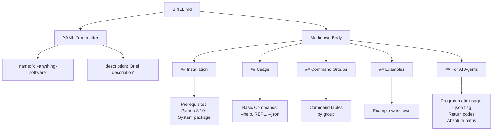
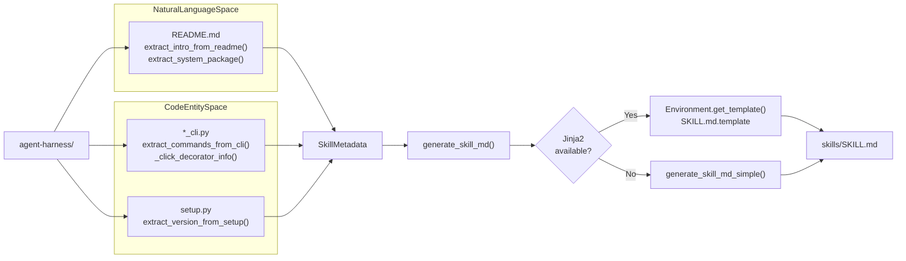
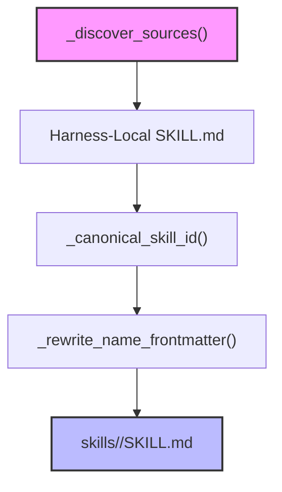
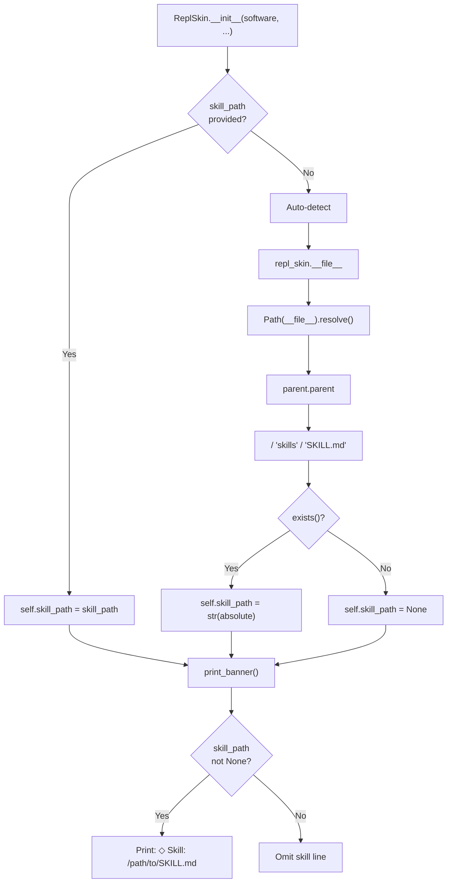
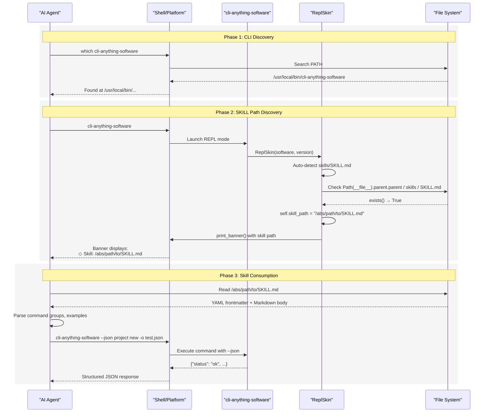

<!-- source: DeepWiki mcp.deepwiki.com · repo HKUDS/CLI-Anything · page 3.5 SKILL.md and Agent Discovery · fetched 2026-11-09 -->

# SKILL.md and Agent Discovery

<details>
<summary>Relevant source files</summary>

The following files were used as context for generating this wiki page:

- [.github/scripts/sync_root_skills.py](.github/scripts/sync_root_skills.py)
- [.github/scripts/validate_root_skills.py](.github/scripts/validate_root_skills.py)
- [.pi-extension/cli-anything/README.md](.pi-extension/cli-anything/README.md)
- [.pi-extension/cli-anything/index.ts](.pi-extension/cli-anything/index.ts)
- [.pi-extension/cli-anything/install.sh](.pi-extension/cli-anything/install.sh)
- [.pi-extension/cli-anything/tests/test_extension.test.ts](.pi-extension/cli-anything/tests/test_extension.test.ts)
- [anygen/agent-harness/cli_anything/anygen/skills/SKILL.md](anygen/agent-harness/cli_anything/anygen/skills/SKILL.md)
- [audacity/agent-harness/cli_anything/audacity/skills/SKILL.md](audacity/agent-harness/cli_anything/audacity/skills/SKILL.md)
- [blender/agent-harness/cli_anything/blender/skills/SKILL.md](blender/agent-harness/cli_anything/blender/skills/SKILL.md)
- [cli-anything-plugin/skill_generator.py](cli-anything-plugin/skill_generator.py)
- [cli-anything-plugin/templates/SKILL.md.template](cli-anything-plugin/templates/SKILL.md.template)
- [cli-anything-plugin/tests/test_skill_generator.py](cli-anything-plugin/tests/test_skill_generator.py)
- [drawio/agent-harness/cli_anything/drawio/skills/SKILL.md](drawio/agent-harness/cli_anything/drawio/skills/SKILL.md)
- [gimp/agent-harness/cli_anything/gimp/skills/SKILL.md](gimp/agent-harness/cli_anything/gimp/skills/SKILL.md)
- [kdenlive/agent-harness/cli_anything/kdenlive/skills/SKILL.md](kdenlive/agent-harness/cli_anything/kdenlive/skills/SKILL.md)
- [libreoffice/agent-harness/cli_anything/libreoffice/skills/SKILL.md](libreoffice/agent-harness/cli_anything/libreoffice/skills/SKILL.md)
- [mubu/agent-harness/skill_generator.py](mubu/agent-harness/skill_generator.py)
- [obs-studio/agent-harness/cli_anything/obs_studio/skills/SKILL.md](obs-studio/agent-harness/cli_anything/obs_studio/skills/SKILL.md)
- [skills/cli-anything-iterm2-ctl/SKILL.md](skills/cli-anything-iterm2-ctl/SKILL.md)
- [skills/cli-anything-qgis/SKILL.md](skills/cli-anything-qgis/SKILL.md)
- [zoom/agent-harness/cli_anything/zoom/skills/SKILL.md](zoom/agent-harness/cli_anything/zoom/skills/SKILL.md)

</details>


## Purpose and Scope

This document describes the `SKILL.md` file format and the agent discovery mechanism in CLI-Anything. `SKILL.md` files make generated CLIs discoverable and usable by AI agents through standardized metadata, YAML frontmatter, and documentation. This page covers the file format specification, the automated generation process via `skill_generator.py`, repo-root skills synchronization and validation scripts (`sync_root_skills.py` and `validate_root_skills.py`), `ReplSkin` auto-detection, and the agent discovery workflow.

For information about the overall 7-phase generation pipeline, see [The 7-Phase Generation Pipeline](). For details on `ReplSkin` usage beyond `SKILL.md` discovery, see [Shared Utilities: ReplSkin and SKILL.md](). For the complete methodology document, see [The HARNESS.md Methodology]().

---

## SKILL.md File Structure

`SKILL.md` is a markdown file with YAML frontmatter that follows the skill-creator methodology. It serves as a self-contained skill definition enabling AI agents to discover CLI capabilities, understand command structure, and generate correct invocations.

### File Format Specification

Title: "SKILL.md Logical Structure"


Sources: [.github/scripts/sync_root_skills.py:1-56](), [cli-anything-plugin/skill_generator.py:7-12](), [cli-anything-plugin/templates/SKILL.md.template:1-123]()

### YAML Frontmatter

The frontmatter contains triggering metadata for skill discovery:

```yaml
---
name: "cli-anything-<software>"
description: "Command-line interface for <Software> - <intro>..."
---
```

| Field | Type | Purpose |
|-------|------|---------|
| `name` | string | Skill identifier matching the console script name or canonical repo-root id [cli-anything-plugin/skill_generator.py:26-32](), [.github/scripts/sync_root_skills.py:13-24]() |
| `description` | string | Brief description (first 100 chars of intro + ellipsis) [cli-anything-plugin/skill_generator.py:173-178]() |

Sources: [.github/scripts/sync_root_skills.py:26-56](), [cli-anything-plugin/skill_generator.py:26-32](), [cli-anything-plugin/templates/SKILL.md.template:1-6]()

### Markdown Body Sections

| Section | Content | Purpose |
|---------|---------|---------|
| **Installation** | Prerequisites, pip install command, system package installation | Setup instructions [cli-anything-plugin/templates/SKILL.md.template:12-26]() |
| **Usage** | Basic commands (--help, REPL, project new, --json) | Quick start reference [cli-anything-plugin/templates/SKILL.md.template:27-52]() |
| **Command Groups** | Tables of commands organized by Click groups | Structured command reference [cli-anything-plugin/templates/SKILL.md.template:54-69]() |
| **Examples** | Multi-step workflow examples | Realistic usage patterns [cli-anything-plugin/templates/SKILL.md.template:70-81]() |
| **For AI Agents** | Programmatic usage guidance (--json, return codes, paths) | Agent-specific instructions [cli-anything-plugin/templates/SKILL.md.template:105-114]() |

Sources: [cli-anything-plugin/templates/SKILL.md.template:1-123]()

---

## Generation Pipeline: skill_generator.py

The `skill_generator.py` module extracts metadata from CLI harnesses and generates `SKILL.md` files. This is Phase 6.5 of the 7-phase pipeline, executed after tests pass but before PyPI publishing.

### Metadata Extraction Workflow

Title: "skill_generator.py Execution Flow"


Sources: [cli-anything-plugin/skill_generator.py:34-189](), [cli-anything-plugin/tests/test_skill_generator.py:115-187]()

### SkillMetadata Dataclass

The `SkillMetadata` dataclass holds extracted information:

```python
@dataclass
class SkillMetadata:
    skill_name: str              # "cli-anything-<software>"
    skill_description: str       # Brief description for frontmatter
    software_name: str           # Package name (e.g., "gimp")
    skill_intro: str             # Full intro from README
    version: str                 # From setup.py
    system_package: Optional[str]  # e.g., "apt install gimp"
    command_groups: list[CommandGroup]  # Extracted from CLI
    examples: list[Example]      # Generated examples
```

Sources: [cli-anything-plugin/skill_generator.py:104-114]()

---

## Root Skills Synchronization and Validation Scripts

To make all generated agent skills centrally discoverable at the repository root level (`skills/`), CLI-Anything employs automated synchronization and validation scripts located in `.github/scripts/`.

### sync_root_skills.py

The `_discover_sources()` function [root: .github/scripts/sync_root_skills.py:58-62]() scans all harness-local `SKILL.md` files across the codebase:
- `*/agent-harness/cli_anything/*/skills/SKILL.md`
- `*/agent-harness/cli_anything/*/SKILL.md`

`_canonical_skill_id()` extracts the package name and normalizes underscores to hyphens to produce identifiers like `cli-anything-blender` [.github/scripts/sync_root_skills.py:13-24](). `_rewrite_name_frontmatter()` updates the YAML frontmatter name field to match the canonical repo-root skill ID [.github/scripts/sync_root_skills.py:26-55]().

Title: "sync_root_skills.py Pipeline"


Sources: [.github/scripts/sync_root_skills.py:13-89]()

### validate_root_skills.py

The validation script `validate_root_skills.py` ensures that repo-root mirrors are fully up-to-date and have not diverged incorrectly [.github/scripts/validate_root_skills.py:1-114](). It loads sync helpers dynamically [.github/scripts/validate_root_skills.py:30-34]() and checks for two types of drift:
1. **Stale root skills**: The harness source has moved ahead, requiring regeneration [.github/scripts/validate_root_skills.py:47-48]().
2. **Clobber/destructive drift**: The root mirror holds content that the source lacks (to prevent silent data loss during automated synchronization) [.github/scripts/validate_root_skills.py:44-46]().

---

## Auto-Detection by ReplSkin

`ReplSkin` automatically detects `skills/SKILL.md` relative to its own installation location and displays the absolute path in the REPL banner. This enables AI agents to locate and read the skill file.

### Detection Algorithm

Title: "ReplSkin Skill Discovery Logic"


Sources: [cli-anything-plugin/tests/test_skill_generator.py:1-217]()

---

## Agent Discovery Workflow

AI agents discover and use `SKILL.md` through a multi-step process involving PATH detection, REPL banner parsing, and file reading.

### Discovery Sequence

Title: "Agent Skill Discovery Workflow"


Sources: [cli-anything-plugin/templates/SKILL.md.template:105-114]()

---

## Package Integration and Testing

`SKILL.md` must be included in Python package distributions via `package_data` in `setup.py`. Test suites in `cli-anything-plugin/tests/test_skill_generator.py` validate metadata extraction, Click decorator parsing, and formatting correctness [cli-anything-plugin/tests/test_skill_generator.py:115-187]().

Sources: [cli-anything-plugin/tests/test_skill_generator.py:1-217]()

---

