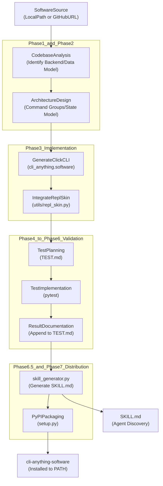
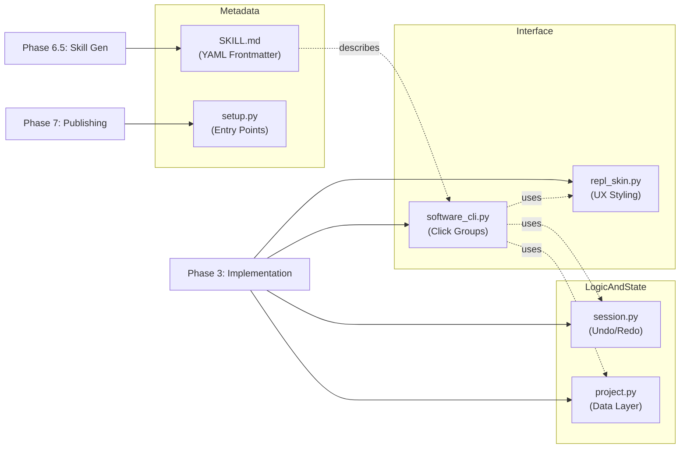

<!-- source: DeepWiki mcp.deepwiki.com · repo HKUDS/CLI-Anything · page 4 The 7-Phase Generation Pipeline · fetched 2026-11-09 -->

# The 7-Phase Generation Pipeline

Relevant source files

The following files were used as context for generating this wiki page:

- [cli-anything-plugin/HARNESS.md](cli-anything-plugin/HARNESS.md)
- [cli-anything-plugin/README.md](cli-anything-plugin/README.md)
- [cli-anything-plugin/guides/filter-translation.md](cli-anything-plugin/guides/filter-translation.md)
- [cli-anything-plugin/guides/mcp-backend.md](cli-anything-plugin/guides/mcp-backend.md)
- [cli-anything-plugin/guides/pypi-publishing.md](cli-anything-plugin/guides/pypi-publishing.md)
- [cli-anything-plugin/guides/session-locking.md](cli-anything-plugin/guides/session-locking.md)
- [cli-anything-plugin/guides/skill-generation.md](cli-anything-plugin/guides/skill-generation.md)
- [cli-anything-plugin/guides/timecode-precision.md](cli-anything-plugin/guides/timecode-precision.md)
- [cli-anything-plugin/repl_skin.py](cli-anything-plugin/repl_skin.py)

## Purpose and Scope

This page documents the automated pipeline that transforms any software codebase into a production-ready CLI harness. The pipeline consists of seven sequential phases (plus a metadata generation step) that handle analysis, design, implementation, testing, documentation, and publishing. This page provides an overview of the complete pipeline architecture and how phases interact. For detailed information about specific phases, see the child pages linked in each section.

**Sources:** [cli-anything-plugin/README.md:9-19](), [cli-anything-plugin/HARNESS.md:10-11]()

---

## Overview

The 7-phase pipeline is a fully automated system that accepts a software codebase (local path or GitHub URL) as input and produces a complete, tested, installable CLI package as output. The pipeline is deterministic and follows the methodology encoded in `HARNESS.md`, which captures lessons learned from generating the demonstration applications.

The pipeline executes sequentially, with each phase building on artifacts from previous phases. Phase 1 analyzes the target software, Phase 2 designs the CLI architecture, Phase 3 generates Python code, Phases 4-6 implement and validate comprehensive tests, Phase 6.5 generates AI-readable skills, and Phase 7 packages the result for distribution.

**Key characteristics:**

- **Fully automated** - No manual intervention required between phases [cli-anything-plugin/README.md:72-81]()
- **Methodology-driven** - Follows strict patterns in `HARNESS.md` [cli-anything-plugin/HARNESS.md:10-11]()
- **Production-ready output** - 100% test pass rate with real backend verification [cli-anything-plugin/README.md:18-19](), [cli-anything-plugin/README.md:197-201]()
- **Namespace packaging** - All CLIs install under `cli_anything.*` namespace [cli-anything-plugin/README.md:230-231](), [cli-anything-plugin/guides/pypi-publishing.md:5-7]()
- **Agent-Native** - Includes `SKILL.md` for AI agent discovery and `--json` output for parsing [cli-anything-plugin/README.md:216-225](), [cli-anything-plugin/guides/skill-generation.md:1-14]()

**Sources:** [cli-anything-plugin/README.md:152-245](), [cli-anything-plugin/HARNESS.md:10-11]()

---

## Pipeline Architecture

The following diagram bridges the Natural Language Space of conceptual requirements to the Code Entity Space of actual modules, scripts, and configuration artifacts (`skill_generator.py`, `pytest`, `setup.py`, `TEST.md`).

### From Code to Agent Skill Architecture

**Sources:** [cli-anything-plugin/README.md:153-245](), [cli-anything-plugin/HARNESS.md:12-215]()

---

## The 7 Phases

### Phase 1: Codebase Analysis
The agent identifies the backend engine (e.g., `MLT` for Shotcut, `bpy` for Blender) and maps GUI actions to API calls. It identifies the project data model (XML, JSON, SQLite) and existing CLI tools.
*For details, see [Phase 1: Codebase Analysis](#4.1)*.

**Sources:** [cli-anything-plugin/HARNESS.md:12-24](), [cli-anything-plugin/README.md:154-162]()

### Phase 2: CLI Architecture Design
Designing command groups that match the app's logical domains (Project, Core, Export, Session). A state model is designed to handle persistence and undo/redo logic via JSON session files.
*For details, see [Phase 2: CLI Architecture Design](#4.2)*.

**Sources:** [cli-anything-plugin/HARNESS.md:25-48](), [cli-anything-plugin/README.md:164-172]()

### Phase 3: Implementation
The agent builds the `Click`-based CLI. It implements core modules (`project.py`, `session.py`, `export.py`) and integrates the `ReplSkin` for a unified UX. It ensures every command supports a `--json` flag for agent consumption.
*For details, see [Phase 3: Implementation](#4.3)*.

**Sources:** [cli-anything-plugin/HARNESS.md:49-134](), [cli-anything-plugin/README.md:174-184]()

### Phase 4-5: Test Planning and Implementation
A `TEST.md` plan is created before any code is written. The agent then implements unit tests (`test_core.py`) and E2E tests (`test_full_e2e.py`) that invoke the real software backend using `subprocess.run()`.
*For details, see [Phase 4-5: Test Planning and Implementation](#4.4)*.

**Sources:** [cli-anything-plugin/HARNESS.md:135-215](), [cli-anything-plugin/README.md:186-205]()

### Phase 6: Test Documentation
The agent runs `pytest -v --tb=no`, captures the output, and appends it to `TEST.md`. This provides a permanent record of the harness's reliability and coverage gaps.
*For details, see [Phase 6: Test Documentation](#4.5)*.

**Sources:** [cli-anything-plugin/README.md:207-214](), [cli-anything-plugin/HARNESS.md:216-224]()

### Phase 6.5: SKILL.md Generation
Using `skill_generator.py`, the agent extracts metadata from the new CLI to create a `SKILL.md` file. This file contains YAML frontmatter that allows AI agents to discover the tool's capabilities automatically.
*For details, see [Phase 6.5: SKILL.md Generation](#4.6)*.

**Sources:** [cli-anything-plugin/README.md:216-225](), [cli-anything-plugin/guides/skill-generation.md:1-24]()

### Phase 7: PyPI Publishing and Installation
The agent creates a `setup.py` using `find_namespace_packages` to support the `cli_anything.<software>` namespace. It configures `console_scripts` so the tool is available as `cli-anything-<software>` in the system PATH.
*For details, see [Phase 7: PyPI Publishing and Installation](#4.7)*.

**Sources:** [cli-anything-plugin/README.md:227-245](), [cli-anything-plugin/guides/pypi-publishing.md:1-49]()

---

## Pipeline Data Flow

The following diagram associates system phases with the specific code entities and files (`project.py`, `session.py`, `software_cli.py`, `repl_skin.py`, `SKILL.md`, `setup.py`) produced or modified during execution.

### Phase Output Code Entities

**Sources:** [cli-anything-plugin/README.md:174-184](), [cli-anything-plugin/guides/skill-generation.md:47-53]()

---

## Pipeline Execution via Plugin Commands

The pipeline is triggered and managed through the following plugin commands (available in Claude Code, OpenCode, and Pi):

| Command | Purpose | Phases Covered |
|:---|:---|:---|
| `/cli-anything` | **Full Build**: Transforms source to installed CLI. | 1 - 7 |
| `/cli-anything:refine` | **Expansion**: Adds new commands/tests to an existing harness. | 1 - 6 |
| `/cli-anything:test` | **Validation**: Runs the suite and updates `TEST.md`. | 5 - 6 |
| `/cli-anything:validate` | **Compliance**: Checks harness against `HARNESS.md` standards. | N/A |
| `/cli-anything:list` | **Discovery**: Lists all installed and generated tools. | N/A |

**Sources:** [cli-anything-plugin/README.md:57-150](), [README_CN.md:89-136](), [.pi-extension/cli-anything/README.md:31-39]()

---

## Success Criteria

A pipeline execution is only considered successful if:
1. **100% Test Pass Rate**: All unit and E2E tests must pass [cli-anything-plugin/README.md:18](), [cli-anything-plugin/README.md:25]().
2. **Subprocess Verification**: `TestCLISubprocess` must successfully invoke the CLI via the system PATH [cli-anything-plugin/README.md:202-203](), [cli-anything-plugin/HARNESS.md:202-204]().
3. **Self-Documentation**: `README.md`, `TEST.md`, and `SKILL.md` must be fully populated [cli-anything-plugin/README.md:111-122](), [cli-anything-plugin/README.md:214-225]().
4. **Namespace Compliance**: The package must be correctly structured as a PEP 420 namespace package (no `__init__.py` in the `cli_anything/` root) [cli-anything-plugin/README.md:230-231](), [cli-anything-plugin/guides/pypi-publishing.md:9-25]().

**Sources:** [cli-anything-plugin/README.md:152-245](), [cli-anything-plugin/HARNESS.md:216-224]()

---

