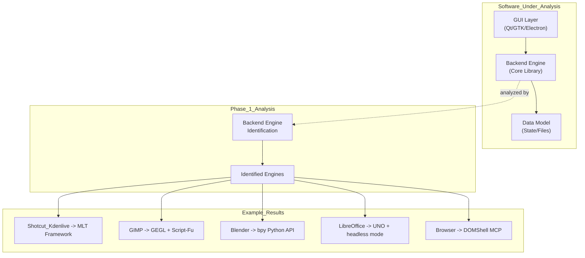
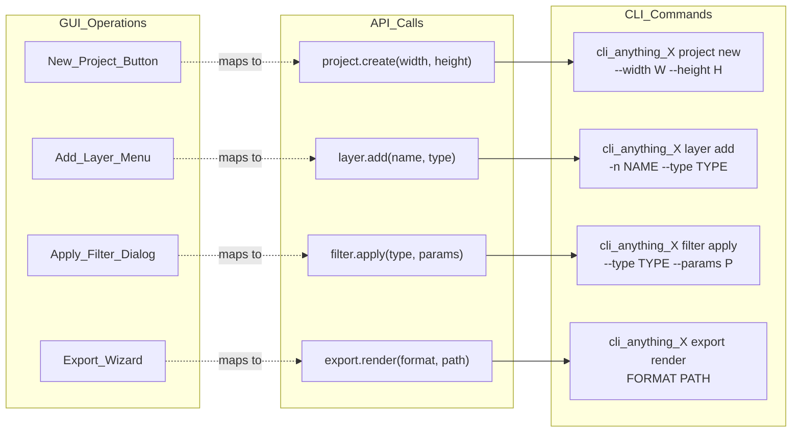
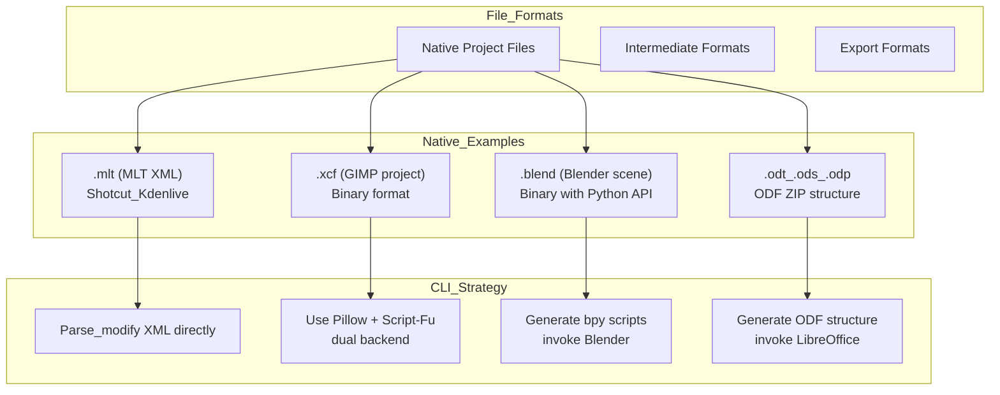
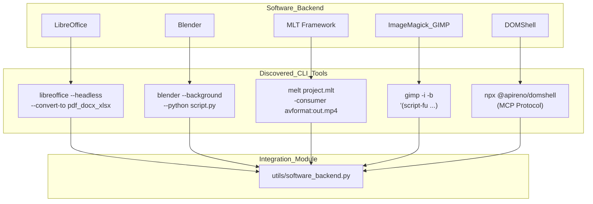
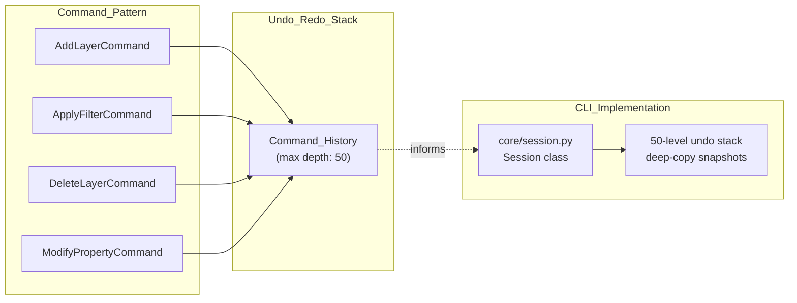

<!-- source: DeepWiki mcp.deepwiki.com · repo HKUDS/CLI-Anything · page 4.1 Phase 1: Codebase Analysis · fetched 2026-11-09 -->

# Phase 1: Codebase Analysis

Relevant source files

The following files were used as context for generating this wiki page:

- [cli-anything-plugin/HARNESS.md](cli-anything-plugin/HARNESS.md)
- [cli-anything-plugin/README.md](cli-anything-plugin/README.md)
- [cli-anything-plugin/guides/filter-translation.md](cli-anything-plugin/guides/filter-translation.md)
- [cli-anything-plugin/guides/mcp-backend.md](cli-anything-plugin/guides/mcp-backend.md)
- [cli-anything-plugin/guides/pypi-publishing.md](cli-anything-plugin/guides/pypi-publishing.md)
- [cli-anything-plugin/guides/session-locking.md](cli-anything-plugin/guides/session-locking.md)
- [cli-anything-plugin/guides/skill-generation.md](cli-anything-plugin/guides/skill-generation.md)
- [cli-anything-plugin/guides/timecode-precision.md](cli-anything-plugin/guides/timecode-precision.md)
- [cli-anything-plugin/repl_skin.py](cli-anything-plugin/repl_skin.py)

## Purpose and Scope

Phase 1: Codebase Analysis is the initial stage of the 7-phase CLI generation pipeline where CLI-Anything examines a software codebase to understand its architecture, identify integration points, and determine what capabilities should be exposed through the generated CLI. This phase produces a `SOFTWARE.md` Standard Operating Procedure (SOP) document that guides all subsequent phases [cli-anything-plugin/HARNESS.md:12-23]().

For information about the overall 7-phase pipeline structure, see [The 7-Phase Generation Pipeline](#4). For details on how the analysis results are used in architectural design, see [Phase 2: CLI Architecture Design](#4.2).

## Overview

Phase 1 transforms an arbitrary software codebase into a structured understanding of how to build a CLI interface for it. The analysis focuses on discovering existing automation interfaces rather than reimplementing functionality—the core principle being "Use the Real Software—Don't Reimplement It" [cli-anything-plugin/HARNESS.md:5-9]().

The phase executes five parallel analysis tasks that collectively answer: "How do we programmatically control this software?" [cli-anything-plugin/HARNESS.md:12-24]().

Sources: [cli-anything-plugin/HARNESS.md:5-24]()

## Analysis Tasks

### 1. Backend Engine Identification

The first task identifies the core library or framework that separates presentation logic from business logic. Most GUI applications are built on top of a computational engine that can be invoked independently [cli-anything-plugin/HARNESS.md:14-15]().

**Backend Discovery Flow**

**Key discovery patterns:**
- **Embedded scripting APIs**: `bpy` for Blender, Script-Fu for GIMP [cli-anything-plugin/HARNESS.md:14-15]().
- **Framework libraries**: MLT for video editors, GEGL for image processing [cli-anything-plugin/HARNESS.md:14-15]().
- **Headless modes**: `libreoffice --headless`, `blender --background` [cli-anything-plugin/HARNESS.md:20-21](), [cli-anything-plugin/HARNESS.md:61-66]().
- **MCP Servers**: For browser automation, the DOMShell MCP server provides the bridge via accessibility tree mapping [browser/agent-harness/cli_anything/browser/README.md:3-4]().

Sources: [cli-anything-plugin/HARNESS.md:14-21](), [cli-anything-plugin/HARNESS.md:61-66](), [browser/agent-harness/cli_anything/browser/README.md:3-4]()

### 2. GUI-to-API Mapping

This task catalogs how user-facing operations in the GUI correspond to programmatic function calls in the backend. Every button click, menu item, and drag operation triggers underlying API calls that the CLI must reproduce [cli-anything-plugin/HARNESS.md:16-17]().

**GUI to CLI Mapping Strategy**

**Mapping methodology:**
1. **Source code inspection**: Examine signal/slot connections (Qt) or event handlers (GTK) [cli-anything-plugin/HARNESS.md:16-17]().
2. **Command pattern identification**: If the software has undo/redo, it likely uses a command pattern—these commands are the primary CLI operations [cli-anything-plugin/HARNESS.md:22-23]().
3. **Filter Translation Analysis**: Identifying complex filter mappings (e.g., MLT to ffmpeg) and documenting parameter scale differences [cli-anything-plugin/guides/filter-translation.md:1-21]().

Sources: [cli-anything-plugin/HARNESS.md:16-23](), [cli-anything-plugin/guides/filter-translation.md:1-21]()

### 3. Data Model Analysis

Phase 1 identifies how project state is represented: what file formats the software uses (XML, JSON, binary), and how state is serialized [cli-anything-plugin/HARNESS.md:18-19]().

**Data Model to Implementation Strategy**

**Analysis dimensions:**
1. **Format structure**: XML, JSON, binary, database, or ZIP archives [cli-anything-plugin/HARNESS.md:18-19]().
2. **Precision Requirements**: Identifying if non-integer frame rates require specific timecode precision logic to avoid drift [cli-anything-plugin/guides/timecode-precision.md:1-18]().
3. **Session file locking**: Determining if the application requires exclusive file locking for state persistence to prevent concurrent write corruption [cli-anything-plugin/HARNESS.md:71-75](), [cli-anything-plugin/guides/session-locking.md:1-37]().

Sources: [cli-anything-plugin/HARNESS.md:18-19](), [cli-anything-plugin/guides/timecode-precision.md:1-18](), [cli-anything-plugin/guides/session-locking.md:1-37]()

### 4. Existing CLI Tools Discovery

Many software backends ship with command-line tools that the generated CLI can leverage as subprocesses. This task catalogs these tools and their invocation patterns [cli-anything-plugin/HARNESS.md:20-21]().

**Integration Module Mapping**

Each tool requires a backend module (e.g., `utils/lo_backend.py`) that handles finding the executable via `shutil.which()` and invoking it via `subprocess.run()` [cli-anything-plugin/HARNESS.md:54-66](). For MCP-based backends, the wrapper communicates with the server via stdio or persistent daemon connections [browser/agent-harness/cli_anything/browser/README.md:104-123]().

Sources: [cli-anything-plugin/HARNESS.md:20-21](), [cli-anything-plugin/HARNESS.md:54-66](), [browser/agent-harness/cli_anything/browser/README.md:104-123]()

### 5. Command/Undo System Cataloging

Software with undo/redo typically implements a command pattern. Phase 1 analyzes how to capture state snapshots for 50-level history [cli-anything-plugin/HARNESS.md:22-23]().

**Session and History Logic**

**Implementation in generated CLIs:**
The analysis results drive the `Session` class in `core/session.py`, which implements deep-copy snapshots of project state at each command and 50-level history management [cli-anything-plugin/HARNESS.md:69](). For file-based persistence, `_locked_save_json` ensures atomic writes using `fcntl.flock` [cli-anything-plugin/guides/session-locking.md:14-37]().

Sources: [cli-anything-plugin/HARNESS.md:22-23](), [cli-anything-plugin/HARNESS.md:69](), [cli-anything-plugin/guides/session-locking.md:14-37]()

## Phase 1 Deliverable: SOFTWARE.md

The culmination of Phase 1 is the `SOFTWARE.md` file, which serves as the Standard Operating Procedure (SOP) for the specific application.

**SOFTWARE.md Structure**

```mermaid
graph TB
    SOFTWARE["SOFTWARE.md"]
    
    subgraph "Section_1_Architecture"
        ARCH1["Backend engine identification"]
        ARCH2["Data model structure"]
        ARCH3["Integration approach"]
    end
    
    subgraph "Section_2_API_Mappings"
        MAP1["GUI -> Backend API mappings"]
        MAP2["Command catalog"]
        MAP3["Parameter schemas"]
    end
    
    subgraph "Section_3_Integration"
        INT1["CLI tool discovery results"]
        INT2["Subprocess invocation patterns"]
        INT3["Error handling requirements"]
    end
    
    subgraph "Section_4_Design_Decisions"
        DEC1["State management approach"]
        DEC2["Command groupings"]
        DEC3["Output format strategy"]
    end
    
    SOFTWARE --> ARCH1
    SOFTWARE --> ARCH2
    SOFTWARE --> ARCH3
    SOFTWARE --> MAP1
    SOFTWARE --> MAP2
    SOFTWARE --> MAP3
    SOFTWARE --> INT1
    SOFTWARE --> INT2
    SOFTWARE --> INT3
    SOFTWARE --> DEC1
    SOFTWARE --> DEC2
    SOFTWARE --> DEC3
```

Sources: [cli-anything-plugin/HARNESS.md:12-24]()

## Integration with Subsequent Phases

Phase 1's outputs directly feed into later phases:

1.  **Backend identification -> `utils/<software>_backend.py`**: Discovered CLI tools become subprocess invocations in the backend module [cli-anything-plugin/HARNESS.md:54-58]().
2.  **GUI->API mappings -> CLI commands**: Each mapping becomes a Click command with appropriate parameters [cli-anything-plugin/HARNESS.md:16-17]().
3.  **Data model analysis -> `core/project.py`**: The project structure becomes Python classes/dicts [cli-anything-plugin/HARNESS.md:51]().
4.  **Command catalog -> Command groups**: Operations are grouped by domain (project, layer, filter, export) [cli-anything-plugin/HARNESS.md:32-37]().

Sources: [cli-anything-plugin/HARNESS.md:16-58]()

---

