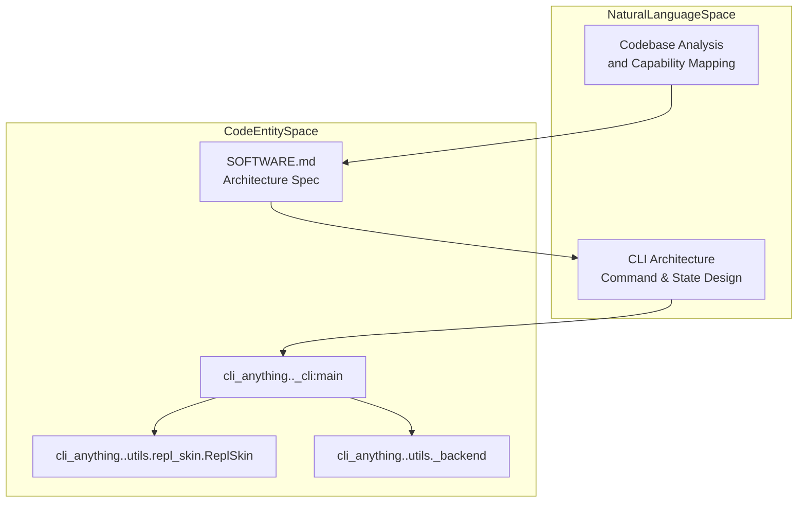
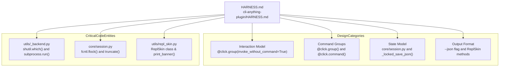
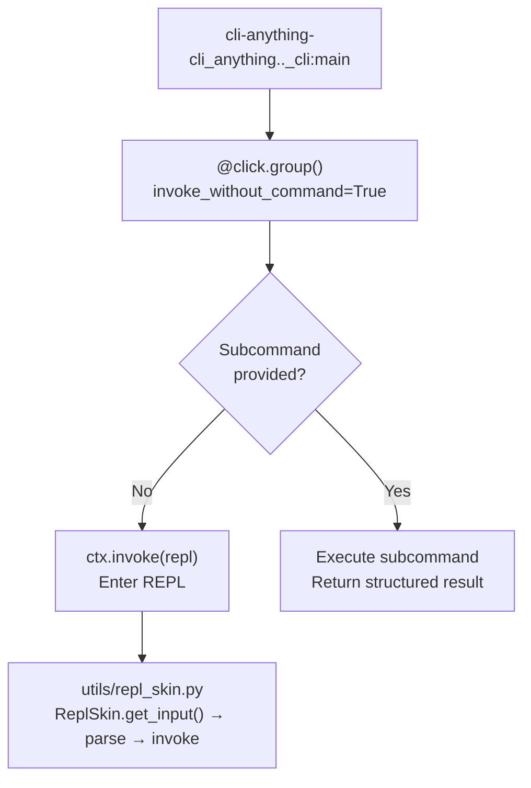
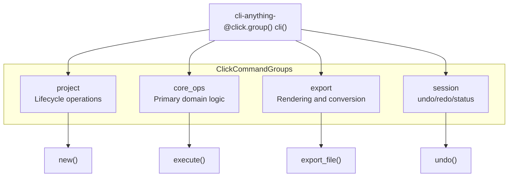
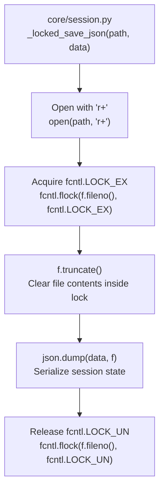
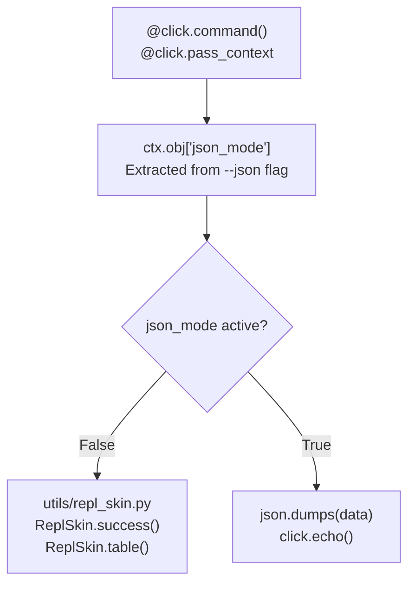
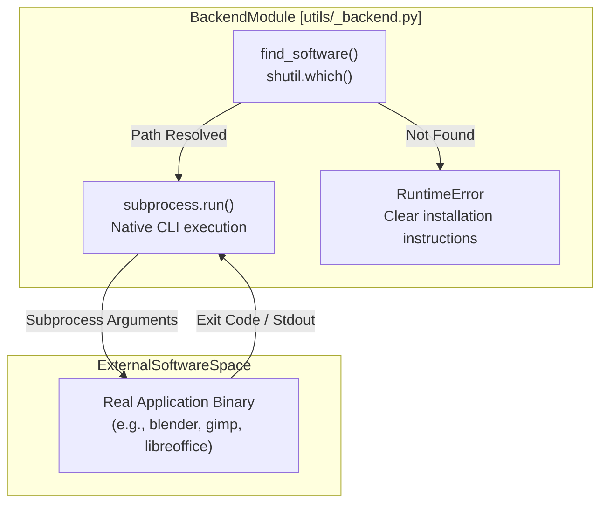

<!-- source: DeepWiki mcp.deepwiki.com · repo HKUDS/CLI-Anything · page 4.2 Phase 2: CLI Architecture Design · fetched 2026-11-09 -->

# Phase 2: CLI Architecture Design

Relevant source files

The following files were used as context for generating this wiki page:

- [cli-anything-plugin/HARNESS.md](cli-anything-plugin/HARNESS.md)
- [cli-anything-plugin/README.md](cli-anything-plugin/README.md)
- [cli-anything-plugin/guides/filter-translation.md](cli-anything-plugin/guides/filter-translation.md)
- [cli-anything-plugin/guides/mcp-backend.md](cli-anything-plugin/guides/mcp-backend.md)
- [cli-anything-plugin/guides/pypi-publishing.md](cli-anything-plugin/guides/pypi-publishing.md)
- [cli-anything-plugin/guides/session-locking.md](cli-anything-plugin/guides/session-locking.md)
- [cli-anything-plugin/guides/skill-generation.md](cli-anything-plugin/guides/skill-generation.md)
- [cli-anything-plugin/guides/timecode-precision.md](cli-anything-plugin/guides/timecode-precision.md)
- [cli-anything-plugin/repl_skin.py](cli-anything-plugin/repl_skin.py)

## Purpose and Scope

This document explains Phase 2 of the 7-phase generation pipeline: **CLI Architecture Design**. Phase 2 takes the codebase analysis from Phase 1 and transforms it into a concrete CLI architectural specification. This phase makes critical design decisions about command groups, state models, output formats, and interaction patterns—all following the standards defined in `HARNESS.md` [cli-anything-plugin/HARNESS.md:25-47]().

For the codebase analysis that precedes this phase, see [Phase 1: Codebase Analysis](). For the implementation of the designed architecture, see [Phase 3: Implementation]().

---

## Pipeline Context

Phase 2 transforms Phase 1 analysis into concrete architectural decisions. It produces the software-specific SOP document (e.g., `GIMP.md`, `ZOTERO.md`, `BROWSER.md`) that serves as the implementation blueprint for Phase 3 [cli-anything-plugin/README.md:162-173]().

The following diagram bridges natural language architecture requirements to exact code execution modules and entry points (`cli_anything.<software>.<software>_cli`, `utils/repl_skin.py`, `utils/software_backend.py`).

**Title: Natural Language Space to Code Entity Space (Pipeline Context)**

**Sources:** [cli-anything-plugin/HARNESS.md:25-47](), [cli-anything-plugin/README.md:162-173](), [cli-anything-plugin/guides/pypi-publishing.md:43-46]()

---

## Design Inputs from Phase 1

Phase 2 receives the following artifacts from Phase 1 analysis:

| Input Artifact | Content | Usage in Phase 2 |
|----------------|---------|------------------|
| **Backend Engine ID** | Core framework (e.g., MLT, GEGL, bpy, MCP) | Determines backend integration strategy in `utils/<software>_backend.py` [cli-anything-plugin/HARNESS.md:54-58]() |
| **GUI-to-API Map** | Mapping of buttons/menus to function calls | Defines Click command names and parameters |
| **Data Model Schema** | Project state representation (XML, JSON, SQLite) | Shapes project JSON schema design in `core/project.py` [cli-anything-plugin/HARNESS.md:51]() |
| **Existing CLI Tools** | Building blocks like `melt` or `ffmpeg` | Informs `utils/software_backend.py` subprocess design [cli-anything-plugin/HARNESS.md:54-58]() |

**Sources:** [cli-anything-plugin/HARNESS.md:12-24](), [cli-anything-plugin/HARNESS.md:54-58]()

---

## Design Decision Framework

Phase 2 follows a structured decision-making process defined in `HARNESS.md`. Each design decision is documented in the software-specific SOP for Phase 3 implementation [cli-anything-plugin/HARNESS.md:25-47]().

**Title: Design Decision Categories and Code Bindings**

**Sources:** [cli-anything-plugin/HARNESS.md:25-47](), [cli-anything-plugin/HARNESS.md:71-110]()

---

## Core Design Decisions

### Decision 1: Interaction Model

Phase 2 chooses how users and agents will interact with the CLI. `HARNESS.md` recommends supporting both modes [cli-anything-plugin/HARNESS.md:27-30]().

| Mode | Use Case | Implementation Code Entity |
|------|----------|----------------------------|
| **Stateful REPL** | Interactive agent sessions | `ctx.invoke(repl)` triggered via `@click.group(invoke_without_command=True)` [cli-anything-plugin/HARNESS.md:99-108]() |
| **Subcommand CLI** | One-shot operations/pipelines | Standard Click subcommands in `<software>_cli.py` |
| **Both** | Maximum flexibility | Default behavior across all generated harnesses |

**Title: REPL and Subcommand Execution Flow**

**Sources:** [cli-anything-plugin/HARNESS.md:27-30](), [cli-anything-plugin/HARNESS.md:99-108]()

### Decision 2: Command Group Architecture

Phase 2 designs the command hierarchy matching the application's logical domains using Click group decorators [cli-anything-plugin/HARNESS.md:32]().

| Command Group | Purpose | Standard Operations |
|---------------|---------|---------------------|
| **Project** | Lifecycle management | `new`, `open`, `save`, `close`, `info` in `core/project.py` [cli-anything-plugin/HARNESS.md:33]() |
| **Core Ops** | Primary application purpose | Software-specific modules (e.g., `layer`, `track`, `fs`) [cli-anything-plugin/HARNESS.md:34]() |
| **Import/Export** | File I/O and conversion | `import`, `export`, `render` via backend integration [cli-anything-plugin/HARNESS.md:35]() |
| **Session** | State management | `undo`, `redo`, `history`, `status` in `core/session.py` [cli-anything-plugin/HARNESS.md:37]() |

**Title: Command Group Hierarchy Structure**

**Sources:** [cli-anything-plugin/HARNESS.md:32-37](), [cli-anything-plugin/HARNESS.md:99-108]()

### Decision 3: State Model Design

The design evaluates what must persist between commands and how state serializes to JSON session files using exclusive locking [cli-anything-plugin/HARNESS.md:39-42]().

| Component | Requirement | Implementation Code Entity |
|-----------|-------------|----------------------------|
| **Persistence** | Must survive between commands | File-based storage (JSON) in `core/session.py` [cli-anything-plugin/HARNESS.md:41]() |
| **Concurrency** | Prevent data corruption | Exclusive file locking via `fcntl.flock` in `_locked_save_json` [cli-anything-plugin/guides/session-locking.md:14-37]() |
| **History** | Support undo/redo | 50-level deep-copy snapshots in `core/session.py` [cli-anything-plugin/HARNESS.md:69]() |
| **Schema** | Agent-parseable structure | Locked JSON saves with `f.truncate()` [cli-anything-plugin/guides/session-locking.md:30-32]() |

**Title: Locked Save Execution Flow**

**Sources:** [cli-anything-plugin/HARNESS.md:39-42](), [cli-anything-plugin/guides/session-locking.md:9-37]()

### Decision 4: Output Format Strategy

Phase 2 designs dual output modes controlled by the `--json` flag. Every command supports both human-readable UI rendering and machine-parseable output [cli-anything-plugin/HARNESS.md:44-47]().

| Mode | Implementation Code Entity | Target Audience |
|------|----------------------------|-----------------|
| **Human-Readable** | `utils/repl_skin.py` (`ReplSkin.success`, `ReplSkin.table`, `ReplSkin.status`) [cli-anything-plugin/repl_skin.py:86-93]() | Human developers and users |
| **Machine-Readable** | `json.dumps()` via `click.echo()` when `ctx.obj['json_mode']` is active | AI Agents (programmatic consumption) |

**Title: Dual Output Mode Routing**

**Sources:** [cli-anything-plugin/HARNESS.md:44-47](), [cli-anything-plugin/repl_skin.py:86-93]()

### Decision 5: Backend Integration Layer

Phase 2 designs the `utils/<software>_backend.py` module. This layer adheres to the core principle: **"Use the Real Software—Don't Reimplement It"** [cli-anything-plugin/HARNESS.md:54-58]().

**Title: Backend Integration Layer Architecture**

**Sources:** [cli-anything-plugin/HARNESS.md:54-66](), [cli-anything-plugin/guides/pypi-publishing.md:59-70]()

---

## Phase 2 Deliverables

Phase 2 concludes with the creation of the software-specific SOP document (Phase 2 section), which includes:

1.  **Architecture Analysis**: Backend engine identification (e.g., Script-Fu, bpy, MCP) and data model specifications [cli-anything-plugin/README.md:154-162]().
2.  **Command Map**: Detailed inventory of command groups and operations mapping to Click decorators [cli-anything-plugin/README.md:166-171]().
3.  **State Schema**: JSON schema design for session persistence and 50-level undo/redo history [cli-anything-plugin/README.md:171-172]().
4.  **Rendering Strategy**: Specification of how project state transforms into final application output via `utils/<software>_backend.py` [cli-anything-plugin/README.md:173]().

**Sources:** [cli-anything-plugin/README.md:154-173](), [cli-anything-plugin/HARNESS.md:12-47]()

---

