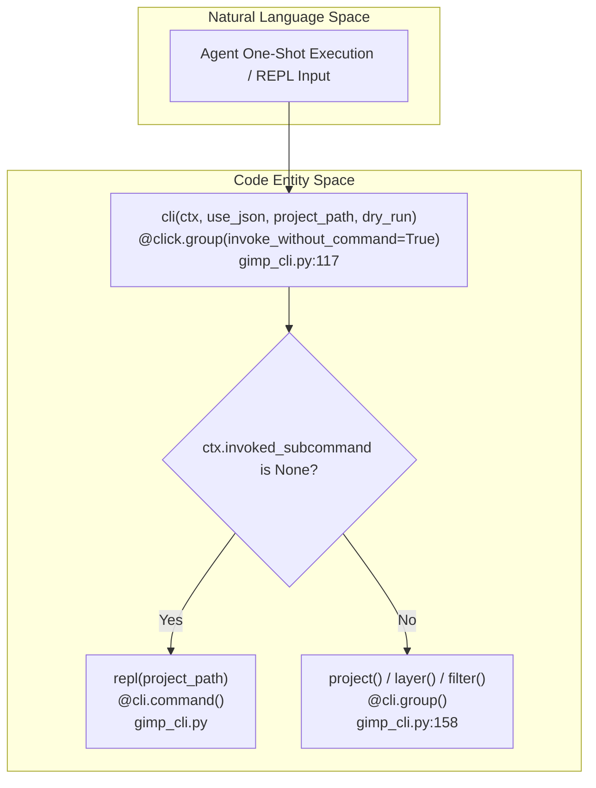
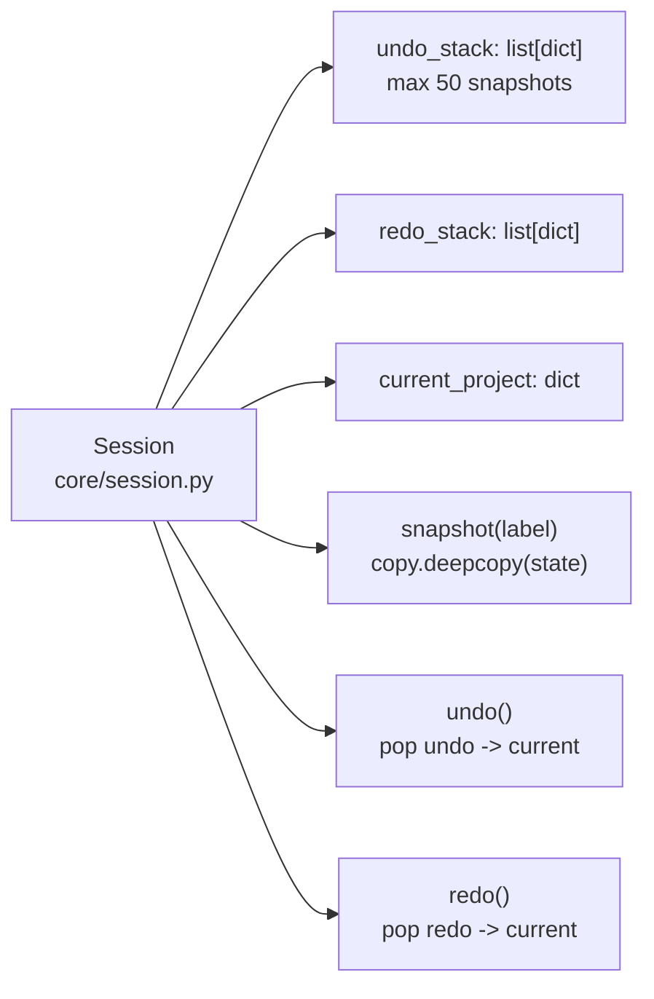
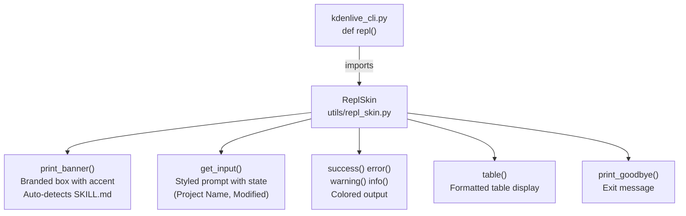
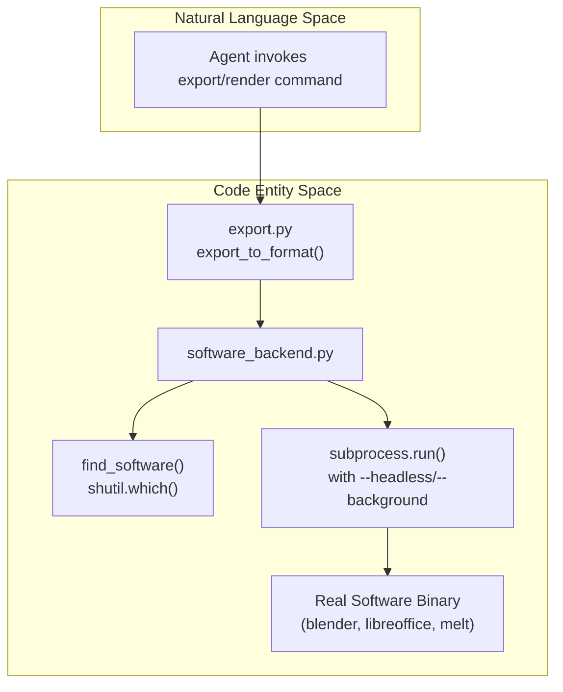
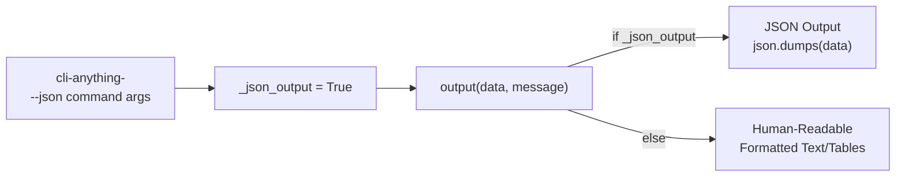

<!-- source: DeepWiki mcp.deepwiki.com · repo HKUDS/CLI-Anything · page 4.3 Phase 3: Implementation · fetched 2026-11-09 -->

# Phase 3: Implementation

<details>
<summary>Relevant source files</summary>

The following files were used as context for generating this wiki page:

- [audacity/agent-harness/cli_anything/audacity/audacity_cli.py](audacity/agent-harness/cli_anything/audacity/audacity_cli.py)
- [blender/agent-harness/cli_anything/blender/blender_cli.py](blender/agent-harness/cli_anything/blender/blender_cli.py)
- [cli-anything-plugin/guides/auto-save-dry-run.md](cli-anything-plugin/guides/auto-save-dry-run.md)
- [gimp/agent-harness/cli_anything/gimp/gimp_cli.py](gimp/agent-harness/cli_anything/gimp/gimp_cli.py)
- [kdenlive/agent-harness/cli_anything/kdenlive/kdenlive_cli.py](kdenlive/agent-harness/cli_anything/kdenlive/kdenlive_cli.py)
- [krita/agent-harness/cli_anything/krita/krita_cli.py](krita/agent-harness/cli_anything/krita/krita_cli.py)
- [libreoffice/agent-harness/cli_anything/libreoffice/libreoffice_cli.py](libreoffice/agent-harness/cli_anything/libreoffice/libreoffice_cli.py)
- [obs-studio/agent-harness/cli_anything/obs_studio/obs_studio_cli.py](obs-studio/agent-harness/cli_anything/obs_studio/obs_studio_cli.py)
- [shotcut/agent-harness/cli_anything/shotcut/shotcut_cli.py](shotcut/agent-harness/cli_anything/shotcut/shotcut_cli.py)

</details>


**Purpose:** This page documents Phase 3 of the 7-phase CLI generation pipeline, which transforms the architecture design (Phase 2) into working code. Phase 3 produces a functional Click-based CLI with REPL mode, core business logic modules, backend integration, and JSON output support. This is where the design becomes executable software `[cli-anything-plugin/HARNESS.md:49-50]()`.

**Scope:** Covers directory structure creation, PEP 420 namespace package organization, core module implementation, Click CLI framework setup, REPL integration with `ReplSkin`, backend integration patterns, and stateful session management with file locking and auto-save capabilities `[cli-anything-plugin/HARNESS.md:49-108]()`, `[cli-anything-plugin/guides/auto-save-dry-run.md:1-25]()`.

---

## Directory Structure and Package Organization

Phase 3 begins by creating a PEP 420 namespace package structure under `agent-harness/`. The namespace `cli_anything` contains no `__init__.py` at the top level, allowing multiple software CLIs to coexist without conflicts in the same Python environment `[cli-anything-plugin/guides/pypi-publishing.md:5-14]()`.

**Standard Directory Layout:**

```
<software>/
└── agent-harness/
    ├── setup.py                      # PyPI package configuration
    ├── <SOFTWARE>.md                 # Software-specific SOP (from Phase 1)
    └── cli_anything/                 # Namespace (NO __init__.py)
        └── <software>/               # Sub-package (HAS __init__.py)
            ├── __init__.py
            ├── <software>_cli.py     # Main CLI entry with Click
            ├── README.md             # Usage and installation docs
            ├── core/                 # Business logic modules
            │   ├── __init__.py
            │   ├── project.py        # Project CRUD operations
            │   ├── session.py        # 50-level undo/redo & snapshots
            │   └── <domain>.py       # Software-specific logic
            ├── utils/                # Shared utilities
            │   ├── __init__.py
            │   ├── <software>_backend.py  # Real software wrapper
            │   └── repl_skin.py      # Unified REPL interface
            ├── skills/               # AI agent discovery
            │   └── SKILL.md          # Generated in Phase 6.5
            └── tests/                # Test suite (Phase 4-5)
                ├── TEST.md
                ├── test_core.py
                └── test_full_e2e.py
```

**Critical Rules:**

1. **Namespace root has NO `__init__.py`**: `cli_anything/` must remain empty to enable PEP 420 namespace packages `[cli-anything-plugin/guides/pypi-publishing.md:23-25]()`.
2. **Software sub-package HAS `__init__.py`**: `cli_anything/<software>/__init__.py` marks it as a regular package.
3. **All imports use full namespace**: Use `from cli_anything.<software>.core import project`, never relative imports across software boundaries `[cli-anything-plugin/guides/pypi-publishing.md:72-81]()`.

Sources: `[cli-anything-plugin/HARNESS.md:100-105]()`, `[cli-anything-plugin/guides/pypi-publishing.md:9-25]()`

---

## CLI Entry Point Architecture

### Click Framework Setup

Phase 3 implements the main CLI entry point in files such as `gimp_cli.py`, `blender_cli.py`, and `kdenlive_cli.py` using the Click framework `[gimp/agent-harness/cli_anything/gimp/gimp_cli.py:117-140]()`, `[blender/agent-harness/cli_anything/blender/blender_cli.py:191-214]()`, `[kdenlive/agent-harness/cli_anything/kdenlive/kdenlive_cli.py:124-147]()`. The CLI supports dual modes: one-shot subcommands for scripting and a stateful REPL for interactive sessions `[cli-anything-plugin/HARNESS.md:25-30]()`.

Title: Natural Language Space to Code Entity Space: Click CLI Command Group Routing


Sources: `[gimp/agent-harness/cli_anything/gimp/gimp_cli.py:117-140]()`, `[blender/agent-harness/cli_anything/blender/blender_cli.py:191-214]()`

**Invocation Pattern:**

The CLI defaults to REPL mode when invoked without subcommands by using `invoke_without_command=True` on the main group and checking `ctx.invoked_subcommand` `[cli-anything-plugin/HARNESS.md:97-108]()`, `[kdenlive/agent-harness/cli_anything/kdenlive/kdenlive_cli.py:124-147]()`.

```python
# Standard implementation pattern (e.g., in kdenlive_cli.py)
@click.group(invoke_without_command=True)
@click.option("--json", "use_json", is_flag=True, help="Output as JSON")
@click.pass_context
def cli(ctx, use_json, ...):
    if ctx.invoked_subcommand is None:
        ctx.invoke(repl, project_path=None)
```

Sources: `[cli-anything-plugin/HARNESS.md:97-108]()`, `[kdenlive/agent-harness/cli_anything/kdenlive/kdenlive_cli.py:124-147]()`, `[gimp/agent-harness/cli_anything/gimp/gimp_cli.py:117-140]()`

---

## Core Business Logic Modules

Phase 3 implements core business logic in the `core/` directory. Each module has a single responsibility and uses functions that operate on project data structures `[cli-anything-plugin/HARNESS.md:49-53]()`.

### Module Responsibilities Table

| Module | Purpose | Key Functions | State Management |
|--------|---------|---------------|------------------|
| `project.py` | Project CRUD operations | `create_project()`, `open_project()`, `save_project()` | Returns/accepts project dictionaries `[gimp/agent-harness/cli_anything/gimp/gimp_cli.py:164-209]()` |
| `session.py` | Undo/redo history | `Session` class with 50-level stack | Deep-copies state snapshots `[cli-anything-plugin/HARNESS.md:69-70]()` |
| `export.py` | Rendering pipeline | `export_to_format()`, `render_via_backend()` | Delegates to backend module `[cli-anything-plugin/HARNESS.md:67-68]()` |
| `<domain>.py` | Software-specific logic | e.g., `add_track()`, `add_shape()` | Mutates project structure `[shotcut/agent-harness/cli_anything/shotcut/shotcut_cli.py:29-37]()` |

### Session Management with Undo/Redo

The `session.py` module implements a 50-level undo/redo stack. It uses `copy.deepcopy` for snapshots to ensure state integrity between operations `[cli-anything-plugin/HARNESS.md:69-70]()`.

Title: Session State and Snapshot Architecture


Sources: `[cli-anything-plugin/HARNESS.md:39-43]()`, `[cli-anything-plugin/HARNESS.md:69-70]()`, `[krita/agent-harness/cli_anything/krita/krita_cli.py:26-42]()`

---

## REPL Mode with ReplSkin Integration

Phase 3 integrates the unified REPL interface by copying `repl_skin.py` from the plugin directory into `utils/`. The `ReplSkin` class provides consistent branding and styled prompts `[cli-anything-plugin/HARNESS.md:74-77]()`, `[cli-anything-plugin/repl_skin.py:1-19]()`.

Title: ReplSkin UI Component Architecture


Sources: `[cli-anything-plugin/repl_skin.py:92-124]()`, `[cli-anything-plugin/HARNESS.md:74-96]()`, `[kdenlive/agent-harness/cli_anything/kdenlive/kdenlive_cli.py:36-37]()`

**Banner Auto-Detection:**

`ReplSkin` automatically detects `SKILL.md` inside the package directory and displays its absolute path in the banner. This enables AI agents to locate and read the skill definition immediately upon entering the REPL `[cli-anything-plugin/repl_skin.py:116-124]()`, `[cli-anything-plugin/guides/skill-generation.md:113-118]()`.

Sources: `[cli-anything-plugin/repl_skin.py:92-124]()`, `[cli-anything-plugin/HARNESS.md:74-96]()`

---

## Backend Integration Layer

Phase 3 implements a backend integration module in `utils/<software>_backend.py` that wraps the real software's CLI or API `[cli-anything-plugin/HARNESS.md:54-58]()`.

Title: Natural Language Space to Code Entity Space: Backend Execution Flow


Sources: `[cli-anything-plugin/HARNESS.md:54-66]()`, `[krita/agent-harness/cli_anything/krita/krita_cli.py:34-35]()`

---

## JSON Output, State Persistence, Locked Save, and Auto-Save / Dry-Run

### JSON Output Flow

Phase 3 implements `--json` flag support on every CLI command to enable machine-readable output for AI agent consumption `[cli-anything-plugin/HARNESS.md:44-48]()`, `[gimp/agent-harness/cli_anything/gimp/gimp_cli.py:118-130]()`.


Sources: `[cli-anything-plugin/HARNESS.md:44-48]()`, `[gimp/agent-harness/cli_anything/gimp/gimp_cli.py:49-61]()`

### Auto-Save and Dry-Run

One-shot commands must auto-save modified state unless `--dry-run` is provided. This is typically implemented via a `result_callback` or `call_on_close` `[cli-anything-plugin/guides/auto-save-dry-run.md:1-43]()`.

```python
@cli.result_callback()
def auto_save_on_exit(result, use_json, project_path, dry_run, **kwargs):
    if _repl_mode or dry_run:
        return
    sess = get_session()
    if sess.has_project() and sess._modified:
        sess.save_session()
```

### Locked Save Pattern

When persisting state to JSON session files, Phase 3 mandates the use of exclusive file locking (`fcntl.flock`) to prevent data corruption during concurrent writes `[cli-anything-plugin/HARNESS.md:71-73]()`, `[cli-anything-plugin/guides/session-locking.md:1-37]()`.

```python
def _locked_save_json(path, data, **dump_kwargs) -> None:
    try:
        f = open(path, "r+")
    except FileNotFoundError:
        f = open(path, "w")
    with f:
        fcntl.flock(f.fileno(), fcntl.LOCK_EX)
        f.seek(0)
        f.truncate()
        json.dump(data, f, **dump_kwargs)
```

Sources: `[cli-anything-plugin/HARNESS.md:44-48]()`, `[cli-anything-plugin/guides/session-locking.md:1-37]()`, `[cli-anything-plugin/guides/auto-save-dry-run.md:1-43]()`, `[audacity/agent-harness/cli_anything/audacity/audacity_cli.py:67-74]()`

---

## Implementation Checklist

Phase 3 is complete when the following components are implemented:

| Component | Location | Requirements |
|-----------|----------|--------------|
| Namespace structure | `cli_anything/` | NO `__init__.py` at top level `[cli-anything-plugin/guides/pypi-publishing.md:23-25]()` |
| Main CLI entry | `<software>_cli.py` | Click group with `invoke_without_command=True` `[cli-anything-plugin/HARNESS.md:97-108]()` |
| Core modules | `core/` | Functions for CRUD, undo/redo, and domain logic `[cli-anything-plugin/HARNESS.md:49-53]()` |
| Backend wrapper | `utils/` | Executable discovery and subprocess invocation `[cli-anything-plugin/HARNESS.md:54-58]()` |
| REPL integration | `utils/repl_skin.py` | Copied from plugin, `ReplSkin` class used `[cli-anything-plugin/HARNESS.md:74-77]()` |
| Auto-Save | `<software>_cli.py` | Support for `--project` and `--dry-run` `[cli-anything-plugin/guides/auto-save-dry-run.md:1-25]()` |

Sources: `[cli-anything-plugin/HARNESS.md:44-134]()`, `[cli-anything-plugin/repl_skin.py:92-198]()`, `[cli-anything-plugin/guides/pypi-publishing.md:1-50]()`

---

