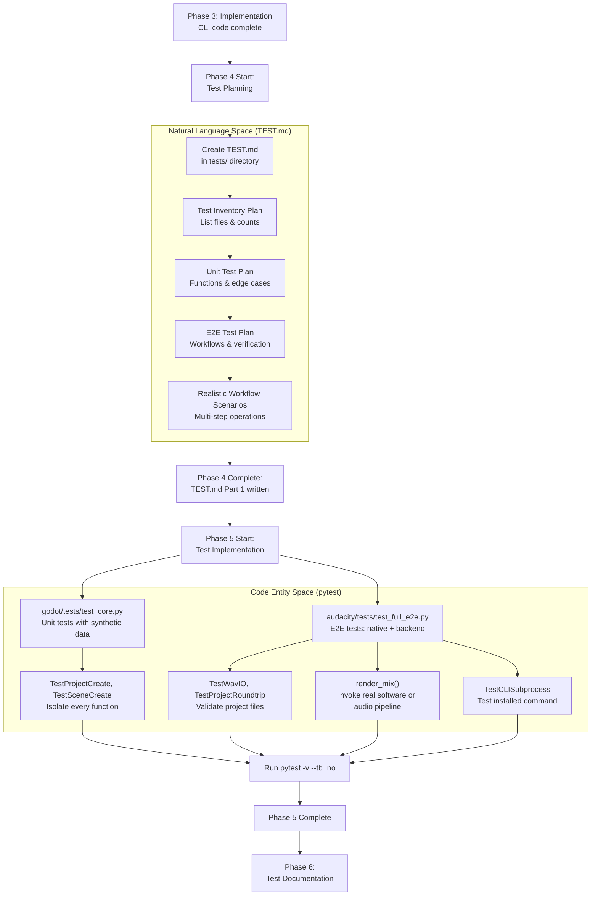

<!-- source: DeepWiki mcp.deepwiki.com · repo HKUDS/CLI-Anything · page 4.4 Phase 4-5: Test Planning and Implementation · fetched 2026-11-09 -->

# Phase 4-5: Test Planning and Implementation

Relevant source files

The following files were used as context for generating this wiki page:

- [audacity/agent-harness/cli_anything/audacity/core/export.py](audacity/agent-harness/cli_anything/audacity/core/export.py)
- [audacity/agent-harness/cli_anything/audacity/tests/test_full_e2e.py](audacity/agent-harness/cli_anything/audacity/tests/test_full_e2e.py)
- [audacity/agent-harness/cli_anything/audacity/utils/audio_utils.py](audacity/agent-harness/cli_anything/audacity/utils/audio_utils.py)
- [cli-hub-matrix/3d-cad/SKILL.md](cli-hub-matrix/3d-cad/SKILL.md)
- [cli-hub-matrix/game-development/SKILL.md](cli-hub-matrix/game-development/SKILL.md)
- [cli-hub-matrix/image-design/SKILL.md](cli-hub-matrix/image-design/SKILL.md)
- [cli-hub-matrix/knowledge-research/SKILL.md](cli-hub-matrix/knowledge-research/SKILL.md)
- [cli-hub-matrix/video-creation/SKILL.md](cli-hub-matrix/video-creation/SKILL.md)
- [cli-hub-matrix/video-creation/references/art-direction-review.md](cli-hub-matrix/video-creation/references/art-direction-review.md)
- [godot/agent-harness/cli_anything/godot/tests/test_core.py](godot/agent-harness/cli_anything/godot/tests/test_core.py)

## Purpose and Scope

This document describes Phases 4 and 5 of the CLI-Anything generation pipeline, which establish comprehensive test coverage for generated CLI harnesses. Phase 4 creates a detailed test plan documented in `TEST.md` before any test code is written [cli-anything-plugin/HARNESS.md:111-114](), while Phase 5 implements the planned tests across four layers: unit tests, E2E native format tests, E2E backend tests, and CLI subprocess tests [cli-anything-plugin/HARNESS.md:142-150]().

For information about the overall 7-phase pipeline, see [The 7-Phase Generation Pipeline](). For the subsequent test documentation phase, see [Phase 6: Test Documentation](). For generated CLI architecture details, see [Generated CLI Architecture]().

**Sources:** [cli-anything-plugin/HARNESS.md:10-109](), [cli-anything-plugin/HARNESS.md:111-150]()

---

## Overview: Two-Phase Testing Approach

Phase 4 and Phase 5 together establish production-grade test coverage through a plan-then-implement methodology. This approach ensures comprehensive test coverage by requiring agents to think through all test scenarios before writing code [cli-anything-plugin/HARNESS.md:138-140]().

### Test Workflow Diagram

"Natural Language Space" (Plan) to "Code Entity Space" (Implementation)

**Key Principles:**
- **Plan before coding** — `TEST.md` is written before test implementation begins [cli-anything-plugin/HARNESS.md:111-114]().
- **Comprehensive coverage** — All layers planned: unit, E2E native, E2E backend, subprocess [cli-anything-plugin/HARNESS.md:144-150]().
- **Real-world scenarios** — Workflows simulate actual user/agent tasks [cli-anything-plugin/HARNESS.md:131-137]().
- **No graceful degradation** — Tests should fail loudly if the backend software is missing [cli-anything-plugin/HARNESS.md:148-150]().

**Sources:** [cli-anything-plugin/HARNESS.md:111-157]()

---

## Phase 4: Test Planning (TEST.md Part 1)

Phase 4 creates `cli_anything/<software>/tests/TEST.md` documenting the complete test strategy. This file serves as the single source of truth for test expectations [cli-anything-plugin/HARNESS.md:111-114]().

### Test Inventory and Workflow Plans
The plan documents:
1.  **Test Inventory Plan**: List of planned test files (e.g., `test_core.py`, `test_full_e2e.py`) and estimated test counts [cli-anything-plugin/HARNESS.md:115-118]().
2.  **Unit Test Plan**: Per-module breakdown (e.g., `project.py`, `session.py`) including edge cases like boundary conditions and error handling [cli-anything-plugin/HARNESS.md:119-124]().
3.  **E2E Test Plan**: Descriptions of real-world workflows and format validations [cli-anything-plugin/HARNESS.md:125-130]().
4.  **Realistic Workflow Scenarios**: Multi-step operations like "audio mixing pipeline" or "game project creation" with specific verification criteria [cli-anything-plugin/HARNESS.md:131-137]().

**Sources:** [cli-anything-plugin/HARNESS.md:111-137]()

---

## Phase 5: Test Implementation

Phase 5 implements the test code planned in Phase 4 across four distinct testing layers [cli-anything-plugin/HARNESS.md:140-142]().

### The Four-Layer Testing Architecture

```mermaid
graph TB
    subgraph "Layer 4: CLI Subprocess Tests"
        SUBPROCESS_CLASS["TestCLISubprocess<br/>in test_full_e2e.py"]
        RESOLVE_CLI["_resolve_cli('cli-anything-audacity')<br/>Resolve installed command"]
        SUBPROCESS_RUN["subprocess.run([cli_cmd, args])<br/>Test as real user would"]
        SUBPROCESS_CLASS --> RESOLVE_CLI
        RESOLVE_CLI --> SUBPROCESS_RUN
    end
    
    subgraph "Layer 3: E2E Backend Tests"
        E2E_BACKEND_CLASS["TestAudioProcessing<br/>in test_full_e2e.py"]
        INVOKE_BACKEND["render_mix()<br/>Processes audio domain/effects"]
        VERIFY_OUTPUT["get_peak(), get_rms()<br/>Check audio properties & waveforms"]
        E2E_BACKEND_CLASS --> INVOKE_BACKEND
        INVOKE_BACKEND --> VERIFY_OUTPUT
    end
    
    subgraph "Layer 2: E2E Native Format Tests"
        E2E_NATIVE_CLASS["TestWavIO<br/>in test_full_e2e.py"]
        GENERATE_PROJECT["write_wav() / save_project()<br/>Build native files"]
        VALIDATE_STRUCTURE["read_wav() / parse structure<br/>Verify properties & roundtrip"]
        E2E_NATIVE_CLASS --> GENERATE_PROJECT
        GENERATE_PROJECT --> VALIDATE_STRUCTURE
    end
    
    subgraph "Layer 1: Unit Tests"
        UNIT_CLASS["TestProjectCreate, TestSceneCreate<br/>in test_core.py"]
        SYNTHETIC_DATA["CliRunner invocation<br/>No external binaries required"]
        UNIT_CLASS --> SYNTHETIC_DATA
    end
```

**Sources:** [cli-anything-plugin/HARNESS.md:142-150](), [audacity/agent-harness/cli_anything/audacity/tests/test_full_e2e.py:100-182](), [godot/agent-harness/cli_anything/godot/tests/test_core.py:72-111]()

### Layer 1: Unit Tests (`test_core.py`)
Verifies core logic using synthetic data and CLI runners. For example, in Godot harnesses, `TestProjectCreate` verifies project creation and duplicate handling via `CliRunner` without needing a running Godot binary [godot/agent-harness/cli_anything/godot/tests/test_core.py:72-96]().

### Layer 2: E2E Native Format Tests (`test_full_e2e.py`)
Verifies project or asset file structural integrity. In Audacity harnesses, `TestWavIO` ensures that writing and reading back 16-bit, 24-bit, or 8-bit WAV files preserves channel counts, sample rates, and sample correlations [audacity/agent-harness/cli_anything/audacity/tests/test_full_e2e.py:102-162]().

### Layer 3: E2E Backend Tests (`test_full_e2e.py`)
Invokes the **real software** backend or internal processing engines. In audio harnesses like Audacity, this executes `render_mix()` which combines tracks, applies domain effects, and enforces peak clamping and format presets [audacity/agent-harness/cli_anything/audacity/core/export.py:122-225](). Tests verify signal properties using metrics such as RMS levels, peak amplitudes, and decibel conversions [audacity/agent-harness/cli_anything/audacity/tests/test_full_e2e.py:165-182]().

### Layer 4: CLI Subprocess Tests (`test_full_e2e.py`)
Tests the installed command via the `_resolve_cli()` pattern to ensure `console_scripts` entry points work correctly under real subprocess invocations [cli-anything-plugin/guides/pypi-publishing.md:96-102]().

---

## Output Verification Methodology

The CLI must verify outputs programmatically to ensure correctness.

| Output Category | Verification Approach | Context |
| :--- | :--- | :--- |
| **Media Files / Audio** | `get_peak()`, `get_rms()`, `read_wav()` | Audio export validation [audacity/agent-harness/cli_anything/audacity/tests/test_full_e2e.py:102-182]() |
| **Project Files** | Structure validation via parser or JSON roundtrip | Native format E2E tests [godot/agent-harness/cli_anything/godot/tests/test_core.py:72-96]() |
| **Backend Tools** | `shutil.which()` + `RuntimeError` | Dependency discovery [audacity/agent-harness/cli_anything/audacity/core/export.py:133-151]() |
| **Numeric Precision** | `abs(o - l) < 0.02` or correlation thresholds | Floating point and quantization tolerances [audacity/agent-harness/cli_anything/audacity/tests/test_full_e2e.py:113-146]() |

**Sources:** [audacity/agent-harness/cli_anything/audacity/tests/test_full_e2e.py:102-182](), [godot/agent-harness/cli_anything/godot/tests/test_core.py:72-96](), [audacity/agent-harness/cli_anything/audacity/core/export.py:133-151]()

---

## Testing Best Practices

### No Graceful Degradation
Tests must fail loudly if the backend software is missing [cli-anything-plugin/HARNESS.md:148-150](). The backend utility should raise a `RuntimeError` or `ValueError` with clear installation instructions [cli-anything-plugin/guides/pypi-publishing.md:56-70](). For example, export modules check preset validity and file existence before rendering [audacity/agent-harness/cli_anything/audacity/core/export.py:133-151]().

### Session Locking Validation
When implementing session management, tests verify that locked saves correctly use file locking mechanisms (such as `fcntl.flock`) to prevent concurrent write corruption [cli-anything-plugin/guides/session-locking.md:9-37]().

### Roundtrip Verification
Tests should verify that a project or asset can be saved, reopened, and result in the same logical state. Roundtrip tests verify consistency across serialization boundaries [audacity/agent-harness/cli_anything/audacity/tests/test_full_e2e.py:102-147]().

**Sources:** [cli-anything-plugin/HARNESS.md:148-150](), [cli-anything-plugin/guides/pypi-publishing.md:56-70](), [audacity/agent-harness/cli_anything/audacity/core/export.py:133-151](), [cli-anything-plugin/guides/session-locking.md:9-37](), [audacity/agent-harness/cli_anything/audacity/tests/test_full_e2e.py:102-147]()

---

