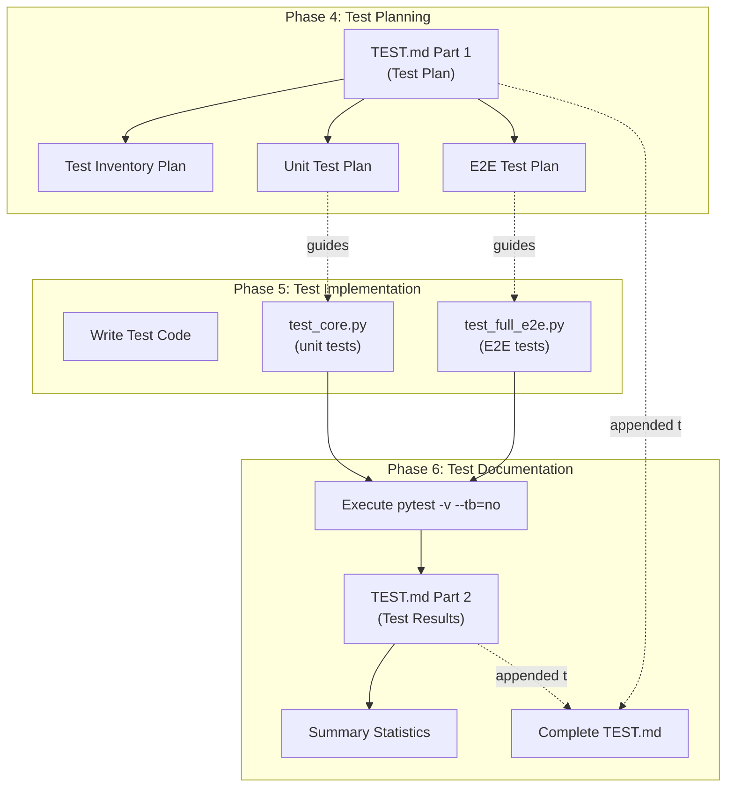
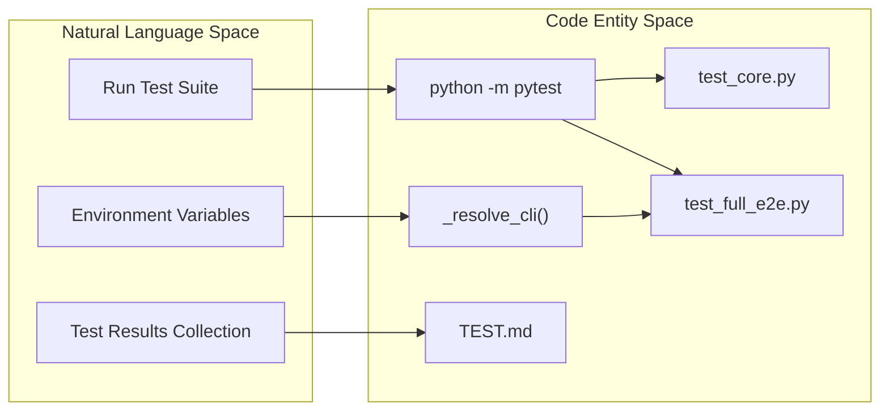
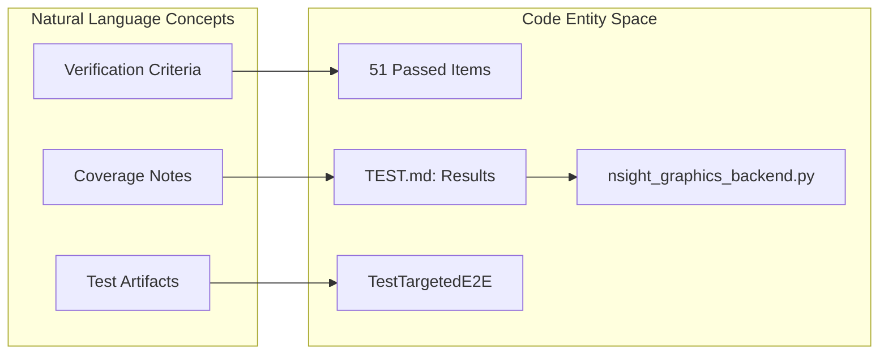

<!-- source: DeepWiki mcp.deepwiki.com · repo HKUDS/CLI-Anything · page 4.5 Phase 6: Test Documentation · fetched 2026-11-09 -->

# Phase 6: Test Documentation

<details>
<summary>Relevant source files</summary>

The following files were used as context for generating this wiki page:

- [nsight-graphics/agent-harness/HARNESS.md](nsight-graphics/agent-harness/HARNESS.md)
- [nsight-graphics/agent-harness/NSIGHT_GRAPHICS.md](nsight-graphics/agent-harness/NSIGHT_GRAPHICS.md)
- [nsight-graphics/agent-harness/cli_anything/nsight_graphics/README.md](nsight-graphics/agent-harness/cli_anything/nsight_graphics/README.md)
- [nsight-graphics/agent-harness/cli_anything/nsight_graphics/__init__.py](nsight-graphics/agent-harness/cli_anything/nsight_graphics/__init__.py)
- [nsight-graphics/agent-harness/cli_anything/nsight_graphics/core/cpp_capture.py](nsight-graphics/agent-harness/cli_anything/nsight_graphics/core/cpp_capture.py)
- [nsight-graphics/agent-harness/cli_anything/nsight_graphics/core/frame.py](nsight-graphics/agent-harness/cli_anything/nsight_graphics/core/frame.py)
- [nsight-graphics/agent-harness/cli_anything/nsight_graphics/core/gpu_trace.py](nsight-graphics/agent-harness/cli_anything/nsight_graphics/core/gpu_trace.py)
- [nsight-graphics/agent-harness/cli_anything/nsight_graphics/core/launch.py](nsight-graphics/agent-harness/cli_anything/nsight_graphics/core/launch.py)
- [nsight-graphics/agent-harness/cli_anything/nsight_graphics/nsight_graphics_cli.py](nsight-graphics/agent-harness/cli_anything/nsight_graphics/nsight_graphics_cli.py)
- [nsight-graphics/agent-harness/cli_anything/nsight_graphics/skills/SKILL.md](nsight-graphics/agent-harness/cli_anything/nsight_graphics/skills/SKILL.md)
- [nsight-graphics/agent-harness/cli_anything/nsight_graphics/tests/TEST.md](nsight-graphics/agent-harness/cli_anything/nsight_graphics/tests/TEST.md)
- [nsight-graphics/agent-harness/cli_anything/nsight_graphics/tests/test_core.py](nsight-graphics/agent-harness/cli_anything/nsight_graphics/tests/test_core.py)
- [nsight-graphics/agent-harness/cli_anything/nsight_graphics/tests/test_full_e2e.py](nsight-graphics/agent-harness/cli_anything/nsight_graphics/tests/test_full_e2e.py)
- [nsight-graphics/agent-harness/cli_anything/nsight_graphics/utils/nsight_graphics_backend.py](nsight-graphics/agent-harness/cli_anything/nsight_graphics/utils/nsight_graphics_backend.py)

</details>


## Purpose and Scope

Phase 6 finalizes the testing process by documenting test execution results. After the comprehensive test suite has been implemented in Phase 5 (see [Phase 4-5: Test Planning and Implementation]()), this phase executes all tests and appends the results to `TEST.md`, creating a complete record of both test planning and test validation [nsight-graphics/agent-harness/cli_anything/nsight_graphics/tests/TEST.md:1-118](). This documentation serves as proof of production readiness and provides transparency into test coverage, gaps, and execution status.

Sources: [nsight-graphics/agent-harness/cli_anything/nsight_graphics/tests/TEST.md:1-118]()

---

## The Two-Part TEST.md Structure

The `TEST.md` file follows a two-part structure that captures both the planning and execution phases of testing:

### Part 1: Test Plan (Written in Phase 4)

Created before any test code is written, Part 1 contains:
- **Test Inventory Plan** — List of planned test files and test counts [nsight-graphics/agent-harness/cli_anything/nsight_graphics/tests/TEST.md:3-7]()
- **Unit Test Plan** — Module-by-module breakdown covering `utils/nsight_graphics_backend.py`, `core/*.py`, and `nsight_graphics_cli.py` [nsight-graphics/agent-harness/cli_anything/nsight_graphics/tests/TEST.md:10-46]()
- **E2E Test Plan** — Environment prerequisites and scenarios for real-world orchestrations using `NSIGHT_GRAPHICS_TEST_EXE` [nsight-graphics/agent-harness/cli_anything/nsight_graphics/tests/TEST.md:47-67]()

### Part 2: Test Results (Written in Phase 6)

Appended after all tests pass successfully, Part 2 documents:
- **Running Tests** — Standard and environment-specific execution commands [nsight-graphics/agent-harness/cli_anything/nsight_graphics/tests/TEST.md:68-84]()
- **Test Results** — Full `pytest` output showing collected test items and their status [nsight-graphics/agent-harness/cli_anything/nsight_graphics/tests/TEST.md:85-118]()

### Logic Flow: From Plan to Results



Sources: [nsight-graphics/agent-harness/cli_anything/nsight_graphics/tests/TEST.md:1-118](), [nsight-graphics/agent-harness/cli_anything/nsight_graphics/tests/test_core.py:1-143]()

---

## Test Execution Process

Phase 6 executes the complete test suite with specific `pytest` flags to produce clean, readable output suitable for documentation.

### Standard Test Execution Command

```bash
cd nsight-graphics/agent-harness
python -m pip install -e .
python -m pytest cli_anything/nsight_graphics/tests -v --tb=no
``` [nsight-graphics/agent-harness/cli_anything/nsight_graphics/tests/TEST.md:70-74]()

For local E2E runs requiring environment overrides:

```powershell
$env:NSIGHT_GRAPHICS_TEST_EXE = "D:\Program Files\NVIDIA Corporation\Nsight Graphics 2026.1.0\samples\applications\vk_graphics_pipeline_library\vk_graphics_pipeline_library.exe"
python -m pytest cli_anything/nsight_graphics/tests -v --tb=no
``` [nsight-graphics/agent-harness/cli_anything/nsight_graphics/tests/TEST.md:78-83]()

### Natural Language Space to Code Entity Space: Test Execution



Sources: [nsight-graphics/agent-harness/cli_anything/nsight_graphics/tests/TEST.md:68-84](), [nsight-graphics/agent-harness/cli_anything/nsight_graphics/tests/test_full_e2e.py:27-50]()

---

## Documentation Requirements

Phase 6 documentation must include specific content to satisfy production-grade quality standards.

### Required Content in TEST.md Part 2

1. **Full Test Results Output** — Verbatim `pytest` execution logs detailing collected items (e.g., 51 items passed) [nsight-graphics/agent-harness/cli_anything/nsight_graphics/tests/TEST.md:85-118]().
2. **Summary Statistics** — Test counts and pass status for backend discovery, help parsing, command builders, and core modules [nsight-graphics/agent-harness/cli_anything/nsight_graphics/tests/TEST.md:8-46]().
3. **Coverage and Environment Notes** — Platform notes (Windows-first orchestration) and prerequisites [nsight-graphics/agent-harness/NSIGHT_GRAPHICS.md:1-56]().

### Natural Language Space to Code Entity Space: Documentation Verification



Sources: [nsight-graphics/agent-harness/cli_anything/nsight_graphics/tests/TEST.md:85-118](), [nsight-graphics/agent-harness/cli_anything/nsight_graphics/tests/test_core.py:1-143]()

---

## Integration with the 7-Phase Pipeline

Phase 6 serves as the validation gate before advancing to SKILL.md generation (Phase 6.5) and PyPI publishing (Phase 7) [nsight-graphics/agent-harness/HARNESS.md:1-95]().

Sources: [nsight-graphics/agent-harness/HARNESS.md:1-95]()

---

