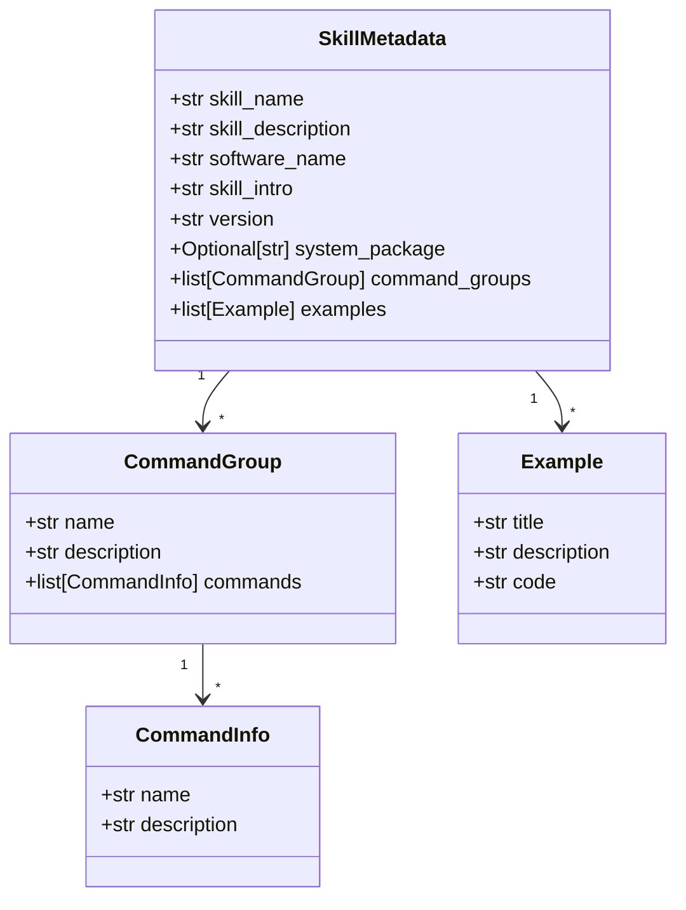
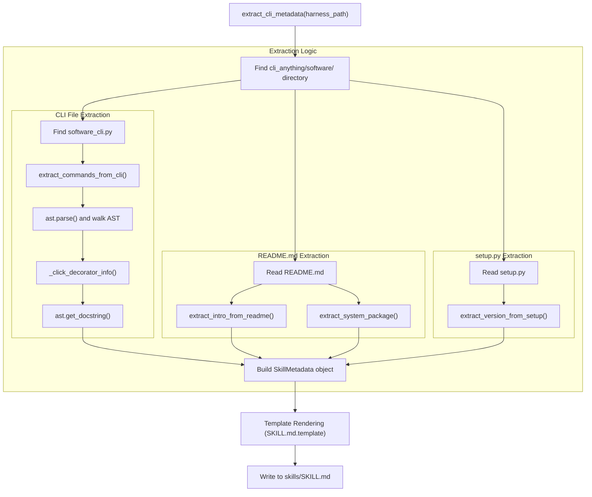
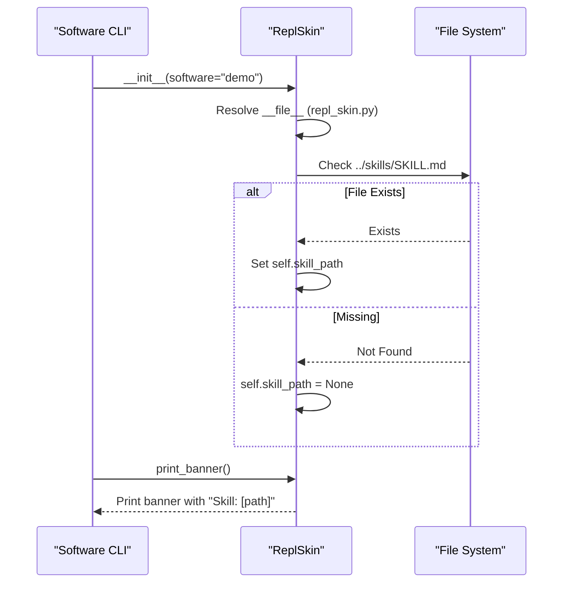

<!-- source: DeepWiki mcp.deepwiki.com · repo HKUDS/CLI-Anything · page 4.6 Phase 6.5: SKILL.md Generation · fetched 2026-11-09 -->

# Phase 6.5: SKILL.md Generation

Relevant source files

The following files were used as context for generating this wiki page:

- [.pi-extension/cli-anything/README.md](.pi-extension/cli-anything/README.md)
- [.pi-extension/cli-anything/index.ts](.pi-extension/cli-anything/index.ts)
- [.pi-extension/cli-anything/install.sh](.pi-extension/cli-anything/install.sh)
- [.pi-extension/cli-anything/tests/test_extension.test.ts](.pi-extension/cli-anything/tests/test_extension.test.ts)
- [cli-anything-plugin/skill_generator.py](cli-anything-plugin/skill_generator.py)
- [cli-anything-plugin/templates/SKILL.md.template](cli-anything-plugin/templates/SKILL.md.template)
- [cli-anything-plugin/tests/test_skill_generator.py](cli-anything-plugin/tests/test_skill_generator.py)
- [mubu/agent-harness/skill_generator.py](mubu/agent-harness/skill_generator.py)
- [zotero/agent-harness/cli_anything/zotero/core/catalog.py](zotero/agent-harness/cli_anything/zotero/core/catalog.py)
- [zotero/agent-harness/cli_anything/zotero/skills/SKILL.md](zotero/agent-harness/cli_anything/zotero/skills/SKILL.md)
- [zotero/agent-harness/cli_anything/zotero/tests/test_agent_harness.py](zotero/agent-harness/cli_anything/zotero/tests/test_agent_harness.py)
- [zotero/agent-harness/cli_anything/zotero/utils/zotero_sqlite.py](zotero/agent-harness/cli_anything/zotero/utils/zotero_sqlite.py)
- [zotero/agent-harness/setup.py](zotero/agent-harness/setup.py)
- [zotero/agent-harness/skill_generator.py](zotero/agent-harness/skill_generator.py)
- [zotero/agent-harness/templates/SKILL.md.template](zotero/agent-harness/templates/SKILL.md.template)

## Purpose and Scope

Phase 6.5 generates `SKILL.md` files that enable AI agents to discover and use generated CLI harnesses through the skill-creator methodology. This phase runs after Phase 6 (Test Documentation) completes successfully, extracting metadata from the harness and producing a self-contained skill definition file that is packaged with the Python distribution [cli-anything-plugin/skill_generator.py:4-12]().

For information about the overall 7-phase pipeline, see [The 7-Phase Generation Pipeline](). For details on how SKILL.md integrates with the REPL interface, see [Shared Utilities: ReplSkin and SKILL.md]().

---

## What is SKILL.md?

`SKILL.md` is a structured Markdown file with YAML frontmatter that serves as a skill definition for AI agents. It provides:

- **Discovery metadata** — YAML frontmatter with `name` and `description` fields that AI platforms use to identify the skill [cli-anything-plugin/skill_generator.py:7-12]().
- **Installation instructions** — Prerequisites and setup steps [cli-anything-plugin/templates/SKILL.md.template:12-26]().
- **Command documentation** — All command groups and their subcommands extracted from the CLI implementation [cli-anything-plugin/templates/SKILL.md.template:54-69]().
- **Usage examples** — Common workflows demonstrating CLI usage [cli-anything-plugin/templates/SKILL.md.template:70-81]().
- **Agent-specific guidance** — Best practices for programmatic usage, such as using the `--json` flag and checking return codes [cli-anything-plugin/templates/SKILL.md.template:105-114]().

Each generated CLI includes a SKILL.md file at `cli_anything/<software>/skills/SKILL.md` that is installed via `pip install` and auto-detected by the REPL banner. For example, the Zotero harness explicitly includes `cli_anything/zotero/skills/SKILL.md` in its `package_data` [zotero/agent-harness/setup.py:64]().

**Sources:** [cli-anything-plugin/skill_generator.py:1-12](), [cli-anything-plugin/templates/SKILL.md.template:1-123](), [zotero/agent-harness/setup.py:64]()

---

## The skill_generator.py Module

The [cli-anything-plugin/skill_generator.py]() module provides automated SKILL.md generation through metadata extraction, template rendering, and file generation. This script is often bundled into extension environments to allow on-the-fly generation for new harnesses [.pi-extension/cli-anything/install.sh:110-114]().

### Core Data Structures

The module defines four dataclasses that structure the extracted metadata. `SkillMetadata` is the top-level container holding all information needed to render a SKILL.md file [cli-anything-plugin/skill_generator.py:104-114]().

**Sources:** [cli-anything-plugin/skill_generator.py:80-114](), [mubu/agent-harness/skill_generator.py:21-50]()

### Key Functions

| Function | Purpose | Returns |
|----------|---------|---------|
| `extract_cli_metadata(harness_path)` | Extract all metadata from harness directory [cli-anything-plugin/skill_generator.py:116-189]() | `SkillMetadata` |
| `extract_intro_from_readme(content)` | Parse introduction text from README [cli-anything-plugin/skill_generator.py:192-208]() | `str` |
| `extract_system_package(content)` | Find system package install command [cli-anything-plugin/skill_generator.py:211-231]() | `Optional[str]` |
| `extract_version_from_setup(setup_path)` | Parse version from setup.py [cli-anything-plugin/skill_generator.py:234-243]() | `str` |
| `extract_commands_from_cli(cli_path)` | Extract Click command groups and commands using AST parsing [cli-anything-plugin/skill_generator.py:246-339]() | `list[CommandGroup]` |
| `generate_examples(software_name, ...)` | Generate usage examples [cli-anything-plugin/skill_generator.py:342-370]() | `list[Example]` |

**Sources:** [cli-anything-plugin/skill_generator.py:116-370](), [mubu/agent-harness/skill_generator.py:53-210]()

---

## Metadata Extraction Pipeline

### Extraction Flow

The extraction pipeline gathers metadata from three primary sources within the harness directory [cli-anything-plugin/skill_generator.py:128-167]():

1.  **README.md** — Introduction text and system package requirements [cli-anything-plugin/skill_generator.py:145-153]().
2.  **setup.py** — Version number, extracted via regex for `version` or `PACKAGE_VERSION` [cli-anything-plugin/skill_generator.py:155-160]().
3.  **`<software>_cli.py`** — Command groups and commands via Click decorator parsing using Python's `ast` module [cli-anything-plugin/skill_generator.py:162-167]().

**Sources:** [cli-anything-plugin/skill_generator.py:116-189](), [mubu/agent-harness/skill_generator.py:53-175]()

### AST Parsing Logic

Unlike earlier versions that relied on regex, the current `skill_generator.py` uses Python's Abstract Syntax Tree (AST) module to robustly extract Click command information [cli-anything-plugin/skill_generator.py:246-339](). This approach is more reliable as it understands the code structure:

*   **`extract_commands_from_cli`**: Parses the CLI Python file into an AST [cli-anything-plugin/skill_generator.py:246]().
*   **`_click_decorator_info`**: Iterates through function decorators to identify `click.group()` and `click.command()` calls [cli-anything-plugin/skill_generator.py:36-70](). It extracts the owner (e.g., `cli`, `my_group`), the decorator type (`group`, `command`), and any explicitly declared names (e.g., `@cli.command("my-command")`) [cli-anything-plugin/skill_generator.py:48-67]().
*   **Docstrings**: Uses `ast.get_docstring()` to retrieve descriptions directly from the function's docstring [cli-anything-plugin/skill_generator.py:72-77]().
*   **Name Formatting**: Functions like `_format_display_name` [cli-anything-plugin/skill_generator.py:21-23]() and `_canonical_skill_name` [cli-anything-plugin/skill_generator.py:26-31]() ensure consistent naming conventions for display and skill IDs.

This AST-based approach correctly handles explicit `name` arguments in Click decorators and automatically converts Python function names (e.g., `import_data`) to CLI-friendly formats (e.g., `import-data`) [cli-anything-plugin/tests/test_skill_generator.py:148-187](). It also correctly disambiguates nested groups with the same declared name [cli-anything-plugin/tests/test_skill_generator.py:189-217]().

**Sources:** [cli-anything-plugin/skill_generator.py:21-77](), [cli-anything-plugin/skill_generator.py:246-339](), [cli-anything-plugin/tests/test_skill_generator.py:148-217]()

---

## Template Rendering

### Generated SKILL.md Structure

The generator populates the `SKILL.md.template` file using Jinja-like syntax [cli-anything-plugin/templates/SKILL.md.template:1-123](). This template includes YAML frontmatter, installation instructions, command groups, examples, and agent-specific usage guidelines.

For example, the Zotero harness's `SKILL.md` includes specific "Important Constraints" generated by `generate_important_constraints` [zotero/agent-harness/skill_generator.py:160-169]() and uses a custom template [zotero/agent-harness/templates/SKILL.md.template:1-61]() to reflect these.

**Sources:** [cli-anything-plugin/templates/SKILL.md.template:1-123](), [zotero/agent-harness/skill_generator.py:160-169](), [zotero/agent-harness/templates/SKILL.md.template:1-61]()

---

## Package Integration

### File Placement and setup.py

SKILL.md is placed at `cli_anything/<software>/skills/SKILL.md` within the package structure. For example, the Zotero harness explicitly includes `cli_anything/zotero/skills/SKILL.md` in its `package_data` to ensure it's bundled during installation [zotero/agent-harness/setup.py:64]().

**Sources:** [zotero/agent-harness/setup.py:64]()

### ReplSkin Auto-Detection

The `ReplSkin` class automatically detects the SKILL.md file by resolving its own location and checking for `../skills/SKILL.md` relative to the `repl_skin.py` file.

**Sources:** [zotero/agent-harness/cli_anything/zotero/tests/test_agent_harness.py:23]()

---

## Verification Tests

The test suite in `cli-anything-plugin/tests/test_skill_generator.py` verifies the generation logic:

*   **Metadata Extraction**: Confirms that software names, versions, and command groups are correctly parsed from a mock harness [cli-anything-plugin/tests/test_skill_generator.py:116-143]().
*   **Click Name Handling**: Ensures explicit `name` arguments in Click decorators are respected, and function names are correctly converted to CLI command names [cli-anything-plugin/tests/test_skill_generator.py:148-187]().
*   **Nested Group Disambiguation**: Verifies that nested Click groups with potentially conflicting names are correctly handled and displayed [cli-anything-plugin/tests/test_skill_generator.py:189-217]().
*   **SKILL.md Regeneration**: The Zotero harness's `test_skill_generator_regenerates_skill` confirms that running `skill_generator.py` produces a valid `SKILL.md` with expected content, including command groups and constraints [zotero/agent-harness/cli_anything/zotero/tests/test_agent_harness.py:39-58]().

**Sources:** [cli-anything-plugin/tests/test_skill_generator.py:115-217](), [zotero/agent-harness/cli_anything/zotero/tests/test_agent_harness.py:39-58]()

---

